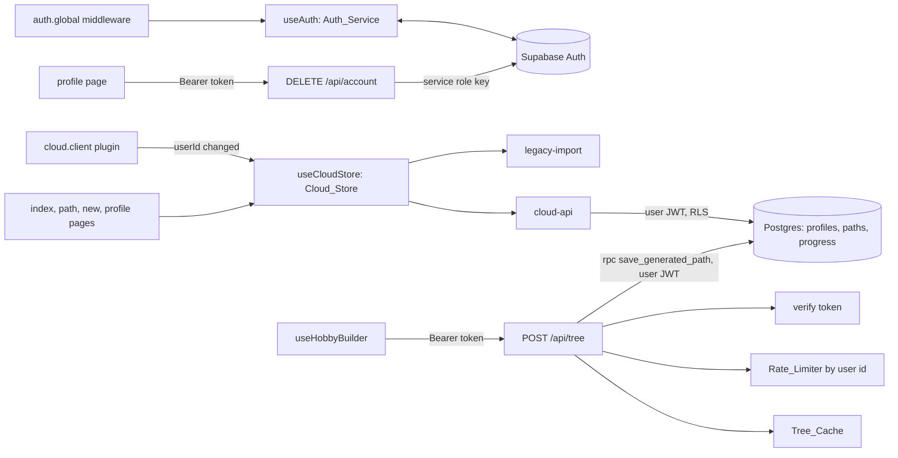
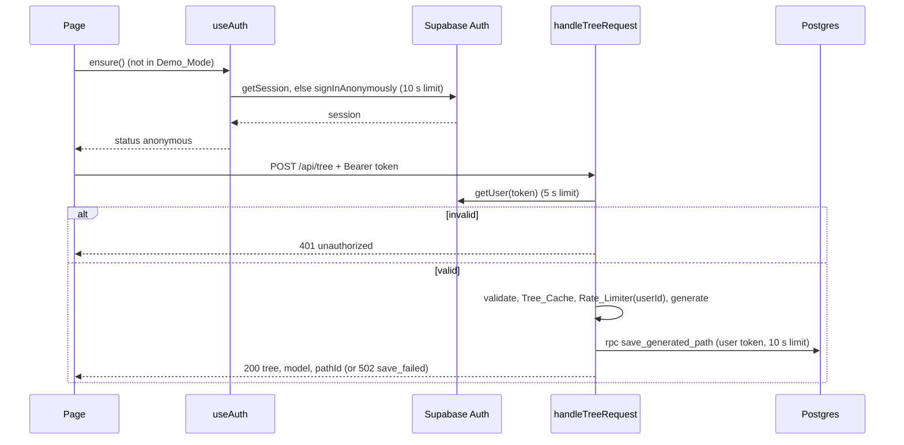

# Design Document: accounts-cloud-save

## Overview

Paths, progress and the profile move from localStorage to Supabase. Every visitor gets an anonymous Supabase user on arrival. Signing up links Google or an email to that same user, so nothing is copied. All reads and writes from the browser go through Row Level Security (RLS) with the user's own token. The only server code that touches Supabase is `POST /api/tree` (verifies the token, saves the path through the user's token) and the new `DELETE /api/account` (the only reader of the Service_Role_Key).

The design adds one package, keeps every new rule in small pure functions, and leaves the existing pure engines alone (`progress-engine`, `xp`, `streak`, `skill-tree-load`, `pickHobby`, `nextHobbyId`).

### Needs approval before work starts

`@supabase/supabase-js` is a new dependency and is **not installed** until the user approves it. Verified with `npm view`: latest is **2.119.0**, `engines.node >=22` (this machine runs Node 24.16). It is pinned exactly, with no `^` or `~`. It is loaded with a dynamic `import()` on the client, so the demo page never downloads it. The existing test `tests/unit/conventions.test.ts` asserts that `dependencies` equal exactly `elkjs, nuxt, vue, vue-router, zod`. That allowlist gains `@supabase/supabase-js` in the same task as the install, or `yarn test` fails.

### Key decisions

| Decision | Choice | Why |
| --- | --- | --- |
| Token check on the server | `auth.getUser(token)` (a call to Supabase Auth) | Req 9.1 says "verify with Supabase". It also rejects tokens of users deleted a moment ago, which local JWT checks do not. |
| Atomic "replace path, reset progress" (Req 9.8) | Postgres function `save_generated_path` (security invoker), called with `rpc` and the user's token | supabase-js cannot run two statements in one transaction. RLS still applies because the function runs as the caller. |
| Progress belongs to the user (Req 2.6) | Composite foreign key `(path_id, user_id)` to `paths (id, user_id)` | The database rejects a mismatch without a trigger. |
| Email save flow | `updateUser({ email })` for an anonymous user, `signInWithOtp({ shouldCreateUser: false })` for login | `signInWithOtp` would create a second user instead of upgrading the first. |
| Google save flow | `linkIdentity({ provider: 'google' })`; login uses `signInWithOAuth` | Same user id is kept (Req 4.1). |
| OAuth and link flow type | Library default (implicit), `detectSessionInUrl` on | A magic link can be opened in another browser than the one that asked for it. PKCE needs the same browser. |
| Callback errors | Pure `callbackFailure(url)` reads `error_code` from the URL query and hash before the client starts | Req 4.5 and 4.9 need the stored Session kept. Current supabase-js master keeps it on a failed callback; this design does not depend on that. Verify on the pinned version after install. |
| Log out | `signOut({ scope: 'local' })` | The default scope signs the user out on every device. |
| Account row ids | Hobby_Id stays `normalizeHobby(tree.hobby)`, stored in `hobby_id` | The client recomputes it from the tree everywhere (`parseEntry`). The `hobby` column holds the request's trimmed hobby (Req 9.7). |
| Active_Hobby (Req 5.8) | A Hobby_Id in new key `pursio-active-hobby:v1` | The old `activeId` lived in `pursio-hobbies:v1`, which the importer deletes. `?hobby=` and `pickHobby` already use Hobby_Ids. `pathId` identifies the row for writes only. |
| Writes for archive, restore, delete, Undo | Wait for the database, then change the screen | Req 5.12 wants the old state kept on failure. Only Progress is optimistic (Req 6.1). |
| Import rollback (Req 8.5) | Two array inserts, then a compensating delete by client-made ids on any failure or timeout | See "Legacy_Importer". A lost response can still leave rows; that case is listed under Error Handling. |

## Architecture



### Session start and first tree



### Existing modules: reused or changed

| Module | What happens |
| --- | --- |
| `server/utils/llm-handlers.ts` | `handleTreeRequest` takes `authorization` instead of `ip`, verifies first, saves last. `ERROR_STATUS` gains two codes. |
| `server/utils/rate-limiter.ts` | Parameter renamed `ip` to `key`. Logic unchanged. It is keyed by user id. |
| `server/utils/tree-cache.ts` | Unchanged. A hit already carries the model id. |
| `server/utils/llm-runtime.ts` | `llmTreeDeps()` adds `verifyToken`, `savePath` and their time limits. |
| `shared/types/llm.ts`, `shared/utils/llm.ts` | `ErrorCode` and `ERROR_CODES` gain `unauthorized` and `save_failed`. `TreeResponse` success gains `pathId`. |
| `app/utils/tree-client.ts` | `MESSAGES` gains both codes with the Req 9.11 sentences. |
| `app/utils/hobby-store.ts` | Kept. Reused: `HobbyRecord`, `HobbyLibrary`, `hobbyId`, `hobbyPath`, `pickHobby`, `nextHobbyId`, `parseHobbyLibrary`, `NEW_HOBBY_PATH`. The localStorage mutators (`addHobby`, `archiveHobby`, and so on) are no longer called by the app. Only their tests keep them alive. |
| `app/utils/progress-store.ts` | Reused: `ProgressStore`, `storedProgressSchema`, `pruneProgress`, `parseStoredProgress`, `createProgressStore` (Demo_Mode only). |
| `app/utils/activity-store.ts`, `generated-tree.ts` | Read-only inputs of the Legacy_Importer (`parseCompletionLog`, `parseStoredGeneratedTree`). |
| `app/composables/useSkillPath.ts` | Second argument changes from `storageKey?: string` to `store: ProgressStore`. Everything else stays. |
| `app/composables/useActivity.ts` | Second argument `completionTimes`. Streak and Week read it. `record()` and the Completion_Log are gone outside Legacy_Data. |
| `app/composables/useLibraryRevision.ts` | Removed. Its only job was telling pages to re-read localStorage; cloud state is reactive. |
| `app/composables/useToast.ts`, `AppToast.vue` | `show(message, action, { sticky })`. A sticky toast has no timer and shows a "Dismiss" button (Req 6.4). |
| `app/components/path/PathConfirmDialog.vue` | Optional props `busy` and `error`. Reused for "Delete my account" (Req 11.15, 11.12). |
| `app/components/path/PathNavItems.vue` | Adds the Profile item unless `route.query.demo === '1'` (Req 11.1, 12.6). |
| `tests/unit/conventions.test.ts` | Dependency allowlist plus a check that `supabaseServiceRoleKey` appears only in `nuxt.config.ts` and `server/utils/account-runtime.ts` (Req 1.5). |

No handler, limiter or Tree_Cache tests exist in `tests/` today (`git ls-files tests` shows only `tree-client.test.ts` for this area). Requirement 13.6 says to "update" the handler tests to use a user id. There is nothing to update, so those tests are written new, with a user id from the start.

## Components and Interfaces

### Database (`supabase/migrations/`, Req 2)

Two plain SQL files, applied in name order:

- `20261108000000_schema.sql`: tables, constraints, profile trigger, `updated_at` trigger, `save_generated_path`.
- `20261108000100_rls.sql`: `enable row level security` and one policy per table.

```sql
create table public.profiles (
  id uuid primary key references auth.users (id) on delete cascade,
  display_name text check (char_length(display_name) between 1 and 40),   -- null = no name
  theme text not null default 'boulder' check (theme in ('boulder', 'trail', 'halloween')),
  created_at timestamptz not null default now()
);

create table public.paths (
  id uuid primary key default gen_random_uuid(),
  user_id uuid not null references auth.users (id) on delete cascade,
  hobby text not null,
  hobby_id text not null,
  level text not null check (level in ('new', 'some', 'serious')),
  tree jsonb not null,
  mascot_set text not null,
  model text not null,
  archived boolean not null default false,
  created_at timestamptz not null default now(),
  unique (user_id, hobby_id),
  unique (id, user_id)                       -- target of the composite foreign key
);

create table public.progress (
  path_id uuid primary key,
  user_id uuid not null,
  completed text[] not null default '{}',
  quests jsonb not null default '{}',
  completed_at jsonb not null default '{}',  -- Node id -> epoch ms
  updated_at timestamptz not null default now(),
  foreign key (path_id, user_id) references public.paths (id, user_id) on delete cascade
);
```

- **Profile trigger.** `handle_new_user()` is `security definer`, `set search_path = public`, runs `insert into profiles (id) values (new.id)` after insert on `auth.users`, and has no exception block. An error in it aborts the `auth.users` insert, so no user exists without a Profile_Row (Req 2.3, 2.11). Anonymous users are rows in `auth.users`, so they get a profile too.
- **`updated_at`** is set by a `before update` trigger on `progress`, not by the client clock.
- **`save_generated_path(p_hobby, p_hobby_id, p_level, p_tree, p_mascot_set, p_model) returns uuid`** is `security invoker`. It upserts into `paths` for `auth.uid()` on conflict `(user_id, hobby_id)`, sets the new content and `archived = false` (keeping `id` and `created_at`), deletes that path's `progress` row, and returns the id. All in one transaction (Req 9.8). Without a session `auth.uid()` is null and the `user_id not null` constraint fails the call.
- **RLS.** Each table has RLS enabled and one policy `for all to authenticated using (<owner> = (select auth.uid())) with check (<owner> = (select auth.uid()))`, where `<owner>` is `id` for `profiles` and `user_id` for the other two. Anonymous users have the `authenticated` role, so they are covered. A request with no session runs as `anon`, which has no policy: selects return no rows, inserts fail, updates and deletes touch no rows (Req 2.8, 2.12). Deletes cascading from `auth.users` run as the table owner and are not blocked.

**Setup_Guide (`supabase/README.md`, Req 2.9, 2.10, 2.12).** Sections: (1) apply migrations (`supabase db push` or paste in the SQL editor in order). (2) Dashboard settings: anonymous sign-ins on; manual linking on; Google provider on with its client id and secret; email provider on with "Confirm email" on; Site URL and redirect URLs for `http://localhost:3000/**` and the production origin; a numeric anonymous sign-in limit per hour per IP (the guide names a starting value, 30); the built-in mailer sends **2 emails per hour** and only to project team addresses ([Supabase docs](https://supabase.com/docs/guides/auth/auth-smtp)), so real magic links need custom SMTP. (3) The three key names to set in the local environment file (names only, no values). (4) RLS checklist, one step and one expected result per line, run in the SQL editor with `set local role authenticated` plus `set_config('request.jwt.claims', ...)` for user B, and `set local role anon` for no session. For each of `profiles`, `paths`, `progress`: B selects A's row, expect 0 rows; B updates it, expect 0 rows affected; B deletes it, expect 0 rows affected; B inserts a row owned by A, expect an RLS error; `anon` selects, expect 0 rows; `anon` inserts, expect an error; `anon` updates and deletes, expect 0 rows affected. Plus: insert a `progress` row whose `user_id` differs from its path's owner, expect a foreign key error (Req 2.6).

### Config (Req 1)

- `nuxt.config.ts`: add top-level `supabaseServiceRoleKey: ''`. `public.supabaseUrl` and `public.supabaseAnonKey` already exist. Nuxt maps `NUXT_SUPABASE_SERVICE_ROLE_KEY` and `NUXT_PUBLIC_SUPABASE_*` to them.
- `.env.example` already lists all three keys once with placeholders. Only the comment `# Server-only (later)` changes to `# Server-only`. No other environment file is opened (Req 1.6).
- `server/utils/account-runtime.ts` is the only code that reads `useRuntimeConfig().supabaseServiceRoleKey` (Req 1.5). Nothing logs it, and every error path logs a code only (Req 1.7, 1.8).

### Shared pure helpers

| File | Exports |
| --- | --- |
| `shared/types/cloud.ts` | `PathSaveInput`, `PathInsertRow`, `ProgressWriteRow`, `ProfileRow`, `CompletedAt`, `DeleteResponse` |
| `shared/utils/auth.ts` | `parseBearer(header): string \| null` (scheme `Bearer`, case-insensitive, one non-empty token, nothing after it), `bearerHeader(token)` |
| `shared/utils/cloud-path.ts` | `buildSaveArgs(input: PathSaveInput)`: the six `rpc` arguments (`hobby`, `hobby_id = normalizeHobby(tree.hobby)`, `level`, `tree`, `mascot_set = tree.mascot.set`, `model`) |

### Server

**`server/utils/supabase-server.ts`** (no service key): `verifyAccessToken(token, signal)` calls `getUser(token)` on a shared client without session storage and returns `user.id` or `null`. `savePathForUser(token, input, signal)` builds a client with `global.headers.Authorization = Bearer <token>`, calls `rpc('save_generated_path', args)` and returns the uuid string, or throws. An empty URL or anon key makes verify return `null`.

**`handleTreeRequest(input: { body; headerKey; authorization }, deps)`**, in order:

1. `parseBearer(authorization)`; `null` gives 401 `unauthorized`.
2. `deps.verifyToken(token)` under a 5 s limit (existing `withTimeout`); `null`, a throw or a timeout gives 401. Nothing below runs (Req 9.2).
3. Existing steps: hobby check, level, `resolveProviderConfig`, Tree_Cache lookup. A hit skips the limiter (Req 9.5).
4. Default_Config miss: `limiter.tryConsume(userId)`; refused gives 429.
5. Generate; cache a tree before saving.
6. `deps.savePath(token, { hobby, level, tree, model })` under a 10 s limit. Failure or timeout gives 502 `save_failed` (the tree stays in the cache, so a retry is a cache hit and not billable, Req 9.10). Success gives 200 `{ tree, model, pathId }`.

The user id comes from step 2 only. Body fields named `userId` or `user_id` are never read (Req 9.4). `TreeDeps` gains `verifyToken`, `savePath`, `verifyTimeoutMs` (5000) and `saveTimeoutMs` (10000), so tests use short limits. `ERROR_STATUS` gains `unauthorized: 401` and `save_failed: 502`. The route `tree.post.ts` passes `getHeader(event, 'authorization')` and drops `getRequestIP`.

**`handleDeleteAccount(input: { authorization }, deps)`** in `server/utils/account-handlers.ts`:

1. `parseBearer` and `deps.verifyToken`; failure gives 401 `unauthorized`, nothing deleted.
2. `deps.serviceRoleKey.trim() === ''` gives 503 `no_key`.
3. `deps.deleteUser(userId)`; failure gives 502 `delete_failed`. Success gives 200 `{ ok: true }`.

`deps` come from `server/utils/account-runtime.ts` (`accountDeleteDeps()`): `deleteUser` is `createClient(url, serviceKey, { auth: { persistSession: false, autoRefreshToken: false } }).auth.admin.deleteUser(id)`, a hard delete, so `on delete cascade` removes profile, paths and progress. The request URL and body are never read (Req 11.14). The route file is `server/api/account.delete.ts`, and like `tree.post.ts` it sets the status and returns the body without `createError`.

### Client auth

**`app/utils/supabase-client.ts`**: `getSupabase(url, anonKey)` returns a cached client created with a dynamic `import('@supabase/supabase-js')`, or `null` when either value is empty. It is never called in Demo_Mode (Req 12.1, 12.4).

**`app/utils/auth-logic.ts`** (pure):

- `isValidEmail(raw)`: after trimming, at most 254 characters, exactly one `@`, a non-empty part before it, and a part after it that contains a `.` (Req 4.2).
- `callbackFailure(url): 'account_exists' | 'failed' | null`: reads `error`, `error_code` and `error_description` from both the query and the hash. `identity_already_exists` and `email_exists` give `account_exists`; any other error gives `failed`; none gives `null` (Req 4.5, 4.9).
- `classifyAuthError(error: unknown): 'account_exists' | 'failed'`: for a thrown or returned Supabase error, `code` of `email_exists`, `identity_already_exists` or `user_already_exists` gives `account_exists`, everything else `failed` (Req 4.5, 4.13).
- `AUTH_MESSAGES`: the exact sentences of Req 3.5, 4.4, 4.5, 4.8, 4.9, 9.11, 11.12, 11.16.
- `shouldShowSavePrompt(anonymous, demo, dismissed, justCompleted): boolean` (Req 10.7).
- `sessionView(status, user)`: returns `{ status, userId, isAnonymous, email }` with `userId` empty unless `anonymous` or `signed_in`, and `email` empty unless `signed_in` (Req 3.3).
- `normalizeDisplayName(raw): string | null`: trims; empty gives `null` (Req 7.4).

**`app/composables/useAuth.ts`** (Auth_Service). State lives in `useState` (status, user id, email, is-anonymous). A module-level client, one in-flight promise and a `started` flag live outside it.

- `ensure()`: returns the in-flight promise if there is one. Otherwise sets `loading`; builds the client (empty URL or key gives `unavailable`); reads `callbackFailure(location.href)` first and, if set, queues the Friendly_Message (or, for `account_exists`, reopens the Auth_Dialog in `save` mode with the 4.5 text) and strips the error params with `history.replaceState`; calls `getSession()`; with a session it applies it (`anonymous` or `signed_in` from `user.is_anonymous`); with none (or a refresh error) it calls `signOut({ scope: 'local' })` to drop the stored value, then `signInAnonymously()`. The whole sequence races a 10 s deadline (`app/utils/deadline.ts`, `raceDeadline(promise, ms)`); an error or deadline gives `unavailable` (Req 3.1, 3.2, 3.5, 3.8).
- `retry()`: sets `loading` and repeats `ensure()` (Req 3.7).
- `accessToken()`: `getSession()` and returns the current token, refreshed by the library when due, or `null`.
- `startGoogle(mode)`: `save` calls `linkIdentity`, `login` calls `signInWithOAuth`; both redirect the browser. `redirectTo` is the current page for `save` and `/` for `login`.
- `sendEmail(mode, email)`: validates with `isValidEmail` first (invalid: no request). `save` calls `updateUser({ email }, { emailRedirectTo })`; `login` calls `signInWithOtp({ email, options: { shouldCreateUser: false, emailRedirectTo: origin + '/' } })`. A 10 s deadline. Returns `'sent' | 'account_exists' | 'failed'`. The Session is never touched on failure.
- `logout()`: `signOut({ scope: 'local' })`; on success clears the Active_Hobby, resets `started`, and navigates to `/`, where the middleware starts a new anonymous Session. On error returns `false` so the page shows "We couldn't log you out. Try again." (Req 11.5, 11.16).
- `endSessionAfterDelete()`: `signOut({ scope: 'local' })` in a try/catch that ignores errors, then resets state. If the stored value survives, the next load fails to refresh a deleted user and falls into the Req 3.8 path (Req 11.13).
- `onAuthStateChange`: applies `SIGNED_IN`, `USER_UPDATED` and `TOKEN_REFRESHED` sessions. On `SIGNED_OUT` it resets and calls `ensure()` in a `setTimeout`, because awaiting Supabase calls inside the callback can deadlock.

**`app/middleware/auth.global.ts`**: on the client, unless `to.path === '/path' && to.query.demo === '1'`, calls `void useAuth().ensure()` without awaiting, so pages render their own loading state. Because the client is only built on demand, a stored Session is neither read nor refreshed during Demo_Mode (Req 12.4).

**`app/composables/useAuthDialog.ts`**: app-wide `{ open, mode: 'save' | 'login', variant: 'prompt' | 'plain', error }` with `show(mode, variant)` and `close()`. `AuthDialog` is mounted once in `app.vue` next to `AppToast`.

**Components** (`app/components/auth/`, token utilities only):

- `AuthOptions.vue`: "Continue with Google", the email field and "Email me a link" button, the "Check your email" state with the address, and inline errors. Both buttons are disabled while a request runs (Req 4.14). No password field (Req 4.10). In `login` mode with an Anonymous_User who has paths it shows the 4.8 warning above the options.
- `AuthDialog.vue`: modal using `useFocusTrap` (focus inside on open, Tab and Shift+Tab wrap, Escape closes and returns focus to the opener, as `PathConfirmDialog` does). `variant: 'prompt'` is the Save_Prompt: title "Save your progress", the Req 10.2 sentence, `AuthOptions` and "Not now". It closes when `isAnonymous` turns false (Req 10.9). In `login` mode it navigates to `/` when the user id changes (Req 4.7).
- `SessionGate.vue`: slot content when the status is `anonymous` or `signed_in`; otherwise the loading skeleton (`PathStatus`) or, for `unavailable`, the 3.5 message and a "Try again" button calling `retry()`. Used by `path.vue` (not in Demo_Mode), `new.vue` and `profile.vue`, which satisfies Req 3.4 and 3.6.

### Cloud layer

**`app/utils/cloud-api.ts`**: `createCloudApi(client, userId): CloudApi`, the only file with table calls. Every method throws when Supabase returns an error and returns plain `unknown` rows, so no `any` leaks. It contains no decisions.

```ts
interface CloudApi {
  listPaths(signal?: AbortSignal): Promise<unknown[]>
  listProgress(signal?: AbortSignal): Promise<unknown[]>
  getProfile(): Promise<unknown | null>
  updateProfile(patch: { theme?: Theme; display_name?: string | null }): Promise<void>
  setArchived(pathId: string, archived: boolean): Promise<void>
  deletePath(pathId: string): Promise<void>
  deletePaths(ids: readonly string[]): Promise<void>
  insertPaths(rows: readonly PathInsertRow[], signal?: AbortSignal): Promise<void>
  insertProgress(rows: readonly ProgressWriteRow[], signal?: AbortSignal): Promise<void>
  upsertProgress(row: ProgressWriteRow): Promise<void>        // onConflict: path_id
}
```

**`app/utils/cloud-rows.ts`** (pure):

- `parsePathRow(raw: unknown): CloudPath | null`: zod-checks the columns, runs `loadSkillTree(row.tree)`, requires a non-empty `model`, and returns `null` otherwise (Req 5.4). The record id is recomputed with `hobbyId(tree)`, as `parseEntry` does. `addedAt = Date.parse(created_at)`.
- `parseProgressRow(raw: unknown, tree): { progress; completedAt }`: validates with `storedProgressSchema`, collapses duplicate completed ids, drops completed ids, quest entries and timestamps whose Node id is not in the tree or (for timestamps) not completed (Req 6.10), and builds `quests` with `Object.fromEntries`.
- `toPathInsertRow(userId, path)`, `toProgressRow(pathId, userId, progress, completedAt)`.

**`app/utils/cloud-library.ts`** (pure list operations on `CloudPath[]`):

```ts
interface CloudPath {
  pathId: string
  record: HobbyRecord              // id = Hobby_Id, tree, model, addedAt, archived
  level: StartLevel
  progress: Progress
  completedAt: CompletedAt         // Node id -> epoch ms
}
```

- `toHobbyLibrary(paths, activeId): HobbyLibrary` feeds the existing `pickHobby` and `nextHobbyId`.
- `cloudEntries(paths, { archived })`: sidebar rows (`id`, `hobby`, `percent` from `completionPercent`, `to`).
- `completionTimes(paths)`: every timestamp of every path, archived ones included, once (Req 6.8).
- `stampCompletions(prev, progress, now)`: keeps existing timestamps, adds `now` for newly completed ids, drops ids no longer completed (Req 6.6).
- `upsertGenerated(paths, response)`: replaces the entry with the same Hobby_Id in place (keeping `addedAt`, resetting progress and `archived`) or appends.
- `withoutPath`, `withArchived`, `withPath`: delete, archive, restore and Undo.

**`app/utils/save-queue.ts`**: `createSaveQueue<T>(write, { onFailure, onSuccess })` returns `{ push, retry }`. At most one write is in flight. `push(v)` starts a write when idle (even after a failure, since a new user action is not an automatic retry) and otherwise replaces the single waiting value. When a write succeeds, the waiting value, if any, is sent next. When it fails, `onFailure` runs, the latest value is kept and nothing is sent until `retry()` or the next `push` (Req 6.3 to 6.5).

**`app/utils/legacy-import.ts`**:

- `readLegacyData(getStorage)`: read-only. Parses `pursio-hobbies:v1` with `parseHobbyLibrary`, the earlier Generated_Tree with `parseStoredGeneratedTree` (added last unless a library entry has the same Hobby_Id; its `addedAt` is the import time because it has none), each entry's Progress with `parseStoredProgress` plus `pruneProgress`, and the Completion_Log with `parseCompletionLog`. It writes and removes nothing, so a failed import leaves every key as it was (Req 8.5). It does not call `loadHobbyLibrary`, which would migrate and write. Returns `null` when none of the Legacy_Data keys exist.
- `planImport(legacy, existingPathCount, ctx: { userId; now; newId })`: a pure function. With `existingPathCount > 0` it returns an empty plan (Req 8.6). Otherwise it makes one `PathInsertRow` per valid entry (`level: 'new'`, `archived` and `model` as stored, `created_at` from `addedAt`), one `ProgressWriteRow` per entry, the `completed_at` map from the timestamp rule below, and `activeHobbyId` (the entry matching the stored `activeId`, else the first entry, else `null`) (Req 8.1 to 8.4, 8.7).
- Timestamp rule (Req 8.3): sort the log ascending, walk entries in library order and each entry's `completed` in order, give the next log value to each completed Node while values last. Nodes beyond the log get none; extra log values are dropped.
- `runLegacyImport(api, plan, deadlineMs = 10_000)`: `insertPaths(all)`, then `insertProgress(all)`, both under one deadline and one `AbortController`. On any error or on the deadline it calls `deletePaths(plan ids)` (cascade removes progress rows) and reports failure. On success the caller sets the Active_Hobby and calls `clearLegacyData`.
- `clearLegacyData(getStorage)`: removes `pursio-hobbies:v1`, `pursio-generated-tree:v1`, `pursio-progress:v1:generated`, `pursio-activity:v1`, and `hobbyProgressKey(id)` for every id found in the library JSON (stored and recomputed). It never touches the Sample_Tree's Progress key, the theme or LLM_Settings (Req 8.4).

Each insert is one statement, so it is atomic on its own. Because the ids are made by the client, the compensating delete targets exactly its own rows even when the response to an insert was lost.

**`app/utils/active-hobby.ts`**: `getActiveHobbyId`, `setActiveHobbyId`, `clearActiveHobbyId`, `isSavePromptDismissed`, `dismissSavePrompt`. Keys `pursio-active-hobby:v1` and `pursio-save-prompt-dismissed:v1`. Every access is in a try/catch; a failed read means "not set", a failed write is ignored (Req 10.8). The dismissed flag is also kept in memory for the current page session.

**`app/composables/useCloudStore.ts`** (Cloud_Store). Shared state in `useState`, filled only on the client: `status` (`idle | loading | importing | ready | error`), `paths`, `profile`. A `cloud.client.ts` plugin watches `useAuth().userId`:

- A non-empty id: `bootstrap(userId)` with a generation counter so stale results are ignored. It loads paths and progress in parallel and parses them. If there are no raw path rows and `readLegacyData` finds data, it sets `importing`, runs `planImport`, `runLegacyImport`, then on success sets the Active_Hobby and clears the keys; on failure it shows the toast "We couldn't import your saved paths. They stay on this device and we'll try again next time." In both cases it reloads the rows. A load failure sets `error` (Req 5.9, 6.11). Separately, it loads the Profile_Row and, if `theme` is valid and different, calls `setTheme` (which also rewrites localStorage, Req 7.1); a bad or missing theme is ignored (Req 7.7). A profile failure never blocks paths.
- An empty id: clears the state.

Actions: `reload()`; `archive(hobbyId)`, `restore(hobbyId)`, `remove(hobbyId)` (returns the removed `CloudPath`), `undoRemove(removed)` (inserts the path row with its old id and `created_at`, then the progress row; if the second insert fails it deletes the first); each waits for the database, then updates `paths`, and on failure leaves `paths` alone and shows "Couldn't save that change. Try again." `addGenerated({ pathId, tree, model, level })` calls `upsertGenerated` and `setActiveHobbyId`. `progressStore(pathId)` returns a `ProgressStore`: `load()` gives the cached progress, `save(p)` updates the cached progress and `completedAt` through `stampCompletions` at once (so XP, ring, Streak and Week change in the same render), then pushes `{ progress, completedAt }` to that path's `SaveQueue`, whose writer is `upsertProgress`. On failure it shows a sticky toast "Couldn't save your last change." with "Retry"; a later success dismisses it (Req 6.1 to 6.6). `saveTheme(theme)` and `saveDisplayName(raw)` call `updateProfile`; on failure they show "Couldn't save that. Try again." as a normal 5 s toast and leave the screen as it is (Req 7.4, 7.5).

### Page wiring

| Page or component | Change |
| --- | --- |
| `path.vue` | Demo_Mode branch unchanged (no `useAuth`, no cloud calls, local `createProgressStore`). Otherwise wrapped in `SessionGate`; shows loading while the store is `loading` or `importing`; on `error` shows the 5.9 message and a "Try again" button calling `reload()`. When `ready`, `pickHobby(toHobbyLibrary(paths, getActiveHobbyId()), route.query.hobby)`; none opens `/new`. `hobbies` and `archived` are computed from `cloudEntries`. Archive, restore and delete call the Cloud_Store; delete shows the Undo toast (5 s, existing behavior). It passes `store` and `completionTimes` to `PathView`. |
| `PathView.vue` | New props `store: ProgressStore \| null` and `completionTimes`. `useSkillPath(tree, store ?? createProgressStore(browserStorage, tree, progressKey))`; `useActivity(demo, () => completionTimes)`; the `activity.record()` call is removed. After a completion, if `shouldShowSavePrompt(...)` is true, `useAuthDialog().show('save', 'prompt')` runs 250 ms after the Unlock_Moment card closes, or 250 ms after the completion when no card shows (Req 10.1). |
| `new.vue`, `useHobbyBuilder.ts` | `build()` awaits `useAuth().accessToken()`; `null` sets `unauthorized` and sends nothing (Req 9.14). Otherwise it adds `Authorization: Bearer <token>`. A response needs `loadSkillTree(tree)`, a non-empty `model` and a string `pathId`; then `cloud.addGenerated(...)` replaces `addHobby`. `new.vue` reads "Continue a hobby" from `cloudEntries` and shows a "Log in" link for anonymous users that opens `AuthDialog` in `login` mode (Req 4.12). |
| `index.vue` | Waits for the store to be `ready` (inside `SessionGate`), then `lastActivePath(...)` from the cloud library, else `/new` (Req 4.7). |
| `profile.vue` (new) | Inside `SessionGate`. Display name field (`maxlength=40`, saved on submit), account status ("Guest" or the email), link to `/settings`, "Log in" link or `AuthOptions` "Save your progress" section for an anonymous user with at least one path, "Log out" for an Account_User only, and "Delete my account" for everyone (Req 10.4 to 10.6, 11.2 to 11.6). Delete opens `PathConfirmDialog` (title and message state that paths, progress and profile are deleted for good), sends `$fetch('/api/account', { method: 'DELETE', headers, signal, retry: 0 })` with a 15 s abort, sets `busy` while in flight, and on error shows `error` in the dialog (Req 11.7 to 11.9, 11.12, 11.15). Success calls `endSessionAfterDelete()`, clears the Active_Hobby and the dismissed flag, and opens `/` (Req 11.13). |
| `settings.vue` | Theme buttons also call `cloud.saveTheme(theme)` after `setTheme` when not in Demo_Mode and a Session exists. The `theme.client.ts` plugin and the dev page do not save. |
| `PathNavItems.vue` | Profile link to `/profile` (icon `user`), hidden in Demo_Mode. |

## Data Models

| Data | Where | Shape |
| --- | --- | --- |
| Profile_Row | `profiles` | `id`, `display_name` (null or 1 to 40 chars), `theme`, `created_at` |
| Path_Row | `paths` | see SQL above. `tree` is the Skill_Tree as JSON. `hobby` is the request's trimmed hobby. `hobby_id = normalizeHobby(tree.hobby)`. |
| Progress_Row | `progress` | `completed` text[] in completion order, `quests` as the stored Progress shape, `completed_at` as `{ [nodeId]: epochMs }` |
| `POST /api/tree` request | header `Authorization: Bearer <jwt>`, body `{ hobby, level, provider?, model? }` | unchanged apart from the header |
| `POST /api/tree` response | `{ tree, model, pathId }` or `{ error: ErrorCode }` | `ErrorCode` adds `unauthorized` (401) and `save_failed` (502) |
| `DELETE /api/account` | header `Authorization: Bearer <jwt>` | `{ ok: true }`, or `{ error: 'unauthorized' }` 401, `{ error: 'no_key' }` 503, `{ error: 'delete_failed' }` 502 |
| Supabase session | localStorage key managed by supabase-js | not read by app code |
| Active_Hobby | `pursio-active-hobby:v1` | a Hobby_Id string |
| Save_Prompt flag | `pursio-save-prompt-dismissed:v1` | `"1"` |
| Legacy_Data (read once, then removed) | `pursio-hobbies:v1`, `pursio-generated-tree:v1`, `pursio-progress:v1:generated`, `pursio-progress:v1:hobby:<id>`, `pursio-activity:v1` | unchanged shapes from earlier specs |
| Kept as they are | `pursio-theme`, LLM_Settings, `pursio-progress:v1:bouldering` (Sample_Tree) | |

The Progress_Row has no XP, level or streak column (Req 6.7). The Streak, Week, XP and level are computed from the rows with `streakDays`, `weekDays`, `weekSummary` and `xpSummary`.

## Correctness Properties

*A property is a characteristic or behavior that should hold true across all valid executions of a system-essentially, a formal statement about what the system should do. Properties serve as the bridge between human-readable specifications and machine-verifiable correctness guarantees.*

Only the pure and handler-level logic has properties. Database behavior (schema, RLS, triggers, the SQL function), Supabase Auth flows and all Vue behavior are checked by the Setup_Guide checklist and by hand, as the requirements state (Req 13.4, 13.5). Reflection removed these overlaps: 5.5, 5.6, 5.7 and 6.9 became one list property; 4.2 and 4.4 share one email predicate; 8.1, 8.2, 8.6 and 8.7 share one import-plan property; 9.4 and 9.7 share the "verified id only" property; 3.2 and 3.3 share the session view property.

### Property 1: Path_Row round trip

For any Skill_Tree accepted by the Tree_Loader and any non-empty model id, building the save arguments, shaping them into a stored row (adding id, owner, `archived`, `created_at`) and parsing that row returns a deeply equal Skill_Tree, an equal model id, and a Hobby_Id equal to `normalizeHobby(tree.hobby)`.

**Validates: Requirements 5.10**

### Property 2: Progress_Row round trip

For any Skill_Tree, any Progress valid for it and any map of Completion_Timestamps for its completed Nodes, converting to a Progress_Row and parsing it back with the same tree returns an equal Progress and equal Completion_Timestamps.

**Validates: Requirements 6.12**

### Property 3: Loaded Progress holds only Nodes of the tree

For any Skill_Tree and any Progress_Row, including rows with extra completed ids, extra quest entries, duplicate ids and timestamps for unknown or uncompleted Nodes, the parsed Progress and timestamps contain only Node ids that are in the tree (timestamps only for completed ones), and the XP counted from them equals the XP of the same rows with the foreign ids removed beforehand.

**Validates: Requirements 6.10**

### Property 4: Archive, delete and Undo are reversible on the library

For any list of CloudPaths and any member of it, archiving then restoring returns an equal list; removing it then putting the removed value back returns an equal set of paths with equal content (tree, model, `archived`, progress, timestamps); and `completionTimes` of the list after the Undo equals `completionTimes` before the removal, while after the removal it contains none of the removed path's timestamps.

**Validates: Requirements 5.5, 5.6, 5.7, 6.9**

### Property 5: Completion_Timestamps are stable

For any sequence of Progress values where each step only adds completed ids, applying `stampCompletions` step by step never changes a timestamp that was already set, gives each newly completed id exactly the step's time, and leaves every timestamp key inside the completed set.

**Validates: Requirements 6.6**

### Property 6: Streak and Week count every timestamp once

For any list of CloudPaths, archived ones included, `completionTimes` is the multiset union of all their timestamps, `streakDays` and `weekDays` computed from it equal those computed from the same timestamps in any other order or grouping, and a list with no timestamps gives Streak 0 and no done days.

**Validates: Requirements 6.8**

### Property 7: Save_Queue writes one at a time and ends on the last value

For any sequence of `push` calls with arbitrary delays, using a mocked async writer that always succeeds, no two writes overlap, written values appear in the order they were pushed, at most one value waits at any time, and once all writes finish the last value written equals the last value pushed.

**Validates: Requirements 6.3**

### Property 8: The import plan mirrors the valid entries

For any Legacy_Data that mixes valid and invalid entries, `planImport` with zero existing paths makes exactly one Path_Row and one Progress_Row per valid entry (and none for invalid ones), with `level` `new`, the stored `model` and `archived`, `created_at` from the stored time, and an `activeHobbyId` that is the entry matching the stored `activeId`, else the first valid entry, else `null`; with one or more existing paths it makes no rows and no `activeHobbyId`.

**Validates: Requirements 8.1, 8.2, 8.4, 8.6, 8.7**

### Property 9: Import timestamps follow the Completion_Log

For any Legacy_Data, the timestamps in the plan are the oldest log values, handed out in library order and then completion order, their number is the smaller of the completed-Node count and the log length, and when the two counts are equal the multiset of timestamps equals the multiset of the log.

**Validates: Requirements 8.3**

### Property 10: Importing twice equals importing once

For any Legacy_Data and any in-memory row set that starts empty, applying `planImport(legacy, count(rows))` to the rows, then planning and applying again from the new row count, leaves the same Path_Rows and Progress_Rows as applying once.

**Validates: Requirements 8.9**

### Property 11: The Rate_Limiter decides per user id

For any sequence of `(userId, time)` requests with non-decreasing times, `tryConsume` allows a request exactly when a reference model holds fewer than 10 allowed times for that user id in the window `(t - 3_600_000, t]`, and removing every request of the other user ids from the sequence does not change any decision for the remaining user id.

**Validates: Requirements 9.4, 9.6**

### Property 12: An unauthorized request does nothing else

For any request body, header key and `authorization` value that is missing, not a Bearer token, or rejected, timing out or failing in `verifyToken`, `handleTreeRequest` answers 401 `{ "error": "unauthorized" }` and makes zero calls to the cache, the limiter, the adapters and `savePath`, and checks `verifyToken` before anything else.

**Validates: Requirements 9.1, 9.2**

### Property 13: Only the verified user id is used

For any valid request body, including bodies that carry `userId`, `user_id` or similar fields with other values, the id given to `tryConsume` and the token given to `savePath` come from the verified token only, and `savePath` receives the trimmed request hobby, the starting level, the tree, and the model id (the cached model id on a Tree_Cache hit).

**Validates: Requirements 9.4, 9.7**

### Property 14: Only billable generations are counted

For any sequence of authorized requests mixing User_Config and Default_Config, new and repeated hobbies and invalid bodies, the number of `tryConsume` calls equals the number of valid Default_Config requests that missed the Tree_Cache.

**Validates: Requirements 9.5**

### Property 15: A save failure keeps the tree for a free retry

For any valid request where `savePath` fails, throws or exceeds its time limit, the response is 502 `{ "error": "save_failed" }`, and the same request repeated afterwards (with `savePath` working) makes zero adapter calls, zero `tryConsume` calls and answers 200 with a `pathId`.

**Validates: Requirements 9.10**

### Property 16: The delete route deletes only the verified user

For any request, `handleDeleteAccount` calls `deleteUser` exactly once, with the verified user id and nothing taken from request fields, when the token verifies and the key is non-empty; it calls `deleteUser` zero times and answers 401 for any missing, malformed or rejected token; and it answers 503 with zero calls for an empty or whitespace key.

**Validates: Requirements 11.9, 11.10, 11.11, 11.14**

### Property 17: Email validity matches the definition

For any string, `isValidEmail` is true exactly when the trimmed string has at most 254 characters, exactly one `@`, a non-empty part before it, and a part after it that contains a `.`.

**Validates: Requirements 4.2, 4.4**

### Property 18: Auth failures are classified

For any callback URL, with parameters in the query or in the hash, `callbackFailure` returns `account_exists` when `error_code` is `identity_already_exists` or `email_exists`, `failed` for any other `error` or `error_code`, and `null` when there is none. For any error object, `classifyAuthError` returns `account_exists` for those codes and `failed` for every other value, including non-objects.

**Validates: Requirements 4.5, 4.9, 4.13**

### Property 19: The Save_Prompt decision

For all 16 combinations of (user is anonymous, page is in Demo_Mode, prompt was dismissed, a Node was just completed), `shouldShowSavePrompt` is true exactly when the user is anonymous, the page is not in Demo_Mode, the prompt was not dismissed and a Node was just completed.

**Validates: Requirements 10.7**

### Property 20: The session view hides what is not known yet

For any status and any user, `sessionView` returns an empty `userId` unless the status is `anonymous` or `signed_in`, an empty `email` unless the status is `signed_in`, and `isAnonymous` true only for `anonymous`.

**Validates: Requirements 3.2, 3.3**

### Property 21: Bearer parsing

For any non-empty token without whitespace, `parseBearer('Bearer ' + token)` returns the token, whatever the case of the word `Bearer`; for any header that is missing, has another scheme, no token or extra parts, it returns `null`.

**Validates: Requirements 9.1, 11.10**

### Property 22: Display names are trimmed

For any string, `normalizeDisplayName` returns `null` when the trimmed string is empty and the trimmed string otherwise, and applying it to its own non-null result returns the same value.

**Validates: Requirements 7.4**

## Error Handling

| Situation | Behavior |
| --- | --- |
| Supabase URL or anon key empty, sign-in error or 10 s deadline | Status `unavailable`; the gated pages show "We couldn't start your account. Check your connection and try again." with "Try again". Demo_Mode is unaffected. |
| Stored Session cannot be refreshed | Local sign-out of the old value, then a new anonymous user (Req 3.8). The old user's data stays in the database but is not reachable from this browser. |
| Callback URL carries an error | Parsed before the client starts; the URL is cleaned; the Session is kept; the message is "That sign-in didn't work. Try again.", or for an existing account the Req 4.5 text in the Auth_Dialog. |
| Email request fails or exceeds 10 s | "That sign-in didn't work. Try again." with the entered address kept; the Session is unchanged. |
| `POST /api/tree` is 401 | Client shows "Your session ended. Reload the page and try again." No token on the client gives the same text and no request. |
| `POST /api/tree` is 502 `save_failed` | "We built your tree but couldn't save it. Try again." The tree stays in the Tree_Cache, so the retry is free. |
| Path or progress load fails | Path_View shows "We couldn't load your paths. Check your connection and try again." with "Try again". No localStorage fallback, and no Progress write can happen because the view never mounts. |
| Progress write fails | Latest Progress stays in memory; sticky toast "Couldn't save your last change." with "Retry" and "Dismiss". No automatic retry. A later successful write dismisses it. |
| Archive, restore, delete or Undo fails | The library stays as it was; toast "Couldn't save that change. Try again." |
| Undo hits a unique conflict (a new path with the same Hobby_Id was built meanwhile) | Treated as a failed Undo with the same toast. |
| Profile save fails | Screen keeps the chosen value; toast "Couldn't save that. Try again." (5 s, paused on hover or focus). |
| Legacy import fails or exceeds 10 s | Compensating delete of the plan's ids, Legacy_Data keys untouched, toast "We couldn't import your saved paths. They stay on this device and we'll try again next time." The next load tries again. If both the insert response and the compensating delete are lost, the user ends up with Path_Rows while Legacy_Data remains; Req 8.6 then skips the import. This double failure is accepted. |
| Log out fails | "We couldn't log you out. Try again." and the Session is unchanged. |
| `DELETE /api/account` fails, times out (15 s) or has a network error | The confirmation dialog stays open with "We couldn't delete your account. Try again.", buttons enabled again, nothing local changed. |
| `DELETE /api/account` succeeds but local sign-out fails | The in-memory state is reset anyway and the app opens `/`. The leftover stored value fails to refresh on the next load and is replaced. |
| Server key empty (`DELETE /api/account`) | 503 `no_key`; nothing deleted. |
| Rate_Limiter memory | The limiter drops no idle user ids, as before. With anonymous users this map can grow; the accepted limitation in the requirements covers cost, and the map holds only ids and timestamps. Pruning is out of scope. |

Server logs hold an error code, and for generation errors the provider and model, as before. They never hold tokens, keys, request bodies or Supabase error messages.

## Testing Strategy

**Approach.** Logic only, as Requirement 13 states. Unit tests cover examples, error cases and the fixed strings. Property tests, with fast-check 4.10.2 and vitest 5.1.0 (both already installed), cover the universal rules above. There are no Vue component tests, no network calls, no live Supabase and no RLS tests. RLS and the SQL function are verified by the Setup_Guide checklist (Req 13.5).

**Property test rules.** One property-based test per property, at least 100 runs (`{ numRuns: 100 }` or more, as the existing suites do), each with a comment `Feature: accounts-cloud-save, Property N: <title>`. Generators reuse `arbValidTree` and `arbProgress(tree)` from `tests/arbitraries.ts`. New generators for CloudPaths, Legacy_Data, Completion_Logs and request sequences go into the same file. Handler properties pass fake `TreeDeps` and `DeleteDeps` (fake adapters, a spy limiter, a map-backed cache, fake `verifyToken`, `savePath`, `deleteUser`); the fake writer in Property 7 resolves after random delays using fake timers. The fake CloudApi for the importer tests is an in-memory object, not a Supabase mock.

| File | Content |
| --- | --- |
| `tests/property/cloud-rows.property.test.ts` | Properties 1, 2, 3 |
| `tests/property/cloud-library.property.test.ts` | Properties 4, 5, 6 |
| `tests/property/save-queue.property.test.ts` | Property 7 |
| `tests/property/legacy-import.property.test.ts` | Properties 8, 9, 10 |
| `tests/property/rate-limiter.property.test.ts` | Property 11 |
| `tests/property/tree-route.property.test.ts` | Properties 12 to 15 |
| `tests/property/account-route.property.test.ts` | Property 16 |
| `tests/property/auth-logic.property.test.ts` | Properties 17 to 22 |

**Unit tests** (`tests/unit/`):

- `tree-route.test.ts`: success case with exact body `{ tree, model, pathId }` (Req 9.9); 401 for missing header, other scheme, rejected token, throwing verifier and verifier timeout; 400 invalid hobby after a valid token; 429 after 10 default-config generations by one user and not for another user; User_Config and cache hits not counted; 502 `save_failed` on throw and on timeout (short limits); cache-hit save uses the cached model; `ERROR_STATUS` and the two new Friendly_Messages.
- `account-route.test.ts`: 200 `{ ok: true }`; 401 for each bad header form; 503 for an empty key with `deleteUser` not called; 502 `delete_failed`; the log spy receives codes only.
- `rate-limiter.test.ts`: window edge, per-user buckets.
- `cloud-rows.test.ts`: rows with a rejected tree or an empty model are skipped while others load (Req 5.4); progress with unknown ids is pruned; empty row gives empty Progress.
- `cloud-library.test.ts`: `upsertGenerated` replaces in place, keeps `addedAt`, resets progress and `archived`; Streak 0 and no done days for no timestamps.
- `save-queue.test.ts`: failure keeps the latest value and sends nothing; `retry` sends it; a `push` after a failure writes.
- `legacy-import.test.ts`: `readLegacyData` writes nothing (storage spy); library plus Generated_Tree; all entries invalid gives an empty plan; `runLegacyImport` with a failing second insert calls `deletePaths` with the plan ids; with a deadline does the same; `clearLegacyData` removes exactly the Legacy_Data keys and leaves the Sample_Tree key, the theme and LLM_Settings.
- `auth-logic.test.ts`: the fixed message strings; `callbackFailure` with real-looking Supabase URLs; `shouldShowSavePrompt` for all 16 combinations written out.
- `active-hobby.test.ts`: get, set, clear; throwing storage reads as unset and writes are ignored (Req 10.8).
- `conventions.test.ts` (existing): dependency allowlist plus the exact-version check now include `@supabase/supabase-js`; new check that `supabaseServiceRoleKey` appears only in `nuxt.config.ts` and `server/utils/account-runtime.ts` (Req 1.5, 9.13).

**Existing tests.** `hobby-store`, `progress-store`, `activity-store`, `streak`, `tree-client` and the rest are unchanged and must pass (Req 13.6). `tree-client.test.ts` gets cases for the two new codes. `yarn typecheck` must report zero errors.

**Manual checks.** The Setup_Guide RLS checklist against a real project; anonymous start, Google and email save, login, log out and delete on desktop and mobile widths; `/path?demo=1` with the browser network tab open (no Supabase request) and with a stored Session (token unchanged after leaving the demo); a legacy import from a browser that holds Hobby_Library, Generated_Tree and Completion_Log data; check that a failed callback in the pinned supabase-js version keeps the stored Session.

## Delivery in at most 7 tasks (Req 1.1)

| # | Task | Gate |
| --- | --- | --- |
| 1 | **Ask for approval, then** install `@supabase/supabase-js` at one exact version (2.119.0 unless the user picks another), add `supabaseServiceRoleKey` to `nuxt.config.ts`, fix the `.env.example` comment, update the dependency allowlist in `conventions.test.ts`. | **Needs explicit user approval; the install command is not run before it.** |
| 2 | Write the two migrations and `supabase/README.md` (settings, key names, RLS checklist). | None. Can run before the approval. |
| 3 | Pure modules and their tests: `shared/utils/auth.ts`, `shared/utils/cloud-path.ts`, `shared/types/cloud.ts`, `app/utils/{auth-logic,cloud-rows,cloud-library,save-queue,legacy-import,active-hobby,deadline}.ts`, `Rate_Limiter` rename, Properties 1 to 11, 17 to 22 and their unit tests. | None. Types of `SupabaseClient` are needed only in task 4 and later. |
| 4 | Server: `supabase-server.ts`, `account-runtime.ts`, `account-handlers.ts`, `account.delete.ts`, changes to `handleTreeRequest`, `llm-runtime.ts`, `tree.post.ts`, `ErrorCode`, `TreeResponse`, `tree-client` messages, and Properties 12 to 16 with the route unit tests. | Task 1. |
| 5 | Client auth: `supabase-client.ts`, `useAuth`, `auth.global` middleware, `useAuthDialog`, `AuthOptions`, `AuthDialog`, `SessionGate`, `profile.vue`, Profile nav item, sticky toast, `PathConfirmDialog` `busy` and `error`, log out and delete. | Task 1. |
| 6 | Cloud data: `cloud-api.ts`, `useCloudStore`, `cloud.client.ts` plugin, `path.vue`, `PathView`, `useSkillPath`, `useActivity`, `new.vue`, `useHobbyBuilder`, `index.vue`, `settings.vue` theme save, Save_Prompt trigger, removal of `useLibraryRevision`. | Tasks 3 and 5. |
| 7 | Run `yarn test` and `yarn typecheck`, run the manual checks and the RLS checklist, add the CHANGELOG.md entries under `## [Unreleased]` (each ending with `(spec: accounts-cloud-save)`), and leave existing entries unchanged. | Tasks 1 to 6. |

## Points for the user

1. **Approve the dependency** `@supabase/supabase-js` 2.119.0 (Node 22 or newer; the project runs Node 24).
2. **Email delivery.** The built-in Supabase mailer sends 2 emails per hour and only to project team members. Email save and login will not work for other people until custom SMTP is set up. Google sign-in is not affected.
3. **Google login with no account.** `signInWithOAuth` creates a new empty account when the Google identity is unknown. The email login does not (`shouldCreateUser: false`). The requirements do not say to block it.
4. **A confirmation link opened in a different browser** converts the user on the server, but the tab that asked for it only notices on its next session refresh. Same-browser use works without waiting.
5. **No handler tests exist today**, so Req 13.6's "update" means writing them new.
6. **Small edits to shared components**: sticky toast in `useToast` and `AppToast`, `busy` and `error` on `PathConfirmDialog`. Both are additive and keep current behavior by default.
7. **`.kiro/steering/structure.md`** does not list `app/middleware/`, `app/components/auth/`, `supabase/` or `app/pages/profile.vue`. The design adds them; update the structure steering file if you want it to stay accurate.
