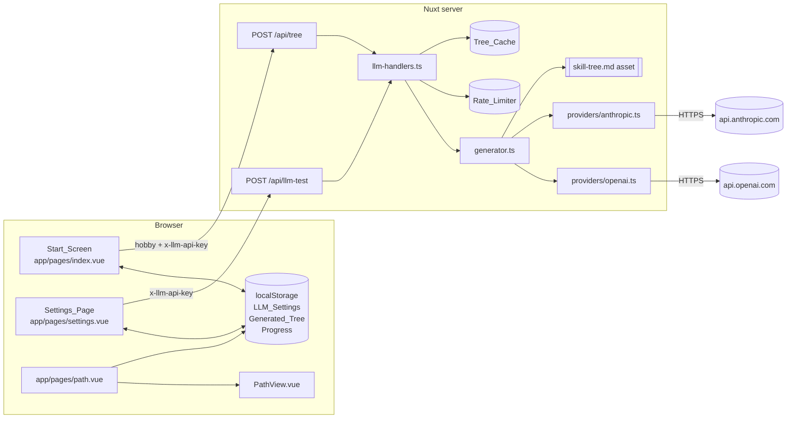
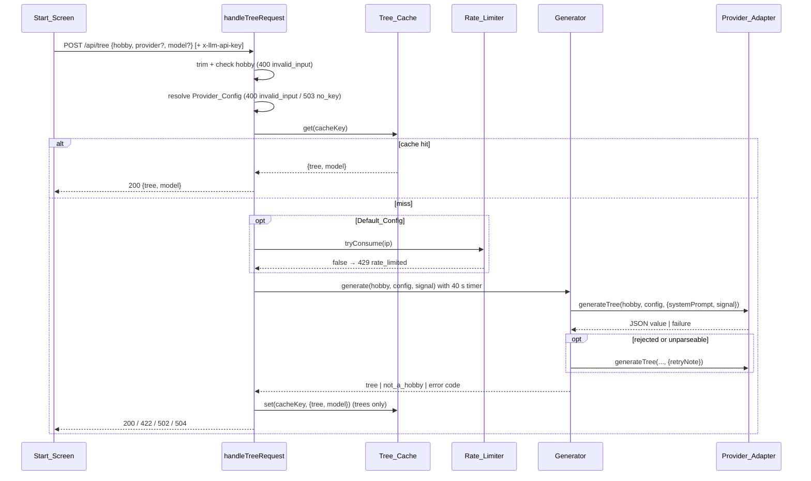

# Design Document: ai-skill-tree-generation

## Overview

The user types a hobby on the Start_Screen. The browser posts it to `POST /api/tree`. The server resolves a Provider_Config (the user's key from the `x-llm-api-key` header, or the Default_Config from `.env`), checks the Tree_Cache and the Rate_Limiter, and runs the Generator. The Generator calls one Provider_Adapter with the unchanged Generation_Prompt, checks the answer with the existing Tree_Loader (`loadSkillTree`), and retries once with the formatted Validation_Errors. The tree comes back to the browser, is saved as the Generated_Tree in localStorage, and `/path` renders it with the existing path components.

A Settings_Page stores provider, model and API key in localStorage. A Test_Route checks a key with one tiny provider request. The demo at `/path?demo=1` keeps rendering the Sample_Tree.

### Key decisions

- **No SDKs, no new dependencies.** Both adapters call the provider HTTP APIs with Nuxt's `$fetch` (ofetch). The Generation_Schema comes from `z.toJSONSchema(skillTreeSchema)` (zod 4.6.7, already a dependency). `fast-check` 4.10.2 and `vitest` 5.1.0 are already dev dependencies, so property tests need nothing new.
- **Thin routes, testable handlers.** The two route files only read the header, body and client IP and call `handleTreeRequest` / `handleTestRequest` in `server/utils/llm-handlers.ts`. The handlers take every collaborator (adapters, cache, limiter, prompt text, default config, clock) as arguments, so tests drive them with mocked adapters and no Nuxt runtime.
- **The prompt file is used as is.** `server/prompts/skill-tree.md` is bundled as a Nitro server asset and read once per process. Conflicts between the prompt and structured output are solved in code (see "Generation_Schema").
- **Validation stays with the Tree_Loader.** The design adds no new tree rules. Rules the prompt states but the Tree_Loader does not check are listed under "Open decisions".
- **`/path` splits into a page and a view component.** The current `app/pages/path.vue` builds a non-reactive node index from one tree at setup. Its body moves unchanged into `app/components/path/PathView.vue`, which takes the tree as a prop. The page decides which tree to show, so none of the path logic changes.
- **Generated_Tree progress has its own key.** `progressStorageKey(hobby)` would give a generated "bouldering" tree the Sample_Tree's progress. The Generated_Tree uses the fixed key `pursio-progress:v1:generated`, which is cleared whenever a new Generated_Tree is saved (Req 10.2).

### Research findings

- **OpenAI structured output** ([Structured Outputs guide](https://developers.openai.com/api/docs/guides/structured-outputs)): with `strict: true` the schema root must be an object, every object needs `additionalProperties: false` and every property listed in `required`. `anyOf` is allowed in nested schemas. Supported array keywords are `minItems` and `maxItems`; `prefixItems` is not in the supported list. `pattern` is supported for strings. An unsupported schema makes the API return an error. Outputs follow the key order of the schema. A model can answer with a `refusal` instead of content.
- **Anthropic tool use** (Messages API, `anthropic-version: 2023-06-01`): a tool's `input_schema` must be an object schema. `tool_choice: { type: "tool", name }` forces the model to call that tool, and the answer arrives as a `tool_use` content block whose `input` is already a parsed object. `max_tokens` is required on every request.
- **zod 4 JSON Schema export**: `z.toJSONSchema` exports `z.tuple([a, b, c])` as `prefixItems` (draft 2020-12), `z.string().regex()` as `pattern`, `.min(1)` on arrays as `minItems`, and `z.object` with `additionalProperties: false` in output mode.
- **Nitro server assets**: files under a directory registered in `nitro.serverAssets` are bundled with the server build and read with `useStorage('assets:<baseName>').getItem(name)`. Reading `server/prompts/skill-tree.md` with `fs` at runtime would break after `nuxt build`, because the source tree is not shipped.

*Content was rephrased for compliance with licensing restrictions.*

## Architecture



### Tree_Route request flow



Order inside `handleTreeRequest`, each step returning early:

1. Read `hobby`; trim it; reject a missing, non-string, empty or longer-than-60 value with 400 `invalid_input` (Req 1.1, 1.2).
2. Resolve the Provider_Config (Req 2.1 to 2.4).
3. Compute the Cache_Key and look it up. A hit responds at once (Req 6.2) and is not counted (Req 7.3).
4. If the config is the Default_Config, call `limiter.tryConsume(ip)`; refuse with 429 `rate_limited` (Req 7.2). User_Config requests skip this step (Req 7.3).
5. Start a 40 s `AbortController` and run the Generator, raced against the abort so a provider call that ignores the signal still ends at 40 s (Req 8.1).
6. Store a returned tree in the Tree_Cache (Req 6.1, 5.4) and map the result to a status and body.

A Billable_Generation is counted at step 4, before the provider is called, so failed or timed-out generations still count. The count happens once per request, so the retry inside the Generator is not counted twice (glossary "Billable_Generation").

### Lifecycle and hydration on `/path`

`/path?demo=1` renders the Sample_Tree during SSR, as today. Without `demo=1` the server cannot see localStorage, so the page renders `PathStatus state="loading"` on the server and on the first client render, then in `onMounted` reads the Generated_Tree and mounts `PathView` with either the Generated_Tree or the Sample_Tree. `PathView` is keyed by its progress key, so switching trees remounts it with fresh composables.

### Module placement

| File | Kind | Purpose |
|---|---|---|
| `shared/types/llm.ts` | new | `Provider`, `ProviderConfig`, `ErrorCode`, `TreeResponse`, `TestResponse` |
| `shared/utils/llm.ts` | new | `PROVIDERS`, `MODEL_PRESETS`, `ERROR_CODES`, `KEY_HEADER`, limits, `isProvider`, `isErrorCode`, `normalizeHobby` |
| `server/utils/generation-schema.ts` | new | `generationSchema` (wrapped, provider-safe JSON schema), `unwrapGenerationOutput` |
| `server/utils/providers/types.ts` | new | `ProviderAdapter`, `AdapterResult`, `Fetcher`, `providerFailure` |
| `server/utils/providers/anthropic.ts` | new | `createAnthropicAdapter(fetcher)` |
| `server/utils/providers/openai.ts` | new | `createOpenAIAdapter(fetcher)` |
| `server/utils/generator.ts` | new | `generateSkillTree`, `retryNote` |
| `server/utils/tree-cache.ts` | new | `cacheKey`, `createTreeCache` |
| `server/utils/rate-limiter.ts` | new | `createRateLimiter` |
| `server/utils/llm-handlers.ts` | new | `resolveProviderConfig`, `handleTreeRequest`, `handleTestRequest`, status table |
| `server/utils/llm-runtime.ts` | new | Process singletons: prompt loader, adapters map bound to `$fetch`, cache, limiter, default config from `useRuntimeConfig` |
| `server/api/tree.post.ts` | new | Tree_Route (thin) |
| `server/api/llm-test.post.ts` | new | Test_Route (thin) |
| `app/utils/llm-settings.ts` | new | LLM_Settings parse/serialize/load/save, `effectiveModel`, `emptySettings` |
| `app/utils/generated-tree.ts` | new | Generated_Tree parse/serialize/load/save, `GENERATED_PROGRESS_KEY` |
| `app/utils/tree-client.ts` | new | `buildTreeRequest`, `errorCodeFrom`, `friendlyMessage` |
| `app/pages/index.vue` | changed | Start_Screen |
| `app/pages/settings.vue` | new | Settings_Page |
| `app/pages/path.vue` | changed | Chooses the tree, renders `PathView` |
| `app/components/path/PathView.vue` | new (moved) | Former body of `path.vue`, plus the Model_Label |
| `app/utils/progress-store.ts` | changed | `createProgressStore(getStorage, tree, key?)` |
| `app/composables/useSkillPath.ts` | changed | `useSkillPath(tree, storageKey?)` |
| `nuxt.config.ts` | changed | Server-only `runtimeConfig` keys, `nitro.serverAssets` for prompts |
| `.env.example` | changed | `NUXT_LLM_PROVIDER`, `NUXT_LLM_MODEL` (`NUXT_LLM_API_KEY` exists) |

Server modules import each other with relative paths instead of relying on Nitro auto-imports, so vitest can import them without Nuxt. Only `llm-runtime.ts` and the route files touch Nitro globals (`$fetch`, `useStorage`, `useRuntimeConfig`, h3 helpers).

## Components and Interfaces

### Shared constants and helpers (`shared/utils/llm.ts`)

```ts
export const PROVIDERS = ['anthropic', 'openai'] as const satisfies readonly Provider[]
export const PROVIDER_LABELS: Record<Provider, string> = { anthropic: 'Anthropic', openai: 'OpenAI' }
/** First entry is the default for the provider (Req 11.3). To be confirmed, see Open decisions. */
export const MODEL_PRESETS: Record<Provider, readonly [string, ...string[]]> = {
  anthropic: ['claude-sonnet-4-5', 'claude-haiku-4-5', 'claude-opus-4-1'],
  openai: ['gpt-5-mini', 'gpt-5', 'gpt-4.1-mini'],
}
export const ERROR_CODES = ['invalid_input', 'not_a_hobby', 'rate_limited', 'timeout',
  'generation_failed', 'provider_auth', 'provider_error', 'no_key'] as const
export const KEY_HEADER = 'x-llm-api-key'
export const HOBBY_MAX_LENGTH = 60
export const MODEL_MAX_LENGTH = 100

export function isProvider(value: unknown): value is Provider
export function isErrorCode(value: unknown): value is ErrorCode
/** trim, collapse inner whitespace runs (/\s+/g) to ' ', toLowerCase (Req 1.3, 1.4). */
export function normalizeHobby(input: string): string
```

`normalizeHobby` is `input.trim().replace(/\s+/g, ' ').toLowerCase()`. Lowercasing can change string length for a few characters (e.g. `İ` becomes two code units), so idempotence is the property tested, not length.

### Generation_Schema (`server/utils/generation-schema.ts`)

The Tree_Schema cannot go to the providers unchanged, and the prompt's not-a-hobby answer has a different shape. Both are handled here.

**Conflict 1: Not_A_Hobby_Signal vs. an object root.** OpenAI strict mode needs an object root with all properties required, and an Anthropic tool input must be an object. A root `anyOf` of "tree or error" fits neither. The schema wraps both shapes in one required property:

```json
{
  "type": "object",
  "properties": {
    "result": {
      "anyOf": [
        { "...": "Skill_Tree schema derived from skillTreeSchema" },
        {
          "type": "object",
          "properties": { "error": { "type": "string", "enum": ["not_a_hobby"] } },
          "required": ["error"],
          "additionalProperties": false
        }
      ]
    }
  },
  "required": ["result"],
  "additionalProperties": false
}
```

`unwrapGenerationOutput(value: unknown)` maps the provider value back:

```ts
type Unwrapped = { kind: 'not_a_hobby' } | { kind: 'candidate'; value: unknown }
```

- If `value` is an object with a `result` key, look at `value.result`; otherwise look at `value` itself. The fallback tolerates a model that answers in the prompt's literal shape.
- If the looked-at value is an object whose `error` is `"not_a_hobby"`, return `{ kind: 'not_a_hobby' }`.
- Otherwise return `{ kind: 'candidate', value }` for the Tree_Loader.

**Conflict 2: tuple quests.** `z.toJSONSchema(skillTreeSchema)` exports `quests` as `prefixItems`. A recursive post-process `toProviderSchema(node)` runs once at module load:

- Drop `$schema`.
- Replace `{ prefixItems: [s1..sn] }` (and the draft-7 form `items: [..]` with `additionalItems`) by `{ type: 'array', items: s1, minItems: n, maxItems: n }`. It throws at load if the `prefixItems` entries are not deep-equal, so a future mixed tuple fails loudly in tests instead of silently loosening the schema.
- On every `type: 'object'`, set `additionalProperties: false` and `required` to all keys of `properties`. All Tree_Schema fields are required today, so this changes nothing for valid trees.
- Keep `pattern: "\\S"` from the `text` regex and `minItems: 1` from `.min(1)`; both are in OpenAI's supported subset.

The Skill_Tree branch is computed from `skillTreeSchema`, so a schema change flows into the Generation_Schema without a separate edit (Req 3.4). The schema only guides the model; the Tree_Loader stays the single acceptance check (Req 4.1).

### Provider_Adapter (`server/utils/providers/`)

```ts
export type AdapterFailure = 'provider_auth' | 'provider_error' | 'bad_output'
export type AdapterResult = { ok: true; value: unknown } | { ok: false; error: AdapterFailure }

export interface GenerateOptions {
  systemPrompt: string
  /** Extra user text for the retry call (Req 4.3). */
  retryNote?: string
  signal?: AbortSignal
}

export interface ProviderAdapter {
  generateTree(hobby: string, config: ProviderConfig, options: GenerateOptions): Promise<AdapterResult>
  /** One request with at most 16 output tokens (Req 12.3). */
  testConnection(config: ProviderConfig, signal?: AbortSignal): Promise<AdapterResult>
}

/** The subset of ofetch's $fetch the adapters use; tests pass a fake. */
export type Fetcher = (url: string, options: {
  method: 'POST'
  headers: Record<string, string>
  body: Record<string, unknown>
  signal?: AbortSignal
  retry: 0
}) => Promise<unknown>

/** 401/403 → provider_auth; any other status, network or abort error → provider_error (Req 3.5, 3.6). */
export function providerFailure(error: unknown): 'provider_auth' | 'provider_error'
```

`generateTree(hobby, { provider, model, apiKey }, options)` keeps the signature from Req 3.1 and adds an options argument for the system prompt, retry note and abort signal. `testConnection` is a second function on the same adapter object, because the Test_Route needs a 16-token request that `generateTree` cannot make; this is noted against Req 3.1's "single function" wording under Open decisions.

`bad_output` separates "the provider answered but the answer is unusable" (not parseable JSON, missing tool call, refusal, truncated by the token limit) from transport failures. Req 3.6 groups unparseable answers under `provider_error`, but Req 4.3 and 4.4 require a retry and then `generation_failed` for them. The Generator therefore treats `bad_output` like a rejected answer, and it never reaches the client as `provider_error`.

`providerFailure` reads a numeric status from `error.status`, `error.statusCode` or `error.response.status` (ofetch's `FetchError` has `status` and `statusCode`). It never reads or forwards the error body or message, which can echo part of the key.

Every call sets `retry: 0`, so ofetch never repeats a paid POST on its own, and passes the abort signal.

**Anthropic (`createAnthropicAdapter(fetcher)`)**

- `POST https://api.anthropic.com/v1/messages`, headers `x-api-key: <apiKey>`, `anthropic-version: 2023-06-01`, `content-type: application/json`.
- Body: `model`, `max_tokens: 8192`, `system: systemPrompt`, `messages: [{ role: 'user', content: [{ type: 'text', text: hobby }, ...(retryNote ? [{ type: 'text', text: retryNote }] : [])] }]`, `tools: [{ name: 'submit_skill_tree', description: 'Submit the skill tree or the not_a_hobby error.', input_schema: generationSchema }]`, `tool_choice: { type: 'tool', name: 'submit_skill_tree' }`.
- Success: the first `content` block with `type === 'tool_use'` and `name === 'submit_skill_tree'`; return its `input`. No such block, or `stop_reason === 'max_tokens'`, gives `bad_output`.
- `testConnection`: same URL and headers, body `{ model, max_tokens: 16, messages: [{ role: 'user', content: 'ping' }] }`. Any 2xx is `ok`.

**OpenAI (`createOpenAIAdapter(fetcher)`)**

- `POST https://api.openai.com/v1/chat/completions`, header `authorization: Bearer <apiKey>`.
- Body: `model`, `messages: [{ role: 'system', content: systemPrompt }, { role: 'user', content: hobby }, ...(retryNote ? [{ role: 'user', content: retryNote }] : [])]`, `response_format: { type: 'json_schema', json_schema: { name: 'skill_tree', strict: true, schema: generationSchema } }`.
- Success: `choices[0].message.content` is a string and `JSON.parse` succeeds; return the parsed value. A `refusal`, `finish_reason === 'length'`, a missing content string or a parse error gives `bad_output`.
- `testConnection`: body `{ model, max_completion_tokens: 16, messages: [{ role: 'user', content: 'ping' }] }`. Any 2xx is `ok`.

Response fields are read by narrowing `unknown` with small type guards; no `any`.

### Generator (`server/utils/generator.ts`)

```ts
export type GenerationResult =
  | { kind: 'tree'; tree: SkillTree; model: string }
  | { kind: 'not_a_hobby' }
  | { kind: 'error'; code: 'generation_failed' | 'provider_auth' | 'provider_error' | 'timeout' }

export interface GeneratorDeps {
  adapters: Record<Provider, ProviderAdapter>
  systemPrompt: string
  signal?: AbortSignal
}

export function generateSkillTree(hobby: string, config: ProviderConfig, deps: GeneratorDeps): Promise<GenerationResult>
export function retryNote(errors: ValidationError[] | null): string
```

Algorithm (at most 2 adapter calls, Req 4.6):

```
adapter = deps.adapters[config.provider]           // one lookup map (Req 3.1)
note = undefined
for attempt in 1..2:
  r = await adapter.generateTree(hobby, config, { systemPrompt, retryNote: note, signal })
  if signal.aborted: return error timeout
  if !r.ok:
    if r.error == 'bad_output': note = retryNote(null); continue          // Req 4.3
    return error r.error                                                  // provider_auth / provider_error
  u = unwrapGenerationOutput(r.value)
  if u.kind == 'not_a_hobby': return not_a_hobby                          // Req 5.1, no retry
  loaded = loadSkillTree(u.value)                                         // Req 4.1
  if loaded.ok: return tree loaded.value, model config.model              // Req 4.2
  note = retryNote(loaded.errors)
return error generation_failed                                            // Req 4.4
```

`retryNote(errors)` returns:

```
Your previous answer was rejected. Fix these problems and return the complete skill tree again:
- <formatValidationError(e)>      (first 20 errors only)
```

or, for `null` (unparseable answer), `Your previous answer did not match the schema. Return the complete skill tree again.` The returned tree is always the Tree_Loader's output, so it passes the Tree_Loader by construction (Req 4.7).

### Tree_Cache (`server/utils/tree-cache.ts`)

```ts
export function cacheKey(hobby: string, provider: Provider, model: string): string
// JSON.stringify([normalizeHobby(hobby), provider, model])

export interface CachedTree { tree: SkillTree; model: string }
export interface TreeCache {
  get(key: string): CachedTree | undefined   // moves the entry to most recent
  set(key: string, value: CachedTree): void  // evicts the least recent past `limit`
  readonly size: number
}
export function createTreeCache(limit = 200): TreeCache
```

The LRU uses a `Map`'s insertion order: `get` deletes and re-inserts a hit, `set` deletes then inserts, then removes `map.keys().next().value` while `size > limit` (Req 6.4). JSON array encoding makes `cacheKey` injective over (Normalized_Hobby, provider, model), which Req 6.5 needs; plain concatenation with a separator would collide when the model id contains the separator. `CachedTree` has no key field, so an API key cannot be stored (Req 2.6).

A User_Config tree is cached under its provider and model like any other. A later Default_Config request with the same provider, model and hobby gets that tree. The key itself is never stored.

### Rate_Limiter (`server/utils/rate-limiter.ts`)

```ts
export interface RateLimiter { tryConsume(ip: string): boolean }
export function createRateLimiter(options: { limit: number; windowMs: number; now: () => number }): RateLimiter
// runtime: { limit: 10, windowMs: 60 * 60 * 1000, now: Date.now }
```

Per IP it keeps the timestamps of allowed requests. `tryConsume(ip)` takes `t = now()`, drops timestamps `<= t - windowMs`, and allows (and records `t`) when fewer than `limit` remain (Req 7.1, 7.6). An IP whose list becomes empty is deleted from the map, so idle IPs do not accumulate. The clock is injected (Req 7.5). The client IP comes from h3 `getRequestIP(event)`; an unknown IP uses the bucket `"unknown"`.

### Handlers (`server/utils/llm-handlers.ts`)

```ts
export interface HandlerResponse<B> { status: number; body: B }

export function resolveProviderConfig(input: {
  headerKey: string | undefined
  body: Record<string, unknown>
  defaults: { provider: string; model: string; apiKey: string }
}):
  | { ok: true; config: ProviderConfig; source: 'user' | 'default' }
  | { ok: false; status: 400 | 503; code: 'invalid_input' | 'no_key' }

export interface TreeDeps {
  adapters: Record<Provider, ProviderAdapter>
  systemPrompt: () => Promise<string>
  defaults: { provider: string; model: string; apiKey: string }
  cache: TreeCache
  limiter: RateLimiter
  timeoutMs: number   // 40_000
  log?: (entry: { code: ErrorCode; provider: Provider; model: string }) => void
}

export function handleTreeRequest(
  input: { body: unknown; headerKey: string | undefined; ip: string },
  deps: TreeDeps,
): Promise<HandlerResponse<TreeResponse>>

export function handleTestRequest(
  input: { body: unknown; headerKey: string | undefined },
  deps: { adapters: Record<Provider, ProviderAdapter>; timeoutMs: number /* 15_000 */ },
): Promise<HandlerResponse<TestResponse>>

export const ERROR_STATUS: Record<ErrorCode, number> = {
  invalid_input: 400, not_a_hobby: 422, rate_limited: 429, timeout: 504,
  generation_failed: 502, provider_auth: 502, provider_error: 502, no_key: 503,
}
```

`resolveProviderConfig`:

- A non-empty (after trim) header key gives a User_Config. `body.provider` must pass `isProvider`, and `body.model` must be a string that is 1 to 100 characters after trimming; otherwise 400 `invalid_input` (Req 2.1, 2.3). The trimmed model is used.
- No header or an empty one gives the Default_Config; body `provider` and `model` are ignored (Req 2.2). An empty `apiKey` or `model`, or a provider failing `isProvider`, gives 503 `no_key` (Req 2.4).

`handleTreeRequest` follows the step order in "Architecture". A body that is not a plain object counts as missing `hobby`. The `log` callback receives only the error code, provider and model, never the key, the body or provider responses (Req 2.6).

`handleTestRequest` requires a non-empty header key; without one, or with an invalid provider/model, it returns 400 `{ ok: false, error: 'invalid_input' }`. Otherwise it calls `adapter.testConnection` under a 15 s abort and returns 200 with `{ ok: true }` or `{ ok: false, error }`, where `error` is `provider_auth`, `provider_error` or `timeout` (Req 12.3 to 12.5). Using 200 for provider outcomes keeps the Settings_Page to one response shape.

### Runtime wiring (`server/utils/llm-runtime.ts`, routes, config)

- `nuxt.config.ts`:
  - `runtimeConfig: { llmProvider: '', llmModel: '', llmApiKey: '', public: {...} }`. Top-level keys are server-only and filled from `NUXT_LLM_PROVIDER`, `NUXT_LLM_MODEL`, `NUXT_LLM_API_KEY` (Req 2.5).
  - `nitro: { serverAssets: [{ baseName: 'prompts', dir: './prompts' }] }` (the directory is relative to `server/`).
- `loadSystemPrompt()` reads `useStorage('assets:prompts').getItem('skill-tree.md')` once, checks it is a non-empty string, and memoizes the promise. The text is passed on unchanged (Req 3.2). If the asset cannot be read, the route responds 502 `provider_error` and logs `prompt_missing`.
- Process singletons: `adapters = { anthropic: createAnthropicAdapter($fetch), openai: createOpenAIAdapter($fetch) }`, `createTreeCache(200)`, `createRateLimiter({ limit: 10, windowMs: 3_600_000, now: Date.now })`.
- `server/api/tree.post.ts`: `body = await readBody(event).catch(() => null)`, `headerKey = getHeader(event, KEY_HEADER)`, `ip = getRequestIP(event) ?? 'unknown'`; calls `handleTreeRequest`; `setResponseStatus(event, status)`; returns `body`. It does not use `createError`, so the response body is exactly `{ "error": <code> }`.
- `server/api/llm-test.post.ts`: same pattern with `handleTestRequest`.
- `.env.example` gains `NUXT_LLM_PROVIDER=anthropic` and `NUXT_LLM_MODEL=claude-sonnet-4-5` next to the existing `NUXT_LLM_API_KEY` line (Req 2.7).

### Client utilities

**`app/utils/llm-settings.ts`**

```ts
export const LLM_SETTINGS_KEY = 'pursio-llm-settings:v1'
export interface LlmSettings { provider: Provider; preset: string; customModel: string; apiKey: string }
export function emptySettings(): LlmSettings     // anthropic, MODEL_PRESETS.anthropic[0], '', ''
export function effectiveModel(s: LlmSettings): string   // customModel.trim() || preset (Req 11.2)
export function serializeSettings(s: LlmSettings): string
export function parseStoredSettings(raw: string | null): { settings: LlmSettings; invalid: boolean }
export function loadSettings(getStorage: () => StorageLike | null): LlmSettings  // removes invalid (Req 11.7)
export function saveSettings(getStorage: () => StorageLike | null, s: LlmSettings): void
```

The stored shape is checked with a zod schema: `provider` passes `isProvider`, `preset` is one of `MODEL_PRESETS[provider]`, `customModel` and `apiKey` are strings. Storage failures are silent, like the Progress_Store. `StorageLike` is reused from `progress-store.ts`.

**`app/utils/generated-tree.ts`**

```ts
export const GENERATED_TREE_KEY = 'pursio-generated-tree:v1'
export const GENERATED_PROGRESS_KEY = 'pursio-progress:v1:generated'
export interface GeneratedTree { tree: SkillTree; model: string }
export function serializeGeneratedTree(g: GeneratedTree): string
export function parseStoredGeneratedTree(raw: string | null): { value: GeneratedTree | null; invalid: boolean }
export function loadGeneratedTree(getStorage: () => StorageLike | null): GeneratedTree | null  // removes invalid (Req 10.6)
export function saveGeneratedTree(getStorage: () => StorageLike | null, g: GeneratedTree): void
// writes GENERATED_TREE_KEY and removes GENERATED_PROGRESS_KEY (Req 10.1, 10.2)
```

`parseStoredGeneratedTree` parses JSON, requires `model` to be a non-empty string, and runs `loadSkillTree` on `tree`. Any failure gives `{ value: null, invalid: true }`.

**`app/utils/tree-client.ts`**

```ts
export function buildTreeRequest(hobby: string, settings: LlmSettings):
  { body: { hobby: string; provider?: Provider; model?: string }; headers: Record<string, string>; usesOwnKey: boolean }
// apiKey.trim() non-empty → header KEY_HEADER, body.provider, body.model = effectiveModel (Req 9.5)
export function errorCodeFrom(data: unknown): ErrorCode   // known `error` field, else 'generation_failed' (Req 8.5)
export function friendlyMessage(code: ErrorCode, context: { usesOwnKey: boolean }): string
```

Friendly_Messages (one sentence each, no technical detail):

| Error_Code | Message |
|---|---|
| `not_a_hobby` | That doesn't look like a hobby yet. Try something you can practice, like bouldering or guitar. |
| `rate_limited` | You've built a lot of trees this hour. Try again later, or add your own API key in Settings. |
| `timeout` | Building your tree took too long. Please try again. |
| `generation_failed` | We couldn't build a tree for that just now. Please try again. |
| `provider_auth` (own key) | Your API key was not accepted. Check it in Settings. |
| `provider_auth` (default) | The AI service is not available right now. Please try again later. |
| `provider_error` | The AI service had a problem. Please try again. |
| `no_key` | Tree building isn't set up yet. Add your own API key in Settings. |
| `invalid_input` | Type a hobby of up to 60 characters. |

### Start_Screen (`app/pages/index.vue`)

- Heading "Pursio", then a form: `<label for="hobby">What do you want to get better at?</label>`, `<input id="hobby" maxlength="60">`, submit button "Build my path", and three Example_Chip buttons (Req 9.1). A link to `/settings` (Req 9.6).
- `state: 'idle' | 'generating'`, `error: string | null`. Submitting a non-empty trimmed value, or tapping a chip (which first sets the input), calls `generate()` (Req 9.2, 9.3).
- `generate()` loads LLM_Settings, calls `buildTreeRequest`, sets `generating`, and posts with `$fetch('/api/tree', { method: 'POST', body, headers, signal, retry: 0 })` under a 45 s `AbortController` (Req 8.2). On success it calls `saveGeneratedTree` and `navigateTo('/path')` (Req 10.1). On failure it maps an abort to `timeout`, otherwise `errorCodeFrom(error.data)`, shows `friendlyMessage`, returns to `idle` and keeps the input (Req 5.3, 7.4, 8.4 to 8.6).
- While generating: input, submit and chips are `disabled`, and a `role="status" aria-live="polite"` element contains "Building your skill tree…" (Req 9.4). The element is always in the DOM so screen readers pick up the change. The error message goes in the same region.
- Styling uses token utilities only (`bg-surface`, `text-ink`, `text-muted`, `rounded-node`, `font-display`).

### Settings_Page (`app/pages/settings.vue`)

- Provider radio group "Anthropic" / "OpenAI"; changing it sets `preset` to `MODEL_PRESETS[provider][0]` (Req 11.1, 11.3).
- Model `<select>` of the provider's presets, and a "Custom model id" text input (Req 11.1, 11.2). The effective model is shown under the fields.
- API key `<input type="password">` with "Show" (toggles `type` between `password` and `text`, `aria-pressed`) and "Clear" (empties the field and saves `apiKey: ''`) (Req 11.4).
- A `watch` on the settings object saves on every change (Req 11.5). Settings load in `onMounted` (Req 11.7).
- The note "Your key is stored only in this browser and sent only to generate your tree." (Req 11.6).
- "Test connection" is disabled while `apiKey.trim()` is empty (Req 12.1). It posts to `/api/llm-test` with the key in `x-llm-api-key` and `{ provider, model }` in the body (Req 12.2), then shows "OK" or `friendlyMessage(error, { usesOwnKey: true })` in a live region (Req 12.4, 12.5). The browser never calls a provider directly.

### `/path` page and `PathView`

`app/pages/path.vue` becomes:

```ts
const route = useRoute()
const isDemo = route.query.demo === '1'
const sampleLoaded = loadSkillTree(sample)          // unchanged Sample_Tree path (Req 10.4)
const choice = shallowRef<{ tree: SkillTree; progressKey: string; model: string | null } | null>(
  isDemo && sampleLoaded.ok ? sampleChoice() : null)
onMounted(() => {
  if (isDemo) return
  const generated = loadGeneratedTree(browserStorage)   // invalid → removed (Req 10.6)
  choice.value = generated
    ? { tree: generated.tree, progressKey: GENERATED_PROGRESS_KEY, model: generated.model }  // Req 10.3
    : sampleChoice()                                                                          // Req 10.5
})
```

`sampleChoice()` uses `progressStorageKey(sample.hobby)`, so Sample_Tree Progress stays where it is today. A Sample_Tree load error keeps today's `PathStatus state="error"` output. Before the choice is known the page shows `PathStatus state="loading"`.

`PathView.vue` props: `tree: SkillTree`, `progressKey: string`, `model: string | null`. Its script is the current `path.vue` script minus the sample import and load-error branch, calling `useSkillPath(props.tree, props.progressKey)`. When `model` is set it renders `<p class="text-xs text-muted">Generated with {{ model }}</p>` below the canvas (Req 10.7). The page renders `<PathView :key="choice.progressKey" ...>`.

`createProgressStore(getStorage, tree, key = progressStorageKey(tree.hobby))` and `useSkillPath(tree, storageKey?)` gain an optional key; existing callers and tests are unchanged.

## Data Models

```ts
// shared/types/llm.ts
export type Provider = 'anthropic' | 'openai'
export interface ProviderConfig { provider: Provider; model: string; apiKey: string }
export type ErrorCode =
  | 'invalid_input' | 'not_a_hobby' | 'rate_limited' | 'timeout'
  | 'generation_failed' | 'provider_auth' | 'provider_error' | 'no_key'
export type TreeResponse = { tree: SkillTree; model: string } | { error: ErrorCode }
export type TestResponse = { ok: true } | { ok: false; error: ErrorCode }
```

### Tree_Route

Request: `POST /api/tree`, JSON body.

| Field | Type | Used when |
|---|---|---|
| `hobby` | string, 1 to 60 chars after trim | always |
| `provider` | `'anthropic' \| 'openai'` | Key_Header present |
| `model` | string, 1 to 100 chars after trim | Key_Header present |

Header `x-llm-api-key`: optional User_Config key.

Responses:

| Status | Body |
|---|---|
| 200 | `{ "tree": SkillTree, "model": "<model id>" }` |
| 400 | `{ "error": "invalid_input" }` |
| 422 | `{ "error": "not_a_hobby" }` |
| 429 | `{ "error": "rate_limited" }` |
| 502 | `{ "error": "generation_failed" \| "provider_auth" \| "provider_error" }` |
| 503 | `{ "error": "no_key" }` |
| 504 | `{ "error": "timeout" }` |

### Test_Route

Request: `POST /api/llm-test`, header `x-llm-api-key` (required), body `{ provider, model }`.
Responses: 200 `{ "ok": true }` or `{ "ok": false, "error": "provider_auth" | "provider_error" | "timeout" }`; 400 `{ "ok": false, "error": "invalid_input" }`.

### Server memory

| Structure | Shape | Bound |
|---|---|---|
| Tree_Cache | `Map<string, { tree: SkillTree; model: string }>` keyed by `JSON.stringify([normalizedHobby, provider, model])` | 200 entries, LRU |
| Rate_Limiter | `Map<ip, number[]>` of allowed timestamps | 10 per IP; empty IPs removed |

Neither holds an API key. Both reset on server restart and are per instance (persistent caches are out of scope).

### localStorage

| Key | Value |
|---|---|
| `pursio-llm-settings:v1` | `{ "provider": "anthropic", "preset": "claude-sonnet-4-5", "customModel": "", "apiKey": "sk-..." }` |
| `pursio-generated-tree:v1` | `{ "tree": SkillTree, "model": "claude-sonnet-4-5" }` |
| `pursio-progress:v1:generated` | Progress JSON (same format as the Progress_Store) for the Generated_Tree |
| `pursio-progress:v1:<hobby>` | Existing Sample_Tree Progress, unchanged |

## Correctness Properties

*A property is a characteristic or behavior that should hold true across all valid executions of a system-essentially, a formal statement about what the system should do. Properties serve as the bridge between human-readable specifications and machine-verifiable correctness guarantees.*

Overlapping criteria were merged during reflection: 1.1 with 1.2; 2.1 to 2.3; 3.5 with 3.6; 4.2, 4.4, 4.6, 4.7 and 5.1 into one Generator property; 6.1 to 6.3 into one cache round trip; 7.1 with 7.6; 9.5 with 11.2.

### Property 1: Normalization is idempotent

For any string `s`, `normalizeHobby(normalizeHobby(s)) === normalizeHobby(s)`.

**Validates: Requirements 1.3**

### Property 2: Normalization ignores case and whitespace layout

For any non-empty list of non-whitespace words, any two hobbies built from those words by joining them with arbitrary non-empty whitespace runs, padding them with arbitrary leading and trailing whitespace, and changing the letter case of arbitrary characters have equal `normalizeHobby` results.

**Validates: Requirements 1.4**

### Property 3: Invalid hobbies never reach a provider

For any request body, `handleTreeRequest` with mocked adapters responds 400 `{ "error": "invalid_input" }` with zero adapter calls exactly when `body.hobby` is not a string or its trimmed value is empty or longer than 60 characters; for every other body, the adapter (when called) receives `body.hobby.trim()`.

**Validates: Requirements 1.1, 1.2**

### Property 4: Provider_Config resolution follows the header

For any header key, request body and complete Default_Config, `resolveProviderConfig` returns the Default_Config when the trimmed header key is empty (whatever the body's `provider` and `model`); otherwise it returns `{ provider: body.provider, model: body.model.trim(), apiKey: headerKey }` when `body.provider` is `anthropic` or `openai` and the trimmed model has 1 to 100 characters, and 400 `invalid_input` in every other case.

**Validates: Requirements 2.1, 2.2, 2.3**

### Property 5: API keys never leave the request

For any User_Config API key and any sequence of mocked adapter outcomes, the JSON of every Tree_Route and Test_Route response body, every Tree_Cache entry and every `log` call contains no occurrence of the key.

**Validates: Requirements 2.6**

### Property 6: Provider failures map by status

For any thrown value, `providerFailure` returns `provider_auth` exactly when the value carries a status of 401 or 403 (in `status`, `statusCode` or `response.status`), and `provider_error` for every other status and for values without a status.

**Validates: Requirements 3.5, 3.6**

### Property 7: The Generator calls at most twice and returns only loadable trees

For any sequence of mocked adapter outcomes drawn from {valid tree, invalid tree, Not_A_Hobby_Signal in wrapped or bare form, `bad_output`, `provider_auth`, `provider_error`}, `generateSkillTree` calls the adapter at most 2 times and returns the same result as this reference: a valid tree in the first answer gives that tree with `config.model` after 1 call; a Not_A_Hobby_Signal first gives `not_a_hobby` after 1 call; `provider_auth` or `provider_error` first gives that code after 1 call; an invalid tree or `bad_output` first leads to a second call whose outcome is mapped the same way, except that an invalid tree or `bad_output` second gives `generation_failed`. Every returned tree is accepted by `loadSkillTree` with zero Validation_Errors.

**Validates: Requirements 4.2, 4.4, 4.6, 4.7, 5.1**

### Property 8: The retry note lists the first 20 formatted errors

For any non-empty list of Validation_Errors, the bullet lines of `retryNote(errors)` equal `errors.slice(0, 20).map(formatValidationError)` in order, and the Generator passes that note on its second call after rejecting a first answer with those errors.

**Validates: Requirements 4.3**

### Property 9: Only trees are cached, and a cached tree is served without a provider call

For any sequence of Tree_Route requests with mocked adapter outcomes, the Tree_Cache gains an entry only when the Generator returns a tree; and for any request that follows a successful generation with a hobby of equal Normalized_Hobby and the same provider and model, the response is 200 with the same `tree` and `model` and no adapter call.

**Validates: Requirements 5.4, 6.1, 6.2, 6.3**

### Property 10: Cache keys are equal exactly when their parts are

For any two triples `(hobbyA, providerA, modelA)` and `(hobbyB, providerB, modelB)`, including model ids that contain quotes, commas and brackets, `cacheKey` returns equal keys if and only if `normalizeHobby(hobbyA) === normalizeHobby(hobbyB)`, `providerA === providerB` and `modelA === modelB`.

**Validates: Requirements 6.5**

### Property 11: The Tree_Cache behaves like a bounded LRU

For any limit from 1 to 200 and any sequence of `get` and `set` operations, `createTreeCache(limit)` returns the same `get` results as a reference list-based LRU of the same limit, and its size never exceeds the limit.

**Validates: Requirements 6.4**

### Property 12: The Rate_Limiter matches the sliding-window model

For any sequence of `(ip, timestamp)` requests with non-decreasing timestamps, `tryConsume` returns `true` exactly when the reference model holds fewer than 10 allowed timestamps for that IP in the window `(t - 3_600_000, t]`, and the model records `t` only when it allows.

**Validates: Requirements 7.1, 7.6**

### Property 13: Only billable generations are counted

For any sequence of Tree_Route requests mixing User_Config and Default_Config, new and repeated hobbies, the number of `tryConsume` calls on a spy limiter equals the number of valid Default_Config requests that missed the Tree_Cache.

**Validates: Requirements 7.3**

### Property 14: Unknown error responses fall back to generation_failed

For any value `data`, `errorCodeFrom(data)` returns `data.error` when `data` is an object whose `error` is one of the eight Error_Codes, and `generation_failed` otherwise; and `friendlyMessage(code, context)` is a non-empty string for every Error_Code and both values of `usesOwnKey`.

**Validates: Requirements 8.5**

### Property 15: Tree requests carry the key only when the user set one

For any LLM_Settings and hobby, `buildTreeRequest` sets the `x-llm-api-key` header and adds `provider` and `model` to the body exactly when `apiKey.trim()` is non-empty; then `model` is `customModel.trim()` when that is non-empty and `preset` otherwise. Without a key the body is `{ hobby }` and there are no headers.

**Validates: Requirements 9.5, 11.2**

### Property 16: Generated_Tree storage round trip

For any Skill_Tree accepted by the Tree_Loader and any non-empty model id, `parseStoredGeneratedTree(serializeGeneratedTree({ tree, model }))` returns a value deeply equal to `{ tree, model }` with `invalid: false`.

**Validates: Requirements 10.8**

### Property 17: An unusable Generated_Tree is removed

For any stored string that is not valid JSON, or whose `tree` the Tree_Loader rejects, or whose `model` is not a non-empty string, `loadGeneratedTree` returns `null` and removes `pursio-generated-tree:v1` from storage.

**Validates: Requirements 10.6**

### Property 18: Saving a Generated_Tree resets only its own Progress

For any storage contents holding Progress under `pursio-progress:v1:generated` and under any `pursio-progress:v1:<hobby>` key, `saveGeneratedTree` removes the generated Progress key, leaves every other Progress key unchanged, and a following `loadGeneratedTree` returns the saved value.

**Validates: Requirements 10.1, 10.2**

### Property 19: LLM_Settings round trip

For any valid LLM_Settings (any provider, a preset from that provider's list, any custom model and API key strings), `parseStoredSettings(serializeSettings(s))` returns settings deeply equal to `s` with `invalid: false`.

**Validates: Requirements 11.8**

### Property 20: Unusable LLM_Settings are reset

For any stored string that is not valid JSON or does not match the LLM_Settings shape (unknown provider, preset outside the provider's list, missing or non-string fields), `loadSettings` returns `emptySettings()` and removes `pursio-llm-settings:v1`.

**Validates: Requirements 11.7**

## Error Handling

| Situation | Where | Result |
|---|---|---|
| Body not JSON, not an object, or bad `hobby` | handler step 1 | 400 `invalid_input`, no provider call |
| Bad `provider`/`model` with a user key | `resolveProviderConfig` | 400 `invalid_input` |
| Default_Config incomplete | `resolveProviderConfig` | 503 `no_key` |
| 11th billable generation in 60 min | handler step 4 | 429 `rate_limited` |
| Provider 401/403 | adapter → Generator | 502 `provider_auth` |
| Provider other status, DNS/network error | adapter → Generator | 502 `provider_error` |
| Answer unparseable, no tool call, refusal, truncated | adapter `bad_output` → Generator retry | 502 `generation_failed` if the retry also fails |
| Tree_Loader rejects twice | Generator | 502 `generation_failed` |
| Not_A_Hobby_Signal | Generator | 422 `not_a_hobby`, not cached |
| Generator still running at 40 s | handler | abort signal fired, 504 `timeout` |
| Prompt asset missing or empty | `loadSystemPrompt` | 502 `provider_error`, logged as `prompt_missing` |
| No Tree_Route response at 45 s | Start_Screen | request aborted, `timeout` message |
| Response not JSON or unknown code | Start_Screen | `generation_failed` message |
| Test connection fails or exceeds 15 s | Test_Route | 200 `{ ok: false, error }` |
| localStorage unavailable or throws | client storage utils | silent: settings fall back to empty, Generated_Tree to none, saves become no-ops |
| Saved Generated_Tree or LLM_Settings invalid | client storage utils | value removed, fallback shown |

Key safety rules:

- The API key appears only in the outgoing provider request headers. Handlers log `{ code, provider, model }` only. Error bodies and messages from providers or ofetch are never logged or returned, because provider error messages can contain a masked key.
- The Default_Config key lives only in server-only `runtimeConfig`; nothing under `runtimeConfig.public` mentions LLM settings.
- The user key sits in localStorage in plain text, so any XSS on the origin could read it. The Settings_Page note states where the key lives. The app renders all tree text through Vue interpolation (no `v-html`), so LLM output cannot inject markup.

## Testing Strategy

Automated tests stay in the existing layout: example tests in `tests/unit/`, property tests in `tests/property/`, run by `yarn test` (vitest, `environment: 'node'`). Tests import server and client modules directly, use mocked adapters or a fake `Fetcher`, and never call a real provider. There are no Vue component tests (Req 13.3). Existing `skill-path-ui` tests must keep passing, and the conventions test keeps the dependency set unchanged (Req 13.1, 13.4).

### Property tests

- Library: `fast-check` 4.10.2 (already a dev dependency). No new dependency.
- Each property in "Correctness Properties" is implemented by exactly one property test with at least 100 runs (`{ numRuns: 100 }` or more; the existing suite uses 200).
- Each test carries a comment tag in the existing format: `// Feature: ai-skill-tree-generation, Property <n>: <title>`.
- Generators reuse `tests/arbitraries.ts`: `arbValidTree` for valid trees and `arbShapeTree` mutations for rejected ones. New arbitraries: whitespace runs (spaces, tabs, newlines, NBSP), Error_Code values, adapter outcome sequences, LLM_Settings, and `(ip, timestamp)` request sequences.

| File | Properties |
|---|---|
| `tests/property/llm-normalize.property.test.ts` | 1, 2, 10 |
| `tests/property/tree-cache.property.test.ts` | 11 |
| `tests/property/rate-limiter.property.test.ts` | 12 |
| `tests/property/generator.property.test.ts` | 6, 7, 8 |
| `tests/property/llm-handlers.property.test.ts` | 3, 4, 5, 9, 13 |
| `tests/property/client-storage.property.test.ts` | 14, 15, 16, 17, 18, 19, 20 |

### Unit tests (examples and edge cases)

- `tests/unit/generation-schema.test.ts`: root is an object with required `result`; no `prefixItems` anywhere; `quests` is `{ type: 'array', minItems: 3, maxItems: 3 }`; every object has `additionalProperties: false` and `required` equal to its property keys; the tree branch's property keys equal `skillTreeSchema.shape` keys; `unwrapGenerationOutput` handles wrapped and bare `{"error":"not_a_hobby"}`.
- `tests/unit/providers.test.ts` with a fake `Fetcher`: Anthropic body has `system`, forced `tool_choice`, `input_schema` equal to `generationSchema`, `max_tokens`; `tool_use.input` is returned; missing tool block and `stop_reason: 'max_tokens'` give `bad_output`. OpenAI body has `response_format.json_schema.strict === true`; JSON content is parsed; refusal and `finish_reason: 'length'` give `bad_output`. Both `testConnection` bodies use 16 output tokens. Every call has `retry: 0`.
- `tests/unit/generator.test.ts`: the adapter receives the exact text of `server/prompts/skill-tree.md` (read with `fs`) as `systemPrompt`; the adapter is chosen by `config.provider`.
- `tests/unit/llm-handlers.test.ts`: status table for each Error_Code; 503 `no_key` for each incomplete Default_Config; 10 billable requests pass and the 11th gets 429 without an adapter call; a hanging adapter with fake timers gives 504 `timeout` at 40 s and aborts the signal; a cache hit answers well under 100 ms; Test_Route returns `{ ok: true }`, `{ ok: false, error }` for auth/error, `timeout` at 15 s, and 400 without a key.
- `tests/unit/client-storage.test.ts`: exact Friendly_Message texts for `not_a_hobby` and `rate_limited`; `provider_auth` with own key mentions Settings; `loadGeneratedTree` with no saved value returns `null`; throwing storage is silent.
- `tests/unit/env-example.test.ts` (or an added case in an existing smoke test): `.env.example` lists the three `NUXT_LLM_*` keys, and `nuxt.config.ts` has no LLM keys under `runtimeConfig.public`.

### Manual checks

UI behaviour that the scope excludes from automated tests: Start_Screen states, chips and live region; 45 s client timeout; `/path` choosing the Generated_Tree, Sample_Tree fallback and `demo=1`; the Model_Label; the Settings_Page controls and Test connection. Check them with `yarn dev` in all three themes and at 320 px and 1024 px widths.

## Fitting in 7 tasks

The modules group into these tasks, each with its own tests:

1. Shared LLM types and constants, `normalizeHobby`, `cacheKey`, Tree_Cache, Rate_Limiter (Properties 1, 2, 10, 11, 12).
2. Generation_Schema, both Provider_Adapters, Generator (Properties 6, 7, 8; schema, provider and generator unit tests).
3. Handlers, runtime wiring, both routes, `nuxt.config.ts` and `.env.example` (Properties 3, 4, 5, 9, 13; handler unit tests).
4. Client utilities: LLM_Settings, Generated_Tree storage, `tree-client.ts`, optional progress key in `createProgressStore` and `useSkillPath` (Properties 14 to 20).
5. Start_Screen.
6. `/path` split into page and `PathView` with the Model_Label, plus the Settings_Page with Test connection.
7. Changelog entries, `yarn test` and `yarn typecheck` passing.

## Open decisions

These keep the requirements' defaults and need confirmation from the user.

- **Default provider and model in `.env`.** The design proposes `NUXT_LLM_PROVIDER=anthropic` and `NUXT_LLM_MODEL=claude-sonnet-4-5` in `.env.example`. To be confirmed.
- **Model_Presets.** Proposed: Anthropic `claude-sonnet-4-5`, `claude-haiku-4-5`, `claude-opus-4-1`; OpenAI `gpt-5-mini`, `gpt-5`, `gpt-4.1-mini`. These ids need checking against the providers' current model lists before the build. Changing the list later resets saved settings whose preset is no longer listed (Req 11.7), unless the user also wants a fallback to the first preset instead.
- **Rate limit on the Test_Route.** Default: not rate-limited, because it always uses the user's own key and costs the operator nothing. It does let anyone use the server as a relay for 16-token requests with arbitrary keys. A small separate limit (for example 20 per IP per hour, reusing `createRateLimiter`) would close that.
- **Client IP behind a proxy.** The design uses `getRequestIP(event)` without trusting `X-Forwarded-For`, because a client can forge that header and bypass the limit. On hosts that put a proxy in front of Nitro, every visitor then shares one IP and one limit. Once the deployment target is known, switch to `getRequestIP(event, { xForwardedFor: true })` only if that host overwrites the header.
- **Off-list `mascot.set`.** The Tree_Loader accepts any non-empty string. Options: leave it (Wick falls back to explorer at render time), map off-list values to `explorer` after loading, or add an `enum` to the Generation_Schema only. No change is made now.
- **Prompt rules the Tree_Loader does not check.** Section count (2 or 3), level order, 4 to 7 nodes per section, last node a milestone, linear main path, side-quest shape, title and description lengths, kebab-case ids. A tree that breaks them still renders. Adding checks would change the shared Tree_Validator used by the `skill-path-ui` spec, so it is left for a separate decision.
- **"Single function" wording in Req 3.1.** Adapters expose `generateTree` plus `testConnection`, because the Test_Route needs a 16-token request (Req 12.3). If the requirement should allow this explicitly, Req 3.1 needs a small wording change.
- **Unparseable answers (Req 3.6 vs. 4.3).** The design reports them as `bad_output` so the Generator can retry, and returns `generation_failed` rather than `provider_error` after the second failure. An OpenAI refusal is treated the same way. If refusals should map to `not_a_hobby` instead, that is a one-line change in the OpenAI adapter.
- **OpenAI endpoint.** Chat Completions with `response_format: json_schema` is used because its request and response shapes are simple and stable. The Responses API would work too.
- **Concurrent identical requests.** Two simultaneous misses for the same Cache_Key both generate. In-flight de-duplication is left out to keep the cache small.
