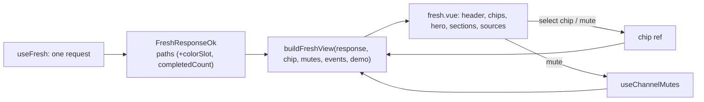

# Design Document: Fresh v2

## Overview

Fresh v2 replaces the page layer of the `fresh` spec. The Fresh_Endpoint, the daily check, ranking scores, mutes, saves and video events stay. The design changes three things:

1. **The view model.** `buildFreshView` in `shared/utils/fresh-view.ts` returns Hobby_Sections instead of a New_Section and a Best_Section, a cross-hobby Hero_Card, new counts and chips without "For <current skill>".
2. **The page components.** A carousel per hobby, an accordion Sources_Panel, a new header and new chips.
3. **One stored field per path, the Color_Slot**, in local storage, in the cloud `paths` table and in the Fresh_Endpoint response. Each `FreshPath` also gains `completedCount` for the "<completed> of <total> done" text.

Requirements: [requirements.md](requirements.md). Scenarios: [scenarios.md](scenarios.md). Base design: [fresh design](../fresh/design.md).

### What the code already gives us

| Finding | Where | Effect on this design |
|---|---|---|
| `buildFreshView` is one pure function; chips and mutes recompute it with no request | `shared/utils/fresh-view.ts`, `app/pages/fresh.vue` | Keep the shape: one pure function, rewritten for sections. Chip and mute changes stay request-free |
| `rankFreshItems`, `chooseHero`, `arrangeVariety`, `tasteAdjustments`, `sourceGroups`, `savedCards`, `freshUpdatedMs` exist | `shared/utils/fresh-rank.ts`, `fresh-view.ts` | Reused. `chooseHero` is replaced (cross-hobby rule). `bestPathOrder` is replaced by `pathOrder` |
| `FreshPath.activeAt` is set for signed-in paths (later of `last_opened_at` and `progress.updated_at`) and null for request paths | `server/utils/supabase-server.ts:177`, `server/utils/fresh/handlers.ts:296` | Path_Order sorts by `activeAt`. Signed-out bodies are already sent in local activity order (`orderByLocalActivity`), so the response-order fallback matches AS2 |
| `FreshPath` has no completed count and no color | `shared/types/fresh.ts` | Add `completedCount` and `colorSlot` |
| `HobbyRecord` has no color; `parseEntry` recomputes the id from the tree | `app/utils/hobby-store.ts` | Add `colorSlot`; missing slots are derived at parse time and written on the next write |
| Cloud paths are created by `save_generated_path` (RPC), by `toPathInsertRow` (undo of delete) and by the legacy import row builder | `supabase/migrations/20261110000000_goal_language.sql`, `app/utils/cloud-rows.ts`, `app/utils/legacy-import.ts` | A `before insert` trigger assigns the slot when the row has none, so every insert path is covered without changing the RPC signature. Undo and import send the known slot |
| `save_generated_path` updates an existing row on conflict without listing every column | migration above | The conflict branch leaves `color_slot` alone, so re-generating a hobby keeps its color |
| `WatchVideoCard` lazy-loads thumbnails (`loading="lazy"`) and reports skips with an `IntersectionObserver` on the viewport | `app/components/watch/WatchVideoCard.vue` | Lazy loading needs no new code (Req 6.6). The observer respects clipping by the carousel, so a card scrolled out sideways stops counting toward a skip |
| `createFreshActions.syncShown` stops the playing video only when its id leaves the shown set | `app/utils/fresh-actions.ts` | Scrolling a card out of view does not change the set, so it keeps playing (Req 7.2) |
| `tests/unit/contrast.test.ts` parses `themes.css` and checks 4.5:1 pairs | tests | Extended with the hobby pairs (Req 12.9) |
| Tailwind utilities come from `@theme inline` in `main.css`; class names must be static | `app/assets/css/main.css` | Hobby colors use one set of utilities (`bg-hobby`, `text-hobby-deep`, …) that read slot-specific variables chosen by a `data-hobby-slot` attribute |

### Key design decisions

1. **Slot colors through an attribute, not class names.** Each theme defines `--pursio-hobby-{1..5}`, `-deep` and `-ink`. `main.css` maps `[data-hobby-slot="n"]` to three generic variables (`--pursio-hobby`, `--pursio-hobby-deep`, `--pursio-hobby-ink`) and Tailwind gets `bg-hobby`, `bg-hobby-deep`, `text-hobby-deep`, `text-hobby-ink`. A component sets `:data-hobby-slot="slot"` on its root. Class names stay static, markup stays the same across themes, and a new theme only adds values.
2. **The slot is assigned where the row is created.** In the cloud, a `before insert` trigger picks it. Locally, `addHobby` picks it. Both use the same rule (`nextColorSlot`). A new cloud path appears in the client state (`upsertGenerated`) with the slot the client computes by the same rule. The next cloud load reads the stored value. The two can differ only when two devices create paths at the same moment. That race is accepted: the stored value wins on the next load and stays stable after that.
3. **Missing local slots are derived on read and saved on the next write.** `parseHobbyLibrary` fills a missing slot by walking the records in `addedAt` order. `serializeHobbyLibrary` writes every slot, so the first write after the upgrade (any add, archive, remove or active change) fixes the derived values. Before that write the derivation reads the same records, so it gives the same slots on every read (Req 9.7).
4. **One pass builds the whole page.** `buildFreshView` always computes every path's section under "All hobbies" first (`buildSections`). A Hobby_Chip then keeps only that path's section and picks that path's hero. The per-path "new" counts and chip badges come from the "All hobbies" pass, so they are equal under every chip (D-A).
5. **The carousel is CSS scrolling with thin script.** `overflow-x: auto`, `scroll-snap-type: x mandatory` and fixed card widths do the work. Script only shows and hides the arrows, scrolls by one step and brings a focused card into view. The arrow logic is a pure function so it can be tested without a DOM.
6. **The accordion state lives in the component, with a pure reducer.** `nextOpenGroups(open, selectedKey)` keeps the user's choices and adds the selected chip's group.

## Architecture

### Module layout

| Module | Change | Requirements |
|---|---|---|
| `shared/utils/color-slot.ts` | **New.** `COLOR_SLOT_COUNT = 5`, `isColorSlot`, `nextColorSlot`, `fillColorSlots` | 9.5–9.8 |
| `shared/types/fresh.ts` | `FreshPath` and `FreshRequestPath` gain `colorSlot` and `completedCount` | 4.3, 9.9 |
| `server/utils/fresh/handlers.ts` | Validate the new request fields (D-C); copy them into the scope path | 9.9 |
| `server/utils/supabase-server.ts` | Select `color_slot`; count completed Skills of the tree | 4.3, 9.9 |
| `supabase/migrations/20261117000000_path_color_slot.sql` | **New.** Column, backfill, trigger, `not null` | 9.5–9.7 |
| `app/utils/hobby-store.ts` | `HobbyRecord.colorSlot`; parse fills, serialize writes, `addHobby` assigns | 9.5–9.7 |
| `app/utils/cloud-rows.ts`, `cloud-library.ts`, `legacy-import.ts`, `shared/types/cloud.ts` | Read `color_slot`; send it on insert; assign for `upsertGenerated` | 9.5, 9.8 |
| `app/utils/fresh-request.ts` | `requestPath` sends `colorSlot` and `completedCount`; the Demo_Path uses slot 1 | 9.9 |
| `shared/utils/fresh-view.ts` | Rewritten view: Path_Order, chips, hero, sections, counts, sources | 1–5, 8, 10 |
| `app/utils/fresh-page.ts` | `freshPageState` for sections; `newTodayText`; `pathLink`; `nextOpenGroups` | 1.4, 4.7, 8.3, 10 |
| `app/utils/fresh-carousel.ts` | **New.** `carouselArrows`, `carouselStep` | 6.3, 6.4 |
| `app/assets/css/themes.css`, `main.css`, `app/pages/dev/theme.vue` | Hobby tokens, slot mapping, swatches | 9.1–9.4 |
| `app/components/fresh/*` | See Components | 1–8, 11 |
| `app/pages/fresh.vue` | New template; chip state; no Selected_Path | 1–11 |

### Data flow (unchanged shape)



Selecting a chip or a mute only recomputes `buildFreshView`. No request is sent (Req 2.5, 8.6).

## Components and Interfaces

### Color slots (`shared/utils/color-slot.ts`, Req 9.5–9.8)

```ts
export const COLOR_SLOT_COUNT = 5
export type ColorSlot = 1 | 2 | 3 | 4 | 5
export function isColorSlot(value: unknown): value is ColorSlot
/** Slot after `prev`, 5 → 1; null (no earlier path) → 1. */
export function nextColorSlot(prev: ColorSlot | null): ColorSlot
/**
 * Fills missing slots in creation order: each record without a slot gets
 * nextColorSlot(slot of the record created just before it). Records keep a valid
 * stored slot. Order: addedAt ascending, then input index. Returns slots by index.
 */
export function fillColorSlots(records: readonly { addedAt: number; colorSlot: ColorSlot | null }[]): ColorSlot[]
/** Slot for a new path: nextColorSlot(slot of the latest-created record), archived ones included. */
export function slotForNewPath(records: readonly { addedAt: number; colorSlot: ColorSlot }[]): ColorSlot
```

"Most recently created" uses `addedAt` (local) and `created_at` (cloud). Removed paths are gone from the list and no longer count. That is fine, because the rule only has to keep existing slots stable, which it does.

### Local Hobby_Library (`app/utils/hobby-store.ts`)

- `HobbyRecord` gains `colorSlot: ColorSlot`.
- `parseEntry` reads `colorSlot` when `isColorSlot`, else `null`. `parseHobbyLibrary` then runs `fillColorSlots` over the kept entries. No write happens on read (Req 9.7).
- `serializeHobbyLibrary` writes `colorSlot`.
- `addHobby` gives a new entry `slotForNewPath(library.hobbies)`. An entry with the same Hobby_Id keeps its slot.
- `archiveHobby`, `restoreHobby`, `removeHobby`, `undoRemoveHobby` and `setActiveHobby` copy records whole, so slots are untouched (Req 9.6). `undoRemoveHobby` puts back the removed record with its slot.
- `migrateLegacy` creates a record through the same path as `addHobby`, so it gets slot 1.

### Cloud paths

- **Migration** `supabase/migrations/20261117000000_path_color_slot.sql`:
  1. `alter table public.paths add column color_slot smallint check (color_slot between 1 and 5);`
  2. Backfill per user in creation order: `row_number() over (partition by user_id order by created_at, id)`, slot `((n - 1) % 5) + 1`. Archived rows are included (Req 9.7).
  3. Trigger function `public.assign_path_color_slot()` (`security invoker`, `set search_path = public`). It runs before each insert. When `new.color_slot` is null, it reads the slot of the user's row with the latest `created_at, id` and sets `(prev % 5) + 1`, or 1 when the user has no row. Row Level Security already lets the user read their own rows.
  4. `alter column color_slot set not null`.
  5. Rollback lines as comments, as in earlier migrations.
- `save_generated_path` is unchanged. A new row gets its slot from the trigger, and the conflict branch keeps the stored one.
- `cloud-rows.ts`: `pathRowSchema` gains `color_slot: z.number().int().min(1).max(5).nullable().optional()`. `buildCloudPaths` fills missing values with `fillColorSlots`, so a client running before the migration still works. `toPathInsertRow` and `PathInsertRow` gain `color_slot`.
- The `cloud-api.ts` select lists gain `color_slot`.
- `cloud-library.ts`: `toHobbyLibrary` copies the slot through `record`. `upsertGenerated` gives a new path `slotForNewPath` and keeps the slot of a replaced path.
- `legacy-import.ts`: the import row carries the local record's `colorSlot` (Req 9.8).

### Fresh_Endpoint fields (Req 9.9, 4.3)

```ts
// shared/types/fresh.ts
export interface FreshPath { /* existing */ colorSlot: ColorSlot; completedCount: number }
export interface FreshRequestPath { id; hobby; skills; currentSkillId; colorSlot: ColorSlot; completedCount: number }
```

- **Signed in** (`supabase-server.ts`): select `color_slot`. A null or invalid value (only possible before the migration) falls back to `fillColorSlots` over the rows in `created_at` order. `completedCount` is the number of progress `completed` ids that are Skill ids of the tree.
- **Signed out** (`handlers.ts` `parseRequest`): `colorSlot` is missing → 1; present and not a slot → `{ field: 'paths[i].colorSlot' }` (400). `completedCount` is missing → 0; present and not an integer in `[0, skills.length]` → `{ field: 'paths[i].completedCount' }` (D-C).
- **Client body** (`fresh-request.ts`): `requestPath(id, tree, progress, colorSlot)` counts completed Skills among the kept ones. `signedOutBody` passes each record's slot. `demoBody` passes 1 (Req 9.9).

### Theme tokens (Req 9.1–9.4)

`themes.css` gets 15 variables in each of `boulder`, `trail` and `halloween`. The suggested hues follow the mockup:

| Slot | Hue | Boulder starting point (tint / deep) |
|---|---|---|
| 1 | teal | `#d6e6e3` / `#2b6467` |
| 2 | coral | `#f5dcd3` / `#a83620` |
| 3 | ochre | `#f5e6c4` / `#7d5a0b` |
| 4 | green | `#dfe9d4` / `#3f6a2c` |
| 5 | plum | `#e9dcea` / `#6c3f74` |

`-ink` is the text color on `-deep`: light on a dark deep in the light themes, dark on a light deep in halloween. The final values are tuned until the contrast test passes for all four pairs of Req 9.2, in every theme. In halloween the tint is a dark surface and the deep is a light accent.

`main.css`:

```css
@theme inline {
  --color-hobby: var(--pursio-hobby);
  --color-hobby-deep: var(--pursio-hobby-deep);
  --color-hobby-ink: var(--pursio-hobby-ink);
}
[data-hobby-slot="1"] { --pursio-hobby: var(--pursio-hobby-1); --pursio-hobby-deep: var(--pursio-hobby-1-deep); --pursio-hobby-ink: var(--pursio-hobby-1-ink); }
/* … slots 2 to 5 */
```

`/dev/theme` shows one swatch row per slot (tint, deep, ink on deep, ink and muted on tint).

### View model (`shared/utils/fresh-view.ts`)

```ts
export type FilterChip = { kind: 'all' } | { kind: 'path'; pathId: string } | { kind: 'saved' }

export interface ChipView { key: string; chip: FilterChip; label: string; selected: boolean
  colorSlot: ColorSlot | null /* hobby chips */; newCount: number }

export type HeroBadge = 'today' | 'week' | 'best'
export interface HeroPathView { pathId: string; hobby: string; letter: string; colorSlot: ColorSlot }
export type HeroView =
  | { kind: 'fresh'; card: FreshItemCard; match: SkillMatch; skillTitle: string; isCurrentSkill: boolean; badge: 'today' | 'week'; path: HeroPathView }
  | { kind: 'pool'; card: PoolCard; match: SkillMatch; skillTitle: string; isCurrentSkill: true; badge: 'best'; path: HeroPathView }

export type SkillTagKind = 'current' | 'next' | 'other'
export type SectionCardView =
  | { kind: 'fresh'; card: FreshItemCard; match: SkillMatch; skillTitle: string; tag: SkillTagKind; isNew: boolean }
  | { kind: 'pool'; card: PoolCard; match: SkillMatch; skillTitle: string; tag: SkillTagKind }

export interface HobbySectionView {
  pathId: string; hobby: string; letter: string; colorSlot: ColorSlot
  currentSkillTitle: string | null; completedCount: number; totalCount: number
  newCount: number
  state: 'cards' | 'finished' | 'empty'
  cards: SectionCardView[]
}

export interface NewToday { videos: number; hobbies: number }

export interface SourceGroupView { key: string; pathId: string; hobby: string; colorSlot: ColorSlot; entries: SourceEntryView[] }

export interface FreshView {
  chip: FilterChip; chips: ChipView[]
  updatedMs: number | null
  newToday: NewToday | null          // null hides the header text (Req 1.5)
  hero: HeroView | null
  sections: HobbySectionView[]
  quietLine: boolean                 // Req 10.2
  state: 'content' | 'empty' | 'saved_empty'
  saved: SavedCardView[]
  sources: SourceGroupView[]
  defaultOpenSource: string | null   // Req 8.3
}

export interface FreshViewInput { response: FreshResponseOk; chip: FilterChip; mutes; events; demo: boolean }
```

`selectedPathId` leaves the input, since nothing depends on a Selected_Path any more. `resolveSelectedPath`, `headerLabel` and the `current` chip are removed.

#### `buildFreshView` steps

1. **Path_Order.** `pathOrder(paths)` sorts by `activeAt` descending. Null values go last, then response order (Req 2.2).
2. **Chips.** `freshChips(ordered, demo)` gives "All hobbies", then a Hobby_Chip per path only when there are 2 or more paths, then "Saved" outside Demo_Mode. An unknown or hidden requested chip falls back to "All hobbies" (Req 2.1, 2.6, 2.9).
3. **Scope for ranking.** Skills of every ordered path that has a `currentSkillId` (AS3). Shown_Items are items in that scope, not muted and published under 7 days. They are ranked once with `rankFreshItems`, using `selectedPathId` = the first ordered path, which only breaks closeness ties. Each item keeps its best match, so it belongs to exactly one path.
4. **"All hobbies" pass.** `allHero = chooseHeroAcross(ranked, ordered, pools, mutes, nowMs)`. Then `buildSections(ordered, allHero)` walks the paths in order and, for each path:
   - Takes its Shown_Items in rank order. It skips the hero id and ids already used, and applies the global Skill cap (3, the hero counted first) and the 12-card section cap.
   - Fills the remaining room with Video_Pool videos of the Current_Window in window order, ranked inside each Skill. It skips used or muted ids and applies the same caps.
   - Runs `arrangeVariety` over the whole section (D-B).
   - Sets `state` to `finished` when there is no Current_Skill, to `empty` when no card is left, else to `cards`.
   - Sets `newCount` to the number of cards with `isNew`, plus 1 when `allHero` is a New_Item of this path (D-A).
5. **Chip badges** take `newCount` from the "All hobbies" pass (Req 2.4).
6. **Selected scope.**
   - Under "All hobbies": hero = `allHero`, sections = all of them.
   - Under a Hobby_Chip: hero = `chooseHeroAcross` restricted to that path, and its one section is rebuilt with that hero. Its `newCount` stays the one from the "All hobbies" pass. The two values are equal by D-A, and a test checks it.
   - Under "Saved": `savedCards`, no hero, no sections.
7. **Header counts.** `newToday` = distinct video ids among the hero (when new) and the `isNew` cards of the sections shown, plus the number of those sections with `newCount > 0`. It is null when the video count is 0 or the chip is "Saved" (Req 1.4, 1.5).
8. **States.**
   - `quietLine`: no Fresh_Item in the hero or the sections, and at least one Video_Pool card is shown.
   - `state`: `empty` when there is no hero and no section has cards, `saved_empty` when "Saved" is selected and empty, else `content` (Req 10).
9. **Sources.** `sourceGroups` in Path_Order, each with its `pathId` and `colorSlot`. `defaultOpenSource` is the selected Hobby_Chip's group key, else the first group with entries.

`chooseHeroAcross(ranked, paths, …)`:
- The first ranked item whose match path has a Current_Skill. Its badge is `today` under 86400 s, else `week` (Req 3.1, 3.2).
- Else, for each path in order with a Current_Skill, the first pool video of that Current_Skill whose channel is not muted, with badge `best` (Req 3.4).
- `isCurrentSkill` is true when the matched Skill is the path's Current_Skill (Req 3.3).

Skill tag kind (Req 5.4): `current` when the Skill is the path's Current_Skill, `next` when it is in `windowSkillIds` but is not the Current_Skill, `other` otherwise. The card shows "Next: <title>" only for `next`.

`letter`: the first code point of the trimmed hobby, upper-cased with `toLocaleUpperCase()`. An empty hobby gives "?".

### Page helpers (`app/utils/fresh-page.ts`)

- `freshPageState(status, view, pathCount)` returns `{ kind: 'loading' | 'error' | 'no_paths' | 'content' | 'empty' | 'saved' | 'saved_empty'; chips; hero; sections; quietLine; sources }`. It replaces `newSection` and `bestSection` with `sections`.
- `newTodayText(n: NewToday): string` gives "1 new video today across 1 hobby" or "<n> new videos today across <m> hobbies".
- `pathLink(paths, pathId, demo)` gives `/path?demo=1` in Demo_Mode, else `hobbyPath(hobbyId ?? id)`. The Path page already sets the active hobby from `?hobby=` (Req 4.7).
- `nextOpenGroups(open: ReadonlySet<string>, selected: string | null): Set<string>` returns `open` plus `selected`, and is used on every chip change (Req 8.3). The user's toggles go through `toggleGroup(open, key)`.
- `skillLink` and `updatedLabel` are unchanged.

### Carousel helpers (`app/utils/fresh-carousel.ts`, Req 6.3, 6.4)

```ts
export const CAROUSEL_EDGE_PX = 2
/** Which arrows show: none when everything fits. */
export function carouselArrows(scrollLeft: number, scrollWidth: number, clientWidth: number): { prev: boolean; next: boolean }
/** Pixels for one arrow press: max(1, floor((clientWidth + gap) / (cardWidth + gap))) cards. */
export function carouselStep(clientWidth: number, cardWidth: number, gap: number): number
```

`prev` is `scrollLeft > EDGE` and `next` is `scrollLeft + clientWidth < scrollWidth - EDGE`. The tolerance absorbs fractional scroll positions.

### Components (`app/components/fresh/`)

| Component | Change | Notes |
|---|---|---|
| `FreshHeader.vue` | Update | Eyebrow "Updated …" (hidden when null), `h1` "Fresh". The new-today text is right-aligned at `lg` and hidden below it. The "Sources" button shows below `lg` and keeps `focusSources()` |
| `FreshFilterChips.vue` | Update | One row with `overflow-x-auto` and no wrapping. Each chip is a `button` with `aria-pressed`. Hobby chips set `data-hobby-slot` and show a `bg-hobby-deep` dot. The badge uses `bg-primary text-primary-ink`. The accessible name is "<hobby>, <n> new" |
| `FreshHeroCard.vue` | Update | Badge text from `badge`. The tag pill uses `bg-hobby` with a `FreshHobbyAvatar` (small), "<Hobby> · <skill>" and, when `isCurrentSkill`, "· your current skill". Two columns at `lg`, stacked below. Save is hidden in Demo_Mode |
| `FreshHobbyAvatar.vue` | **New** | A round letter avatar, `bg-hobby-deep text-hobby-ink`, in two sizes. `aria-hidden` (the hobby name is next to it) |
| `FreshHobbySection.vue` | **New** | A `section` with `data-hobby-slot` and `bg-hobby`, labelled by its `h2`. The header has the avatar, the name, the subtitle (desktop and mobile variants through `lg:` classes), the "n new" badge, and "Open path" (`lg` and up) or the avatar and name as a `NuxtLink` with a chevron (below `lg`). Then either `FreshCarousel` with `FreshVideoCard`s or the line "Path finished" / "No videos yet" |
| `FreshCarousel.vue` | **New** | Props `label` (hobby) and `labelledBy`. A scroll container `ul` (`overflow-x-auto snap-x snap-mandatory overscroll-x-contain`) whose `li` items are `snap-start shrink-0` with width classes per breakpoint. The prev and next buttons (`size-11`, hidden below `lg` and when `carouselArrows` says so) have the names "Previous videos in <hobby>" and "Next videos in <hobby>". A passive scroll listener and a `ResizeObserver` update the arrows. `focusin` calls `scrollIntoView({ block: 'nearest', inline: 'nearest' })` on the focused `li`. With `prefers-reduced-motion` the behavior is `auto`, else `smooth` |
| `FreshVideoCard.vue` | Update | Always the `stack` layout, so the thumbnail is on top. The skill tag pill shows a `bg-hobby-deep` dot and "Next: " for `next`. A "New" badge sits on the thumbnail. The why line shows only for Fresh_Items. A small save control (an icon button, `aria-pressed`, name "Save <title>" or "Remove <title> from saved") shows outside Demo_Mode |
| `FreshSourcesPanel.vue` | Rewrite | Heading, subtitle, one `FreshSourcesGroup` per group, and the closing line "Videos play from YouTube; nothing is copied." in `text-xs text-muted`. It gets `open: ReadonlySet<string>` and emits `toggle(key)` |
| `FreshSourcesGroup.vue` | **New** | The header is a `button` with `aria-expanded` and `aria-controls` when it has entries, showing a `bg-hobby-deep` dot, the hobby, "1 channel" / "<n> channels" and a chevron. With no entries it is a plain row with "none yet" and no chevron. The body lists the entries with `FreshMuteSwitch` outside Demo_Mode |
| `FreshSourcesSheet.vue` | Update | Passes `open` and `toggle` through |
| `FreshSection.vue` | Kept | Used only for the "Saved" grid |
| `FreshState.vue` | Kept | Same states. The `empty` text is shown above the header-only sections |

Card width classes. These are fractions of the scroll container's width, minus gaps, so they track the main column and not the window:
- below `sm` (640 px): `w-[calc((100%-0.75rem)/1.6)]`, about 1.6 cards;
- `sm` to below `lg`: `w-[calc((100%-1.5rem)/2.3)]`, about 2.3 (AS4);
- `lg` and up: `w-[calc((100%-2.25rem)/3.3)]`, about 3.3.

Tokens only: tints `bg-hobby`, accents `text-hobby-deep`, avatars `bg-hobby-deep text-hobby-ink`. Cards keep `bg-surface`, `border-line` and `text-ink`. No hex values appear in components (Req 1.6, 9.3).

### Page (`app/pages/fresh.vue`)

- `chip` starts as `{ kind: 'all' }` (Req 2.5). `selectedPathId` and its watcher go away.
- `shownIds` lists the hero id plus every section card id, or the saved ids under "Saved". `actions.syncShown()` keeps working, so a chip or mute change that removes the playing card stops it, and sideways scrolling does not (Req 7.2).
- `openSources = ref(new Set<string>())`. A watcher on `[view.chip, view.defaultOpenSource]` applies `nextOpenGroups`. The panel's `toggle` applies `toggleGroup`. The desktop panel and the mobile sheet share the state.
- The layout grid stays as it is (`lg:grid-cols-[minmax(0,1fr)_320px]`). The main column is `min-w-0`, so carousels never widen the page (Req 6.7).
- Demo_Mode wiring is unchanged: there is no recorder and no mutes, and `showSave` is false. `pathLink` gets `demo` (Req 11).

## Data Models

### Local storage

`pursio-hobbies:v1` keeps its key. Entries gain `"colorSlot": 1..5`. Old entries without the field still parse (decision 3 above), so no version bump is needed.

### Database

| Table | Column | Type | Rule |
|---|---|---|---|
| `paths` | `color_slot` | `smallint not null`, `check (color_slot between 1 and 5)` | Set by the trigger when an insert has none; never updated by the app |

There is no change to Row Level Security: the column is read and written by the row's owner like the other columns.

## Error Handling

- An invalid `colorSlot` or `completedCount` in a signed-out body returns 400 `invalid_input` with the field. The page shows the existing error state.
- A cloud row with a missing or invalid slot is filled on the client with `fillColorSlots` and on the server with the same helper. Nothing fails.
- If `ResizeObserver` or `scrollIntoView` is missing, the carousel still scrolls by touch and keyboard, and the arrows simply stay as last computed.
- Two devices creating paths at the same moment may get the same slot (decision 2). The colors repeat; nothing breaks.

## Correctness Properties

*A property is a characteristic or behavior that should hold true across all valid executions of a system-essentially, a formal statement about what the system should do. Properties serve as the bridge between human-readable specifications and machine-verifiable correctness guarantees.*

The property tests live in `tests/property/fresh-v2-*.property.test.ts`. Each runs at least 100 cases and carries a tag comment with the feature name `fresh-v2`, the property number and its title. Generators extend `tests/arbitraries.ts` and the fresh fakes with `colorSlot`, `completedCount` and `activeAt`.

Redundancy review: section size, the global uniqueness of ids, the Skill cap, mute exclusion and variety are one property over `buildFreshView` (Property 4), because they share one generator and one walk over the page. The "new" counts get their own property (Property 3) because they cross the header, the chips and the sections, and they compare two chip states. The local and cloud slot rules share `fillColorSlots` and `slotForNewPath`, so one property covers assignment and stability (Property 7), and a separate round trip covers the parse and serialize path (Property 8).

### Property 1: Path_Order

*For any* list of 1 to 6 paths with random `activeAt` (some null), the Hobby_Chips, the Hobby_Sections under "All hobbies" and the Sources_Panel groups list the same path ids in the same order. That order is sorted by `activeAt` descending, with null values last in response order.

**Validates: Requirements 2.2, 4.1, 8.2, 12.1**

### Property 2: Chip set

*For any* path count from 0 to 6, demo flag and requested chip (including unknown path ids), the chips are "All hobbies", then the Hobby_Chips only when there are 2 or more paths, then "Saved" unless in demo. Exactly one chip is selected. An unknown request selects "All hobbies". No chip has the kind `current`.

**Validates: Requirements 2.1, 2.5, 2.6, 2.9, 11.1, 12.2**

### Property 3: New counts agree

*For any* generated response and mutes:
- each Hobby_Chip's `newCount` equals its section's `newCount` under "All hobbies" and under that chip;
- a section's `newCount` equals its `isNew` cards plus 1 when the hero is a New_Item of that path;
- `newToday.videos` equals the distinct ids among the hero (when new) and the shown `isNew` cards;
- `newToday.hobbies` equals the shown sections with `newCount > 0`;
- `newToday` is null exactly when that count is 0 or the chip is "Saved";
- no muted channel and no item published 86400 s or more before `nowMs` is counted.

**Validates: Requirements 1.4, 1.5, 2.4, 4.4, 12.3**

### Property 4: Section composition

*For any* 1 to 5 paths (some with no Current_Skill), 0 to 50 Fresh_Items, 0 to 30 pool videos per Skill and random mutes, under "All hobbies" and every Hobby_Chip:
- every section holds at most 12 cards;
- no video id appears twice on the page, the hero included;
- no Skill has more than 3 cards across the hero and the sections;
- no card or hero has a muted channel;
- the Fresh_Items of a section keep their rank order;
- before the variety step every Fresh_Item comes ahead of every pool card;
- every Variety_Window before the first card placed at the end holds at most 2 cards of one channel;
- a path with no Current_Skill has state `finished` and no cards, and none of its Fresh_Items appear anywhere.

**Validates: Requirements 3.5, 4.8, 5.1, 5.5, 5.6, 12.5**

### Property 5: Hero choice

*For any* generated response, the hero is:
- the top-ranked Shown_Item among the paths in Scope with a Current_Skill, with badge `today` exactly when it was published under 86400 s before, else `week`;
- else the first non-muted pool video of the Current_Skill of the first path in Path_Order (within Scope) that has one, with badge `best`;
- else null.

It is null under "Saved". After muting the hero's channel, the hero is the result of the same rule on the new mutes.

**Validates: Requirements 3.1, 3.2, 3.4, 3.6, 3.7, 12.4**

### Property 6: Section text and tags

*For any* path and progress, the section shows `completedCount` and `totalCount` equal to the completed Skills and all Skills of the path, and `currentSkillTitle` equal to the title of its Current_Skill. Every card's tag is `next` exactly when its Skill is in the Current_Window and is not the Current_Skill.

**Validates: Requirements 4.3, 5.4, 12.6**

### Property 7: Color slot assignment and stability

*For any* sequence of creating, archiving, restoring, removing, undoing a removal and activating paths, applied to the local Hobby_Library:
- every new path gets `nextColorSlot` of the latest-created existing record, or 1 when there is none;
- no other operation changes any remaining record's slot;
- re-adding an existing Hobby_Id keeps its slot.

`upsertGenerated` gives the same results for cloud paths.

**Validates: Requirements 9.5, 9.6, 12.8**

### Property 8: Slot read and write round trip

*For any* stored library where each entry's `colorSlot` is valid, missing or invalid, parsing twice gives the same slots. Every valid stored slot is kept. Missing ones follow `fillColorSlots` in `addedAt` order. Serializing and parsing again gives the same slots.

**Validates: Requirements 9.7, 12.8**

### Property 9: Request fields

*For any* signed-out body whose paths carry a random `colorSlot` (valid, missing, 0, 6, fractional, a string) and `completedCount` (valid, missing, negative, above the Skill count), the handler returns 400 with the first invalid field when any present value is invalid. Otherwise every path's `FreshPath.colorSlot` and `completedCount` equal the sent values, or 1 and 0 when missing.

**Validates: Requirements 9.9, 12.8**

### Property 10: Carousel arrows

*For any* `scrollWidth ≥ clientWidth > 0` and `0 ≤ scrollLeft ≤ scrollWidth − clientWidth`, `prev` is shown exactly when `scrollLeft > 2` and `next` exactly when `scrollLeft + clientWidth < scrollWidth − 2`. Neither is shown when `scrollWidth − clientWidth ≤ 2`. `carouselStep` is at least one card width and never more than `clientWidth + gap`.

**Validates: Requirements 6.3, 6.4, 12.7**

### Property 11: Sources accordion

*For any* sequence of chip selections and toggles, the open set always contains the group of the most recently selected Hobby_Chip. Toggles of other groups are kept across chip changes. A group with no entries is never in the set.

**Validates: Requirements 8.3, 8.4, 8.5, 12.10**

## Testing Strategy

**Example tests** (Vitest, `tests/unit/`):
- `fresh-v2-view.test.ts`: the scenario rows A1 to A4, B1 to B5, B9, C1 to C6 and the hero labels, using a small fixed response.
- `fresh-v2-page.test.ts`: `newTodayText` singular and plural, `pathLink` with and without demo, `freshPageState` for every kind.
- `fresh-v2-carousel.test.ts`: the arrow step for 1, 3 and 4 visible cards.
- `fresh-v2-actions.test.ts`: a playing id stays playing when nothing changes the shown set, and stops when a chip or mute change drops it. Demo writes 0 events, 0 mutes and 0 snapshots (Req 12.11).
- `contrast.test.ts`: extended with every hobby pair in every theme, plus a check that each theme defines all 15 variables (Req 12.9).
- `hobby-store.test.ts`, `cloud-rows.test.ts`, `cloud-library.test.ts`, `fresh-request.test.ts` and `fresh-endpoint.test.ts`: the slot and count fields.
- A migration contract test in the style of `fresh-check-store-pg.test.ts`. It runs only when the local test database is configured, and checks the backfill order, the trigger's next slot and that conflict updates keep the slot.

**Tests updated, not added** (Req 12.12): the property tests `fresh-chip-scope`, `fresh-header`, `fresh-hero`, `fresh-sections`, `fresh-page-state`, `fresh-sources-panel`, `fresh-no-current-skill` and `fresh-mutes-view`, and the unit tests `fresh-view.test.ts`, `fresh-view-examples.test.ts` and `fresh-page.test.ts`. They are rewritten to the v2 rules or removed when a v2 property covers them. `fresh-variety`, `fresh-rank-*`, `fresh-taste`, `fresh-saved-list` and every server test stay unchanged.

**Manual checks** (no component test setup exists, see project memory): carousel swipe and snap on iOS Safari and Android Chrome, the arrows at desktop width, Tab through a carousel, reduced motion, all three themes on `/dev/theme`, the Sources sheet on mobile and Demo_Mode. The checklist goes in `changes.md`.
