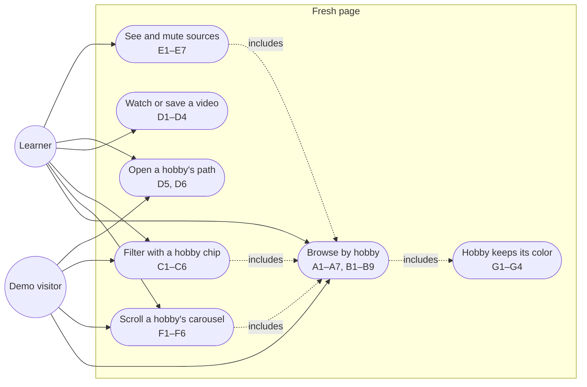
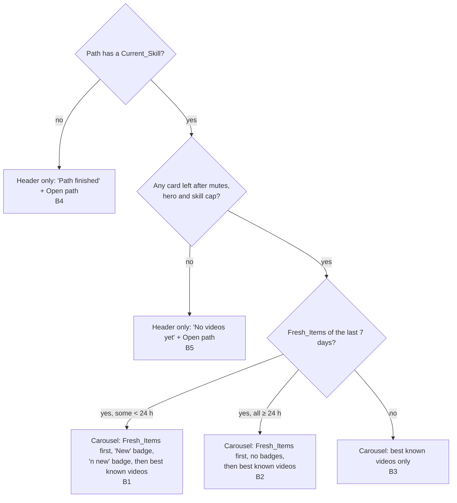
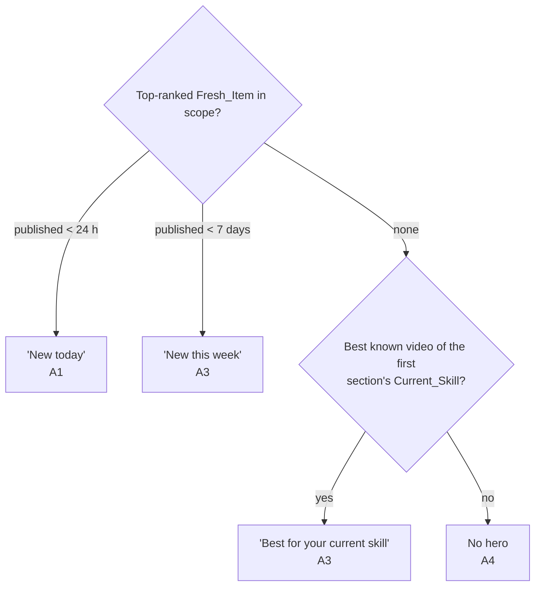

# Scenarios: Fresh v2 (grouped by hobby)

Fresh v2 redesigns the Fresh page around hobbies. Instead of one "New for your path" list and one "Best for your current skills" list, the page shows one tinted section per hobby, each a horizontal carousel, filtered by hobby chips. The Fresh_Endpoint, the daily check, ranking, mutes, saves and video events stay as in the `fresh` spec ([requirements](../fresh/requirements.md)). The only data change is a stored color slot per path (decision 1).

Layout references: `dev_docs/NEW · Fresh v2, desktop (grouped by hobby, try the chips)@1x.png` and `dev_docs/NEW · Fresh v2, mobile (scrolls)@1x.png`. They replace `Desktop · Fresh@1x.png` and `Mobile · Fresh@1x.png`. Where the decisions below differ from the mockups (carousels on desktop, the "done" count, the mobile path link), the decisions win.

### What changes, compared with the current page

| Area | Today (`fresh` spec) | Fresh v2 |
|---|---|---|
| Header | "Fresh", filter label, "Updated …" | Eyebrow "Updated 2h ago", title "Fresh", right-aligned "4 new videos today across 4 hobbies" on desktop, hidden when nothing is new |
| Chips | All skills · For <current skill> · one per hobby · Saved | All hobbies · one per hobby with a colored dot and a new-count badge · Saved. Row scrolls sideways. Single hobby chip hidden with one path |
| Hero | Hero of the Selected_Path, "New for <skill>" or "Best for your current skill" | Top-ranked video across the hobbies in scope. Badge "New today", "New this week" or "Best for your current skill". Tag "<avatar> <Hobby> · <skill> · your current skill" |
| Body | "New for your path" (max 24) + "Best for your current skills" (max 12) | One section per hobby, tinted in the hobby's color, as a horizontal carousel of up to 12 cards on every width |
| Section header | — | Avatar letter, hobby, "You're on <current skill> · <completed> of <total> done", "n new" badge, "Open path" (desktop) or a linked avatar and name with a chevron (mobile) |
| Cards | Skill tag = matched skill | Skill tag "<skill>" or "Next: <skill>" for later skills of the Current_Window; "New" badge; why line on new cards; save control on every card |
| Sources | Flat list per hobby with switches and a long note | Accordion per hobby: dot, hobby, "<n> channels" or "none yet", chevron. Several groups may be open. Subtitle on top, "Videos play from YouTube; nothing is copied." at the bottom |
| Colors | Theme tokens only | 5 hobby color slots per theme (tint, deep, ink). Each path stores its slot |

## Diagrams

### Use cases

### What a hobby section shows

### Hero label

## Scenarios

### A. Opening the page

| ID | Starting state | Action | Expected result | Covered by | Status |
|---|---|---|---|---|---|
| A1 | Signed in, 2+ paths, new videos today in some hobbies | Opens Fresh | Eyebrow "Updated <time>". Right text "<n> new videos today across <m> hobbies". "All hobbies" selected. Hero shows the top-ranked video across all hobbies with "New today". Sections follow, most recently active path first | 1.1, 1.2, 1.4, 2.1, 3.1–3.3 | Confirmed |
| A2 | 1 path | Opens Fresh | Chips "All hobbies" and "Saved" only. One section. Right text "<n> new videos today across 1 hobby" when something is new | 1.4, 2.6 | Confirmed |
| A3 | Nothing new today; Fresh_Items from the last 7 days or only best known videos | Opens Fresh | Right text hidden. Hero shows "New this week", or "Best for your current skill" with no Fresh_Item | 1.5, 3.2, 3.4 | Confirmed |
| A4 | Paths exist, no video in scope at all | Opens Fresh | No hero. Wick with "No videos yet. Pursio checks for new ones every day." Each section shows its header only | 3.6, 4.9, 10.3 | Confirmed |
| A5 | No paths | Opens Fresh | Same "no paths" state as today | 10.1 | Confirmed |
| A6 | Loading, request failed or timed out | Opens Fresh | Same loading and error states as today, "Try again" works | 10.4 | Confirmed |
| A7 | Mobile width | Opens Fresh | Header with "Sources" button, chip row, hero above the first section, sections below, bottom navigation | 1.3, 3.1 | Confirmed |

### B. Hobby sections

| ID | Starting state | Action | Expected result | Covered by | Status |
|---|---|---|---|---|---|
| B1 | Hobby has Fresh_Items, some under 24 h | Views its section | Header: avatar letter, hobby, "You're on <current skill> · <completed> of <total> done", "<n> new" badge (new videos shown on the page, hero included; see D-A in requirements), "Open path". Carousel of up to 12 cards: Fresh_Items first (ranked, variety rule), then best known videos of the Current_Window (the variety rule may move a new card behind a known one, D-B). Cards under 24 h show "New" and a why line | 4.1–4.6, 5.1–5.4 | Confirmed |
| B2 | Hobby has Fresh_Items, all older than 24 h | Views its section | Fresh_Items first with why lines, no "New" badges, no "n new" badge | 4.4, 5.2 | Confirmed |
| B3 | Hobby has no Fresh_Items, has best known videos | Views its section | Best known videos of the Current_Window, skill tags "<skill>" or "Next: <skill>", no why line, no "New" | 5.1, 5.3, 5.4 | Confirmed |
| B4 | Path finished (no Current_Skill) | Views the page | Header-only section: avatar, hobby, "Path finished", "Open path". No cards | 4.8 | Confirmed |
| B5 | Path has a Current_Skill, no card left after mutes, hero and skill cap | Views the page | Header-only section: "No videos yet", "Open path" | 4.9 | Confirmed |
| B6 | Hero video belongs to a hobby | Views that hobby's section | Hero video not repeated in the section | 3.5 | Confirmed |
| B7 | Several hobbies | Views the page | Sections in the chip order: most recently active path first | 2.2, 4.1 | Confirmed |
| B8 | Any section | Views it on any theme | Tint, deep and ink come from the path's color slot tokens; switching theme changes only token values | 9.1–9.4 | Confirmed |
| B9 | A skill has many videos | Views its section | At most 3 cards of one skill on the page, hero included | 5.5 | Confirmed |

### C. Chips

| ID | Starting state | Action | Expected result | Covered by | Status |
|---|---|---|---|---|---|
| C1 | 2+ paths | Looks at chips | "All hobbies", then one chip per hobby in section order with a colored dot and a badge with its new count (hidden at 0), then "Saved". Row scrolls sideways when it overflows | 2.1–2.4 | Confirmed |
| C2 | "All hobbies" selected | Selects a hobby chip | Hero and the right text narrow to that hobby; only that hobby's section shows, as the same carousel; no new request | 2.5, 3.1 | Confirmed |
| C3 | Hobby chip selected | Selects "All hobbies" | All sections back, mutes made in between still applied | 2.5 | Confirmed |
| C4 | Signed in | Selects "Saved" | Saved list as today, no hero; "No saved videos yet." when empty | 2.7 | Confirmed |
| C5 | — | Opens the page | No "For <current skill>" chip | 2.1 | Confirmed |
| C6 | Demo_Mode | Looks at chips | No "Saved" chip | 2.1, 11.1 | Confirmed |

### D. Watching, saving, opening a path

| ID | Starting state | Action | Expected result | Covered by | Status |
|---|---|---|---|---|---|
| D1 | Any card or the hero | Taps play or "Watch" | Plays in place, every other video stops, same events as today | 7.1 | Confirmed |
| D2 | A carousel card is playing | Swipes or scrolls it out of view | It keeps playing. Starting another video stops it. A chip or mute change that removes its card stops it | 7.2 | Confirmed |
| D3 | Signed in | Taps "Save" on the hero or the save control on any card | Same toggle and Save_Snapshot as today | 7.3 | Confirmed |
| D4 | Card with a skill tag | Taps the tag | Opens that path with the skill's sheet open, as today | 7.4 | Confirmed |
| D5 | Desktop, any section (cards or header-only) | Taps "Open path" | That hobby becomes the active hobby and `/path` opens (`/path?demo=1` in Demo_Mode) | 4.7 | Confirmed |
| D6 | Mobile | Taps the hobby avatar and name with the chevron | Same as D5 | 4.7 | Confirmed |

### E. Sources

| ID | Starting state | Action | Expected result | Covered by | Status |
|---|---|---|---|---|---|
| E1 | Desktop | Views the right column | "Your sources", subtitle "The channels Pursio checks every day, grouped by hobby.", one row per hobby in chip order: dot, hobby, "<n> channels" or "none yet", chevron; the line "Videos play from YouTube; nothing is copied." at the bottom | 8.1, 8.2, 8.7 | Confirmed |
| E2 | Page opens | Views the panel | The selected chip's hobby group is open, else the first hobby. Under "All hobbies" or "Saved", the first hobby | 8.3 | Confirmed |
| E3 | A group is open | Opens another group | Both stay open; each closes on its own | 8.4 | Confirmed |
| E4 | Signed in, group open | Toggles a channel switch | Channel's cards leave the hero and sections (or return); badges, counts and the right text update; no new request. Same switch state in every group with that channel | 8.6 | Confirmed |
| E5 | Hobby has no Channel_Source | Views its row | "none yet", no chevron, nothing to expand | 8.5 | Confirmed |
| E6 | Mobile | Taps "Sources" | Sheet with the same accordion; Escape or close returns focus to the button | 8.8 | Confirmed |
| E7 | Demo_Mode | Opens a group | Channel names only, no switches | 11.1 | Confirmed |

### F. Carousels

| ID | Starting state | Action | Expected result | Covered by | Status |
|---|---|---|---|---|---|
| F1 | Desktop, section with more cards than fit | Views it | About 3.3 cards visible, the partly visible card shows the row continues. "Next videos in <hobby>" arrow at the right end; no "Previous" arrow at the start | 6.1, 6.3 | Confirmed |
| F2 | Desktop, scrolled to the middle | Taps an arrow | Row scrolls and snaps to a card. Both arrows shown | 6.2, 6.4 | Confirmed |
| F3 | Desktop, scrolled to the end, or all cards fit | Views the row | The arrow for that direction is hidden | 6.3 | Confirmed |
| F4 | Mobile | Swipes the row | About 1.6 cards visible, snaps per card, no arrows | 6.1, 6.2 | Confirmed |
| F5 | Keyboard | Tabs through a section | Each card and its controls get focus in order, and the focused card scrolls into view | 6.5 | Confirmed |
| F6 | Long row | Scrolls | Thumbnails load as they come into view | 6.6 | Confirmed |

### G. Hobby colors

| ID | Starting state | Action | Expected result | Covered by | Status |
|---|---|---|---|---|---|
| G1 | User has paths with slots 1, 2, 3 | Creates a new path | It gets slot 4; after slot 5 the next path gets slot 1 | 9.5 | Confirmed |
| G2 | Several paths | Archives, restores or reorders paths, or another path becomes active | Each remaining path keeps its slot and color | 9.6 | Confirmed |
| G3 | Paths stored before this change (local or cloud) | Opens the app | Each gets a slot once, in creation order, and keeps it from then on | 9.7 | Confirmed |
| G4 | Signed-out user with local paths signs in | Local paths are uploaded | Each keeps its local slot | 9.8 | Confirmed |

## Owner decisions

All decided by the owner on 2026-11-17.

1. **Hobby colors.** 5 hobby color slots per theme, each with tint, deep and ink, each passing 4.5:1 for text on its tint. A path's slot is assigned once when the path is created and stored with the path, cycling after 5, so a hobby keeps its color when others are archived or reordered. Affects B8, C1, E1, G1–G4.
2. **Carousels.** Every hobby section is a horizontal carousel on all widths. Up to 12 cards per hobby, new ones first, same ranking and variety rules, hero video excluded. Card width shows about 3.3 cards in the desktop main column and about 1.6 on mobile. Scroll snapping per card. On desktop, previous and next arrow buttons at the row ends (44 px, accessible names "Previous videos in <hobby>" and "Next videos in <hobby>"), hidden when there is nothing more in that direction. Each card is reachable with Tab and scrolls into view on focus. Thumbnails load lazily. A hobby chip shows that hobby's section alone, with the same carousel. Affects B1, C2, F1–F6.
3. **Chip set.** "For <current skill>" is dropped; "Saved" stays at the end of the chip row. Affects C1, C4, C5.
4. **What counts as "new".** Published less than 24 h before the response, not muted, and the hero not counted twice. The same rule for the header text, the section "n new" badges and the chip badges. Affects A1, A3, B1, B2, C1.
5. **Header text with nothing new.** Hidden. Affects A3.
6. **Hero.** The top-ranked video across the hobbies in scope. Badge "New today" under 24 h, "New this week" under 7 days, otherwise "Best for your current skill". Affects A1, A3.
7. **Hero on mobile.** Shown above the first section. Affects A7.
8. **Order.** Sections and chips use the same order: most recently active path first (the later of last open and last progress save). Affects B7, C1, E1.
9. **One path.** The single hobby chip is hidden; "All hobbies" and "Saved" stay. Affects A2.
10. **Skill progress text.** "You're on <current skill> · <completed> of <total> done". Affects B1.
11. **Finished paths and empty hobbies.** A compact header-only section with "Path finished" or "No videos yet" and "Open path". Affects B4, B5.
12. **Carousel playback.** A video keeps playing when swiped out of view; the one-at-a-time rule still applies. Affects D2.
13. **Save on cards.** A small save control on every card outside Demo_Mode, not only on the hero. Affects D3.
14. **Path link on mobile.** The hobby avatar and name are a link to the path, with a chevron. Affects D6.
15. **Sources note.** "Videos play from YouTube; nothing is copied." stays as a small line at the bottom of the Sources panel. Affects E1.
16. **Accordion.** The selected chip's hobby group opens first, else the first hobby. Several groups may be open at once. Affects E2, E3.
17. **Guitar "1 new" with no sources in the mockup** is a sample-data slip. New videos only come from Channel_Sources.

## Open decisions

- None. The assumptions made while writing the requirements are listed under "Assumptions" in [requirements.md](requirements.md).

## To verify

- Nothing open.
