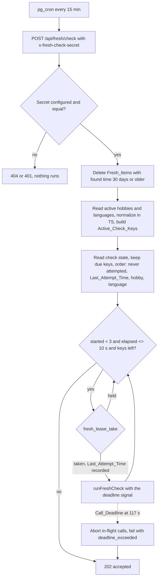
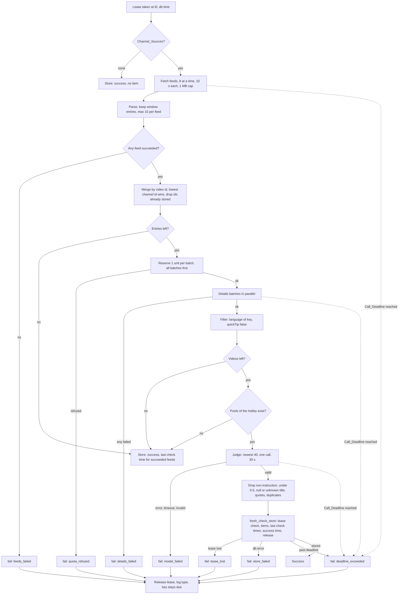
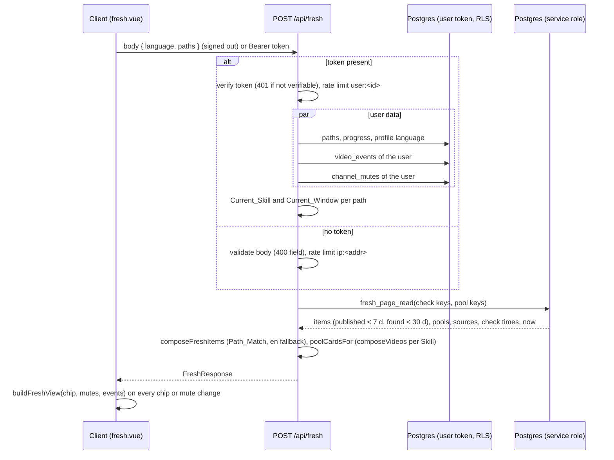

# Design Document: Fresh

## Overview

Fresh adds a page at `/fresh` that shows new YouTube videos for the hobbies on the user's paths, sorted into the user's Skills, followed by the best Video_Pool videos for the user's Current_Windows. New videos come from a daily Fresh_Check per Check_Key (Normalized hobby, Language_Code): the Server reads the public RSS (Atom) feed of each Channel_Source, gets details, runs the existing filter, and sends the survivors to the Judge in one model call.

The design extends the `skill-video-pipeline` modules and keeps their rules: server-only tables behind `security definer` functions, a secret-protected route called by pg_cron through pg_net, the Quota_Gate, the Default_Config Judge adapter, the ranking helpers and the Video_Event recorder. Fresh adds no new dependency. The Atom parser is a small built-in scanner for the fixed YouTube feed shape (Decision 3).

### What the code already gives us

These findings come from reading the code, not the earlier design, where they differ:

| Finding | Where | Effect on this design |
| --- | --- | --- |
| `video_pool_store(p_key, p_run, p_videos)` stores a pool, deletes the lease and the fill row in one transaction | `supabase/migrations/20261110000100_video_pipeline.sql` | Channel_Source upkeep goes inside a replaced version of this function, so it shares the transaction (Req 1.6) |
| `PoolVideo`, `SearchHit`, `VideoDetails`, `RankedVideo` carry no channel id | `shared/types/video.ts`, `server/utils/video/provider.ts` | Add `channelId: string \| null`; the YouTube provider reads `snippet.channelId` |
| `applyVerdicts` keeps up to 3 videos at `teaches_this_skill >= 0.3` when none reach 0.5 (relaxed rule) | `server/utils/video/judge.ts` | The Fresh Judge does not use this rule (Req 6.7 is strict at 0.5). Relaxed pool videos are below 0.7, so they never qualify a Channel_Source |
| `isStale(age, count)` gives empty pools a 1-day expiry | `server/utils/video/pool.ts` | No effect on Fresh |
| `handleDrainRequest` checks a header secret with `secretsMatch` (hash plus constant-time compare) and awaits its work | `server/utils/video/handlers.ts` | The Check_Route reuses `secretsMatch` and the same 404/401 rules |
| `nitro.vercel.functions.maxDuration` is 60 and is written to the one `.vc-config.json` of the server bundle | `nuxt.config.ts`, `node_modules/nitropack/dist/presets/vercel/utils.mjs` (nitropack 2.13.6) | Nitro has no per-route function option. With `compatibilityDate` at or after 2025-07-15 it writes one `.func` per API route as a symlink to the same bundle, so all share one config. The Check_Route gets its own 120 s config through a build hook (see Serverless timing) |
| `languageCode(null \| undefined \| '' \| whitespace)` already returns `'en'`; only non-empty text without a valid primary subtag returns `'und'` | `shared/utils/video-normalize.ts` | Every Check_Key is built through `languageCode`, so a missing language gives `en` (decision D15) |
| `video_leases` is keyed by free text with `video_lease_take` / `video_lease_release` | pipeline migration | The Fresh Lease reuses this table with the key `fresh:` + Check_Key JSON |
| `mergeEvents` and `merge_video_events` merge per column; local storage keeps only unsent records | `shared/utils/video-events.ts`, `app/utils/video-events-store.ts` | Save_Snapshot is a new column merged by the same rule; a Signed_In_User's full event list comes from the Fresh_Endpoint |
| `paths` has no open time; `progress.updated_at` is set by a trigger on every progress write | `supabase/migrations/20261108000000_schema.sql` | Add `paths.last_opened_at`; Active_Path uses the later of the two |
| `PathNavItems.vue` shows 3 items at `w-28` (336 px) | `app/components/path/PathNavItems.vue` | 4 items need `w-22` (4 × 88 px = 352 px, fits 390 px) |
| `/path?hobby=<id>` opens a hobby; there is no way to open a Skill_Sheet from the URL | `app/utils/hobby-store.ts`, `app/pages/path.vue` | Add a `skill` query parameter |
| Demo_Mode is `/path?demo=1` with the Sample_Tree (`data/sample-bouldering.json`); the second demo hobby is a label with no tree | `app/pages/path.vue`, `app/utils/demo-placeholders.ts` | The Demo_Paths are the one Sample_Tree path |
| fast-check 4.10.2 and Vitest 5.1.0 are in `devDependencies` | `package.json` | Property tests use fast-check; no new test dependency |

### Key design decisions

1. **Ranking runs on the Client, from pure shared functions.** The Fresh_Endpoint returns candidate items with their raw scores, the ranked Video_Pool videos per Skill, the Channel_Sources, the check times and (for a Signed_In_User) the user's Channel_Mutes and Video_Events. `shared/utils/fresh-rank.ts` and `shared/utils/fresh-view.ts` compute the Fresh_Score, Hero_Card, sections, variety and empty states. Chip changes and mute changes then need no new request (Req 14.8, 15.6) and the same code runs in tests.
2. **The Lease reuses `video_leases`.** Key `fresh:["<hobby>","<language>"]`. A new function `fresh_lease_take` takes it and records the Last_Attempt_Time in the same statement, so a check the platform kills still counts as attempted.
3. **The Atom parser is built in.** `server/utils/fresh/feed-parser.ts` is a small XML scanner (about 200 lines) that checks tag balance, rejects `<!DOCTYPE>` and unknown entities, requires the root `<feed xmlns="http://www.w3.org/2005/Atom">`, and reads `yt:videoId`, `yt:channelId`, `title` and `published` from each `<entry>`. No dependency is added (Req 18.4, resolved Q5).
4. **Channel_Source upkeep is SQL inside the pool store transaction.** `video_pool_store` is replaced by a version that calls `fresh_sources_refresh(hobby, language)` before it returns. A TypeScript mirror (`rankChannelSources`) drives the in-memory store and the property test; a contract test keeps both aligned.
5. **Normalization stays in TypeScript.** SQL never re-implements `normalizeText`. The Check_Route reads raw hobby texts of Active_Paths from Postgres and normalizes them in TypeScript. `video_pools` gets plain columns `hobby_norm`, `skill_norm` and `language`, written by the store function from the Pool_Key (which already holds Normalized parts).
6. **Save_Snapshot is a field of the Video_Event**, not a separate store (decision D2). It travels through `serializeEvent`, `parseEvent`, `mergeEvents`, the local store and `merge_video_events`.
7. **Demo_Mode never writes.** The Fresh_Page in Demo_Mode builds the Signed_Out_User body from the Sample_Tree and its local Progress, does not mount the recorder or the mute store, and hides every control that would write (decision D13).
8. **The Check_Route alone runs with 120 s.** A Nuxt build hook gives `/api/fresh/check` its own Vercel function with `maxDuration: 120`; every other route stays on the 60 s bundle. Every Check_Route call has a Call_Deadline at `callStart + 117 s`, enforced by one abort signal and by the store function (decision D12, Req 3.8, 3.15).
9. **Closeness is per path.** Each Path_Match is scored against its own path (1.0, 0.8, 0.6). There is no 0.4 value and no reference path in the ranking (decision D14).
10. **A missing language is `en`.** Every Check_Key and every Fresh_Endpoint language goes through `languageCode`, which maps a missing or empty value to `en`. No code path writes `'und'` for a missing language (decision D15).
11. **Completed paths have no window.** A path with no Current_Skill has an empty Current_Window: it contributes Fresh_Items (closeness 0.6) and Channel_Sources, but no pool videos and no Hero_Card fallback (decision D16, Req 8.17).

## Architecture

### Module layout

Files marked **new** are created; files marked **change** exist and are extended.

```
shared/types/fresh.ts                    new    CheckKey, FeedEntry, SaveSnapshot, ChannelMute, FreshRequest, FreshResponse, card and view types
shared/types/video.ts                    change channelId on PoolVideo and RankedVideo; snapshot on VideoEvent
shared/utils/video-ranking.ts            new    baseScore, goalAdjustment, GOAL_BONUS moved here (pure, Client-safe)
shared/utils/video-events.ts             change snapshot in newEvent/applySave/mergeEvents/serialize/parse; snapshotCanonical
shared/utils/channel-mutes.ts            new    isValidChannelId, mergeMute, mergeMuteLists, parseMute, serializeMute
shared/utils/fresh-rank.ts               new    recencyFactor, closenessFactor, bestMatch, tasteAdjustments, freshScore, rankFreshItems, arrangeVariety, bestList
shared/utils/fresh-view.ts               new    chip scope, chooseHero, buildFreshView, headerLabel, relativeTime, savedCards
shared/utils/fresh-keys.ts               new    checkKey, checkKeyId, freshLeaseKey, checkKeysForPath, compareCodePoints

server/utils/video/provider.ts           change channelId on SearchHit and VideoDetails
server/utils/video/youtube-provider.ts   change read snippet.channelId
server/utils/video/judge.ts              change copy channelId into PoolVideo; export truncateDescription
server/utils/video/compose.ts            change copy channelId into RankedVideo
server/utils/video/ranking.ts            change re-export baseScore, goalAdjustment, GOAL_BONUS from shared; keeps rankVideos
server/utils/video/runtime.ts            change expose the service-role client and the quota gate factory on VideoRuntime
server/utils/video/handlers.ts           change export the shared token/limit helpers used by the Fresh handlers (no behavior change)

server/utils/fresh/feed-parser.ts        new    parseChannelFeed(xml): FeedEntry[] | FeedError
server/utils/fresh/feed-fetch.ts         new    fetchChannelFeed(channelId, opts): 10 s timeout, 1 MB cap, no key
server/utils/fresh/feed-window.ts        new    keepEntries, mergeEntries, chooseForJudge (pure)
server/utils/fresh/fresh-judge.ts        new    freshVerdictSchema, buildFreshJudgeInput, applyFreshVerdicts, quotesSource (pure)
server/utils/fresh/sources.ts            new    rankChannelSources, refreshSources (pure mirror of the SQL)
server/utils/fresh/schedule.ts           new    activeCheckKeys, isDue, dueOrder (pure)
server/utils/fresh/check.ts              new    runFreshCheck(key, deps): feeds, details, filter, Judge, store
server/utils/fresh/check-store.ts        new    FreshStore interface
server/utils/fresh/check-store-pg.ts     new    Postgres FreshStore over the service-role client
server/utils/fresh/check-store-memory.ts new    In-memory FreshStore with an injected clock (tests)
server/utils/fresh/compose.ts            new    composeFreshItems (Path_Match, en fallback, dedupe), poolCardsFor
server/utils/fresh/handlers.ts           new    handleCheckRequest, handleFreshRequest, parseFreshRequest
server/utils/fresh/runtime.ts            new    wires deps from videoRuntime(), the check secret and a limiter
server/utils/supabase-server.ts          change loadFreshUserData(token): paths, progress, profile language, events, mutes
server/prompts/fresh-judge.md            new    Fresh Judge system prompt
server/api/fresh.post.ts                 new    POST /api/fresh (Fresh_Endpoint)
server/api/fresh/check.post.ts           new    POST /api/fresh/check (Check_Route)

supabase/migrations/20261112000000_fresh_tables.sql   new  video_pools columns, Channel_Sources, Fresh_Items, check state, functions, new video_pool_store
supabase/migrations/20261112000100_fresh_user.sql     new  paths.last_opened_at, touch_path_opened, channel_mutes, video_events.snapshot, new merge_video_events
supabase/migrations/20261112000200_fresh_check_cron.sql new pg_cron + pg_net job every 15 minutes

app/pages/fresh.vue                      new    Fresh_Page (AppShell, desktop 3 columns, mobile 1 column)
app/components/fresh/FreshHeader.vue     new    Title, filter label, "Updated <time>", mobile "Sources" button
app/components/fresh/FreshFilterChips.vue new   Chip row (radio-group semantics)
app/components/fresh/FreshHeroCard.vue   new    Hero_Card with Watch and Save
app/components/fresh/FreshSection.vue    new    Heading plus responsive grid or list
app/components/fresh/FreshVideoCard.vue  new    Wraps WatchVideoCard with Why_Line, skill tag, "New" badge, save control
app/components/fresh/FreshSaveButton.vue new    Toggle button with aria-pressed
app/components/fresh/FreshSourcesPanel.vue new  "Your sources" groups, mute switches, note
app/components/fresh/FreshSourcesSheet.vue new  Mobile sheet with focus trap and Escape
app/components/fresh/FreshMuteSwitch.vue new    role="switch" with full accessible name
app/components/fresh/FreshState.vue      new    Wick states: loading, no paths, quiet, empty, error, saved empty
app/components/watch/WatchVideoCard.vue  change optional `layout` ('stack' | 'list'), `meta` and `actions` slots, tab-visibility check for skips
app/components/path/PathNavItems.vue     change Fresh item, Demo_Mode links, 4-item widths
app/components/path/PathView.vue         change optional initialSkillId opens that Skill_Sheet
app/pages/path.vue                       change read `skill` query; call touchPathOpened for cloud paths
app/composables/useFresh.ts              new    Request, 10 s timeout, retry, state, 60 s relative-time tick
app/composables/useChannelMutes.ts       new    Local and cloud mute store with merge, retry and sign-in move
app/composables/useVideoEvents.ts        change recordSave takes an optional snapshot; exposes mergedEvents(cloudRows)
app/utils/fresh-api.ts                   new    Typed client and response parser for POST /api/fresh
app/utils/fresh-request.ts               new    Signed-out and Demo_Mode request body from local paths
app/utils/channel-mutes-store.ts         new    localStorage store `pursio-channel-mutes:v1`
app/utils/video-events-store.ts          change no code change beyond the snapshot field carried by parse/serialize
app/utils/cloud-api.ts                   change mergeChannelMutes, touchPathOpened
nuxt.config.ts                           change runtimeConfig.freshCheckSecret; 'nitro:init' hook that registers the Check_Route duration step
build/vercel-function-duration.ts        new    Build step: gives functions/api/fresh/check.func its own .vc-config.json with maxDuration 120
env example file                         change NUXT_FRESH_CHECK_SECRET placeholder
tests/support/feed-printer.ts            new    Feed_Printer (test helper, Req 4.11)
tests/support/fresh-fakes.ts             new    Fake feed fetcher, fake provider and Judge, fixed clock
```

Nested `server/utils/fresh/*` modules are imported explicitly, as the video modules are.

### Boundaries

- Only the Server fetches Channel_Feeds, and only from `https://www.youtube.com/feeds/videos.xml?channel_id=<id>`. The channel id is checked against `^[A-Za-z0-9_-]{1,64}$` and URL-encoded, so the host and path are fixed.
- The Client calls `POST /api/fresh` only. It never calls the Check_Route or the provider data API (Req 18.3, 18.7). Snapshot thumbnails render only when their host is `i.ytimg.com`; any other URL shows the neutral thumbnail block, so a stored snapshot cannot make the Client contact another host.
- The Fresh_Endpoint has no provider, feed or model dependency in its deps type. A unit test checks the deps object, and an import-boundary test checks that `server/utils/fresh/handlers.ts` `handleFreshRequest` does not import `check.ts`, `feed-fetch.ts` or the provider (Req 3.11, 8.6).

### Check_Route flow



### One Fresh_Check



### Fresh_Endpoint flow



### Serverless timing (120 s for the Check_Route only)

Decision D12: the Check_Route runs with `maxDuration` 120 s, every other function keeps 60 s, and every Check_Route call has a Call_Deadline at `callStart + 117 s`. Vercel allows up to 300 s by default on all plans with Fluid compute ([Vercel Functions Limits](https://vercel.com/docs/functions/limitations)), so 120 s needs no plan change.

#### Scoping 120 s to `/api/fresh/check`

Checked against the installed nitropack 2.13.6 (`node_modules/nitropack/dist/presets/vercel/utils.mjs`):

- `generateFunctionFiles` writes one `.vc-config.json` into the server bundle (`.vercel/output/functions/__fallback.func`), spreading `nitro.vercel.functions` into it. That is where today's `maxDuration: 60` lands.
- Because `compatibilityDate` (`2026-11-08`) is at or after `2025-07-15`, `getObservabilityRoutes` also creates one function directory per scanned route, for example `functions/api/fresh/check.func`, as a **symlink** to `__fallback.func`, and adds a `config.json` route `{ src: '/api/fresh/check', dest: '/api/fresh/check' }` before the `/(.*)` fallback. The symlinks share the bundle's `.vc-config.json`, so they share its `maxDuration`.
- The preset has no per-route function option, and a `functions` block in `vercel.json` does not apply to a prebuilt Build Output API v3 directory.

So the design replaces that one symlink with a real copy of the bundle that has its own config, after Nitro has written its files:

```ts
// build/vercel-function-duration.ts
import { cp, lstat, readFile, rm, writeFile } from 'node:fs/promises'
import { join, resolve } from 'node:path'
import type { Nitro } from 'nitropack'

/** Routes that need a longer Vercel limit than nitro.vercel.functions.maxDuration. */
export const ROUTE_MAX_DURATION: Readonly<Record<string, number>> = { '/api/fresh/check': 120 }

export function registerRouteDurations(nitro: Nitro): void {
  if (nitro.options.preset !== 'vercel') return            // dev and other presets: nothing to do
  nitro.hooks.hook('compiled', async () => {
    const bundleDir = nitro.options.output.serverDir        // .vercel/output/functions/__fallback.func
    const functionsDir = resolve(bundleDir, '..')
    const base: Record<string, unknown> = JSON.parse(await readFile(join(bundleDir, '.vc-config.json'), 'utf8'))
    for (const [route, maxDuration] of Object.entries(ROUTE_MAX_DURATION)) {
      const funcDir = join(functionsDir, `${route.slice(1)}.func`)
      const entry = await lstat(funcDir).catch(() => null)
      // Fail the build loudly if Nitro stops creating the per-route function.
      if (!entry?.isSymbolicLink()) throw new Error(`[vercel-function-duration] no Nitro function for ${route}`)
      await rm(funcDir)
      await cp(bundleDir, funcDir, { recursive: true, dereference: true })
      await writeFile(join(funcDir, '.vc-config.json'), JSON.stringify({ ...base, maxDuration }, null, 2))
    }
  })
}
```

```ts
// nuxt.config.ts (additions only)
import { registerRouteDurations } from './build/vercel-function-duration'

export default defineNuxtConfig({
  // ...
  hooks: {
    // Registered after the preset's own 'compiled' hook, which writes the function files.
    'nitro:init'(nitro) { registerRouteDurations(nitro) },
  },
  nitro: {
    preset: 'vercel',
    // Default for every function. /api/fresh/check gets 120 s (build/vercel-function-duration.ts).
    vercel: { functions: { maxDuration: 60 } },
    // ...
  },
})
```

The preset's hooks are added when Nitro is created; `nitro:init` runs after that, and hookable runs `compiled` handlers one after another in the order they were added, so the copy runs after Nitro wrote the symlink and the bundle config. The existing route entry already sends `/api/fresh/check` to `functions/api/fresh/check.func`, so no `config.json` change is needed. The copy duplicates the server bundle once (a few MB, far under Vercel's 250 MB function size limit). A smoke test runs after `yarn build` and checks that `functions/api/fresh/check.func/.vc-config.json` has `maxDuration` 120 and is not a symlink, and that `__fallback.func/.vc-config.json` and every other `.func` still resolve to 60 (Req 3.8).

#### Worst case of one Fresh_Check

Requirement 3 lets the Check_Route start a new Fresh_Check up to 10 s after the call starts and lets it run until it ends or the Call_Deadline. Checks run one after another, so a check that starts at 10 s is the last one. Its worst case with the requirement timeouts is:

| Stage | Worst case | Reason |
| --- | --- | --- |
| Start offset | 10 s | Start_Window (Req 3.8) |
| Feeds | 20 s | 15 Channel_Sources, 8 in parallel, so 2 rounds of at most 10 s (Req 4.1, 4.4) |
| Details | 20 s | at most 225 entries (15 × 15) give 5 batches, run in parallel; 10 s plus the provider's single retry (Req 5.3) |
| Judge | 30 s | Req 6.1, 6.6 |
| Store | about 1 s | one RPC |
| **Total** | **about 81 s** | under the 117 s Call_Deadline and the 120 s limit |

The requirement timeouts alone fit, so the Call_Deadline only acts on stalls that no per-call timeout covers (a slow body stream, a stalled database call, a provider that keeps a socket open). Three mechanisms keep a stall orderly:

1. **Parallel details batches.** All quota units are reserved first, one by one (fast database calls). If any reservation is refused, no batch is called (Req 5.2). Otherwise the batches run in parallel, so the stage costs one provider timeout instead of five. If any batch fails, the check fails and no batch's videos reach the filter (Req 5.3).
2. **The Call_Deadline as one abort signal.** `handleCheckRequest` computes `deadlineMs = callStart + 117_000` and creates one `AbortSignal` that fires then (from an injected timer, so tests drive it with the fake clock). Every feed fetch, details call and Judge call of every check combines its own timeout with this signal (`AbortSignal.any`), so the 10 s and 30 s limits end earlier when the deadline comes first (Req 4.4, 5.3, 6.6). Database calls of the check are raced against the same signal. When the signal has fired, `runFreshCheck` returns `deadline_exceeded`, whatever stage it was in and even if some feeds had already succeeded (Req 3.15, 4.4). It releases the Lease (best effort) and the key stays due. The handler then responds 202, about 3 s before the 120 s limit.
3. **No late store.** The store step is not started when fewer than 3 s remain before the Call_Deadline (after `callStart + 114 s`); the check fails with `deadline_exceeded`. `fresh_check_store` also takes `p_deadline_ms`, the Call_Deadline in database time (the db `now` of the check-state read plus the time left at that read). The function returns `'deadline_exceeded'` and writes nothing when `clock_timestamp()` is past it, so a store request the Server already gave up on cannot commit later. Nothing is ever half stored, because the only write is the single store transaction (Req 7.5).

If the platform still ends the function, nothing has been written except the Lease and the Last_Attempt_Time. The Lease expires after 300 s, the key stays due, and the Last_Attempt_Time moves it behind keys that were not attempted, so one slow hobby cannot block the others.

The pg_cron job calls the route with a pg_net timeout of 120 s, matching the function limit. pg_net only stops waiting for the answer; the function keeps running.

## Components and Interfaces

### Keys (`shared/utils/fresh-keys.ts`)

```ts
export interface CheckKey { hobby: string /* Normalized */; language: string /* Language_Code */ }
/**
 * Builds a key from raw texts: normalizeText(hobby), languageCode(language).
 * A null, undefined, empty or whitespace-only language gives 'en' (decision D15).
 */
export function checkKey(hobby: string, language: string | null | undefined): CheckKey
/** JSON text ["hobby","language"], injective like poolKey. */
export function checkKeyId(key: CheckKey): string
/** Lease key in video_leases. Cannot collide with a Pool_Key (a 4-element JSON array). */
export function freshLeaseKey(key: CheckKey): string            // 'fresh:' + checkKeyId(key)
/** The user-language key, plus the 'en' key when that language is not 'en'. A missing language gives only the 'en' key. */
export function checkKeysForPath(hobby: string, language: string | null | undefined): CheckKey[]
/** Code point order, equal to UTF-8 byte order and to Postgres `collate "C"`. */
export function compareCodePoints(a: string, b: string): number
```

All tie-breaks "ascending" on ids or names use `compareCodePoints`, and the SQL side uses `collate "C"`, so both sides order the same way.

**Language rule (decision D15).** `checkKey`, `checkKeysForPath`, `activeCheckKeys` and the Fresh_Endpoint all reduce a language with the existing `languageCode`, which returns `'en'` for `null`, `undefined`, `''` and whitespace-only text (`skill-video-pipeline` Req 10.1). No other function maps a language, and SQL never coalesces a language: `fresh_active_hobbies` returns `profiles.language` as stored (possibly null) and TypeScript reduces it. So a missing profile or request language never forms a Check_Key with `'und'` (Req 3.16, 8.16). `'und'` remains possible only for non-empty text with no valid primary subtag, as in the skill pipeline.

### Channel_Sources (Req 1)

The SQL function `fresh_sources_refresh(p_hobby text, p_language text, p_new_videos jsonb)` runs inside the new `video_pool_store`, after the pool upsert:

1. Counts, for the Check_Key, the distinct video ids per channel id over every stored pool with `hobby_norm = p_hobby and language = p_language` whose `teachesThisSkill >= 0.7` and whose `channelId` is a non-empty string (Req 1.3, 1.7).
2. For every channel of a Qualifying_Video in `p_new_videos` (the pool just stored): upserts the Channel_Source with the channel name of the first such video in pool order, the new count, and `latest_qualifying_at = now()`. `last_checked_at` is not touched (Req 1.1, 1.2).
3. Sets the count of every other Channel_Source of the key from step 1 (0 when absent), then deletes sources with count 0 (Req 1.4).
4. Deletes every source ranked 16th or lower by `qualifying_count desc, latest_qualifying_at desc, channel_id collate "C" asc` (Req 1.5).

All four steps run in the store transaction. An error rolls the pool store back too (Req 1.6). A pool without Qualifying_Videos with channel ids adds nothing and still stores (Req 1.8).

TypeScript mirror (`server/utils/fresh/sources.ts`), used by the in-memory store and by tests:

```ts
export const QUALIFYING_MIN = 0.7
export const SOURCES_PER_KEY = 15
export interface ChannelSourceRow {
  channelId: string; channelName: string
  qualifyingCount: number; latestQualifyingMs: number; lastCheckedMs: number | null
}
/** Steps 1 to 4 over the pools of one Check_Key after `newPool` was stored at `nowMs`. */
export function refreshSources(
  existing: readonly ChannelSourceRow[],
  poolsOfKey: readonly (readonly PoolVideo[])[],
  newPool: readonly PoolVideo[],
  nowMs: number,
): ChannelSourceRow[]
/** Sort and cut to 15. */
export function rankChannelSources(rows: readonly ChannelSourceRow[]): ChannelSourceRow[]
```

Mutes never touch these rows (Req 1.10). Responses carry only `{ hobby, language, channelId, channelName }` (Req 1.9).

### Feed reading (Req 4)

**Fetch** (`feed-fetch.ts`):

```ts
export const FEED_TIMEOUT_MS = 10_000
export const FEED_MAX_BYTES = 1_048_576
export const FEED_CONCURRENCY = 8
export type FeedFetchResult = { ok: true; xml: string } | { ok: false }
export function fetchChannelFeed(
  channelId: string,
  opts: { fetcher: typeof fetch; signal: AbortSignal },
): Promise<FeedFetchResult>
/** Runs fn over items with at most `limit` in progress. Order of results follows items. */
export function mapLimit<T, R>(items: readonly T[], limit: number, fn: (item: T) => Promise<R>): Promise<R[]>
```

The request is a plain `GET` with no key and no quota reservation (Req 4.1). A `content-length` above 1 MB fails at once. Otherwise the body is read from `res.body.getReader()` and the read is cancelled as soon as the byte count passes 1 MB. A connection error, a non-2xx status, the 10 s timeout, the Call_Deadline, or a too-large body all give `{ ok: false }` (Req 4.4). `runFreshCheck` tells a deadline abort apart by `deps.deadline.aborted` and fails the whole check with `deadline_exceeded` instead of discarding only that feed. Nothing from the response is logged.

**Parser** (`feed-parser.ts`):

```ts
export type FeedError = { error: 'not_xml' | 'not_atom' }
export function parseChannelFeed(xml: string): FeedEntry[] | FeedError
```

The scanner walks the text once and handles: the XML declaration, comments, processing instructions, CDATA, start, end and empty-element tags with quoted attributes, and character data. It returns `not_xml` for any of: a `<!DOCTYPE` (rejected, so no entity expansion is possible), an unknown named entity or a bad numeric reference, a mismatched or unclosed tag, text or a second element outside the root, or a `<` inside an attribute value. It returns `not_atom` when the root is not `feed` with `xmlns="http://www.w3.org/2005/Atom"` (Req 4.9).

For each `entry` element that is a direct child of `feed`, in document order, it reads the text of `yt:videoId`, `yt:channelId`, `title` and `published` (first occurrence each; the `yt` prefix must be bound to `http://www.youtube.com/xml/schemas/2015`). Text is decoded for the five predefined entities, numeric references and CDATA. Titles keep their exact text, including leading and trailing whitespace. An entry is skipped when the video id does not match `^[A-Za-z0-9_-]{11}$`, the channel id is missing, or `published` does not match RFC 3339 (`YYYY-MM-DDThh:mm:ss[.fff](Z|±hh:mm)`) and parse with `Date.parse` (Req 4.8, 4.10). A missing title gives `''`.

The parser is not a general XML parser. It accepts the subset that YouTube feeds use and the printer writes. Anything outside that subset is an error, which only makes that one feed count as failed.

**Printer** (`tests/support/feed-printer.ts`, Req 4.11): writes the XML declaration, `<feed xmlns="http://www.w3.org/2005/Atom" xmlns:yt="http://www.youtube.com/xml/schemas/2015">`, and one `<entry>` per Feed_Entry with `yt:videoId`, `yt:channelId`, `title` and `published` (ISO text in UTC with whole seconds), escaping `& < > " '` in titles.

**Window and merge** (`feed-window.ts`, pure):

```ts
export const FEED_WINDOW_S = 604800
export const ENTRIES_PER_FEED = 15
export const JUDGE_LIMIT = 40
/** Req 4.2, 4.3: channel id equal, lower < published <= checkStart, newest 15. */
export function keepEntries(entries: readonly FeedEntry[], src: { channelId: string; lastCheckedMs: number | null }, checkStartMs: number): FeedEntry[]
/** Req 4.6: one entry per video id (lowest channel id wins), minus ids already stored for the key. Ordered by published desc, then id asc. */
export function mergeEntries(perFeed: readonly FeedEntry[][], storedIds: ReadonlySet<string>): FeedEntry[]
/** Req 6.1, 6.12: newest 40 by Feed_Entry published time, ties by video id ascending. */
export function chooseForJudge<T extends { entry: FeedEntry }>(videos: readonly T[]): T[]
```

`lower = max(lastCheckedMs ?? -Infinity, checkStartMs - 604800000)`. An entry exactly at `lower` is dropped and one at `lower + 1 s` is kept (Req 19.3).

### Details and filter (Req 5)

`runFreshCheck` reuses `batchIds` and `ProviderError` from `details.ts` and `filterCandidates` from `filter.ts` without changes to their behavior. It does not call `fetchDetails`, because Fresh reserves all units before it starts the batches in parallel (see Serverless timing). A new exported helper in `details.ts` keeps one code path for one batch:

```ts
/** One getDetails call for one batch, with quota-exceeded marking. Shared by fetchDetails and Fresh. */
export async function detailsBatch(deps: DetailsStageDeps, batch: readonly string[]): Promise<{ ok: true; details: VideoDetails[] } | { ok: false }>
```

`fetchDetails` is rewritten to call `detailsBatch` in its existing sequential loop, so the skill pipeline behaves as before. A quota-exceeded response saturates the day through `gate.markExceeded()` (Req 5.3). Ids missing from a response are dropped (Req 5.6). After details, `channelId` is `details.channelId ?? entry.channelId` (Req 5.7). The filter runs once with `{ language: key.language, quickTip: false }` (Req 5.4).

### Fresh Judge (`fresh-judge.ts`, Req 6)

```ts
export const WHY_MAX = 120
export const QUOTE_WORDS = 6
export const freshVerdictSchema = z.object({
  video_id: z.string(),
  skill_title: z.string().nullable(),
  level: z.enum(['beginner', 'intermediate', 'advanced']),
  teaches_this_skill: z.number().min(0).max(1),
  level_fit: z.number().min(0).max(1),
  is_instruction: z.boolean(),
  style: z.enum(['drill', 'technique', 'explainer', 'approachable']),
  why: z.string(),
})
export const freshJudgeOutputSchema = z.object({ verdicts: z.array(freshVerdictSchema) })
export function buildFreshJudgeInput(ctx: { hobby: string; language: string; skillTitles: readonly string[] }, videos: readonly VideoDetails[]): string
/** True when the Normalized why shares 6 or more consecutive words with the Normalized title or description. */
export function quotesSource(why: string, title: string, description: string): boolean
export type FreshJudgeResult = { ok: true; kept: JudgedFresh[] } | { ok: false }
export function applyFreshVerdicts(output: unknown, sent: readonly VideoDetails[], skillTitles: readonly string[]): FreshJudgeResult
```

- Input: hobby, Language_Code, the Skill title list (1 to 60 distinct `skill_norm` values from `video_pools` of the hobby in any language, newest `stored_at` first, decision D6), and per video the id, title, description cut to 500 characters by `truncateDescription` (empty when none), channel name and duration (Req 6.2).
- No pools for the hobby: no model call, success with no item (Req 6.3).
- One `generateStructured` call with the Default_Config, schema `toProviderSchema(z.toJSONSchema(freshJudgeOutputSchema))`, 30 s timeout combined with the call deadline, no retry (Req 6.1, 6.6). Missing Default_Config is a model failure.
- `applyFreshVerdicts` returns `ok: false` when zod rejects the output or any `why` has a trimmed length outside 1 to 120 (Req 6.5). Otherwise: ignore ids not sent; drop a video with no verdict or with two or more verdicts; drop `is_instruction` false, `teaches_this_skill < 0.5` or `skill_title` null; map `normalizeText(skill_title)` to a given title or drop; drop when `quotesSource` is true (Req 6.7 to 6.10). The kept `why` is the trimmed text.
- `quotesSource`: split `normalizeText(why)`, `normalizeText(title)` and `normalizeText(description)` at whitespace; the result is true when some 6-word run of `why` appears as a contiguous run in the title words or in the description words (decision D5). It uses the full description from details, not the 500-character cut.
- `server/prompts/fresh-judge.md` holds the instruction of Req 6.11 (one sentence, at most 120 characters, Pursio's own words, no copying of title or description) and the choice rules for `skill_title` (one of the given titles or null) and `level`.

### Check store (`check-store.ts`)

```ts
export interface DueState { key: CheckKey; lastSuccessMs: number | null; lastAttemptMs: number | null }
export interface FreshStore {
  /** Fresh_Items with found time 30 days or older (db clock). Returns the count. */
  cleanup(): Promise<number>
  /** Raw hobby text and profile language of every non-archived path active in the last 14 days. */
  activeHobbies(): Promise<{ hobby: string; language: string | null }[]>
  /** Check state of the given keys plus the db time. */
  checkStates(keys: readonly CheckKey[]): Promise<{ nowMs: number; states: DueState[] }>
  /** Takes the Lease (300 s) and records Last_Attempt_Time in one statement. Db start time, or null when held. */
  takeLease(key: CheckKey, runId: string): Promise<number | null>
  releaseLease(key: CheckKey, runId: string): Promise<void>
  sources(key: CheckKey): Promise<ChannelSourceRow[]>
  storedIds(key: CheckKey, ids: readonly string[]): Promise<Set<string>>
  /** Distinct Normalized Skill titles of the hobby's pools, newest first, at most 60. */
  skillTitles(hobby: string): Promise<string[]>
  /**
   * One transaction (Req 7.1, 7.2, 7.9). 'lease_lost' when runId no longer owns the Lease;
   * 'deadline_exceeded' when the db clock is past deadlineMs, with nothing written (Req 3.15).
   */
  storeCheck(input: {
    key: CheckKey; runId: string; startedMs: number; deadlineMs: number
    items: readonly FreshItemRow[]; checkedChannelIds: readonly string[]
  }): Promise<'stored' | 'lease_lost' | 'deadline_exceeded'>
  /** Fresh_Endpoint read (service role). */
  readPage(input: { checkKeys: readonly CheckKey[]; poolKeys: readonly string[] }): Promise<PageRead>
}
```

The Postgres implementation calls the SQL functions below. The in-memory implementation keeps the same tables in maps and takes an injected clock. Quota calls go through the existing `PipelineStore.reserveQuota` and `saturateQuota` via `createQuotaGate`, so Fresh and the skill pipeline share one Daily_Quota.

### Scheduling (`schedule.ts`, Req 3)

```ts
export const CHECKS_PER_CALL = 3
export const START_WINDOW_MS = 10_000
export const CHECK_INTERVAL_S = 86400
export const ACTIVE_PATH_S = 1209600
export const CALL_DEADLINE_MS = 117_000
export const STORE_RESERVE_MS = 3_000
/** Normalizes hobbies, reduces languages with languageCode (missing gives 'en'), adds the 'en' key, removes duplicates. */
export function activeCheckKeys(rows: readonly { hobby: string; language: string | null }[]): CheckKey[]
export function isDue(state: DueState, callStartMs: number): boolean   // no success, or callStart - lastSuccess >= 86400 s
/** Never attempted first, then Last_Attempt_Time asc, then hobby asc, then language asc (code point order). */
export function dueOrder(states: readonly DueState[]): DueState[]
```

`handleCheckRequest(input, deps)`:

1. `deps.secret === ''`: 404. Header missing or `!secretsMatch(header, secret)`: 401. Nothing else runs (Req 3.4).
2. `callStart = deps.now()`, `deadlineMs = callStart + CALL_DEADLINE_MS` (117 s), one deadline `AbortSignal` from the injected timer (see Serverless timing).
3. `store.cleanup()`; a failure logs `cleanup_failed` and the call goes on (Req 7.4).
4. Keys from `activeHobbies()` (Req 3.7), states from `checkStates()`; `callStartDb` is the db `nowMs` of that read, used for `isDue`. Keys due are ordered by `dueOrder` (Req 3.5, 3.6). None due: 202 with no feed, provider or model call (Req 3.14).
5. Loop while `started < 3` and `deps.now() - callStart <= 10_000` and keys remain: `takeLease`; when null, skip without counting (Req 3.12); else `started += 1` and `await runFreshCheck(...)`. A failed check does not stop the loop (Req 3.13). A check already running is never stopped by the Start_Window, only by the Call_Deadline (Req 3.8, 3.15).
6. Respond `202 { accepted: true }`, at the latest just after the Call_Deadline, before the 120 s limit. The body holds no secret, Lease or item data (Req 3.3).

`activeHobbies()` reads with the service role: `paths.hobby` and `profiles.language` (raw, possibly null) for non-archived paths where `greatest(paths.last_opened_at, progress.updated_at) > now() - 14 days`. Only Signed_In_Users have rows there, so local-only hobbies are never checked. `activeCheckKeys` reduces a null or empty language to `en` (Req 3.16).

### `runFreshCheck(key, deps)` (`check.ts`)

```ts
export type FreshFailure =
  | 'feeds_failed' | 'details_failed' | 'quota_refused' | 'model_failed'
  | 'lease_lost' | 'store_failed' | 'deadline_exceeded'
export type FreshCheckOutcome = { kind: 'stored'; items: number } | { kind: 'failed'; type: FreshFailure }
export interface FreshCheckDeps {
  store: FreshStore
  gate: QuotaGate
  provider: VideoProvider
  adapter: ProviderAdapter
  config: ProviderConfig | null
  feedFetcher: typeof fetch
  /** Fires at the Call_Deadline (callStart + 117 s). */
  deadline: AbortSignal
  /** Remaining ms until the Call_Deadline. */
  remainingMs: () => number
  /** The Call_Deadline in database time, passed to storeCheck. */
  deadlineDbMs: number
  judgePrompt?: string
  log: (entry: { checkKey: string; type: string }) => void
}
export function runFreshCheck(key: CheckKey, runId: string, startedMs: number, deps: FreshCheckDeps): Promise<FreshCheckOutcome>
```

Stages follow the Fresh_Check flowchart. Every failure releases the Lease (best effort; it expires anyway) and logs `{ checkKey: checkKeyId(key), type }` with one fixed type (Req 7.6). It never throws.

Deadline rule: after every stage, and on every caught error, `runFreshCheck` first checks `deps.deadline.aborted`. When it is set, the outcome is `deadline_exceeded`, which takes precedence over the stage's own failure type, so a feed aborted at the Call_Deadline fails the whole check even when other feeds succeeded (Req 3.15, 4.4). The store step starts only when `remainingMs() >= STORE_RESERVE_MS`; otherwise the outcome is `deadline_exceeded`.

### Fresh_Endpoint (`handleFreshRequest`, Req 8)

Request (signed out, Req 8.2, 8.3):

```ts
export interface FreshRequest {
  language?: string | null     // optional; reduced by languageCode, missing or empty gives 'en' (D15)
  paths: FreshRequestPath[]    // 0 to 10
}
export interface FreshRequestPath {
  id: string                   // 1..200 chars
  hobby: string                // 1..100 chars after trim
  skills: { id: string; title: string; level: Level }[]   // 1..200, path order
  currentSkillId: string | null  // null: every Skill is completed
}
```

`parseFreshRequest(body)` returns the request or the first invalid field name, in the order `body`, `language`, `paths`, then per path `paths.<i>.id`, `.hobby`, `.skills`, `.skills.<j>.id`, `.title`, `.level`, `.currentSkillId`. The error code is `invalid_input` with `field` set (Req 8.3). A missing, `null`, empty or whitespace-only `language` is accepted and becomes `en`; only a present value that is not a string or null is a `language` error (Req 8.2, 8.16). A non-null `currentSkillId` must match a Skill id of the path; `null` is accepted and means every Skill of the path is completed (decision D16, Req 8.2, 8.3).

Steps:

1. Token handling as in `handleVideosRequest`: a present token that cannot be verified gives 401 before any read (Req 8.4).
2. Signed out: parse the body. Signed in: the body is ignored.
3. Rate limit with a `createRateLimiter({ limit: 60, windowMs: 60_000 })` instance owned by the Fresh runtime, keyed `user:<id>` or `ip:<addr>` (Req 8.5).
4. Signed in: `loadFreshUserData(token)` runs four reads in parallel with the user's token: `paths` (id, hobby, hobby_id, tree, goal_class, last_opened_at, created_at; not archived; created_at ascending), `progress` (path_id, completed, updated_at), `profiles.language`, `video_events` (all columns, newest 5000 by updated_at) and `channel_mutes`. The Current_Skill is `findCurrentNodeId(tree, { completed, quests: {} })`, the Current_Window is `currentWindow(tree, currentSkillId)`, the Goal_Class is `coerceGoalClass` (Req 8.8), and `activeAt` is the later of `last_opened_at` and `progress.updated_at`. The language is `languageCode(profiles.language)`, so a missing or empty stored language gives `en` (Req 8.16). Signed out: Skills come from the body, the window is the current Skill and the next 2 in body order, the Goal_Class is `none`, `activeAt` is null, mutes and events are empty, and the language is `languageCode(body.language)`.
   In both cases a path with no Current_Skill (`findCurrentNodeId` returns null, or `currentSkillId: null` in the body) gets `windowSkillIds: []` (Req 8.17, decision D16).
5. No paths: 200 with empty lists and no check time (Req 8.13).
6. One service-role call `fresh_page_read(p_check_keys, p_pool_keys)`. Check keys: `checkKeysForPath(hobby, language)` per path, for every path including those with no Current_Skill (Req 8.17). Pool keys: every window Skill × (user language, plus `en` when the language is not `en`), at most 60; a path with an empty window adds none. The function returns Fresh_Items of those keys with `published_at > now() - 7 days` and `found_at > now() - 30 days` (Req 7.10, 8.10), the pools, the Channel_Sources (id, name, key only), the last successful check times and the db `now`.
7. `composeFreshItems` keeps items with a Path_Match to any Skill of the paths (Req 8.1), applies the `en` fallback per Skill (Req 8.11) and lists every match. `poolCardsFor` runs `composeVideos` per window Skill with the path's Goal_Class and `limit: 24`, so a path with no Current_Skill returns no pool videos while its Fresh_Items and Channel_Sources are still returned (Req 8.17).
8. Any database failure: 200 with empty lists, no check time and no error field; the log has a fixed type only (Req 8.9).
9. The handler deps have no provider, feed fetcher, model adapter or scheduler, so the endpoint cannot start work (Req 3.11, 8.6).

Performance (Req 8.7): one token check, one parallel batch of user reads and one service-role function call. `fresh_page_read` uses the indexes listed in Data Models. A server timing log line with the duration only (no ids) is written per request so the 95th percentile can be read from the host logs.

### Composition on the Server (`server/utils/fresh/compose.ts`)

```ts
export interface PathScope { pathId: string; hobby: string; skills: { id: string; title: string; level: Level }[] }
/** Items with Path_Match, per-Skill en fallback when fewer than 3 user-language items, user copy wins. */
export function composeFreshItems(input: {
  language: string
  paths: readonly PathScope[]
  items: readonly FreshItemRow[]          // both keys of every path
}): FreshItemCard[]
export function poolCardsFor(input: {
  language: string; goal: GoalClass; pathId: string; skillId: string
  userPool: VideoPool | null; enPool: VideoPool | null
}): FreshSkillPool
```

For each Skill (path id, Skill id): user items are the items of `(hobby, language)` whose `skill_norm` equals `normalizeText(skill.title)`. When `fallbackApplies(language, userItems.length)`, the `en` items of the same title follow, minus video ids already in the user list. A video id appears once in the result, with `poolLanguage` from the copy that was kept first (user language before `en`) and with every `{ pathId, skillId }` it matched in that language (Req 8.11, 8.12, decision D11). Level is never compared.

### Client ranking and view (`shared/utils/fresh-rank.ts`, `fresh-view.ts`, Req 9, 12 to 16)

```ts
export const FRESH_WINDOW_S = 604800
export const NEW_BADGE_S = 86400
export const NEW_MAX = 24
export const BEST_MAX = 12
export const VARIETY_WINDOW = 6
export const VARIETY_MAX_PER_CHANNEL = 2
export const TASTE_MIN_EVENTS = 10
export const TASTE_STEP = 0.1
export const TASTE_BOUND = 0.2

export function recencyFactor(ageSeconds: number): number          // 1 - 0.5 * max(0, age) / 604800
export const CLOSENESS = { current: 1.0, window: 0.8, path: 0.6 } as const
/** Scored against the match's own path (decision D14): 1.0, 0.8 or 0.6. */
export function closenessFactor(match: SkillMatch, path: FreshPath): number
/**
 * Highest closeness over the given matches, each against its own path.
 * Ties: Selected_Path first, then the earlier Skill in path order, then the earlier path in response order.
 */
export function bestMatch(
  matches: readonly SkillMatch[],
  paths: ReadonlyMap<string, FreshPath>,
  selectedPathId: string,
): { match: SkillMatch; closeness: number } | null
/** Per channel id: 0 under 10 records; +0.1 for 1+ Finished; -0.1 for 3+ feed skips; clamped to ±0.2. */
export function tasteAdjustments(events: readonly VideoEvent[], channelOf: (videoId: string) => string | null): Map<string, number>
export function freshScore(item: FreshItemCard, ctx: { nowMs: number; closeness: number; goal: GoalClass; taste: number }): number
/** Score desc, published desc, video id asc. Each item carries its chosen match. */
export function rankFreshItems(items: readonly FreshItemCard[], ctx: RankContext): RankedFreshItem[]
/** Variety rule of Req 9.13, 9.14. Returns the cards and the index where cards placed at the end start. */
export function arrangeVariety<T>(cards: readonly T[], channelOf: (card: T) => string | null): { cards: T[]; tailStart: number }
```

- **Closeness per path (decision D14).** Each match is scored against the path it belongs to, whatever chip is selected: 1.0 for that path's Current_Skill, 0.8 for another Skill of that path's Current_Window, 0.6 for any other Skill of that path. A path with no Current_Skill has an empty window, so all its matches get 0.6 (decision D16). There is no lower value for other paths, so "All skills" treats all the user's paths alike. `closenessFactor` looks the path up by `match.pathId`; a match whose path or Skill is not in the response is ignored by `bestMatch` (it cannot occur after `composeFreshItems`).
- **Tie-break in `bestMatch`.** Among matches with the highest closeness: the match on the Selected_Path first; then the Skill earlier in its path's order; then, across two other paths, the path earlier in the response order (Req 9.4).
- **Taste.** The record count is the number of merged Video_Event records (every source, every video). A record's channel id comes from the returned items and pool cards, else from its Save_Snapshot; a record with neither counts toward the total only (Req 9.7, 9.8). Skips count only from Source `feed` (Req 9.10). In Demo_Mode every value is 0 (Req 9.15).
- **Fresh_Score** is `recencyFactor × teaches × levelFit × closeness + goalAdjustment(item, goal of the matched path) + taste` (Req 9.1). `goalAdjustment` is imported from `shared/utils/video-ranking.ts`, the same function the pool ranking uses.
- **Variety.** A channel id of `null` never conflicts with anything. The algorithm builds the output left to right:

  ```
  out = [], waiting = []
  fits(c) = c.channel is null or count of c.channel in the last 5 cards of out < 2
  for card in ranked order:
    place every waiting card that fits, earliest-ranked first, repeating until none fits
    if fits(card) then out.push(card) else waiting.push(card)
  place every waiting card that fits, as above
  tailStart = out.length; out.push(...waiting)        // Req 9.14
  ```

  A moved card lands at the first later position where it fits (Req 9.13). Cards that never move keep their ranked order, and the output holds exactly the input cards.

`buildFreshView(input)` (pure, fast enough for the 200 ms budget of Req 14.8 and 15.6 with at most 24 + 12 cards per section and a few hundred candidates):

```ts
export type FilterChip = { kind: 'current' } | { kind: 'all' } | { kind: 'path'; pathId: string } | { kind: 'saved' }
export interface FreshViewInput {
  response: FreshResponseOk
  chip: FilterChip
  selectedPathId: string | null        // stored choice; resolved inside (Req 12.4, 14.9)
  mutes: ReadonlyMap<string, boolean>  // channel id -> muted
  events: readonly VideoEvent[]        // merged: cloud rows + local unsent
  demo: boolean
}
export interface FreshView {
  chips: ChipView[]                    // order and visibility of Req 14.1, 14.10, 11.10
  headerLabel: string                  // Req 11.4
  updatedMs: number | null             // Req 11.5, 11.6
  hero: HeroView | null                // Req 12
  quietLine: boolean                   // Req 16.2
  newCards: NewCardView[]              // Req 13.1, 13.2, 13.12
  bestCards: BestCardView[]            // Req 13.5, 13.11
  saved: SavedCardView[]               // Req 14.6
  state: 'content' | 'empty' | 'saved_empty'   // Req 16.3, 14.7
  sources: SourceGroupView[]           // Req 15.1, 15.2, 15.7, 15.8
}
```

Order of work inside `buildFreshView`:

1. Resolve the Selected_Path: the stored id when it is among the response paths, else the first path (Req 12.4, 14.9). Hero_Path from the chip (Req 12.3).
2. Scope: the Skills shown under the chip (Req 14.3 to 14.5) and the pool Skills (Current_Skill only for "current", every window for "all", the chip path's window for a path chip).
3. Items in scope with any match in scope, not muted (latest `muted` true), `published > nowMs − 7 days` (Req 9.6, 12.1). Rank with `rankFreshItems`, using only matches in scope for `bestMatch`.
4. Hero_Card: the first ranked item, labeled "New for <title of its chosen Skill>". Else, when the Hero_Path has a Current_Skill, the first non-muted pool card of that Current_Skill, labeled "Best for your current skill". Else none (a Hero_Path with no Current_Skill has no fallback, decision D16). Hidden for "Saved" (Req 12.1, 12.2, 12.7, decision D7).
5. New_Section: the ranked items minus the hero id, first 24, then `arrangeVariety` (Req 13.1, 9.13).
6. Best_Section: pool cards per Skill in the order of Req 9.11, minus muted channels, minus the hero id and every New_Section id, first occurrence of each id, first 12, then `arrangeVariety` (Req 9.11, 9.12, 12.9, 13.5). Path order: the Selected_Path first, then the others by `activeAt` descending (null last, then response order). A path chip shows only that path.
7. Saved: merged records with Source `feed`, combined saved value true (via `combineSources` over all sources of the video), a Save_Snapshot, and a non-muted snapshot channel. Ordered by Saved_Time descending, then video id ascending (Req 14.6).
8. Empty and quiet states of Req 16.2, 16.3 and 14.7.

`relativeTime(nowMs, checkMs)` gives "just now", "<n>m ago", "<n>h ago" or "<n>d ago" with the bounds of Req 11.5. `nowMs` is the response's db time plus the time passed on the Client since the response, so the label ticks every 60 s with `useNow`.

### Channel_Mute store (`shared/utils/channel-mutes.ts`, `useChannelMutes`, Req 2)

```ts
export interface ChannelMute { channelId: string; muted: boolean; changedAt: number }
export function isValidChannelId(id: unknown): id is string        // 1..64 chars
/** Later changedAt wins; equal times: muted true wins. Commutative, associative, idempotent. */
export function mergeMute(a: ChannelMute, b: ChannelMute): ChannelMute
export function mergeMuteLists(a: readonly ChannelMute[], b: readonly ChannelMute[]): ChannelMute[]
```

`useChannelMutes()` follows the structure of `useVideoEvents`:

- Signed out: every mute lives in `pursio-channel-mutes:v1` and survives reloads (Req 2.5).
- Signed in: the Fresh_Endpoint returns the cloud mutes. A change is stored locally as pending first, then sent through `CloudApi.mergeChannelMutes` (`merge_channel_mutes` RPC) with a `createSaveQueue`. A failed send keeps the switch state and the pending record, shows nothing, retries after 30 s and again at the next app start, with the original `changedAt` (Req 2.7).
- Sign-in: when the cloud store becomes ready and local mutes exist, they are sent through `merge_channel_mutes` and removed locally only after success (Req 2.6).
- The shown state is `mergeMuteLists(cloud, local)`. One record per channel id, so a switch in any hobby group changes every group (Req 2.3, 15.7, decision D3).
- `isValidChannelId` is checked before anything is stored, so an invalid id never reaches the queue (Req 2.10). The SQL function checks it again.
- Demo_Mode: the composable is not used and the stored mutes are not read (Req 2.11).

### Video events and Save_Snapshot (Req 17, decision D2)

- `VideoEvent` gains `snapshot: SaveSnapshot | null`. `parseEvent` reads a missing field as `null`, so existing local records stay valid.
- `applySave(rec, saved, now, snapshot?)`: on save, the snapshot replaces the old one; on removal, the old snapshot stays (Req 17.4).
- `mergeEvents` decides the kept saved side as today and takes the snapshot by this rule: the later `savedAt` side's snapshot; on equal `savedAt` with different `saved`, the `saved: true` side's snapshot; on fully equal saved fields, the present snapshot over a missing one, and between two present ones the one whose `snapshotCanonical` text sorts first by `compareCodePoints`. When the chosen side has no snapshot, the other side's snapshot is kept (a removal made on another device carries no snapshot). The rule only depends on the unordered pair, so the merge stays commutative, and it is idempotent (Req 17.10, decision D2, resolved Q3).
- `snapshotCanonical(s)` joins `videoId, title, channel, channelId ?? '', thumbnailUrl, String(durationSeconds)` with U+001F. The SQL function builds the same text with `concat_ws(chr(31), ...)` and compares with `collate "C"`.
- `useVideoEvents().recordSave(videoId, saved, 'feed', snapshot)` passes the snapshot from the card's shown details. `mergedEvents(cloudRows)` returns `mergeEvents` over the cloud rows and the local unsent records, keyed by `eventKey`.
- The Fresh_Page records `recordPlay`, `recordProgress`, `recordSave` and `recordSkip` with Source `feed` only (Req 17.1 to 17.6). It never calls the progress engine, so XP, level, streak, quests and completion stay the same (Req 17.7).
- Skips: `WatchVideoCard` starts its 2 s timer only while `document.visibilityState === 'visible'` and stops it on `visibilitychange`. The page records the skip only when `combineSources` of the video's records has no `playedAt` and the card is not hidden by a mute or chip (Req 17.5).
- Demo_Mode: `useVideoEvents` is not used; cards emit events that the page ignores (Req 17.9).

### Navigation (Req 10)

`PathNavItems.vue`:

- New item between Path and Quests: `PathIcon name="spark"` (a new inline stroke icon in `app/utils/icons.ts`) and the label "Fresh", `to="/fresh"` or `/fresh?demo=1` in Demo_Mode.
- `onFresh = route.path === '/fresh'`; `onPath` excludes it, so only Fresh gets `aria-current="page"` there (Req 10.3).
- In Demo_Mode the Path item links to `/path?demo=1` and Quests and Profile stay hidden (Req 10.4).
- Bottom bar items change from `w-28` to `w-22` (88 px). Four items take 352 px of 390 px; each keeps `min-h-11 min-w-11` (44 px) (Req 10.6). The doc comment is updated.
- `NuxtLink` gives client-side navigation and keyboard activation; the focus classes are the same as on the other items (Req 10.7, 10.8).

### Fresh_Page (`app/pages/fresh.vue`, Req 11 to 16)

- Wrapped in `AppShell`. Desktop (`lg`): `grid-cols-[minmax(0,1fr)_320px]` inside the shell's main area, main column and right column with `FreshSourcesPanel`. Mobile: one column, `FreshHeader` shows the "Sources" button that opens `FreshSourcesSheet` (focus trap through `useFocusTrap`, Escape and close button, focus returns to the button) (Req 11.1, 11.2, 15.4, 15.5).
- `useFresh()` owns the request: `AbortSignal.timeout(10_000)`, states `loading | error | ready`, and `retry()` that sends exactly one request and disables the button while pending (Req 16.4 to 16.6).
- Signed-out and Demo_Mode bodies come from `fresh-request.ts`: the hobby library (signed out) or the Sample_Tree with its local Progress (Demo_Mode), with `findCurrentNodeId` for the Current_Skill, the language from `user-settings.ts`, and paths sorted by local activity (most recent first) so the Best_Section order is meaningful for signed-out users.
- The view is `computed(() => buildFreshView(...))` over the response, the chip, the mutes and the merged events. One `activeVideoId` ref ensures one player at a time; starting a video sets it, which unmounts the previous `WatchEmbedPlayer` and its unmount flushes progress (Req 12.5, 13.6, 13.7, 17.2).
- `FreshVideoCard` passes `layout="list"` below `md` and `layout="stack"` from `md`, with grid columns 1, 2 or 3 (`md:grid-cols-2 lg:grid-cols-3`) (Req 13.3). The skill tag links to `hobbyPath(hobbyId) + '&skill=' + skillId`, or `/path?demo=1&skill=<id>` in Demo_Mode (Req 13.4).
- Styling uses token utilities already used by the Watch and Path components (`bg-surface`, `bg-surface-2`, `border-line`, `text-ink`, `text-muted`, `text-accent-text`, `bg-primary-soft`, `font-head`, `rounded-2xl`, `shadow-raised-line`). The conventions test covers `app/components/fresh/*` and `app/pages/fresh.vue` (Req 11.8). No XP text appears (Req 11.9).

### Path page changes

- `path.vue` reads `route.query.skill` and passes it to `PathView` as `initialSkillId`, which opens that Skill_Sheet once after mount when the id exists.
- For a Signed_In_User's cloud path, `path.vue` calls `CloudApi.touchPathOpened(pathId)` once per page open. The RPC sets `last_opened_at = now()` only when it is null or older than 1 hour, so it writes at most once per hour per path (Req 3.10). Signed-out paths call nothing.

## Data Models

### Shared types (`shared/types/fresh.ts`)

```ts
import type { Level } from './skill-tree'
import type { GoalClass, VideoEvent, VideoStyle } from './video'

export interface CheckKey { hobby: string; language: string }
export interface FeedEntry { videoId: string; title: string; channelId: string; publishedMs: number }
export interface SaveSnapshot {
  videoId: string; title: string; channel: string; channelId: string | null
  thumbnailUrl: string; durationSeconds: number
}
export interface ChannelMute { channelId: string; muted: boolean; changedAt: number }

export interface FreshPathSkill { id: string; title: string; level: Level }
export interface FreshPath {
  id: string
  hobbyId: string | null           // paths.hobby_id for cloud paths; null for request paths (id is the hobby id)
  hobby: string
  goalClass: GoalClass             // 'none' for signed-out
  currentSkillId: string | null
  windowSkillIds: string[]         // Current_Window in path order, Current_Skill first
  skills: FreshPathSkill[]         // path order
  activeAt: number | null          // epoch ms, later of last open and last progress save
}
export interface SkillMatch { pathId: string; skillId: string }
interface CardBase {
  videoId: string; title: string; channel: string; channelId: string | null
  thumbnailUrl: string; durationSeconds: number; style: VideoStyle
  poolLanguage: string; matches: SkillMatch[]
}
export interface FreshItemCard extends CardBase {
  kind: 'fresh'; why: string; publishedMs: number
  teachesThisSkill: number; levelFit: number; level: Level
}
export interface PoolCard extends CardBase { kind: 'pool' }
export interface FreshSkillPool { pathId: string; skillId: string; videos: PoolCard[] }   // ranked
export interface FreshSource { hobby: string; language: string; channelId: string; channelName: string }
export interface FreshCheckTime { hobby: string; language: string; lastSuccessMs: number }

export interface FreshResponseOk {
  nowMs: number                    // db clock
  language: string
  paths: FreshPath[]
  items: FreshItemCard[]
  pools: FreshSkillPool[]
  sources: FreshSource[]
  checkTimes: FreshCheckTime[]
  mutes: ChannelMute[]             // signed in only
  events: VideoEvent[]             // signed in only
}
export type FreshResponse =
  | FreshResponseOk
  | { error: 'invalid_input' | 'unauthorized' | 'rate_limited'; field?: string }
export interface FreshRequestPath { id: string; hobby: string; skills: FreshPathSkill[]; currentSkillId: string | null }
export interface FreshRequest { language: string; paths: FreshRequestPath[] }
```

`shared/types/video.ts` changes: `PoolVideo.channelId: string | null` (old pools read `undefined` as `null`), `RankedVideo.channelId: string | null`, `VideoEvent.snapshot: SaveSnapshot | null`. `server/utils/video/provider.ts`: `SearchHit.channelId` and `VideoDetails.channelId`, both `string | null`.

### Database

**`20261112000000_fresh_tables.sql`** (server-only; apply after `20261110000300`)

```sql
-- Check_Key parts of each pool, written by video_pool_store from the Pool_Key (already Normalized).
alter table public.video_pools add column hobby_norm text, add column skill_norm text, add column language text;
update public.video_pools set hobby_norm = (pool_key::jsonb) ->> 0, skill_norm = (pool_key::jsonb) ->> 1,
  language = (pool_key::jsonb) ->> 3;
create index video_pools_check_key on public.video_pools (hobby_norm, language);
create index video_pools_hobby_stored on public.video_pools (hobby_norm, stored_at desc);

create table public.fresh_channel_sources (
  hobby_norm           text not null,
  language             text not null,
  channel_id           text not null check (char_length(channel_id) between 1 and 64),
  channel_name         text not null,
  qualifying_count     integer not null check (qualifying_count > 0),
  latest_qualifying_at timestamptz not null,
  last_checked_at      timestamptz,
  primary key (hobby_norm, language, channel_id)
);

create table public.fresh_items (
  hobby_norm     text not null,
  language       text not null,
  video_id       text not null check (video_id ~ '^[A-Za-z0-9_-]{11}$'),
  skill_norm     text not null,
  level          text not null check (level in ('beginner', 'intermediate', 'advanced')),
  channel_id     text not null,
  video          jsonb not null,   -- title, channel, thumbnailUrl, durationSeconds, style, teachesThisSkill, levelFit
  why            text not null check (char_length(why) between 1 and 120),
  published_at   timestamptz not null,
  found_at       timestamptz not null default now(),
  primary key (hobby_norm, language, video_id)
);
create index fresh_items_page on public.fresh_items (hobby_norm, language, published_at desc);
create index fresh_items_found on public.fresh_items (found_at);

create table public.fresh_check_state (
  hobby_norm      text not null,
  language        text not null,
  last_success_at timestamptz,
  last_attempt_at timestamptz,
  primary key (hobby_norm, language)
);
-- RLS on, no policies, revoke from public, anon, authenticated; grant to service_role (as video_pipeline).
```

Functions (all `security definer`, `set search_path = public`, execute granted to `service_role` only):

| Function | Behavior |
| --- | --- |
| `video_pool_store(p_key, p_run, p_videos)` (replaced) | As before, plus it writes `hobby_norm`, `skill_norm`, `language` from the key and calls `fresh_sources_refresh` before it returns, in the same transaction (Req 1.1 to 1.8) |
| `fresh_sources_refresh(p_hobby, p_language, p_new_videos jsonb)` | Steps 1 to 4 of the Channel_Sources section. Not granted to any role; called only by `video_pool_store` |
| `fresh_items_cleanup() returns int` | `delete from fresh_items where found_at <= now() - interval '2592000 seconds'` (Req 7.4) |
| `fresh_active_hobbies()` | Raw `paths.hobby` and `profiles.language` of non-archived paths with `greatest(last_opened_at, progress.updated_at) > now() - interval '1209600 seconds'` (Req 3.7). The language is returned as stored, null included, with no `coalesce`; TypeScript maps a missing one to `en` (Req 3.16) |
| `fresh_check_states(p_keys jsonb)` | State rows for the keys plus `now_ms` |
| `fresh_lease_take(p_hobby, p_language, p_run uuid) returns bigint` | Calls the `video_lease_take` logic for `'fresh:' || key` with 300 s; when taken, upserts `last_attempt_at = now()` and returns `now()` as epoch ms; else null (Req 3.9, 7.5) |
| `fresh_sources_of(p_hobby, p_language)` | Channel_Source rows for the check |
| `fresh_stored_ids(p_hobby, p_language, p_ids text[])` | Ids already stored as Fresh_Items for the key (Req 4.6) |
| `fresh_skill_titles(p_hobby)` | `skill_norm` of pools of the hobby, distinct, ordered by latest `stored_at` desc, limit 60 (decision D6) |
| `fresh_check_store(p_hobby, p_language, p_run, p_started_ms, p_deadline_ms, p_items jsonb, p_channels text[]) returns text` | Returns `'deadline_exceeded'` and writes nothing when `clock_timestamp()` is past `to_timestamp(p_deadline_ms / 1000.0)`, It checks at the start and again after the writes; the second check raises the error `deadline_exceeded`, which rolls the writes back and which the Postgres store maps to the same outcome, so no commit lands after the Call_Deadline (Req 3.15). Locks the lease row; returns `'lease_lost'` when `run_id <> p_run` or the lease is older than 300 s. Else inserts items `on conflict do nothing` (found time `now()`), sets `last_checked_at = to_timestamp(p_started_ms / 1000.0)` for `p_channels`, sets `last_success_at = now()`, deletes the lease, returns `'stored'` (Req 7.1, 7.2, 7.9) |
| `fresh_page_read(p_keys jsonb, p_pool_keys text[])` | Rejects more than 20 keys or 60 pool keys. Returns one jsonb object with `items` (published within 7 days and found within 30 days), `pools`, `sources` (hobby, language, channel id, channel name), `checkTimes` (last success only) and `nowMs` (Req 7.7, 7.10, 8.1, 8.10) |

The lease release on failure uses the existing `video_lease_release('fresh:' || key, run)`.

**`20261112000100_fresh_user.sql`** (per user, RLS)

```sql
alter table public.paths add column last_opened_at timestamptz;

create function public.touch_path_opened(p_path_id uuid) returns void
language sql security invoker set search_path = public as $$
  update public.paths set last_opened_at = now()
  where id = p_path_id and user_id = (select auth.uid())
    and (last_opened_at is null or last_opened_at < now() - interval '1 hour');
$$;
grant execute on function public.touch_path_opened(uuid) to authenticated;

create table public.channel_mutes (
  user_id    uuid not null default auth.uid() references auth.users (id) on delete cascade,
  channel_id text not null check (char_length(channel_id) between 1 and 64),
  muted      boolean not null,
  changed_at timestamptz not null,
  primary key (user_id, channel_id)
);
alter table public.channel_mutes enable row level security;
grant select, insert, update, delete on public.channel_mutes to authenticated;
create policy channel_mutes_owner on public.channel_mutes for all to authenticated
  using (user_id = (select auth.uid())) with check (user_id = (select auth.uid()));

-- merge_channel_mutes(p_rows jsonb), security invoker: per row, later changed_at wins,
-- equal times keep muted true; user_id forced to auth.uid(); invalid channel ids raise.

alter table public.video_events add column snapshot jsonb
  check (snapshot is null or (jsonb_typeof(snapshot) = 'object' and pg_column_size(snapshot) <= 4096));
-- merge_video_events is replaced: same column rules as before plus the snapshot rule of
-- mergeEvents (later saved_at side, saved true on a tie, present over missing,
-- smallest canonical text collate "C" between two present, other side when the kept one is null).
```

Row-level security gives each user only their own mutes and events (Req 2.4, 17.10). The existing `paths_owner` policy already covers `last_opened_at`.

**`20261112000200_fresh_check_cron.sql`**: same pattern as `video_drain_cron`. Job name `fresh-check`, schedule `*/15 * * * *`, `POST <video_drain_app_url>/api/fresh/check` with header `x-fresh-check-secret` read from the Vault secret `fresh_check_secret`, `timeout_milliseconds := 120000` (the Check_Route's function limit). The statement selects no row when either Vault value is empty, so nothing is sent (Req 3.1, 3.2).

### Configuration

| Key | Runtime config | Purpose |
| --- | --- | --- |
| `NUXT_FRESH_CHECK_SECRET` | `freshCheckSecret` | Protects `/api/fresh/check` |

The key goes in `runtimeConfig` (server-only, never under `public`) and in the env example file with a placeholder (Req 18.1, 18.2). The YouTube key, the Supabase service role key and the Default_Config keys are reused.

### Local storage

| Key | Content |
| --- | --- |
| `pursio-video-events:v1` (existing) | Unsent Video_Events, now with `snapshot` |
| `pursio-channel-mutes:v1` (new) | Signed out: all Channel_Mutes. Signed in: unsent ones |


## Correctness Properties

*A property is a characteristic or behavior that should hold true across all valid executions of a system-essentially, a formal statement about what the system should do. Properties serve as the bridge between human-readable specifications and machine-verifiable correctness guarantees.*

Redundancy review: Channel_Source add, update, count, removal and cut are one model-based property over `refreshSources` (Property 1); the cut order also gets its own property because the user asked for it and it is shared with the SQL contract test (Property 2). Feed window, merge and Judge selection are separate pure steps with different invariants (Properties 12, 13, 18). All Fresh_Check failure kinds, including `deadline_exceeded`, and the partial-feed case are one atomicity property over the in-memory store (Property 16), instead of one per failure type; the call-level side of the Call_Deadline (abort and response time) is part of Property 7. The language rule gets its own property (Property 40) because the requirement is an absence (no `und` key) that spans three functions and the endpoint. Paths with no Current_Skill get Property 41 rather than a case in Property 28, since they touch the endpoint, the closeness and the hero fallback. Hero, New and Best dedupe and caps are one property (Property 28); mute exclusion and the re-application after a mute change are one metamorphic property (Property 29). The existing Video_Event reducer properties of `skill-video-pipeline` (Properties 35 to 38 there) keep covering play, progress, finish and skip; this spec adds only the snapshot rules (Properties 37 to 39).

### Property 1: Channel_Source refresh matches the model

*For any* existing Channel_Source rows of one Check_Key, any set of stored pools of that key (videos with `teachesThisSkill` drawn around 0.7 including exactly 0.7 and 0.69, and channel ids that may be null), any newly stored pool and any store time, `refreshSources` returns exactly the first 15 rows, in the order of Property 2, of this model: a row for every channel that has a Qualifying_Video with a known channel id in the new pool, or that already had a row; each row's count is the number of distinct qualifying video ids of that channel over all pools of the key; rows with count 0 are absent; rows for channels in the new pool have the latest qualifying time equal to the store time and the channel name of the first such video in pool order; every other row keeps its name and latest qualifying time; every row keeps its last check time.

**Validates: Requirements 1.1, 1.2, 1.3, 1.4, 1.5, 1.7, 1.8**

### Property 2: Channel_Source top-15 ranking

*For any* list of Channel_Source rows with unique channel ids, `rankChannelSources` returns at most 15 rows sorted by Qualifying_Count descending, then latest qualifying time descending, then channel id ascending in code point order; every returned row ranks before every dropped row; and the result is the same for every permutation of the input.

**Validates: Requirements 1.5**

### Property 3: Channel_Mute merge

*For any* Channel_Mute records a, b and c for the same channel id, `mergeMute` is commutative, associative and idempotent; the result has the `muted` value and `changedAt` of the record with the later `changedAt`, and `muted` true when the times are equal and either record has it. *For any* two lists of mutes, `mergeMuteLists` holds exactly one record per channel id present in either list, each equal to the merge of that channel's records.

**Validates: Requirements 2.3, 2.6, 2.8**

### Property 4: Channel id validation

*For any* string, `isValidChannelId` is true if and only if its length is 1 to 64; *for any* sequence of mute writes that includes invalid ids, the stored mutes equal the result of applying only the valid writes.

**Validates: Requirements 2.10**

### Property 5: Local mute store round trip

*For any* list of valid Channel_Mutes with unique channel ids, writing it to the local mute store and reading it back gives an equal list (as a map by channel id).

**Validates: Requirements 2.5**

### Property 6: Due rule and due order

*For any* check states and call start time, `isDue` is true if and only if the key has no successful check or `callStart − lastSuccess >= 86400` seconds; and *for any* list of due states, `dueOrder` returns a permutation of it in which every never-attempted key comes before every attempted key, attempted keys are ordered by Last_Attempt_Time ascending, and ties are ordered by Normalized hobby, then Language_Code, in code point order.

**Validates: Requirements 3.5, 3.6**

### Property 7: Check_Route call bounds

*For any* set of Active_Check_Keys with random check states, random held Leases, random check durations on a fake clock and random check failures, a Check_Route call with the correct secret starts Fresh_Checks only for due keys whose Lease was free, in `dueOrder`, starts at most 3, starts none after 10 seconds have passed since the call started, does not count or record an attempt for a key with a held Lease, continues after a failed check, never stops a started check before the Call_Deadline, aborts every feed, details and Judge call still in flight at 117 seconds after the call started, records that check as failed with `deadline_exceeded`, responds before 120 seconds, and starts none when no key is due; the response body holds no secret, Lease or item field.

**Validates: Requirements 3.3, 3.7, 3.8, 3.12, 3.13, 3.14, 3.15**

### Property 8: Secret gate

*For any* configured secret and any header value that differs from it (including a missing header and a prefix or suffix of the secret), and for an unset configured secret with any header, the Check_Route returns an error status, and the fakes record 0 Fresh_Checks, 0 feed fetches, 0 provider calls, 0 model calls and 0 store writes.

**Validates: Requirements 3.4**

### Property 9: Secrets never leak

*For any* random Check_Route secret and provider API key, and any failure mode (wrong secret, failed feed with a body that contains the key, provider error, model error, store error), no response body, response header or log entry produced by the Check_Route or the Fresh_Endpoint contains the secret or the key, or any substring of 8 or more characters of either.

**Validates: Requirements 7.6, 18.5, 18.6**

### Property 10: One Fresh_Check per Check_Key with Lease expiry

*For any* Lease age in seconds, a second run can take the Fresh Lease of a Check_Key if and only if the age is at least 300; and *for any* sequence where run A's Lease expires and run B takes it, A's store returns `lease_lost`, stores no Fresh_Item, changes no last check time and leaves B's data unchanged.

**Validates: Requirements 3.9, 7.9**

### Property 11: Feed fetch concurrency

*For any* list of 0 to 15 Channel_Sources and random fetch delays and outcomes, the feed stage fetches each Channel_Feed exactly once, never has more than 8 fetches in progress at the same time, sends no API key, and reserves no quota units.

**Validates: Requirements 4.1**

### Property 12: Feed window

*For any* list of Feed_Entries, Channel_Source (channel id, last check time or none) and check start time, `keepEntries` returns exactly the newest 15, by published time, of the entries whose channel id equals the source's, whose published time is strictly after the later of the last check time and 7 days before the check start, and whose published time is at or before the check start.

**Validates: Requirements 4.2, 4.3**

### Property 13: Feed merge

*For any* lists of kept Feed_Entries from several feeds and any set of already stored video ids, `mergeEntries` returns each video id at most once, never a stored id, and for a video id found in several feeds the entry with the lowest channel id; every video id of the input that is not stored appears in the output.

**Validates: Requirements 4.6**

### Property 14: Feed print and parse round trip

*For any* list of 0 to 15 valid Feed_Entries (11-character ids from letters, digits, `-` and `_`; channel ids of 1 to 64 such characters; titles of 0 to 100 characters drawn from XML-legal characters including `& < > " '` and leading or trailing spaces; published times with whole-second precision), parsing the printed document gives a list of the same length and order with equal video id, title, channel id and published instant.

**Validates: Requirements 4.8, 4.11, 4.12**

### Property 15: Parser robustness

*For any* printed valid feed into which invalid entries are inserted at random positions (missing or malformed video id, missing channel id, missing or unparseable published time), the parser returns exactly the valid entries in document order; and *for any* document made from a valid feed by an edit that breaks well-formedness (an unclosed or mismatched tag, an unknown entity, a `<!DOCTYPE`, a second root) or by changing the root element or its namespace, the parser returns an error.

**Validates: Requirements 4.9, 4.10**

### Property 16: Fresh_Check is all or nothing

*For any* Check_Key with random Channel_Sources and stored Fresh_Items, random per-feed outcomes (success with random entries, failure), random details outcomes (success, error, quota refusal), random Judge outcomes (valid, invalid, error), a random lost Lease and a Call_Deadline that fires at a random point (during any stage, or never), running a Fresh_Check on the in-memory store gives exactly one of two results. On failure (every feed failed, details failure, quota refusal, model failure, lost Lease, deadline reached, with failure type `deadline_exceeded` whenever the deadline fired before the store committed), the stored Fresh_Items, every last check time and the successful check time are unchanged, the Lease is free, the Last_Attempt_Time equals the check start, and the key is still due. On success, the stored items are the old items plus the kept new videos whose ids were not stored before (old items unchanged, including found time), the last check time equals the check start for exactly the sources whose feed succeeded, and the successful check time is set.

**Validates: Requirements 3.15, 4.4, 4.5, 4.7, 5.2, 5.3, 5.5, 7.1, 7.2, 7.5, 7.6**

### Property 17: Details batching

*For any* list of n new video ids (0 to 225), the details stage reserves exactly `ceil(n / 50)` quota units before it calls the provider, calls `getDetails` `ceil(n / 50)` times with 1 to 50 ids each in merged order (0 calls for n = 0), drops ids missing from the responses, and gives each video the details channel id, or the Feed_Entry channel id when the details have none.

**Validates: Requirements 5.1, 5.6, 5.7**

### Property 18: Judge selection

*For any* list of filtered videos, the videos sent to the Judge are the first 40 by Feed_Entry published time descending, then video id ascending, in one model call; no other video is stored as a Fresh_Item by that check.

**Validates: Requirements 6.1, 6.12**

### Property 19: Judge input

*For any* Check_Key, Skill title list and videos, the Judge input contains the Normalized hobby, the Language_Code, between 1 and 60 distinct titles in the given newest-first order, and per video its id, title, channel name, duration and a description of at most 500 characters (unchanged when shorter, empty when missing).

**Validates: Requirements 6.2**

### Property 20: Fresh verdict handling

*For any* sent videos, Skill titles and Judge response: if the response violates the schema in any way (missing field, wrong type, number outside 0 to 1, a value outside its list, a `why` empty or over 120 characters after trimming, unparsable output) the result is a model failure with no kept video; otherwise a video is kept if and only if it has exactly one verdict, `is_instruction` is true, `teaches_this_skill >= 0.5`, `skill_title` is not null and its Normalized form equals a given title, and `quotesSource` is false; verdicts for ids not sent are ignored; and each kept video's Skill title is the given Normalized title and its Level is the verdict's `level`.

**Validates: Requirements 6.4, 6.5, 6.7, 6.8, 6.10, 6.13**

### Property 21: Quote check

*For any* title, description and why text, and any k from 0 to 10, inserting a run of k consecutive Normalized words taken from the title or the description into an otherwise unrelated why makes `quotesSource` true when k >= 6; and `quotesSource` is true only when such a run of 6 or more words exists, compared after Normalization (case, punctuation and whitespace differences do not matter).

**Validates: Requirements 6.9**

### Property 22: Path_Match and language fallback

*For any* paths (with random Skill titles and Levels), language code and Fresh_Items of the user-language and `en` keys, `composeFreshItems` returns each video id at most once; an item matches a Skill if and only if the Normalized hobby and the Normalized Skill title are equal, whatever the Levels; for each Skill, `en` items are included if and only if the language is not `en` and the Skill has fewer than 3 user-language items; user-language items come first and keep the user-language copy of a video id found in both; and each item's `poolLanguage` is the language of the kept copy and its `matches` lists every matching Skill.

**Validates: Requirements 6.13, 8.1, 8.11, 8.12**

### Property 23: Fresh_Endpoint is read-only and validates its body

*For any* signed-in or signed-out request, valid or invalid, the Fresh_Endpoint makes 0 provider calls, 0 model calls, 0 feed fetches, 0 fill requests and 0 store writes; and *for any* signed-out body with one generated defect (more than 10 paths, more than 200 Skills in a path, an empty id, hobby or title, a hobby or title over 100 characters, a Level outside the list, a Current_Skill id that is neither null nor among the path's Skills), the response is 400 `invalid_input` with the field name of the first defect and no data read; and *for any* otherwise valid body whose language is missing, null, empty or whitespace-only, or whose paths have `currentSkillId: null`, the body is accepted.

**Validates: Requirements 3.11, 8.2, 8.3, 8.6**

### Property 24: Fresh_Score parts

*For any* Fresh_Item, now time, set of 1 to 3 paths (some with no Current_Skill), Selected_Path and matches: `recencyFactor` is 1 at age 0 and for any future published time, decreases strictly with age, and lies in (0.5, 1] for ages under 604800 seconds; `closenessFactor` of a match, computed against the match's own path, is 1.0 when the Skill is that path's Current_Skill, 0.8 when it is another Skill of that path's Current_Window, and 0.6 otherwise (always 0.6 on a path with no Current_Skill), so every value is in {1.0, 0.8, 0.6} and never depends on the selected chip or the Selected_Path; `bestMatch` returns a match with the highest closeness, preferring the Selected_Path, then the earlier Skill in path order, then the earlier path, on ties; and `freshScore` equals recency × teaches × levelFit × closeness + goal adjustment + taste.

**Validates: Requirements 9.1, 9.2, 9.3, 9.4**

### Property 25: Fresh_Item ranking order

*For any* list of 0 to 50 Fresh_Items over 1 to 3 paths and any permutation of it, `rankFreshItems` returns the same list, ordered by Fresh_Score descending, then published time descending, then video id ascending; and *for any* two items equal in every input except that one matches its own path's Current_Skill and the other matches a Skill outside its own path's Current_Window (on the same or another path), the first ranks above the second.

**Validates: Requirements 9.5, 19.8**

### Property 26: Taste adjustment

*For any* list of Video_Events and channel lookup: every adjustment is 0 when there are fewer than 10 records in total; otherwise a channel gets +0.1 when it has at least 1 Finished record, −0.1 when it has 3 or more `feed` records with skipped true, their sum when both hold and 0 when neither holds; every value lies in −0.2 to 0.2; changing the skipped flag of any `skill_sheet` record changes no value; a record whose video is in no returned card uses the channel id of its Save_Snapshot; and Best_Section order does not change with any taste value.

**Validates: Requirements 9.7, 9.8, 9.9, 9.10**

### Property 27: Variety rearrangement

*For any* section of 0 to 24 cards from 1 to 10 channels (some with no channel id), `arrangeVariety` returns the same multiset of cards; every 6 consecutive cards that lie fully before `tailStart` hold at most 2 cards of one channel; cards that were not moved keep their ranked order; and the cards from `tailStart` on are in ranked order.

**Validates: Requirements 9.13, 9.14, 19.10**

### Property 28: Hero, New and Best dedupe and caps

*For any* response, chip, mutes and events, the Hero_Card video id appears in neither the New_Section nor the Best_Section; no video id appears twice in the New_Section or in the Best_Section; no Best_Section id appears in the New_Section; the New_Section has at most 24 cards and the Best_Section at most 12; and the Best_Section lists Skills with the Selected_Path first, then the other paths by activity time descending, each path's Skills in Current_Window order with the Current_Skill first, and videos within one Skill in pool ranking order (before the variety step).

**Validates: Requirements 9.11, 9.12, 12.9, 13.1, 13.5**

### Property 29: Mute exclusion and re-application

*For any* response, chip, events and mute map, no card of the Hero_Card, the New_Section or the Best_Section has a channel id whose latest mute is true; and *for any* channel id c, the view after muting c equals the view built from the same inputs with every card of channel c removed from the response, so muting the Hero_Card's channel gives the next Fresh_Item, else the pool fallback, else no Hero_Card; unmuting restores the original view.

**Validates: Requirements 9.6, 12.8, 15.6**

### Property 30: Hero choice

*For any* response, chip, Selected_Path (stored or missing) and mutes, the Hero_Card is: hidden for "Saved"; otherwise the first in-scope, non-muted Fresh_Item published less than 7 days before the response time in ranking order, labeled with its chosen Skill's title; else, when the Hero_Path has a Current_Skill, the first non-muted pool video of that Current_Skill, where the Hero_Path is the Selected_Path for "For <current skill>" and "All skills" and the chip's path for a path chip, and the Selected_Path is the first response path when the stored one is missing; else hidden.

**Validates: Requirements 12.1, 12.2, 12.3, 12.4, 12.7**

### Property 31: Chip scope

*For any* response and chip other than "Saved", every Fresh_Item shown has a Path_Match with a Skill in the chip's scope and was published less than 7 days before the response time, and every Best_Section video belongs to a pool Skill in the chip's scope; and `buildFreshView` is a pure function, so selecting another chip and returning gives the same view for the same mutes and events.

**Validates: Requirements 8.10, 14.3, 14.4, 14.5, 14.11**

### Property 32: Saved list

*For any* merged Video_Events and mutes, the "Saved" list holds exactly the videos whose combined saved value over all sources is true, that have a Save_Snapshot and whose snapshot channel is not muted, shown with the snapshot's title, channel, thumbnail and duration, ordered by Saved_Time descending, then video id ascending, whether or not the video is in the response.

**Validates: Requirements 14.6**

### Property 33: Header text and time labels

*For any* elapsed seconds (including negative), `relativeTime` gives "just now" below 60, `<floor(s/60)>m ago` below 3600, `<floor(s/3600)>h ago` below 86400 and `<floor(s/86400)>d ago` from 86400; *for any* chip and number of paths, the header label follows Req 11.4; the "Updated" value is the latest check time of the Check_Keys of the paths in scope, or none; and *for any* Fresh_Item, the "New" badge shows if and only if it was published less than 86400 seconds before the response time.

**Validates: Requirements 11.4, 11.5, 11.6, 13.12**

### Property 34: Sources panel

*For any* paths, Channel_Sources (including channel ids shared across hobbies) and mutes, the panel has one group per hobby in path-chip order, each channel id at most once per group, sorted by channel name case-insensitively and then channel id; muted channels stay listed; a switch is off if and only if the latest mute of its channel id is true, the same in every group; and a hobby with no source shows the empty line.

**Validates: Requirements 2.9, 15.1, 15.2, 15.7, 15.8**

### Property 35: Page state

*For any* view input with 1 or more paths and a chip other than "Saved", the state is "quiet" (line shown, New_Section heading hidden) if and only if no Fresh_Item is shown and at least one pool video is shown in the Hero_Card or the Best_Section, and "empty" (Wick line) if and only if the Hero_Card is hidden and both sections have 0 cards; for "Saved", the saved-empty line shows if and only if the saved list is empty.

**Validates: Requirements 14.7, 16.2, 16.3**

### Property 36: Snapshot thumbnail host

*For any* Save_Snapshot thumbnail URL, the Client renders it as an image if and only if it is an `https:` URL whose host is `i.ytimg.com`.

**Validates: Requirements 18.3**

### Property 37: Save reducer with snapshot

*For any* event record, snapshot and sequence of save and removal actions, a save sets `saved` true, `savedAt` and `updatedAt` to the action time and replaces the snapshot; a removal sets `saved` false and the times, and keeps the snapshot; no other reducer changes the snapshot.

**Validates: Requirements 12.6, 17.4**

### Property 38: Event merge with snapshot

*For any* event records a, b and c of one video and source, with random snapshots (present, missing, equal, different) and equal or different saved times, `mergeEvents` stays commutative, associative and idempotent including the snapshot; the kept snapshot is that of the record whose saved value and Saved_Time the merge keeps, the present one over a missing one on a full tie, the one with the smaller canonical text between two present ones on a full tie, and the other record's snapshot when the kept record has none.

**Validates: Requirements 17.10, 19.21**

### Property 39: Event round trip with snapshot

*For any* valid event record with or without a snapshot, serializing then parsing gives an equal record; and a stored record without the `snapshot` field parses with `snapshot` null.

**Validates: Requirements 17.10**

### Property 40: Missing language gives `en`, never `und`

*For any* hobby text and any missing language (null, undefined, `''` or whitespace-only text), `checkKey` gives the Language_Code `en`, `checkKeysForPath` gives exactly one key, with `en`; *for any* list of active-path rows in which some languages are missing, no key from `activeCheckKeys` has `und` unless a row has a non-empty language that `languageCode` maps to `und`; and *for any* valid signed-out body or signed-in profile with a missing language, the check keys and pool keys the Fresh_Endpoint reads all have `en`.

**Validates: Requirements 3.16, 8.2, 8.16**

### Property 41: Paths with no Current_Skill

*For any* response input where some paths have no Current_Skill, those paths have an empty Current_Window, contribute no pool key and no Best_Section or Hero_Card fallback video, still contribute their check keys, Channel_Sources and every Fresh_Item with a Path_Match to one of their Skills, and every such match has a Closeness_Factor of 0.6.

**Validates: Requirements 8.17, 9.3**

## Error Handling

| Situation | Behavior | Req |
| --- | --- | --- |
| Check_Route secret not configured | 404, nothing runs | 3.4 |
| Header missing or wrong | 401, nothing runs, log `check_rejected` (no header value) | 3.4, 18.6 |
| Cleanup fails | Log `cleanup_failed`, checks still run | 7.4 |
| Active-hobby or state read fails | 202, no check runs, log `store_failed` | 3.14 |
| Lease held | Key skipped, not counted, no attempt recorded | 3.12 |
| Feed connect error, non-2xx, 10 s timeout, over 1 MB, parse error | That feed fails; its last check time stays | 4.4, 4.9 |
| Every feed fails | `feeds_failed` | 4.5 |
| Quota_Gate refuses a details reservation | No batch called, `quota_refused`; reserved units stay counted | 5.2 |
| Details batch error or quota-exceeded response | `details_failed`; quota-exceeded also saturates the day | 5.3 |
| No stored pool for the hobby | Success with no item, no model call | 6.3 |
| Default_Config missing, model error, 30 s timeout, invalid output | `model_failed`, no retry | 6.5, 6.6 |
| Lease lost before store | `lease_lost`, nothing stored | 7.9 |
| Store RPC error | `store_failed`, nothing stored | 7.5 |
| Call_Deadline (117 s) reached during a feed, details, Judge or database call, fewer than 3 s left before the store, or the store function past the deadline | In-flight calls aborted, `deadline_exceeded`, nothing stored, 202 before 120 s | 3.15, 7.5 |
| Function killed by the platform | Only the Lease and Last_Attempt_Time exist; the Lease expires after 300 s and the key stays due | 7.5 |
| Missing or empty profile or request language | Treated as `en`, no 400 | 3.16, 8.16 |
| Any failure | Lease released (best effort), log `{ checkKey, type }`, key due next call | 7.5, 7.6 |
| Fresh_Endpoint token present but invalid | 401, no read | 8.4 |
| Invalid signed-out body | 400 `invalid_input` with `field` | 8.3 |
| Over the rate limit | 429 `rate_limited`, no read | 8.5 |
| Any Fresh_Endpoint database read fails | 200 with empty lists and no check time; log `fresh_read_failed` | 8.9 |
| Client request fails or exceeds 10 s | "Couldn't load Fresh right now." with "Try again"; navigation usable | 16.4 |
| Mute write fails | Switch keeps the user's state, pending locally, retry after 30 s and at next start | 2.7 |
| Mute with invalid channel id | Not stored; SQL check rejects it too | 2.10 |
| Event or snapshot write fails | Video keeps playing, record pending locally, retry after 30 s and at next start | 17.8 |
| Snapshot thumbnail on another host | Neutral thumbnail block, no image request | 18.3 |
| Embed blocked or autoplay refused | Player stays in the card with its play control | 13.13 |

Log lines use `console.error('[fresh]', { checkKey, type })` for checks and `console.error('[fresh]', { type })` for the endpoint, with `type` from a fixed set. No URL, header, body, token, secret or key is logged.

## Testing Strategy

The test stack is the existing one: Vitest 5.1.0 and fast-check 4.10.2 (both already in `devDependencies`, so nothing is added). Unit tests go in `tests/unit/fresh-*.test.ts`, property tests in `tests/property/fresh-*.property.test.ts`, fakes in `tests/support/fresh-fakes.ts`, and the Feed_Printer in `tests/support/feed-printer.ts`.

Property-based testing fits this feature because most of it is pure logic over large input spaces: the feed parser and printer, the feed window and merge, the Judge input and verdict rules, Channel_Source upkeep, mute and event merges, ranking, variety, dedupe and view building. It does not fit the SQL DDL and RLS grants, the pg_cron job, the page layout at given widths, the embed player, or the 500 ms latency target. Those use example tests, smoke checks and database tests.

Each correctness property is implemented by a single fast-check property test with at least 100 runs (`{ numRuns: 100 }` or more), tagged with a comment in the form `// Feature: fresh, Property N: <title>`.

### Fakes (Req 19.16)

- `FakeFeedFetcher`: implements `typeof fetch` for the feed URL only; scripted documents, statuses, delays, oversized bodies and failures per channel id; records concurrency (current and peak in-flight count) and whether any request carried a key header or query parameter.
- `FakeVideoProvider` and `FakeJudge` from `tests/support/video-fakes.ts`, extended with `channelId` and with scripted Fresh verdicts.
- `InMemoryFreshStore` with an injected clock, sharing state with `InMemoryPipelineStore` so the Lease table, pools and quota are the same maps as in production, where they are the same tables.
- A fake clock that advances by scripted amounts inside fake calls, with a fake timer that fires the deadline signal, to drive the Start_Window and the Call_Deadline.
- No test makes a network call or uses the production database.

### Property tests

| Properties | Generators |
| --- | --- |
| 1, 2 | Pools of 0 to 6 with 0 to 12 videos, scores from a set with 0.69, 0.7, 0.71 and random values, channel ids from a small pool plus null, 0 to 20 existing rows with random times |
| 3 to 5 | Mutes with channel ids of length 0 to 70, times with collisions, muted flags |
| 6, 7, 10 | Check states with null and colliding times, 0 to 8 keys, lease ages around 300 s, check durations 0 to 15 s, failure flags |
| 8, 9 | Random secrets and keys (8 to 64 chars), wrong headers built by mutation, failure modes |
| 11 to 13 | 0 to 15 sources, entries with times around the window bounds (exactly the lower bound, plus 1 s, the check start, plus 1 s), duplicate ids across channels, stored id sets |
| 14, 15 | Entry lists of 0 to 15; titles from `fc.string` over XML-legal characters plus `& < > " '`; times `fc.integer` seconds converted to ms; invalid entry and document mutations |
| 16, 17 | Full check scenarios on the in-memory store; 0 to 225 ids for batching |
| 18 to 21 | 0 to 60 filtered videos with tied published times; verdict lists built valid then mutated; why texts with inserted word runs of length 0 to 10 and random punctuation and case |
| 22, 23 | 1 to 3 paths with titles that collide after Normalization, both languages, Levels differing from item levels; invalid bodies with one defect |
| 24 to 35 | Random `FreshResponseOk` values (0 to 50 items, 0 to 3 paths, 1 to 10 channels, pools per window Skill), chips, mute maps, 0 to 30 events with snapshots |
| 36 | URLs with random schemes and hosts, including `i.ytimg.com` lookalikes |
| 37 to 39 | Event records with random snapshots, equal and null saved times |
| 40 | Hobby texts; languages from `fc.constantFrom(null, undefined, '', ' ', '\t')` mixed with valid tags (`de`, `pt-BR`) and invalid non-empty text |
| 41 | 1 to 3 paths, each with or without a Current_Skill, items matching Skills of both kinds |

For Properties 7 and 16, the deadline is a generated point on the fake clock (before the first feed, during feeds, details, Judge or store, or never), and fake calls honor the abort signal.

### Example and integration tests

The numbers in brackets are the verification criteria of Requirement 19.

- Channel_Sources: 0.7 adds and 0.69 does not; a video without channel id is skipped and the pool still stores; 16 channels leave 15 in order; a failed pool store adds nothing, on the in-memory store and, when a local database is set, on Postgres [19.1].
- Parser: a document that cannot be parsed returns an error; entries without id or valid time are skipped [19.2].
- Window with a fixed clock: bound exactly dropped, plus 1 s kept, no last check time uses 7 days, stored id not sent, 41 videos send the newest 40 and a following check does not read the others again [19.3].
- Check_Route: 4 due keys give at most 3 checks; no start after 10 s while a check started at 10 s finishes before the deadline; a feed, details call or Judge call still in flight at 117 s is aborted, nothing is stored, no last check time changes, `deadline_exceeded` is logged and the key stays due; with 2.9 s left the store is not started; 15 sources never exceed 8 in-flight fetches; missing, wrong and unset secret run nothing; a hobby inactive for more than 14 days gets no check; a user with a null or empty profile language forms only `en` keys [19.4, 19.18].
- Build smoke (after `yarn build`): `.vercel/output/functions/api/fresh/check.func` is a real directory whose `.vc-config.json` has `maxDuration` 120; `__fallback.func` and every other `.func` resolve to a config with `maxDuration` 60; `config.json` routes `/api/fresh/check` to that function before the fallback [3.8].
- Each failure type leaves items and last check times unchanged, releases the Lease and keeps the key due; one failed feed among good ones keeps only that source's last check time [19.5].
- Judge drops for `is_instruction` false, 0.49, null title and unknown title; keeps 0.5; a why with 6 copied words drops and with 5 keeps [19.6].
- A duplicate video id stores once; cleanup deletes at exactly 2592000 s and keeps 2591999 s [19.7].
- Taste: 9 records give 0, 10 records with a Finished channel give a positive value, 3 feed skips give a negative value, `skill_sheet` skips change nothing, a snapshot gives the channel [19.9].
- Hero: top Fresh_Item with its label; pool fallback with its label; hidden with neither or with "Saved"; muting walks to the next item, then the fallback, then hidden; Best excludes hero and new ids [19.11].
- Fresh_Endpoint: 0 provider, model, feed and fill calls for both kinds of request; signed-out requests use `none` and are limited by IP; an invalid token gives 401 with no read [19.12]; the invalid bodies of [19.18] give 400 with the field; a missing or empty language succeeds and reads `en` keys; a signed-in user with no stored language reads `en` keys; a path with `currentSkillId: null` is accepted, returns no Current_Window videos and still returns its Fresh_Items and Channel_Sources; the `en` fallback, the 7-day item filter and a Level mismatch that still matches [19.18].
- Page states with the composable and pure view (no DOM mounting, because `@vue/test-utils` is not installed): no paths, quiet line, empty Wick line, no update time, error with "Try again" and one request per retry [19.13].
- Events: play, finish and save record Source `feed`; a save stores the snapshot fields; XP, level and streak are equal before and after [19.14].
- Mute merge examples: later time wins; a with b equals b with a [19.15].
- Database tests in `tests/integration/fresh-db.test.ts`, skipped unless a local test database URL is set (for example from `supabase start`): Client roles cannot read or write `fresh_items`, `fresh_channel_sources`, `fresh_check_state` or `video_leases`; `channel_mutes` and `video_events.snapshot` are owner-only; `merge_channel_mutes` and the new `merge_video_events` match their TypeScript merges on generated rows; `fresh_sources_refresh` matches `refreshSources` [19.16].
- Lease: a second check cannot start under 300 s and can at 300 s; due keys run never-attempted first, then by Last_Attempt_Time [19.17].
- Chips and mutes: the page opens on "All skills"; each chip and a mute change cause 0 new requests; "For <current skill>" is hidden without a Current_Skill; "Saved" orders by Saved_Time with no Hero_Card; starting one video stops the other [19.19].
- Demo_Mode: the request has the Demo_Paths and no token; no mute switch, save control or "Saved" chip; 0 mutes, events and snapshots written after play, finish and skip [19.20].
- "Saved" shows a video from its snapshot after its Fresh_Item was deleted and with no pool; snapshot merge examples [19.21].
- Navigation: Fresh between Path and Quests, `aria-current` on Fresh only, Demo_Mode links, `w-22` items, accessible name "Fresh".
- Smoke: the env example file lists `NUXT_FRESH_CHECK_SECRET` with a placeholder; `freshCheckSecret` is not under `runtimeConfig.public`; a sentinel secret appears in no Client bundle file; `package.json` dependencies are unchanged [18.1, 18.2, 18.4].
- Conventions: no hardcoded color, font, radius or shadow in `app/components/fresh/*` and `app/pages/fresh.vue` (existing `conventions.test.ts` pattern).
- Import boundary: the Fresh_Endpoint handler imports no feed fetcher, provider or model adapter.

## Open Questions

None. The questions of the design review are resolved below and reflected in the requirements.

### Resolved in the design review

1. **Q1. Check_Route time limit.** Resolved: `/api/fresh/check` runs with `maxDuration` 120 s through the build step in Serverless timing; every other function keeps 60 s. The Call_Deadline is `callStart + 117 s`; feed, details and Judge calls keep the deadline abort signal, and a check aborted there fails with `deadline_exceeded` (decision D12, Req 3.8, 3.15, 7.6).
2. **Q2. Closeness on "All skills".** Resolved: every match is scored against its own path (1.0, 0.8, 0.6), with no 0.4 value (decision D14, Req 9.3, 9.4).
3. **Q3. Snapshot fallback in the merge.** Resolved as the default: when the record the merge keeps has no snapshot, the other record's snapshot is kept; the merge stays commutative and idempotent (decision D2, Req 17.10).
4. **Q4. Completed paths in a signed-out body.** Resolved as the default: `currentSkillId: null` is accepted for a path whose Skills are all completed; such a path returns no Current_Window videos but still its Fresh_Items and Channel_Sources (decision D16, Req 8.2, 8.3, 8.17).
5. **Q5. XML parser.** Resolved as the default: the built-in Atom scanner, no new dependency (Req 18.4).
6. **Q6. Check capacity.** Resolved as the default: 96 calls a day with at most 3 checks each, so at most 288 Fresh_Checks a day, accepted for the hackathon (Req 3.1, 3.3).
7. **Missing language.** Added in the review: a missing or empty language means `en` everywhere, so no `und` Check_Key comes from a missing language (decision D15, Req 3.16, 8.2, 8.16).

## Requirements Traceability

| Requirement | Design elements |
| --- | --- |
| 1 Channel_Sources | `video_pool_store` (replaced), `fresh_sources_refresh`, `sources.ts`, `channelId` on provider types and `PoolVideo`, Properties 1, 2 |
| 2 Channel mutes | `channel_mutes`, `merge_channel_mutes`, `channel-mutes.ts`, `useChannelMutes`, `channel-mutes-store.ts`, Properties 3 to 5, 34 |
| 3 Scheduling | `fresh_check_cron` migration, `handleCheckRequest`, `schedule.ts` (`CALL_DEADLINE_MS`, `activeCheckKeys`), `fresh_lease_take`, `paths.last_opened_at`, `touch_path_opened`, Serverless timing, `build/vercel-function-duration.ts` (3.8), deadline signal and `p_deadline_ms` (3.15), `languageCode` rule (3.16), Properties 6 to 8, 10, 16, 40 |
| 4 Feeds | `feed-fetch.ts`, `feed-parser.ts`, `feed-window.ts`, Feed_Printer, Properties 11 to 16 |
| 5 Details and filter | `detailsBatch`, parallel batches, `filterCandidates`, Properties 16, 17 |
| 6 Judge | `fresh-judge.ts`, `fresh-judge.md`, `fresh_skill_titles`, Properties 18 to 21 |
| 7 Store and failures | `fresh_check_store` (with `p_deadline_ms`), `fresh_items_cleanup`, `runFreshCheck` (`deadline_exceeded`), logging, Properties 9, 10, 16 |
| 8 Fresh_Endpoint | `handleFreshRequest`, `parseFreshRequest` (optional language, null `currentSkillId`), `loadFreshUserData`, `fresh_page_read`, `compose.ts`, empty window for paths with no Current_Skill (8.17), Properties 22, 23, 40, 41 |
| 9 Ranking | `fresh-rank.ts` (`closenessFactor` per own path, `bestMatch`), `video-ranking.ts`, Properties 24 to 29, 41 |
| 10 Navigation | `PathNavItems.vue`, new icon |
| 11 Layout and header | `fresh.vue`, `FreshHeader`, `relativeTime`, `headerLabel`, Property 33 |
| 12 Hero_Card | `chooseHero` in `fresh-view.ts`, `FreshHeroCard`, Properties 28 to 30, 41 |
| 13 Sections | `FreshSection`, `FreshVideoCard`, `WatchVideoCard` changes, `PathView.initialSkillId`, Properties 27, 28, 33 |
| 14 Filter_Chips | `FreshFilterChips`, chip scope in `fresh-view.ts`, Properties 31, 32 |
| 15 Sources_Panel | `FreshSourcesPanel`, `FreshSourcesSheet`, `FreshMuteSwitch`, Property 34 |
| 16 States | `useFresh`, `FreshState`, Property 35 |
| 17 Events and XP | `VideoEvent.snapshot`, `applySave`, `mergeEvents`, new `merge_video_events`, `useVideoEvents`, Properties 37 to 39 |
| 18 Secrets and Client requests | `freshCheckSecret`, env example entry, fixed feed host, thumbnail host check, Properties 9, 36 |
| 19 Verification | Testing Strategy |
