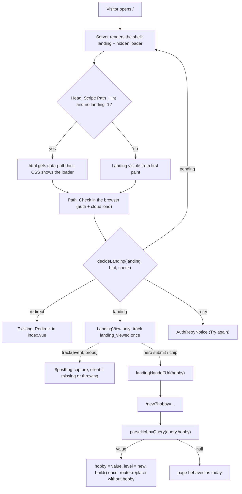

# Design Document

## Overview

The Landing_Page replaces the body of `app/pages/index.vue`. The decision at `/` depends on Saved_Paths, not on sign in (owner decision, 2026-11-18): a Visitor with at least one Saved_Path runs the Existing_Redirect, a Visitor with none sees the landing, and `/?landing=1` always shows the landing. The server always renders the landing. A Head_Script hides it behind the existing loading state before first paint when the device has a Path_Hint, and the Path_Check in the browser makes the final call.

All text, all decision logic and all URL building live in small pure modules. The Vue components only render them. This keeps the design rules (no dash in copy, hobby cap, handoff URL, landing decision) testable without a Nuxt or component test environment (the repo's Vitest runs in the `node` environment and has no component tests).

Scope is exactly the requirements. This design adds no waitlist, no checkout, no email form, no `/start` route, no cookie, no new dependency and no runtime config key.

Requirements: [requirements.md](./requirements.md)

### Reuse

| Need | Reused as is |
|---|---|
| Mascot | `app/components/mascot/wick.vue` (`outfit="bouldering"`, `theme` from `useTheme()`). No second mascot. |
| Logo | `public/logo/App icon 1024-192.png` (file exists), shown at 32 px in the Header and Footer next to the text "Pursio". Image tags carry `width` and `height`. |
| Redirect | The navigation in the `watch(cloud.status, ...)` block of `app/pages/index.vue` stays in that file, with the same target (`lastActivePath(...) ?? NEW_HOBBY_PATH`). Only its trigger changes (see `index.vue` outline). |
| Path_Check | `useAuth().status` and `useCloudStore()` (`status`, `paths`, `reload`) as they are. `cloud.paths` already holds archived Path_Rows (`record.archived`), so its length counts every Saved_Path. |
| Path_Hint keys | `ACTIVE_HOBBY_KEY` (`pursio-active-hobby:v1`, `app/utils/active-hobby.ts`) and `HOBBY_LIBRARY_KEY` (`pursio-hobbies:v1`, `app/utils/hobby-store.ts`). |
| Head_Script pattern | `themeInitScript` in `nuxt.config.ts` (inline `<head>` script, `try`/`catch`, no dependency). |
| Loading and retry | `PathStatus state="loading"` and `AuthRetryNotice` with `CLOUD_MESSAGES.loadFailed` / `cloud.reload` and `AUTH_MESSAGES.unavailable` / `auth.retry`, as `index.vue` and `AuthSessionGate` use them now. |
| Analytics client | `$posthog` from `app/plugins/posthog.client.ts` (`PostHog` or `undefined`). |
| Start level | `DEFAULT_LEVEL` (`'new'`) from `shared/utils/llm.ts`. |
| Node look | `nodeVisual()` from `app/utils/node-visual.ts` for done, current, locked and milestone classes and icons, and `PathIcon.vue` for icons. |
| Fonts, colors | Token utilities only (`font-head` = Archivo Black, `font-body` = Archivo, `bg-surface`, `text-ink`, `rounded-node`, `shadow-raised-*`). |
| Layout | `layouts/default.vue` (unchanged). |

`PathNode.vue` is a button that needs a `SkillNode`, so the preview does not use it. It draws plain `div`s with the classes from `nodeVisual()`, which gives the same look and no focusable element.

## Architecture



### Path_Check result

`pathCheckOf(authStatus, cloudStatus, pathCount)` turns the existing statuses into one of four results:

| Auth status | Cloud status | Result |
|---|---|---|
| `unavailable` | any | `failed` |
| `loading` | any | `pending` |
| `anonymous` or `signed_in` | `error` | `failed` |
| `anonymous` or `signed_in` | `ready`, at least one path | `has_paths` |
| `anonymous` or `signed_in` | `ready`, no path | `no_paths` |
| `anonymous` or `signed_in` | `idle`, `loading`, `importing` | `pending` |

Archived paths count (Assumption 24): a Visitor whose paths are all archived gets `has_paths`, and the Existing_Redirect opens `/new` because `lastActivePath` skips archived paths.

### Landing decision

`decideLanding({ landing, hint, check })` returns one of four views. `hint` is whether the Path_Hint is present on this device for this visit.

| `?landing=1` | Path_Hint | Path_Check | View | Visitor sees |
|---|---|---|---|---|
| `1` | any | any | `landing` | The sections (Req 1.3) |
| absent or other | any | `has_paths` | `redirect` | Loading state, then the Existing_Redirect (Req 1.2) |
| absent or other | any | `no_paths` | `landing` | The sections (Req 1.6, 1.8) |
| absent or other | yes | `failed` | `retry` | `AuthRetryNotice` with "Try again" (Req 1.9) |
| absent or other | no | `failed` | `landing` | The sections stay (Req 1.10) |
| absent or other | any | `pending` | `pending` | The shell: loader with a Path_Hint (Req 1.7), sections without (Req 1.5) |

On the server the auth status is always `loading`, so the server view is `pending` (or `landing` with `?landing=1`). Both render the sections in the server HTML, which satisfies Req 1.5 for a Visitor without a Path_Hint. The head tags are set in setup, so they are in the server HTML too.

### Path_Hint and the Head_Script

The server cannot read Saved_Paths (Supabase rows, session in localStorage), so a Head_Script decides only what the first paint shows. The real decision waits for the Path_Check (Assumption 22).

- `shared/utils/path-hint.ts` holds `PATH_HINT_ATTR = 'data-path-hint'`, the two storage keys as literals (`nuxt.config.ts` cannot import from `app/`), the pure `hasPathHint(read, pathname, search)`, and the script string `pathHintInitScript`.
- `hasPathHint` returns true when `pathname` is `/`, the `landing` search parameter is not `1`, and `pursio-active-hobby:v1` or `pursio-hobbies:v1` holds a non-empty value. A storage read that throws counts as no hint.
- `pathHintInitScript` does the same in plain ES5 and sets `data-path-hint=""` on `<html>`. It runs in a `try`/`catch` like `themeInitScript`. `nuxt.config.ts` adds it to `app.head.script` after the theme script, with `tagPosition: 'head'`.
- `app/assets/css/main.css` gets one variant: `@custom-variant path-hint (&:where(html[data-path-hint] *));`. The shell uses `hidden path-hint:block` for the loader and `path-hint:hidden` for the sections. No color or token is involved.
- In `index.vue` setup on the client, `hint` is computed with `hasPathHint((key) => localStorage.getItem(key), location.pathname, location.search)` and the attribute is set or removed to match. On a full load this equals what the Head_Script did, so nothing changes during hydration. On an in-app navigation to `/` (for example "Back to Pursio" from a Legal_Page), the Head_Script does not run again and this keeps the attribute correct. `onBeforeUnmount` removes the attribute.

Trade-offs (from Assumption 22): a Visitor with saved paths but no Path_Hint sees the landing briefly, then the redirect; a Visitor with a stale Path_Hint sees the loader briefly, then the landing. Other legacy keys (`GENERATED_TREE_KEY` and the rest in `legacy-import.ts`) are not read, so a Visitor whose only legacy data is under those keys falls in the first case.

## Components and Interfaces

New files (all inside the existing structure):

```
app/pages/index.vue                    Changed: shell, Path_Check decision, redirect trigger, landing_viewed, LandingView
app/pages/privacy.vue                  New: <LegalPage title="Privacy" />
app/pages/terms.vue                    New: <LegalPage title="Terms" />
app/pages/refund.vue                   New: <LegalPage title="Refund" />
app/pages/new.vue                      Changed: read ?hobby= once, level new, remove it from the URL (Req 11)
app/components/landing/LandingView.vue         Composes the eight sections
app/components/landing/LandingHeader.vue
app/components/landing/LandingHero.vue
app/components/landing/LandingPathPreview.vue
app/components/landing/LandingHowItWorks.vue
app/components/landing/LandingFresh.vue        Text + Fresh_Preview
app/components/landing/LandingFreshPreview.vue
app/components/landing/LandingChips.vue
app/components/landing/LandingFounding.vue
app/components/landing/LandingFaq.vue
app/components/landing/LandingFooter.vue
app/components/landing/LegalPage.vue
app/utils/landing.ts                   Pure logic
app/utils/landing-copy.ts              All visible copy as constants
app/utils/analytics.ts                 track(): sends to $posthog, silent on failure
shared/utils/path-hint.ts              Path_Hint check and Head_Script string
app/assets/css/main.css                Changed: path-hint variant
nuxt.config.ts                         Changed: adds pathHintInitScript to app.head.script
public/og.png                          OG_Image, supplied by the owner (not produced here)
```

Nuxt auto-imports the components with the folder prefix (`LandingHeader`, `LandingFaq`, and so on), matching the existing `fresh/` and `hobby/` folders. Each is small and takes typed props and emits.

### `app/utils/landing.ts` (pure)

```ts
import type { SessionStatus } from '~/utils/auth-logic'
import type { CloudStatus } from '~/composables/useCloudStore'
import type { LocationQuery, LocationQueryRaw } from 'vue-router'

export const HOBBY_MAX_LENGTH = 60
export const NEW_PAGE = '/new'
export const DEMO_PATH = '/path?demo=1'
export const SITE_URL = 'https://pursio.fun'

export type PathCheck = 'pending' | 'has_paths' | 'no_paths' | 'failed'
export type LandingView = 'pending' | 'landing' | 'redirect' | 'retry'

/** The Path_Check result from the existing statuses (Req 1.2, 1.6, 1.9). Archived paths count. */
export function pathCheckOf(auth: SessionStatus, cloud: CloudStatus, pathCount: number): PathCheck {
  if (auth === 'unavailable') return 'failed'
  if (auth === 'loading') return 'pending'
  if (cloud === 'error') return 'failed'
  if (cloud === 'ready') return pathCount > 0 ? 'has_paths' : 'no_paths'
  return 'pending'
}

/** Req 1.2, 1.3, 1.5 to 1.10, 15.3, 15.4. `landing` is the raw query value. */
export function decideLanding(input: { landing: unknown; hint: boolean; check: PathCheck }): LandingView {
  if (input.landing === '1') return 'landing'
  switch (input.check) {
    case 'has_paths': return 'redirect'
    case 'no_paths': return 'landing'
    case 'failed': return input.hint ? 'retry' : 'landing'
    default: return 'pending'
  }
}

/** Req 3.5, 3.6: the trimmed text, or null when it is empty. Not cut: the input has maxlength 60. */
export function normalizeHobby(raw: string): string | null {
  const text = raw.trim()
  return text === '' ? null : text
}

/** Req 3.5, 6.2: the Hobby_Handoff URL for a hobby. */
export function landingHandoffUrl(hobby: string): string {
  return `${NEW_PAGE}?hobby=${encodeURIComponent(hobby)}`
}

/** Req 11.1, 11.2: the hobby from `route.query.hobby`, trimmed and cut to 60, or null. */
export function parseHobbyQuery(value: unknown): string | null {
  const raw = Array.isArray(value) ? value[0] : value
  if (typeof raw !== 'string') return null
  const text = raw.trim().slice(0, HOBBY_MAX_LENGTH).trim()
  return text === '' ? null : text
}

/** Req 11.5: the same query without `hobby`, every other key and value kept. */
export function withoutHobbyQuery(query: LocationQuery): LocationQueryRaw {
  const { hobby: _hobby, ...rest } = query
  return rest
}
```

`parseHobbyQuery` trims, cuts to 60, and trims again so a cut that ends in a space leaves no trailing blank. `slice` on UTF-16 units can split a surrogate pair at the cut; the builder's own `maxlength="60"` has the same unit, so the behavior is consistent with today.

### `shared/utils/path-hint.ts`

```ts
export const PATH_HINT_ATTR = 'data-path-hint'
/** Same values as ACTIVE_HOBBY_KEY and HOBBY_LIBRARY_KEY; a unit test keeps them equal. */
export const PATH_HINT_KEYS = ['pursio-active-hobby:v1', 'pursio-hobbies:v1'] as const

/** Req 1.5, 1.7: true when `/` should open on the loading state. */
export function hasPathHint(read: (key: string) => string | null, pathname: string, search: string): boolean {
  if (pathname !== '/' || new URLSearchParams(search).get('landing') === '1') return false
  try {
    return PATH_HINT_KEYS.some((key) => {
      const value = read(key)
      return value !== null && value !== ''
    })
  } catch {
    return false
  }
}

/** Inline <head> script with the same rule, run before first paint (like themeInitScript). */
export const pathHintInitScript = `(function(){try{...}catch(e){}})()`
```

The script body is written by hand in ES5 from `PATH_HINT_ATTR` and `PATH_HINT_KEYS` with `JSON.stringify`, the way `themeInitScript` is built. Property 7 checks that it agrees with `hasPathHint`.

### `app/utils/analytics.ts`

PostHog is live (Assumption 7). The wrapper sends to the client that `app/plugins/posthog.client.ts` provides as `$posthog`. That value is `undefined` when the key or host is missing, and the plugin does not run on the server.

```ts
import type { PostHog } from 'posthog-js'

export type AnalyticsEvent =
  | 'landing_viewed'
  | 'hero_hobby_submitted'
  | 'example_hobby_clicked'
  | 'demo_clicked'

export type AnalyticsProps = Readonly<Record<string, string | number | boolean>>
export type AnalyticsClient = Pick<PostHog, 'capture'>

/** Sends one event, or does nothing. Never logs, never throws (Req 15.2, 15.6, 15.7). */
export function sendEvent(client: AnalyticsClient | null | undefined, event: AnalyticsEvent, properties?: AnalyticsProps): void {
  if (!client) return
  try {
    client.capture(event, properties)
  } catch {
    // Analytics must never block the learner.
  }
}

/** Single entry point for Landing_Page analytics (spec: landing-page, Req 15.1). */
export function track(event: AnalyticsEvent, properties?: AnalyticsProps): void {
  try {
    sendEvent(tryUseNuxtApp()?.$posthog, event, properties)
  } catch {
    // No Nuxt app (server, tests): nothing to send.
  }
}
```

`track` itself never throws, so components call it directly before they navigate and need no catching wrapper of their own (Req 15.5). `tryUseNuxtApp` is a Nuxt auto-import, like `useNuxtApp` in the existing composables. In Vitest (no Nuxt) the name is not defined, and the resulting `ReferenceError` is caught by the same `try`/`catch`, so `track` still returns normally. `$posthog` is narrowed to `AnalyticsClient` the way `useAuth.ts` does it, with no `any`. `tryUseNuxtApp` works in click handlers on the client because Nuxt sets its app context globally there (`callWithNuxt` in `nuxt/dist/app/nuxt.js`). The split into `sendEvent` exists so tests can pass a fake, missing or throwing client. The existing direct `$posthog?.capture(...)` calls in `useHobbyBuilder` and `useCloudStore` are not changed.

### `app/utils/landing-copy.ts`

One module holds every string a visitor can read or hear (headline, subline, placeholder, step titles and lines, Fresh text, chip labels, FAQ questions and answers, footer text, legal placeholder text, alt text and ARIA labels). Components import from it. This lets one test check the dash and price rules over all copy (Req 14.5, 14.6).

Key constants:

```ts
export const EXAMPLE_HOBBIES = [
  'bouldering', 'guitar', 'film photography', 'sourdough',
  'chess', 'gardening', 'running', 'drawing',
] as const                                              // Req 6.1

export const FAQ_ITEMS: readonly { question: string; answer: string }[] // Req 8, answers from Assumptions 8 to 11
export const LANDING_COPY: Readonly<Record<string, string>>             // headline, subline, ...
export const LANDING_TITLE = 'Pursio · Type a hobby. Get a path.'      // middle dot, Req 12.1
export const LEGAL_PLACEHOLDER = 'This page is a placeholder and will be filled in before launch.'
```

The Fresh_Preview uses its own three sample rows in this module. It does not reuse `FRESH_SAMPLES`, because titles there contain a hyphen ("V-grades"), which Req 14.5 forbids in Visible_Copy.

### Section components

| Component | Behavior |
|---|---|
| `LandingView` | Renders the sections in the order Header, Hero, How_It_Works, Fresh_Highlight, Example_Chips, Founding_Section, FAQ, Footer. It does not send `landing_viewed`: it is also rendered in the `pending` shell (server HTML), so `index.vue` sends the event when the view becomes `landing` (Req 15.3, 15.4). |
| `LandingHeader` | Logo image (`width`/`height` 32) with "Pursio" on the left. Right side: `NuxtLink` "Try the demo" to `/path?demo=1` (class `max-[699px]:hidden`) and `NuxtLink` "Build your path" to `/new`, styled as the primary button. Click on "Try the demo" calls `track('demo_clicked')`. Breakpoint 700 px is set with the Tailwind arbitrary variant `min-[700px]` and `max-[699px]`. |
| `LandingHero` | The only `h1`. A `form` with a labelled input (`maxlength=60`, placeholder "Bouldering, guitar, sourdough…"), a "Build my path" submit button, a message area (`role="alert"`, text "Type a hobby to start.") and a "See an example path" link. On submit: `normalizeHobby`; if null, show the message, focus the input, stay; else `track('hero_hobby_submitted', { length })`, then `navigateTo(landingHandoffUrl(text))`. The hobby text is never an analytics property (Req 3.11). Layout: one column below 700 px, two columns (`min-[700px]:grid-cols-2`) above, with the preview below the text on narrow screens. |
| `LandingPathPreview` | Static `div` tree with `aria-hidden="true"` and `role="presentation"`: a column of five nodes (done, done, current, locked, milestone) drawn with `nodeVisual()` classes, icons from `PathIcon`, and `<MascotWick outfit="bouldering" :theme="theme" :size="96" :animated="false" label="Wick in a bouldering outfit" />`. No link or control, so the hidden subtree holds nothing focusable. The Wick label is not read; the Hero text carries the meaning. |
| `LandingHowItWorks` | `h2` and three steps (ordered list) with the three titles and one line each, from the copy module. |
| `LandingFresh` and `LandingFreshPreview` | Section text (Req 5.2) beside a static card list of three sample rows (thumbnail block, title, source, "Video · 8 min" style meta) built from `div`s. Preview root has `aria-hidden="true"`, and contains no `a`, `button`, `input` or `tabindex`. |
| `LandingChips` | Eight `button type="button"` chips, `min-h-11`, in the order of `EXAMPLE_HOBBIES`. Click: `track('example_hobby_clicked', { hobby })`, then `navigateTo(landingHandoffUrl(hobby))`. |
| `LandingFounding` | `<section id="founding" aria-hidden="true">` with an HTML comment `<!-- waitlist goes here -->`, no text, no heading, no focusable child (Req 7). Vue strips comments in production builds, so the comment is placed in the template source; it is visible in the repo and in dev, which satisfies "contain the comment" for the source. Noted under Risks. |
| `LandingFaq` | Four native `details`/`summary` items (no script, Assumption 12). `summary` has `min-h-11` and the visible focus outline. The videos answer states YouTube, picked and checked by Pursio, plays from YouTube, nothing copied. |
| `LandingFooter` | Logo image, links Privacy, Terms, Refund (`NuxtLink`), "Source code" (`<a href="https://github.com/gorkemtumkaya/pursio" rel="noopener">`, confirmed by the owner 2026-11-18), and "Built for Kiroween 2026". |
| `LegalPage` | Prop `title`. Renders `LandingHeader`, `main` with one `h1` (the title), one paragraph (`LEGAL_PLACEHOLDER`), a `NuxtLink` "Back to Pursio" to `/`, and `LandingFooter`. Sets `useHead({ title: ... })`. No price, promise or date. |

All interactive elements get `min-h-11 min-w-11` (44 px) and the existing focus style used on other pages: `focus-visible:outline-3 focus-visible:outline-offset-2 focus-visible:outline-primary`. The page root uses `overflow-x-clip` and `max-w-full` children so nothing exceeds 390 px.

### `index.vue` outline

```vue
<script setup lang="ts">
// existing imports...
import { decideLanding, pathCheckOf, SITE_URL } from '~/utils/landing'
import { LANDING_TITLE, LANDING_DESCRIPTION } from '~/utils/landing-copy'
import { hasPathHint, PATH_HINT_ATTR } from '~~/shared/utils/path-hint'
import { track } from '~/utils/analytics'

const route = useRoute()
const auth = useAuth()
const cloud = useCloudStore()

// Client only: same rule as the Head_Script, so hydration sees no change.
const hint = import.meta.client
  && hasPathHint((key) => localStorage.getItem(key), location.pathname, location.search)
if (import.meta.client) document.documentElement.toggleAttribute(PATH_HINT_ATTR, hint)
onBeforeUnmount(() => document.documentElement.removeAttribute(PATH_HINT_ATTR))

const check = computed(() => pathCheckOf(auth.status.value, cloud.status.value, cloud.paths.value.length))
const view = computed(() => decideLanding({ landing: route.query.landing, hint, check: check.value }))

useHead({ title: LANDING_TITLE, link: [{ rel: 'canonical', href: `${SITE_URL}/` }] })
useSeoMeta({ description, ogTitle, ogDescription, ogType: 'website', ogUrl: `${SITE_URL}/`,
  ogImage: `${SITE_URL}/og.png`, ogImageWidth: 1200, ogImageHeight: 630 })

// Existing_Redirect: same target as today, now triggered by the decision.
watch(view, async (v) => {
  if (v !== 'redirect' || !import.meta.client) return
  const to = lastActivePath(toHobbyLibrary(cloud.paths.value, getActiveHobbyId())) ?? NEW_HOBBY_PATH
  await navigateTo(to, { replace: true })
}, { immediate: true })

let viewedSent = false
watch(view, (v) => {
  if (v !== 'landing' || viewedSent || !import.meta.client) return
  viewedSent = true
  track('landing_viewed')
}, { immediate: true })
</script>

<template>
  <template v-if="view === 'pending'">
    <main class="mx-auto hidden w-full max-w-160 path-hint:block"><PathStatus state="loading" /></main>
    <LandingView class="path-hint:hidden" />
  </template>
  <LandingView v-else-if="view === 'landing'" />
  <main v-else class="mx-auto w-full max-w-160">
    <template v-if="view === 'retry'">
      <AuthRetryNotice v-if="auth.status.value === 'unavailable'" :message="AUTH_MESSAGES.unavailable" @retry="auth.retry" />
      <AuthRetryNotice v-else :message="CLOUD_MESSAGES.loadFailed" @retry="cloud.reload" />
    </template>
    <PathStatus v-else state="loading" />
  </main>
</template>
```

- `AuthSessionGate` is no longer used here: the server must render the sections, and a failed session must not hide them from a Visitor without a Path_Hint (Req 1.5, 1.10).
- The `pending` and `landing` branches both render `LandingView`. Moving from `pending` to `landing` re-creates it once; this happens in the browser after the Path_Check, and the content is the same, so nothing visible changes for a Visitor without a Path_Hint. If a re-mount proves noticeable in testing, the `pending` and `landing` branches can share one `LandingView` with a bound class instead.
- "Try again" moves the Path_Check back to `pending`, and with the Path_Hint the shell shows the loader again.
- The redirect view shows the loading state while `navigateTo` runs, as today.

### Page metadata (Req 12)

`useHead` sets the title and the canonical link `https://pursio.fun/`. `useSeoMeta` sets `description`, `ogTitle`, `ogDescription`, `ogType: 'website'`, `ogUrl`, `ogImage: 'https://pursio.fun/og.png'`, `ogImageWidth: 1200`, `ogImageHeight: 630`. It runs in setup, so it is in the server HTML along with the sections. The values are literals, not runtime config (Req 14.7).

### OG image

The owner supplies `public/og.png` (Assumption 16). This design only references it: Nuxt serves it from `public/` at `/og.png`, so `og:image` is `https://pursio.fun/og.png` with width 1200 and height 630. No script, build step or request-time generation is added. Req 12.5 describes the file the owner supplies, and it is checked by hand before release.

### `new.vue` handoff (Req 11)

`useHobbyBuilder()` already exposes `hobby`, `level`, `state` and `build`. Add to `new.vue` only:

```ts
import { DEFAULT_LEVEL } from '~~/shared/utils/llm'
import { parseHobbyQuery, withoutHobbyQuery } from '~/utils/landing'

const route = useRoute()
const router = useRouter()
let handoffDone = false
watchEffect(() => {
  if (handoffDone || !import.meta.client) return
  const value = parseHobbyQuery(route.query.hobby)
  if (value === null) { handoffDone = true; return }
  if (auth.status.value !== 'anonymous' && auth.status.value !== 'signed_in') return // wait for the session
  handoffDone = true
  hobby.value = value
  level.value = DEFAULT_LEVEL
  void build()
  void router.replace({ query: withoutHobbyQuery(route.query) })
})
```

- It fires once (`handoffDone`), so a failed build does not start again; the existing error state shows and only a learner submit calls `build()` again (Req 11.3).
- `build()` reads `hobby` and `level` synchronously before its first `await`, so the `router.replace` right after it cannot change the request.
- `router.replace` keeps every other query parameter (`withoutHobbyQuery`) and replaces the current history entry, so refresh and the back button reach `/new` without `hobby`, which is the Req 11.2 case and starts nothing (Req 11.5, 11.6).
- Nuxt keys pages by route path, so changing only the query does not re-mount `new.vue`, and the builder state (now `generating`) survives the replace.
- `build()` already reads the token with `auth.accessToken()`. The page is wrapped by `AuthSessionGate`, but the watch waits for a ready session itself, so `build()` does not hit the `unauthorized` branch because the token was not ready yet. If the session is `unavailable`, `hobby` stays in the URL until "Try again" starts the session, then the handoff runs.
- No query parameter, or a blank one, sets `handoffDone` and changes nothing, the URL included (Req 11.2). The hobby input, level picker and error handling are untouched (Req 11.4). The level is set to `new` only for this run; the picker is not shown while generating (Assumption 21).

## Data Models

No database, API or type changes. The only new shapes are in `app/utils/landing.ts`, `app/utils/analytics.ts` and `shared/utils/path-hint.ts` (above). `SessionStatus` and `CloudStatus` are the existing types from `~/utils/auth-logic` and `~/composables/useCloudStore`.

## Error Handling

| Case | Handling |
|---|---|
| Empty or blank hobby on submit | Message "Type a hobby to start.", focus to the input, no navigation, no analytics call (Req 3.6). |
| `$posthog` is `undefined` (key or host missing, server) | `sendEvent` returns at once, no log (Req 15.6). |
| `capture` throws, or no Nuxt app | Caught inside `track`; navigation continues (Req 15.5, 15.7). |
| Path_Check fails, Path_Hint present | `retry` view: `AUTH_MESSAGES.unavailable` with `auth.retry`, or `CLOUD_MESSAGES.loadFailed` with `cloud.reload` (Req 1.9). |
| Path_Check fails, no Path_Hint | The sections stay; `landing_viewed` is sent (Req 1.10, 15.3). |
| localStorage blocked or throws | No Path_Hint; the landing shows, then the Path_Check decides. |
| Stale Path_Hint (paths deleted elsewhere) | Loader, then the sections once the Path_Check returns `no_paths`. |
| `?hobby=` generation fails | Existing builder error state; no automatic retry; `hobby` already removed from the URL (Req 11.3). |
| `?hobby=` is an array, number-like or blank | `parseHobbyQuery` takes the first string or returns null. |
| Unknown `?landing=` value | Treated as absent, by `decideLanding` and by the Head_Script. |

## Correctness Properties

*A property is a characteristic or behavior that should hold true across all valid executions of a system-essentially, a formal statement about what the system should do. Properties serve as the bridge between human-readable specifications and machine-verifiable correctness guarantees.*

Reflection: the handoff round trip also covers the chip click (6.2) and the hero submit (3.5), so there is one property for URL building. Query parsing (11.1, 11.2) and query removal (11.5) have different inputs, so they stay separate. The routing criteria (1.2, 1.3, 1.5 to 1.10, 15.3, 15.4) are one decision property over `pathCheckOf` and `decideLanding`; the Head_Script is a separate property because it is a separate copy of the hint rule. `sendEvent` and `track` (15.2, 15.5 to 15.7) are one property. No-dash and no-price checks over the copy are one property over the copy constants.

### Property 1: Landing decision

For any auth status, cloud status, path count, Path_Hint value and `landing` query value: the view is `landing` whenever the query value is `'1'`; otherwise it is `redirect` exactly when the Path_Check is `has_paths` (auth `anonymous` or `signed_in`, cloud `ready`, count at least 1), `landing` when the Path_Check is `no_paths` or is `failed` without a Path_Hint, `retry` when the Path_Check is `failed` with a Path_Hint, and `pending` in every other case. `pending` never depends on the Path_Hint (the server and the client render the same shell), and `landing_viewed` is sent only for the `landing` view, so it is never sent when the view is `redirect`.

**Validates: Requirements 1.2, 1.3, 1.5, 1.6, 1.7, 1.8, 1.9, 1.10, 15.3, 15.4**

### Property 2: Hobby normalization

For any string `s`, `normalizeHobby(s)` returns `null` if and only if `s.trim()` is empty, and otherwise returns `s.trim()`. The analytics property for `hero_hobby_submitted` is `{ length: text.length }` for that text and contains no field holding the text.

**Validates: Requirements 3.5, 3.6, 3.11**

### Property 3: Handoff round trip

For any non-empty hobby string `h` (including spaces, `&`, `=`, `#`, `?`, `%` and non-ASCII characters), parsing the query of `landingHandoffUrl(h)` with `URLSearchParams` returns `h` for the `hobby` key, and the URL starts with `/new?hobby=`. For each label in `EXAMPLE_HOBBIES` the same holds.

**Validates: Requirements 3.5, 6.2**

### Property 4: Hobby query parsing

For any value `v` (string, array of strings, `undefined`, number), `parseHobbyQuery(v)` returns `null` when the first element or value is not a string or is blank after trimming; otherwise it returns a non-empty string of at most 60 characters with no leading or trailing whitespace, which is a prefix of the trimmed input. For any string of 60 characters or fewer with no surrounding whitespace, the result equals the input.

**Validates: Requirements 11.1, 11.2**

### Property 5: Copy has no dash and no price

For any string in the landing copy (headline, subline, placeholder, steps, Fresh text and sample rows, chip labels, FAQ questions and answers, footer text, legal placeholder, alt texts and ARIA labels), the string contains no hyphen-minus, en dash or em dash, and the FAQ answers for "Is it free?" and "Do I need an account?" contain no currency symbol, digit or the words "price", "plan", "$" or "euro".

**Validates: Requirements 8.4, 10.3, 14.5, 14.6**

### Property 6: Analytics sends or stays silent

For any event and any properties object: `sendEvent` with a client calls `capture` exactly once with that event and those properties; with an `undefined` or `null` client it calls nothing; with a client whose `capture` throws any value it returns normally. In every case it writes nothing to the console. `track` returns normally for any input when no Nuxt app exists.

**Validates: Requirements 15.2, 15.5, 15.6, 15.7**

### Property 7: Head_Script agrees with the Path_Hint rule

For any pathname, any search string (with and without `landing=1`) and any values of the two Path_Hint keys (absent, empty, non-empty, or a storage that throws), running `pathHintInitScript` against a fake `localStorage`, `location` and `document` sets `data-path-hint` on the root element if and only if `hasPathHint` returns true for the same inputs, and the script never throws.

**Validates: Requirements 1.3, 1.5, 1.7**

### Property 8: Hobby removal keeps the rest of the query

For any query object, `withoutHobbyQuery(query)` has no `hobby` key, and has every other key of `query` with the same value.

**Validates: Requirements 11.5, 11.6**

## Testing Strategy

Tests use the existing Vitest setup (`environment: 'node'`, `tests/**/*.test.ts`) and fast-check where the repo already uses it (see `tests/property/`). No component or Nuxt test environment exists, and none is added. Per the repo convention, composable behavior is tested through pure functions.

Property tests (minimum 100 runs each), in `tests/property/landing-*.property.test.ts`. Tag format: **Feature: landing-page, Property N: <text>**.

| File | Property |
|---|---|
| `landing-decision.property.test.ts` | 1 |
| `landing-hobby.property.test.ts` | 2, 3 |
| `landing-hobby-query.property.test.ts` | 4, 8 |
| `landing-copy.property.test.ts` | 5 |
| `landing-analytics.property.test.ts` | 6 |
| `landing-path-hint.property.test.ts` | 7 |

Example and smoke tests in `tests/unit/`:

- `EXAMPLE_HOBBIES` has the eight labels in the given order (Req 6.1); `FAQ_ITEMS` has the four questions in order, and the videos answer mentions YouTube, picked and checked, plays from YouTube, nothing copied (Req 8.1, 8.3, 8.5).
- `PATH_HINT_KEYS` equals `[ACTIVE_HOBBY_KEY, HOBBY_LIBRARY_KEY]`, so the Head_Script cannot drift from the app's storage keys.
- `pathCheckOf('signed_in', 'ready', n)` with only archived paths still gives `has_paths` (Assumption 24); covered by Property 1, written once as an example for the reader.
- Source scan of `app/components/landing/` and the three legal pages: no `#xxxxxx` color, no `font-family`, no `shadow-[` with a color literal (Req 14.1), no `<img` without `width` and `height` (Req 13.4), exactly one `<h1` in the landing components other than `LegalPage.vue`, which has its own h1 on the legal pages (Req 13.3), no `a`, `button`, `input` or `tabindex` inside `LandingFreshPreview.vue` and `LandingPathPreview.vue` (Req 5.3).
- `package.json` is unchanged in dependencies and `nuxt.config.ts` gains no `runtimeConfig` key (Req 14.7); checked in review, not by test.

Manual test matrix (browser, 390 px and 1280 px):

| Check | Requirements |
|---|---|
| New device (empty localStorage): `/` shows the eight sections from first paint, and the page source (view source or `curl`) contains them | 1.1, 1.5 |
| Device with saved paths and a Path_Hint, anonymous and signed in: loader from first paint, then the redirect; no flash of sections | 1.2, 1.7 |
| `/?landing=1` with saved paths: sections, no loader, no redirect | 1.3 |
| Account with no paths but a stale Path_Hint: loader, then the sections; `landing_viewed` once | 1.6, 1.8, 15.3 |
| Account with only archived paths: redirect to `/new` | 1.2 |
| Offline with a Path_Hint: "Try again" notice; offline without a Path_Hint: sections stay | 1.9, 1.10 |
| PostHog shows `landing_viewed`, `hero_hobby_submitted` (`length` only), `example_hobby_clicked`, `demo_clicked`; no `landing_viewed` on redirect | 15.2 to 15.4 |
| PostHog key unset: every click still navigates, console stays clean | 15.5, 15.6 |
| Header at 699 px and 700 px | 2.3 |
| Hero submit empty, whitespace, text; chip click; both demo links | 2.4, 3.5 to 3.8, 6.2 |
| `/new?hobby=guitar&x=1` starts generation once at "New to it"; URL becomes `/new?x=1`; refresh and back start nothing; failure shows error and no second start | 11.1, 11.3, 11.5, 11.6 |
| Keyboard focus outline on every control; tap targets at least 44 px | 13.2, 13.5 |
| No horizontal scroll at 390 px; Path_Preview position at 700 px | 3.9, 13.1 |
| `public/og.png` is 1200 by 630; share preview shows it and the title | 12.x |
| `/privacy`, `/terms`, `/refund` render and link back | 10.x |

Lint and typecheck: `yarn typecheck` and the existing lint script on changed files.

## Risks and Notes

1. **Missing or stale Path_Hint.** The server cannot see Saved_Paths, so a Visitor with paths but no Path_Hint sees the sections briefly before the redirect, and a stale Path_Hint shows the loader briefly before the sections (Assumption 22). The rejected cookie alternative is described there.
2. **Two copies of the hint rule.** `hasPathHint` and the hand-written `pathHintInitScript` must agree; Property 7 and the key-equality unit test guard this.
3. **Founding comment.** The `waitlist goes here` comment lives in the template source; Vue removes comments from production output, so it will not appear in the built HTML.
4. **`tryUseNuxtApp` in handlers.** `track` depends on Nuxt's client-side global app context. If an event is missing in PostHog during the manual check, pass `$posthog` from the calling component instead; the `sendEvent` core stays the same.
5. **OG image** is supplied by the owner and needs to be in `public/` before release; until then `og:image` points to a missing file.
