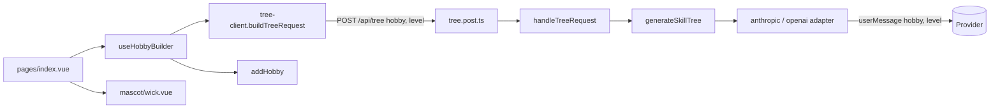
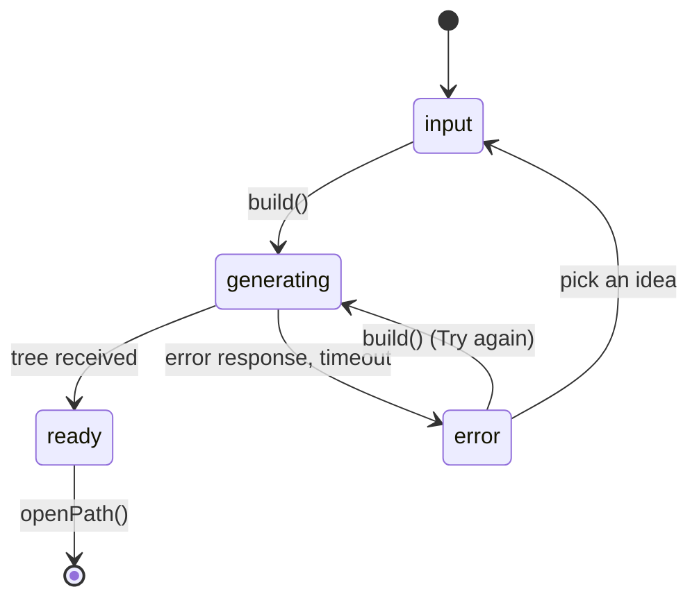

# Design Document: New Hobby Page

## Overview

Replace the start page (`app/pages/index.vue`, route `/`) with the design in `docs/design/new-hobby.html`. The page keeps the real generation flow: it posts to `POST /api/tree`, saves the tree with `addHobby`, and opens `/path?hobby=<id>` via `hobbyPath`. What changes:

- A four-state page (input, generating, ready, error) with Wick beside the card.
- A starting level (`new`, `some`, `serious`) sent to the API and added to the generation input.
- Building steps driven by a timer while the request runs.
- Wick mood and outfit follow the state. The outfit comes from `tree.mascot.set` through `toWickOutfit()`.

No new dependencies. No new theme tokens. No new tests except the one that checks the level reaches the API request.

### Findings from the codebase

| Item | Location |
| --- | --- |
| Current new hobby page | `app/pages/index.vue` (generate, timeout, error handling already there) |
| Wick component | `app/components/mascot/wick.vue` (not `components/wick/Wick.vue`). Props: `theme`, `mood`, `outfit`, `size`, `animated`, `label` |
| Wick helpers | `app/components/mascot/wick.ts`: `WickMood`, `WickOutfit`, `toWickOutfit(value)` (falls back to `explorer`) |
| Wick moods | `idle`, `cheer`, `think`, `sleep`. The page uses `idle`, `think`, `cheer` |
| Request builder | `app/utils/tree-client.ts` (`buildTreeRequest`, `errorCodeFrom`, `friendlyMessage`) |
| API route | `server/api/tree.post.ts` calls `handleTreeRequest` in `server/utils/llm-handlers.ts` |
| Generation input | The provider adapters (`server/utils/providers/anthropic.ts`, `openai.ts`) send `hobby` as the user message. The system prompt is `server/prompts/skill-tree.md` |
| Cache key | `server/utils/tree-cache.ts` `cacheKey(hobby, provider, model)` |
| Dev theme switcher | `<DevThemeSwitcher v-if="isDev" />` in `app/app.vue`, so it shows on every page |
| Existing styles to reuse | The current `index.vue` input, primary button, focus ring and card classes. Tokens: `shadow-raised-primary`, `shadow-raised-line`, `bg-surface-2`, `bg-primary-soft`, `bg-locked`, `bg-done` |
| Untracked files | `app/components/mascot/` and `docs/design/new-hobby.html` are untracked in git. The commit task must add them |

### Decisions

- The system prompt file stays as is. The level goes into the user message, next to the hobby, so the cached system prompt is unchanged and the instruction sits where the model reads the hobby.
- `level` is optional on the API and defaults to `new`, so old clients keep working. A value outside the three levels returns `invalid_input`.
- The cache key includes the level, so a "new to it" tree is never served to a "getting serious" learner.
- The tree is saved with `addHobby` as soon as the response arrives, so the path is not lost if the user leaves before pressing "Open my path".
- The dev theme switcher stays in `app.vue` for other pages and is hidden on `/`.
- Chips use `rounded-full` (pill), not `rounded-node`.
- The "What you'll get" section is ported as a small static component and hidden on small screens, as in the design.

## Architecture



State machine in `useHobbyBuilder`:



## Components and Interfaces

### Shared (`shared/`)

`shared/types/llm.ts`:

```ts
export type StartLevel = 'new' | 'some' | 'serious'
```

`shared/utils/llm.ts`:

```ts
export const START_LEVELS = ['new', 'some', 'serious'] as const satisfies readonly StartLevel[]
export const DEFAULT_LEVEL: StartLevel = 'new'
export const LEVEL_LABELS: Record<StartLevel, string> = {
  new: 'New to it',
  some: 'Tried it a bit',
  serious: 'Getting serious',
}
export function isStartLevel(value: unknown): value is StartLevel
/** "The learner's starting level is: <label lowercased>. Start the tree at that level." */
export function levelInstruction(level: StartLevel): string
```

`levelInstruction('some')` returns `The learner's starting level is: tried it a bit. Start the tree at that level.`

### Server (`server/`)

- `providers/types.ts`: `GenerateOptions` gains `level: StartLevel`. New helper `userMessage(hobby, level)` returns `` `${hobby}\n\n${levelInstruction(level)}` ``.
- `anthropic.ts` and `openai.ts`: use `userMessage(hobby, options.level)` where they used `hobby`.
- `generator.ts`: `generateSkillTree(hobby, level, config, deps)` passes `level` in the adapter options (also on the retry call).
- `tree-cache.ts`: `cacheKey(hobby, level, provider, model)`, still a JSON array so it stays injective.
- `llm-handlers.ts`: after the hobby check, read `body.level`. Missing means `DEFAULT_LEVEL`. Not a `StartLevel` returns `invalid_input`. Pass the level to `cacheKey` and `generateSkillTree`.

### Client utils (`app/utils/`)

`tree-client.ts`:

```ts
export interface TreeRequest {
  body: { hobby: string; level: StartLevel; provider?: Provider; model?: string }
  headers: Record<string, string>
  usesOwnKey: boolean
}
export function buildTreeRequest(hobby: string, level: StartLevel, settings: LlmSettings): TreeRequest
```

`tree-summary.ts` (new, pure):

```ts
export interface TreeSummary { skills: number; sections: number; quests: number; firstSkill: string }
export function summarizeTree(tree: SkillTree): TreeSummary
```

`skills` counts every node, `quests` is the sum of each node's quests, `firstSkill` is the title of the first node of the first section.

### Composable (`app/composables/useHobbyBuilder.ts`)

```ts
export type BuilderState = 'input' | 'generating' | 'ready' | 'error'
export const BUILD_STEPS = [
  'Mapping the skills',
  'Putting them in order',
  'Writing quests for each skill',
  'Picking Wick’s outfit',
] as const

export function useHobbyBuilder(): {
  hobby: Ref<string>
  level: Ref<StartLevel>
  state: Readonly<Ref<BuilderState>>
  stepIndex: Readonly<Ref<number>>     // 0..BUILD_STEPS.length - 1
  errorCode: Readonly<Ref<ErrorCode | null>>
  errorMessage: Readonly<Ref<string | null>>
  summary: Readonly<Ref<TreeSummary | null>>
  outfit: Readonly<Ref<WickOutfit>>    // 'none' until a tree arrives
  build(): Promise<void>
  pickIdea(idea: string): void         // fills the input and returns to state 'input'
  surprise(): void                     // fills the input with a random pool entry
  openPath(): Promise<void>
}
```

Behavior of `build()`:

1. Trim `hobby`. If empty, or the state is already `generating`, do nothing.
2. Build the request with `buildTreeRequest(value, level, loadSettings(browserStorage))`. Set state `generating`, `stepIndex = 0`, outfit `none`.
3. Start a `setInterval` every `STEP_INTERVAL_MS` (3500). Each tick moves `stepIndex` forward until the last step, where it stays. The timer never moves the state to `ready`.
4. `$fetch('/api/tree', { method: 'POST', body, headers, signal, retry: 0 })` with the same 90 s abort the current page uses.
5. On a valid response (`loadSkillTree` ok and a non-empty `model`): clear the timer, call `addHobby`, set `summary` from `summarizeTree`, set `outfit` to `toWickOutfit(tree.mascot.set)`, remember the new id, set state `ready`.
6. On failure: clear the timer, read the code with `errorCodeFrom` (`timeout` when aborted), set `errorMessage` from `friendlyMessage`, set state `error`. The typed hobby is kept.
7. A `onScopeDispose` hook clears the timer and aborts a running request.

`openPath()` calls `navigateTo(hobbyPath(id))`.

`pickIdea` and `surprise` do nothing while generating. The surprise pool is a constant array in the composable file.

### Components (`app/components/hobby/`)

All use `<script setup lang="ts">`, typed props and emits, token utilities only.

| Component | Props | Emits | Notes |
| --- | --- | --- | --- |
| `HobbyLevelPicker.vue` | `modelValue: StartLevel` | `update:modelValue` | Three buttons in a `role="group"`, `aria-pressed`, labels from `LEVEL_LABELS` |
| `HobbyIdeaChips.vue` | `ideas: readonly string[]`, `surprise?: boolean`, `disabled?: boolean` | `pick(idea)`, `surprise` | `rounded-full` pills. The surprise chip has a dashed `border-primary`, `bg-primary-soft`, `text-accent-text`. Text only, no dice icon, so `icons.ts` stays unchanged |
| `HobbyBuildSteps.vue` | `steps: readonly string[]`, `active: number` | none | Progress bar (`role="progressbar"`) and an ordered list. Done steps show the `check` icon from `PathIcon` |
| `HobbyReadyCard.vue` | `summary: TreeSummary` | `open` | Three counts, the first skill, and the "Open my path" button. Focuses the button on mount |
| `HobbyBenefits.vue` | none | none | "What you'll get" with three cards. Hidden below `sm` |

Wick is `components/mascot/wick.vue`. Nuxt builds the auto-import name from the directory and file, so it is `MascotWick`. The page uses `<MascotWick :theme="theme" :mood="mood" :outfit="outfit" :size="220" />`. Do not copy the inline SVG from the HTML design.

### Page (`app/pages/index.vue`)

Layout, from the design: top bar (brand with `PathIcon name="star"` and a Settings `NuxtLink` to `/settings`), then a hero with Wick and a speech bubble on one side and the active card on the other, then `HobbyBenefits`.

Mood and bubble by state:

| State | Wick mood | Wick outfit | Bubble text |
| --- | --- | --- | --- |
| input | `idle` | `none` | What do you want to get better at? |
| generating | `think` | `none` | Building your `<hobby>` path… |
| ready | `cheer` | `toWickOutfit(tree.mascot.set)` | Your `<hobby>` path is ready! |
| error | `idle` | `none` | `not_a_hobby`: Hmm, I don't know “`<hobby>`” as a hobby. Other codes: Something went wrong. |

Cards:

- input: `<form>` with label, text input (`maxlength="60"`, `id="hobby"`), `HobbyLevelPicker`, the primary button "Build my path", `HobbyIdeaChips` with `bouldering`, `film photography`, `guitar`, `sourdough baking`, `chess` and the surprise chip.
- generating: `HobbyBuildSteps` and the note "Usually takes about 15 seconds."
- ready: `HobbyReadyCard`.
- error: for `not_a_hobby`, the design copy "Pursio builds paths for things you can practice and get better at. Try a hobby, a craft, a sport or a skill." For any other code, `friendlyMessage(...)`. Below it the retry input (bound to the same `hobby`), four idea chips and a "Try again" submit button.

The card status text is in an `aria-live="polite"` region. Focus moves to the retry input on error and to "Open my path" on ready. Motion respects `prefers-reduced-motion` through `motion-safe:` on the progress bar transition. Wick already handles its own motion.

Class reuse: input classes and primary button classes are taken from the current `index.vue` (`h-12`/`h-14`, `rounded-2xl`, `border-2 border-line`, `bg-primary`, `shadow-raised-primary`, `focus-visible:outline-ink`). The design's taller 58 px controls map to `h-14`. The card uses `rounded-3xl border-2 border-line bg-surface shadow-raised-line`.

### App shell (`app/app.vue`)

`<DevThemeSwitcher v-if="isDev && route.path !== '/'" />` using `useRoute()`. The switcher stays on `/path`, `/settings` and `/dev/theme`.

## Data Models

Request:

```json
{ "hobby": "bouldering", "level": "some" }
```

with optional `provider` and `model` when the learner uses their own key, as today. Response is unchanged: `{ tree, model }` or `{ error: ErrorCode }`. `not_a_hobby` returns status 422 with `{ error: "not_a_hobby" }`.

Generation input (user message):

```
bouldering

The learner's starting level is: tried it a bit. Start the tree at that level.
```

## Error Handling

- `not_a_hobby`: error state with the design copy and the retry input.
- `rate_limited`, `timeout`, `generation_failed`, `provider_auth`, `provider_error`, `no_key`, `invalid_input`: error state with the matching `friendlyMessage` text.
- Network failure or a response that is not a valid tree: treated as `generation_failed`.
- Empty hobby: submit does nothing; focus returns to the input.
- Invalid `level` on the server: 400 `invalid_input`.
- Leaving the page mid-request: the timer is cleared and the request is aborted.

## Testing Strategy

The feature is UI work and wiring, so there are no correctness properties and no property-based tests. As requested, the only new test checks that the level reaches the API request: a unit test in `tests/unit/tree-client.test.ts` for `buildTreeRequest`. Verification for everything else is `yarn typecheck`, the existing `yarn test` suite, and `yarn build`. Not verified by automated tests: the server-side level validation and prompt text, the building steps timing, and the visual match to the design. These need a manual pass in the browser with `yarn dev`.
