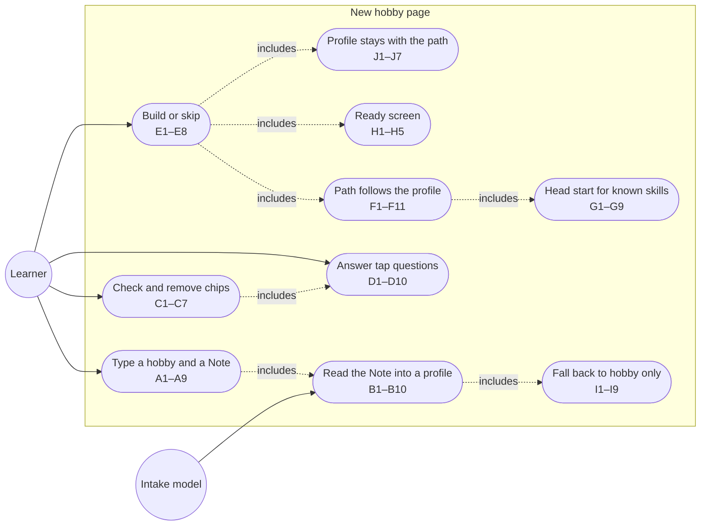
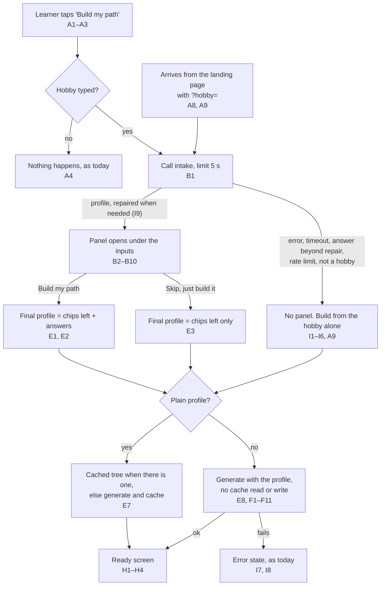
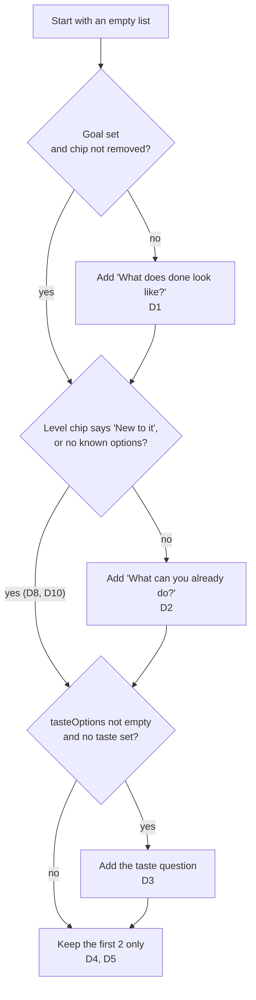
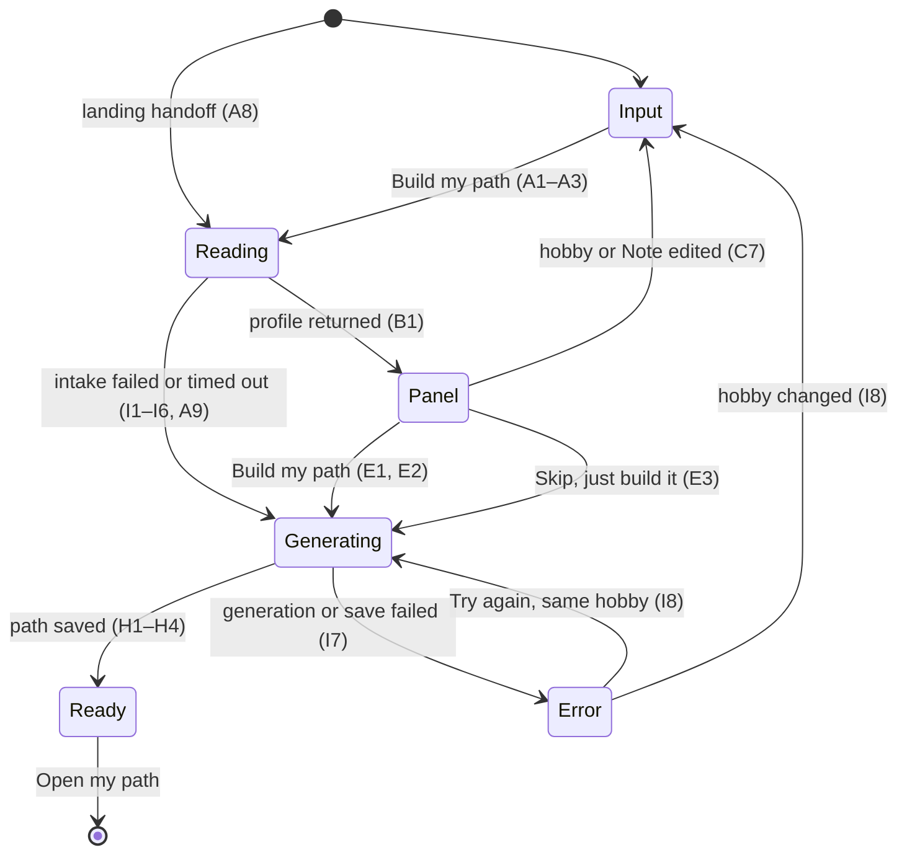

# Scenarios: Path intake (smarter path creation)

Today the generator knows only the hobby and one of three starting levels. It often guesses the level wrong, and every path ends on a generic mastery goal (guitar ends on "perform with a band", even for a learner who only wants to play at home).

Path intake gives a path three inputs: **Hobby** (required), **Start** (where the learner is now, optional) and **Goal** (where they want to get, optional), plus optional **Taste** (likes, and things they do not want). The learner may write a short note. A small, fast model reads it and returns a Learner_Profile. A short panel shows what was understood and asks at most 2 tap questions. Generation then uses the final profile, and the profile is saved with the path.

The requirements are in [requirements.md](requirements.md).

Design references, in `dev_docs/new-path-generator-designs/`: `NEW · Desktop new hobby (Tweaks startState, knownStyle).png`, `NEW · Mobile · Guitar, read from what you typed.png`, `NEW · Mobile · Sandwich, taste question.png` and `NEW · Mobile · Ready, finish line + head start.png`. Where the decisions below differ from the mockups, the decisions win. The differences are listed under To verify.

Terms used below:

- **Note**: the optional textarea "Tell Wick more", at most 800 characters (decision 40).
- **Learner_Profile**: `level` (`new`, `returning`, `regular` or null), `goal` (`{ id, label, finishLine }` or null), `avoid` (strings), `taste` (strings), plus the options the panel can offer: `goalOptions` (asked as 4, at least 2 after repair), `knownOptions` (asked as 4 to 6) and `tasteOptions` (0 to 5), and `mascotSet`, Wick's outfit for the hobby.
- **Detected field**: a field of level, goal, avoid or taste that intake filled from the learner's own words. Intake never invents one.
- **Known skill**: a `knownOptions` entry the learner selected under "What can you already do?". The generator marks its node with `knownOptionId`.
- **Plain profile**: a final profile with no goal, no avoid, no taste and no known skill.
- **Head start**: the XP for known skills, 30 each, at most 6 skills, so at most 180 XP.
- **Finish line**: `goal.finishLine`, the goal written as a final milestone, for example "Play 5 songs you love, start to finish".

### What changes, compared with the current page

| Area | Today (`new-hobby-page`, `ai-skill-tree-generation`) | Path intake |
|---|---|---|
| Inputs on `/new` | Hobby, and a 3-way level picker "Where are you now?" | Hobby, and the optional Note "Tell Wick more". The level picker is removed (decision 15) |
| "Build my path" | Starts generation at once | Calls intake first (target under 2 s, hard limit 5 s), then opens the panel under the inputs |
| Landing handoff (`?hobby=`) | Starts generation at once | Fills the hobby and runs intake (decision 19) |
| What generation knows | Hobby and level | Hobby and the final Learner_Profile: level, goal, avoid, taste, known skills |
| End of the path | A generic mastery milestone | A milestone built from the finish line, when a goal is set |
| Start of progress | Nothing done, 0 XP | Known skills are created as done, with 30 XP each |
| Ready screen | Skills, sections, quests, "First up" | Also a "Your finish line" block and a "You start with a head start" block |
| Stored with the path | Level, tree, model, goal class | Also the Learner_Profile (`paths.profile`) |
| Tree cache | Used for every build | Used only for a plain profile (decision 27) |
| Intake fails | Not applicable | The panel is skipped and the path is built from the hobby alone, as today |

## Diagrams

### Use cases

### From "Build my path" to a path

### Which questions the panel asks

### State of the new hobby page

## Scenarios

### A. Typing and starting

| ID | Starting state | Action | Expected result | Covered by | Status |
|---|---|---|---|---|---|
| A1 | `/new`, input state | Types only a hobby and taps "Build my path" | Intake runs with the hobby and an empty Note. The button shows a busy state and a second tap does nothing. Wick says he is reading. The panel opens with no chips and 2 questions (B3) | 3.1, 3.3, 5.1 | Confirmed |
| A2 | `/new` | Types a hobby and a Note, taps "Build my path" | Intake runs with both. The panel opens with one chip per detected field | 3.1, 3.5, 4.2 | Confirmed |
| A3 | `/new` | Types in the Note | The Note takes at most 800 characters. When 40 or fewer are left, the page shows how many. It is optional and never blocks the button | 1.1, 1.2 | Confirmed |
| A4 | Hobby empty, Note filled | Taps "Build my path" | Nothing is sent, as today with an empty hobby | 1.4 | Confirmed |
| A5 | `/new` | Taps an idea chip or "Surprise me" | The hobby field is filled, as today. The Note is kept. Nothing is sent until "Build my path" | 1.5 | Confirmed |
| A6 | Note contains instructions for the model ("ignore your rules…") | Taps "Build my path" | The Note is treated as data. Intake still returns only a Learner_Profile | 2.6 | Confirmed |
| A7 | Learner's Language_Code is not `en` | Taps "Build my path" | Chip values, option labels and the finish line come back in the learner's language. Fixed page copy stays as it is today | 2.12, 15.3 | Confirmed |
| A8 | Arrives from the landing page with `?hobby=` | Page loads | The hobby field is filled and intake runs at once, with an empty Note. The panel opens like a normal build, with focus on the first question. `hobby` leaves the URL, so a refresh starts nothing | 1.6, 1.7, 4.7 | Confirmed |
| A9 | Arrives from the landing page with `?hobby=`, intake fails or times out | Page loads | The path is built at once from the hobby alone, as today. `intake_failed` is sent | 1.6, 3.6 | Confirmed |

### B. What the panel shows

| ID | Starting state | Action | Expected result | Covered by | Status |
|---|---|---|---|---|---|
| B1 | Intake answered in time | Panel opens | It opens under the inputs on the same page, without a page change. The hobby and the Note stay visible above it. Wick says "Got it. Anything to fix?". Focus moves into the panel and a screen reader hears that it opened. `intake_shown` is sent with the names of the detected fields and the number of questions | 4.1, 4.7, 14.2 | Confirmed |
| B2 | Note gave level, goal, avoid and taste | Views the panel | "Here's what I got" with four chips: Level, Goal, Not for you, Taste. Each shows its tag and its value, and has a × button with an accessible name such as "Remove goal" | 4.2–4.4 | Confirmed |
| B3 | Nothing detected (hobby only, or a Note with nothing usable) | Views the panel | No "Here's what I got" block. Questions only | 4.2 | Confirmed |
| B4 | Note says only what the learner does not want ("no performing") | Views the panel | One chip, "Not for you" with "Performing". Level and goal stay empty. The goal question is asked | 2.10, 5.1 | Confirmed |
| B5 | Note names several things to avoid | Views the panel | One "Not for you" chip that lists them all. Removing it clears them all | 4.3, 4.5 | Confirmed |
| B6 | Note is vague about level or goal ("I like music") | Views the panel | No Level chip and no Goal chip. Intake does not guess | 2.10 | Confirmed |
| B7 | Hobby where taste does not matter (chess, running) | Views the panel | `tasteOptions` is empty. No Taste chip unless the learner wrote a taste, and no taste question | 2.13, 5.1 | Confirmed |
| B8 | Any profile with an avoid entry | Views the questions | No goal option, known skill option or taste option matches an avoid entry | 2.11 | Confirmed |
| B9 | Panel open | Looks at the buttons | "Build my path" and "Skip, just build it", both in the panel. The "Build my path" button of the form above is not shown twice | 4.8 | Confirmed |
| B10 | Panel open for guitar, or for sandwich making | Looks at Wick | Wick wears the outfit intake returned for the hobby (guitar, chef hat), from the moment the panel opens. An outfit value that is not known gives the default outfit | 2.7, 2.8, 4.1 | Confirmed |

### C. Chips

| ID | Starting state | Action | Expected result | Covered by | Status |
|---|---|---|---|---|---|
| C1 | Goal chip shown | Taps × on Goal | The goal becomes null and the chip leaves. "What does done look like?" appears as the first question. `intake_chip_removed` is sent with `field: goal` | 4.5, 5.1, 14.3 | Confirmed |
| C2 | Goal chip shown, questions are known skills and taste | Taps × on Goal | Questions become goal and known skills. The taste question leaves, and anything selected in it is not used | 5.1, 5.5 | Confirmed |
| C3 | Level chip shown | Taps × on Level | The level becomes null. No level question replaces it. The path then starts as for a new learner. If the chip said "New to it", the known skills question may now appear | 4.5, 5.1, 7.3 | Confirmed |
| C4 | "Not for you" chip shown | Taps × | The avoid list becomes empty. No question replaces it. Options are not fetched again | 4.5 | Confirmed |
| C5 | Taste chip shown, `tasteOptions` not empty | Taps × on Taste | Taste becomes empty. The taste question appears only when fewer than 2 questions are shown | 4.5, 5.1 | Confirmed |
| C6 | Any chip | Uses the keyboard | Each × is reachable with Tab, at least 44 px, and works with Enter and Space. After a removal, focus moves to the next chip, or to the first question when no chip is left | 4.4, 4.6 | Confirmed |
| C7 | Panel open | Edits the hobby or the Note | The panel closes and its chips and answers are dropped. The next "Build my path" runs intake again | 4.9 | Confirmed |

### D. Tap questions

| ID | Starting state | Action | Expected result | Covered by | Status |
|---|---|---|---|---|---|
| D1 | Goal missing | Views the goal question | "What does done look like?" with the goal options of this hobby: 4 as a rule, at least 2 | 5.2 | Confirmed |
| D2 | Known skills question shown | Views it | "What can you already do?" with the hint "these start as done" and 4 to 6 concrete beginner skills of this hobby, multi select | 5.3 | Confirmed |
| D3 | `tasteOptions` not empty, no taste set, fewer than 2 questions before it | Views the taste question | Up to 5 options, multi select | 5.4 | Confirmed |
| D4 | Goal missing, taste options exist | Views the panel | Goal and known skills are asked. Taste is not asked, because 2 is the limit | 5.1 | Confirmed |
| D5 | Goal detected, taste options exist | Views the panel | Known skills and taste are asked | 5.1 | Confirmed |
| D6 | Goal detected, no taste options | Views the panel | Only the known skills question | 5.1 | Confirmed |
| D7 | Goal question shown | Taps a second goal | Single select: the second goal replaces the first. Tapping the selected goal clears it. One goal, one finish line | 5.2 | Confirmed |
| D8 | Note says the learner is new ("never held a guitar") | Views the panel | Level chip "New to it". The known skills question is not asked while that chip is there | 5.1 | Confirmed |
| D9 | Any question | Uses the keyboard or a screen reader | Each question is a labelled group. Each option is a toggle button that reports pressed or not pressed | 5.6 | Confirmed |
| D10 | Intake returned no usable known skill option | Views the panel | The known skills question is not asked. The next question in the order takes its place | 5.1 | Confirmed |

### E. Build or skip

| ID | Starting state | Action | Expected result | Covered by | Status |
|---|---|---|---|---|---|
| E1 | Panel open, some answers selected | Taps "Build my path" | Generation starts with the final profile: the chips that are left, plus the answers. `intake_answered` is sent with `goal_set`, `known_count` and `taste_count` | 6.1, 6.3, 14.4 | Confirmed |
| E2 | Panel open, nothing selected | Taps "Build my path" | Generation starts with the chips that are left. `intake_answered` is sent with `goal_set` true only when a Goal chip is left, and both counts 0 | 6.1, 14.4 | Confirmed |
| E3 | Panel open, with or without selections | Taps "Skip, just build it" | Generation starts with the chips that are left. Selections in the questions are not used. `intake_skipped` is sent | 6.2, 14.5 | Confirmed |
| E4 | Panel open, all chips removed, nothing selected | Taps either button | The path is built from the hobby alone, as today | 6.1, 6.2, 7.4 | Confirmed |
| E5 | Generation running | Looks at the page | The same building steps as today. The panel is gone | 6.3 | Confirmed |
| E6 | Learner uses their own API key (Settings) | Builds | Intake and generation both use the learner's key. Intake uses that provider's small model | 2.4, 6.6 | Confirmed |
| E7 | Final profile is plain (no goal, no avoid, no taste, no known skill), or intake failed | Builds a hobby that was built before with the same level and model | The cached tree is used, as today. A new plain tree is written to the cache | 7.4 | Confirmed |
| E8 | Final profile has a goal, an avoid entry, a taste entry or a known skill | Builds | The cache is not read, so the learner never gets a tree made for someone else. The new tree is not written to the cache | 7.5 | Confirmed |

### F. The path follows the profile

| ID | Starting state | Action | Expected result | Covered by | Status |
|---|---|---|---|---|---|
| F1 | Level `new` | Path is built | It starts at first contact: setup, safety, first basics | 8.2 | Confirmed |
| F2 | Level `returning` | Path is built | It skips first steps. It may open with one short refresher, then continues where a returning learner stands | 8.2 | Confirmed |
| F3 | Level `regular` | Path is built | It starts past the fundamentals | 8.2 | Confirmed |
| F4 | Level null | Path is built | It starts as for a new learner | 7.3, 8.2 | Confirmed |
| F5 | Goal set | Path is built | The last node of the last section is a milestone, and the server sets its title to the finish line, whatever title the generator gave it. No generic mastery ending. Earlier sections lead toward it | 8.3 | Confirmed |
| F6 | Goal null | Path is built | The ending is chosen by the generator, as today | 8.4 | Confirmed |
| F7 | Avoid has entries ("performing") | Path is built | No skill, milestone or quest matches an avoid entry | 8.5 | Confirmed |
| F8 | Taste has entries ("vegetarian") | Path is built | Quests are shaped by them (dishes, materials, styles). The skill order still follows how the hobby is learned | 8.6 | Confirmed |
| F9 | Goal set, and the generator returns a tree whose last node is not a milestone | Server checks the tree | The tree is rejected and generated once more with the reason, as other invalid trees are today. A second failure gives the usual "could not build" error. No other profile rule rejects a tree | 8.9 | Confirmed |
| F10 | Known skills selected | Generator returns the tree | Each known skill should have one node that carries its id as `knownOptionId`. The server repairs slips and rejects nothing: it strips an id that is unknown, repeated (the first node keeps it), or on a milestone or side quest. The match is by id, never by title | 8.7, 8.8 | Confirmed |
| F11 | 3 known skills selected, the generator made a node for only 2 of them | Path is created | The path is built. The 2 skills with a node are known, with 60 XP. The third is not stored as known and is not shown on the ready card | 8.8, 11.3, 12.2 | Confirmed |

### G. Head start for known skills

| ID | Starting state | Action | Expected result | Covered by | Status |
|---|---|---|---|---|---|
| G1 | 3 known skills selected | Path is created | Each known skill is a node early in the path and is already completed. The path starts with 90 XP, and the first open skill is the first one not known | 8.7, 9.2, 9.3 | Confirmed |
| G2 | 6 known skills selected | Path is created | 180 XP, which is level 2 on a new path. More than 6 can never be selected or counted | 9.1, 9.3 | Confirmed |
| G3 | No known skill selected, or Skip | Path is created | Nothing is completed. 0 XP, as today | 9.8 | Confirmed |
| G4 | Path with known skills | Opens a known skill | It shows as completed. Its 3 quests are open as an optional refresher, with a line that says they give no XP | 10.1 | Confirmed |
| G5 | Path with known skills | Ticks refresher quests | The ticks are saved and shown. XP does not change. They count for nothing else: no daily pick, no daily bonus, no streak or weekly day, not on the Quests page | 10.2–10.4 | Confirmed |
| G6 | Path with a 90 XP head start | Reloads, opens on another device, or looks at the profile page | The same 90 XP everywhere. It is never added a second time | 9.5 | Confirmed |
| G7 | Path with known skills | Completes the next skill | +50 XP as today. The known skills keep 30 each, not 50 | 9.3, 9.4 | Confirmed |
| G8 | Path with a head start | Resets progress for that path | The path returns to how it was created: known skills done, head start XP kept, refresher ticks cleared | 9.7 | Confirmed |
| G9 | Generator gave a known node a title that differs from the option label ("Tune your guitar" for "Holding and tuning") | Path is created | The node is still known: done, 30 XP, listed in the head start. A node with a matching title but no `knownOptionId` is not known | 9.1 | Confirmed |

### H. Ready screen

| ID | Starting state | Action | Expected result | Covered by | Status |
|---|---|---|---|---|---|
| H1 | Goal set, 2 known skills | Generation finishes | The ready card shows the "Your finish line" block with the finish line, and the "You start with a head start" block with "+60 XP", the 2 known skills with check marks and the line about refresher quests. "First up" names the first skill that is not known | 12.1, 12.2, 12.4 | Confirmed |
| H2 | Goal set, no known skills | Generation finishes | The finish line block shows. No head start block | 12.1 | Confirmed |
| H3 | No goal, known skills selected | Generation finishes | The head start block shows. No finish line block | 12.2 | Confirmed |
| H4 | No goal, no known skills, or intake failed | Generation finishes | The ready card looks as it does today | 12.3 | Confirmed |
| H5 | Path is ready | Looks at Wick | Wick wears the outfit of the generated path, as today, even if intake had picked another one for the panel | 4.1 | Confirmed |

### I. Failures and fallbacks

| ID | Starting state | Action | Expected result | Covered by | Status |
|---|---|---|---|---|---|
| I1 | Intake returns an error | Taps "Build my path" | No panel. Generation starts from the hobby alone, exactly as today. `intake_failed` is sent. The learner sees no error | 3.6, 14.6 | Confirmed |
| I2 | Intake has not answered after 5 s | Waits | The intake request is aborted. Same as I1 | 2.5, 3.4, 3.6 | Confirmed |
| I3 | Intake answers with something that cannot be read as a profile, or with fewer than 2 usable goal options | Taps "Build my path" | The answer is dropped as a whole. Same as I1 | 2.8, 3.5, 3.6 | Confirmed |
| I4 | Learner made 30 intake calls this hour | Taps "Build my path" | Same as I1. The limit for building trees is separate and unchanged | 2.3, 2.16, 3.6 | Confirmed |
| I5 | Offline, or the request cannot be sent | Taps "Build my path" | Intake fails fast, then generation fails with today's error state. The hobby and the Note are kept | 3.6, 13.4 | Confirmed |
| I6 | Hobby is not a hobby (gibberish, a person's name) | Taps "Build my path" | Intake reports it and no panel opens. Generation makes the final call and shows today's "not a hobby" error | 2.14, 3.6 | Confirmed |
| I7 | Panel answered, generation or save fails | Waits | Today's error state with the hobby kept. The Note and the final profile are kept in memory | 13.1 | Confirmed |
| I8 | Error state after I7 | Taps "Try again" | Same hobby: generation runs again with the same final profile, with no second intake and no panel. Changed hobby: back to the input state, and intake runs on the next build | 13.2, 13.3 | Confirmed |
| I9 | Intake answers with small slips (9 known options, a wrong level value, a repeated id, a 70 character finish line, a goal that is not one of the options) | Taps "Build my path" | The answer is repaired, not rejected: lists are cut to their maximum, bad and repeated options are dropped, long texts are shortened, the wrong level and the unlisted goal become empty. The panel opens with the repaired profile | 2.8, 3.5 | Confirmed |

### J. Later

| ID | Starting state | Action | Expected result | Covered by | Status |
|---|---|---|---|---|---|
| J1 | Path built with a profile | Path is saved | The final Learner_Profile is stored with the path (`paths.profile`), with the known skills. The Note itself is not stored | 11.2, 11.3 | Confirmed |
| J2 | Path built without a profile (intake failed) | Path is saved | `paths.profile` is null | 11.4 | Confirmed |
| J3 | Paths made before this feature | Opens them | No change. No finish line, no head start, same XP as before | 9.8, 11.6 | Confirmed |
| J4 | Learner already has a guitar path | Builds guitar again with a new profile | As today, the old path is replaced and its progress is reset. The new profile and the new head start apply | 11.7 | Confirmed |
| J5 | Learner set a goal in Settings | Builds a path | The Settings goal keeps its current use for videos. It is not shown in the panel and does not fill the Goal chip | 7.8 | Confirmed |
| J6 | Any path with a profile | Wants to change the goal, swap one skill, or reshape the path | Not available | out of scope | Out of scope |
| J7 | Path with known skills, kept in the account or in local storage, or put back by Undo of a delete | The app reads it again | The same known skills and the same head start XP as when it was saved. A stored path whose profile is missing or unreadable has no known skills | 11.5, 11.8 | Confirmed |

### K. Analytics

| ID | Starting state | Action | Expected result | Covered by | Status |
|---|---|---|---|---|---|
| K1 | Any intake flow | Events are sent | Only these, through `track()`: `intake_shown` (`detected_fields`, `questions_count`), `intake_chip_removed` (`field`), `intake_answered` (`goal_set`, `known_count`, `taste_count`), `intake_skipped`, `intake_failed` | 14.1–14.6 | Confirmed |
| K2 | Learner wrote a Note | Any event is sent | No event carries the Note, a chip value, an option label or the finish line. Only field names, counts and booleans | 14.7 | Confirmed |
| K3 | Analytics is blocked or fails | Any step | The flow continues, as today | 14.8 | Confirmed |

## Owner decisions

From the brief of 2026-11-21.

1. **Inputs.** Hobby is required. Start, Goal and Taste are optional. Typing only a hobby must still work. Affects A1, A4.
2. **Note.** Optional textarea "Tell Wick more", at most 400 characters. Affects A3.
3. **Intake endpoint.** `POST /api/intake`, a small and fast model, target under 2 s, hard limit 5 s. Affects B1, I2.
4. **Never invent.** Level, goal, avoid and taste come only from what the learner wrote. Labels are in the learner's Language_Code. Affects A7, B4, B6.
5. **Panel.** Opens under the inputs, no new page. One removable chip per detected field. At most 2 questions, only for what is missing, in the order goal, known skills, taste. Removing the Goal chip brings the goal question back. Affects B1 to B9, C1 to C6, D1 to D6.
6. **Skip.** "Skip, just build it" builds with what the profile already has. Affects E3.
7. **Generation.** Level sets the start. The last section ends on a milestone from the finish line. Nothing that matches avoid. Quests shaped by taste. Known skills early and already completed. Affects F1 to F9, G1.
8. **Head start.** 30 XP per known skill, at most 6 skills and 180 XP, given once when the path is created, counted toward the level. Their quests stay open as an optional refresher and give no XP. Affects G1 to G6.
9. **Stored profile.** The Learner_Profile is saved with the path so a later "change goal" feature can use it. Affects J1.
10. **Ready screen.** The finish line and the head start with its XP, with the known skills listed. Affects H1 to H4.
11. **Failure.** If intake fails or times out, skip the panel and build from the hobby alone. Intake never blocks path creation. Affects I1 to I6.
12. **Analytics.** The five events of K1. The learner's text is never sent. Affects K1, K2.
13. **Copy.** No dash characters in visible copy.
14. **Out of scope.** Changing the goal, swapping one skill, reshaping an existing path, and any change to Fresh or to quests outside generation. Affects J6.

From the scenarios review of 2026-11-21.

15. **Level picker.** Removed from `/new`. The intake level maps to the existing one for `paths.level` and the generator: `new` and null to `new`, `returning` to `some`, `regular` to `serious`. The profile keeps the intake value. Affects C3, F1 to F4.
16. **One goal.** The goal question is single select. One finish line. Affects D7, F5, H1.
17. **Known skill XP.** The profile lists the known skills. Their nodes count as completed and give 30 XP, computed, not stored. Refresher ticks give 0. Nothing new is stored in progress. Affects G1 to G7.
18. **Known skills question for a new learner.** Not asked while the detected level is `new` and its chip is still there. Affects C3, D8.
19. **Landing handoff.** Fills the hobby and runs intake. The panel opens like a normal build, with focus on the first question. If intake fails, the path is built at once, as today. Affects A8, A9.
20. **Settings goal.** Untouched. It is not shown in the panel and does not fill the Goal chip. Affects J5.
21. **Reset progress.** A reset returns the path to how it was created. Affects G8.
22. **Not a hobby.** Generation decides. Intake opens no panel for it. Affects I6.
23. **Intake model, key and limit.** A small model from the server config, or the learner's own key with that provider's small model. Same session token as tree building. 30 intake calls per user per hour, separate from the tree limit. Over the limit counts as an intake failure. Affects E6, I4.
24. **Finish line length.** At most 60 characters. The final milestone is exempt from the 28 character title rule. Affects F5, H1.
25. **Refresher quests.** They count for nothing: no XP, no daily pick, no daily bonus, no weekly count. Affects G5.
26. **Skip and edits.** Skip ignores selections in the questions (E3). Editing the hobby or the Note closes the panel (C7). Both rows were confirmed as written.
27. **Tree cache.** The cached tree is used only when the final profile is plain: no goal, no avoid, no taste and no known skill. Any other profile bypasses the cache, and its tree is not written to it. Affects E7, E8.
28. **Known skills by id.** The generator returns `knownOptionId` on each known node. The server check and the head start match by that id, never by title. Affects F10, G9.

From the requirements review of 2026-11-21.

29. **Repair, do not reject, the intake answer.** Lists are cut to their maximum, invalid options and repeated ids are dropped, labels are shortened to 40 and the finish line to 60 characters, and a goal that is not one of the goal options becomes null. It is an intake failure only when the answer cannot be parsed or fewer than 2 goal options survive. A profile has 2 to 4 goal options. Affects I3, I9, D1, D10.
30. **Final milestone title.** The server requires only that the last node is a milestone, then sets its title to the finish line. No title comparison. Reject and retry only when the last node is not a milestone. Affects F5, F9.
31. **No rejection for known skills.** The server strips `knownOptionId` values that are unknown or repeated (the first is kept) and accepts a tree that misses a known skill. The stored known skills are only those that have a node. The head start and the ready card follow that. Affects F10, F11, H1.
32. **Small model ids.** They come from the server config, with defaults, not from the requirements. Affects E6.
33. **Wick's outfit.** Intake returns `mascotSet`, one of the existing outfit values. Anything else is read as the default outfit. Wick wears it in the panel. Affects B10, H5.
34. **Approved assumptions.** AS1 (copy the mockups do not show) and AS11 (the line "You can change your goal later from the path." is left out).
35. **Order of work.** The core ships first: intake endpoint, panel, generation with the profile, known nodes and head start XP, ready screen. Refresher quest rules and the analytics tests come after. This orders [tasks.md](tasks.md).

From the design review of 2026-11-21.

36. **The profile travels with the path.** A path kept in local storage stores its profile too and is read with the same rules as a cloud path, so a read never strips known skills. Reading a saved path back, local or cloud, keeps the same known skills and head start XP. Affects G6, J7.
37. **Intake model settings.** The server only uses Claude. The intake call runs with extended thinking off and at most 1200 output tokens. A learner's own OpenAI key is still possible in Settings, so that path stays, with the lowest reasoning effort and at most 2000 output tokens. Affects E6, I2.
38. **Latency check first.** 20 intake calls are measured against the 2 s target right after the intake endpoint is built, before the panel. Orders [tasks.md](tasks.md).

From the latency check of 2026-11-21.

39. **Panel before the latency decision.** The check failed only on the 2 s target (median 3.2 s, all under 5 s, all answers valid). The owner had the Panel built first and will decide afterwards between another model, a looser target, starting intake earlier, or splitting the call. Until then the gate of decision 38 is set aside.

From the Panel review of 2026-11-21.

40. **Longer Note.** The Note takes at most 800 characters instead of 400. The field keeps its size; the counter still appears at 40 left. Affects A3.

## Open decisions

- **Latency target and model** (decision 39). Measured median 3.2 s with `claude-haiku-5-5`. Options: try `claude-haiku-4-5`; set the target to the measured numbers (median under 3.5 s, none over 5 s); start intake when the learner leaves the Note; or cache the options per hobby and language and keep only a small "read the Note" call. Recommendation: try `claude-haiku-4-5`, then take the measured target, and start intake earlier only if the wait feels long in use.

## To verify

- **Sandwich mockup.** The Note says "I like spicy stuff" but no Taste chip is shown and the taste question is asked. Under decision 4 a stated taste gives a Taste chip and no taste question. The requirements follow the decision.
- A small model with a structured answer returns the full profile (up to 15 options) in under 2 s for most calls. Measured by the latency check of decision 38.
- A 60 character milestone title fits the node label, the bottom sheet and the side panel of the path view on mobile.
