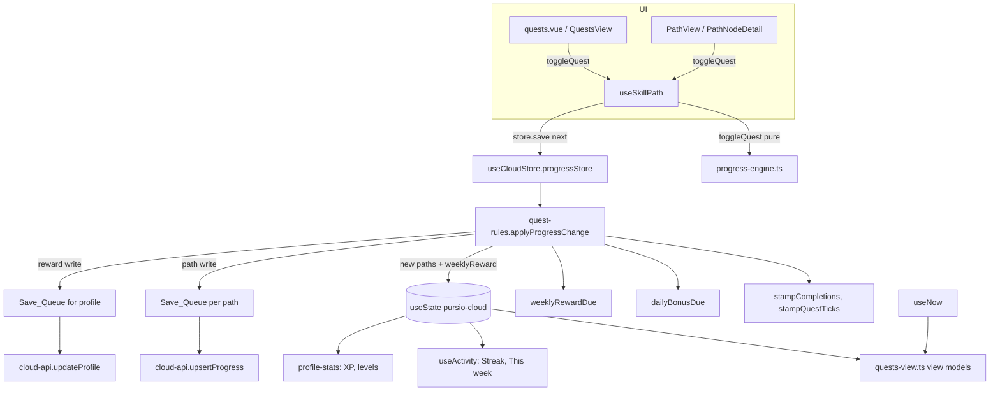

# Design Document: quests-page

## Overview

The Quests page at `/quests` shows three small quests a day from the learner's Active_Hobby, a +20 XP bonus for finishing them, a weekly challenge that counts active days over all hobbies, a quest log of the current week, and a "From your path" section. The mockups are `dev_docs/Desktop · Quests@1x.png` and `dev_docs/Mobile · Quests@1x.png`.

The design adds no second store. A quest tick on the path and on the Quests page runs the same code: `useSkillPath(...).toggleQuest` → `ProgressStore.save` of the Cloud_Store. That one `save` records the tick time, grants the daily bonus and grants the weekly reward, in the same state update that changes Progress. Everything the page shows is derived from the Cloud_Store's `paths` and `profile` plus a clock.

What changes, in one list:

| Area | Change |
| --- | --- |
| Data | Per path: `questTicks`, `dailyPick`, `dailyBonusCount`. Per account: `weeklyReward` (week and count). `Progress` itself (`completed`, `quests`) is unchanged. |
| Database | One new migration adds 3 columns to `progress` and 2 to `profiles`. No policy change. |
| Pure logic | `xp.ts`, `streak.ts`, `progress-engine.ts` get small additions. New `daily-pick.ts` (shared) and `quest-rules.ts` (app) hold the pick and grant rules. |
| Cloud layer | `cloud-library.ts`, `cloud-rows.ts`, `cloud-api.ts`, `useCloudStore.ts` carry the new fields. `progress-store.ts` gets one optional member. |
| UI | New page `quests.vue`, new folder `components/quests/`, a Quests item in the main navigation, small prop additions to `PathQuestItem`. |
| Consumers | Streak, "This week", path XP bar, Profile totals and hobby levels read the new data. |

## Open items

**Lint script (needs a decision from the user).** Requirement 16, criterion 3 asks for `yarn lint` to pass, but `package.json` has no `lint` script and no linter configuration. A linter is a new dependency, which the project rules say needs approval and a pinned version. The design does not add one. The options are:

1. Approve a linter (for example ESLint with `typescript-eslint` and `eslint-plugin-vue`, or `@nuxt/eslint`), pinned to exact versions. The implementation then adds the `lint` script, a config file, updates the dependency list asserted in `tests/unit/conventions.test.ts`, and fixes what it reports.
2. Drop the `yarn lint` part of criterion 3. `yarn typecheck` and `yarn test` stay.

Until the user chooses, the implementation tasks do not touch `package.json` dependencies, and the lint part of criterion 3 cannot be checked.

## Design decisions to check in review

These are choices the requirements leave open. Each has a reason and is cheap to change.

| # | Decision | Reason |
| --- | --- | --- |
| D1 | `Progress` stays `{ completed, quests }`. Tick times, the pick and the bonus count live next to `completedAt` on `CloudPath`. | `Progress` is also the localStorage shape of Demo_Mode and the legacy import. Leaving it alone keeps those paths, `storedProgressSchema` and most existing tests unchanged. |
| D2 | The bonus count reaches XP through an optional `dailyBonusCount?()` member of `ProgressStore`. | `useSkillPath` computes the XP bar from `Progress` only. The optional getter reads reactive Cloud_Store state, so the bar updates in the same render, and Demo_Mode (no getter) gets 0. |
| D3 | An empty pick (no candidate quests) is not stored. The page shows "You're all caught up on this path" and looks again whenever Progress changes. | Requirement 4.6 pins Quest_Ids for the day. An empty stored pick would stay empty after the learner completes a skill and unlocks new quests. Nothing is shown from a stale pick. |
| D4 | The weekly reward is granted only when the account's weekly values were loaded (`profile.weeklyReward !== null`). | If the profile failed to load, writing `count + 1` from an unknown base would overwrite the stored count. |
| D5 | If the daily bonus and the weekly reward are granted by the same tick, the second toast replaces the first. A toast that is sticky (a failed save with "Retry") is never replaced by a grant toast. | `useToast` holds one toast. The persistent card texts "Bonus earned" and "Reward earned" still show both. |
| D6 | "RESETS IN" never shows `0M`: under one minute it shows `1M`. | A literal floor would show `0M` for up to a minute before the day changes. |
| D7 | A quest's tick time is the time of its latest tick. Untick then tick later moves it. | Requirement 2.4 allows one time per Quest_Id, and "Tick_Time" is defined as the last tick. |
| D8 | Quest-grant rules run in `save` on every tick, whatever page it comes from. Toasts are shown by the Quests page only, by watching state. | Requirements 6.2 and 8.2 need the same rules on the path. Requirements 6.6 and 8.6 limit toasts to the Quests page. |

## Architecture



Layers keep the existing split: shared pure logic (`shared/utils`), app pure logic and row mapping (`app/utils`), the Cloud_Store composable, then components. The Cloud_Store remains the only code that writes state or calls Supabase.

## Components and Interfaces

### Shared types

`shared/types/progress.ts` gets the quest identity:

```ts
/** A Quest_Id: the Node id and the quest index. Same Quest only when both match. */
export interface QuestId {
  id: string
  index: 0 | 1 | 2
}
```

`shared/types/cloud.ts` gets the stored shapes:

```ts
/** Tick_Times: Node id to one time per quest, null when that quest has none. All-null entries are left out. */
export type QuestTicks = Record<string, QuestTriple<number | null>>

export interface DailyPick {
  /** Local_Day, `YYYY-MM-DD`. */
  day: string
  /** At most 3 Quest_Ids, in the order shown. */
  quests: QuestId[]
  /** True once the Daily_Bonus of this pick was granted. */
  bonus: boolean
}

/** What a tick changes on one path besides Progress and Completion_Timestamps. */
export interface QuestData {
  questTicks: QuestTicks
  dailyPick: DailyPick | null
  dailyBonusCount: number
}

/** Account-wide. `week` is a Week_Key, or null when never granted. */
export interface WeeklyReward {
  week: string | null
  count: number
}

export interface ProgressWriteRow {
  path_id: string
  user_id: string
  completed: string[]
  quests: Record<string, QuestTriple<boolean>>
  completed_at: CompletedAt
  quest_ticks: QuestTicks
  daily_pick: DailyPick | null
  daily_bonus_count: number
}

export interface ProfileRow {
  id: string
  display_name: string | null
  theme: Theme
  created_at: string
  weekly_reward_week: string | null
  weekly_reward_count: number
}

export interface ProfilePatch {
  theme?: Theme
  display_name?: string | null
  weekly_reward_week?: string | null
  weekly_reward_count?: number
}
```

### `shared/utils/xp.ts`

```ts
export const XP_PER_NODE = 50            // unchanged
export const XP_PER_QUEST = 10
export const XP_PER_DAILY_BONUS = 20
export const XP_PER_WEEKLY_REWARD = 50

/** 50 per distinct completed id in the tree (the old xpFor body). */
export function skillXpFor(tree: SkillTree, progress: Progress): number
/** 10 per quest that is true in `progress.quests`, for Node ids in the tree. */
export function questXpFor(tree: SkillTree, progress: Progress): number
/** Hobby_XP = skillXpFor + questXpFor + 20 * dailyBonusCount. */
export function xpFor(tree: SkillTree, progress: Progress, dailyBonusCount = 0): number
export function xpSummary(tree: SkillTree, progress: Progress, dailyBonusCount = 0): XpSummary
/** Weekly_Reward_XP = 50 * count. Not part of Hobby_XP. */
export function weeklyRewardXp(count: number): number
```

A count that is negative, fractional or not finite counts as 0, so a bad value cannot lower XP. `xpSummaryOf`, `levelFor` and the thresholds do not change.

### `shared/utils/streak.ts`

`weekDays` keeps its behavior. Its Monday calculation moves into a private `mondayOf(date)` so the new functions share it. New exports:

```ts
/** Week_Key: the Local_Day of the Monday of the week containing `ms`. */
export function weekKeyOf(ms: number): string
/** The 7 Local_Day keys Monday to Sunday of the week containing `now`. */
export function weekDayKeys(now: number): string[]
/** Distinct Local_Days of the current week that hold at least one of `times`. */
export function activeDaysInWeek(times: readonly number[], now: number): number
/** Days left in the week after today: 6 on Monday, 0 on Sunday. */
export function daysLeftInWeek(now: number): number
/** Milliseconds from `now` to the next local midnight, built from date parts so DST days are right. */
export function msUntilNextMidnight(now: number): number

export type QuestLogStatus = 'done' | 'missed' | 'today' | 'upcoming'
export interface QuestLogDay {
  date: string
  name: string
  short: string
  /** Ticks on that day; 0 for upcoming days (not shown). */
  count: number
  status: QuestLogStatus
}
/** Seven boxes Monday to Sunday with the number of `times` on each Local_Day. */
export function questLogWeek(times: readonly number[], now: number): QuestLogDay[]
```

Streak and "This week" need no new functions. They take a list of times, so the change is to pass completion times and tick times together (see `activityTimes` below).

### `shared/utils/progress-engine.ts`

Additions only. `toggleQuest`, `markComplete` and the node state rules do not change.

```ts
export function findNode(tree: SkillTree, id: string): SkillNode | undefined   // now exported
/** Open_Nodes in document order: not completed, every prerequisite completed. First node wins on a repeated id. */
export function openNodes(tree: SkillTree, progress: Progress): SkillNode[]
export function isQuestTicked(progress: Progress, quest: QuestId): boolean
/** Quest_Ids that went false→true (`ticked`) or true→false (`unticked`) between two Progress values. */
export function diffTicks(before: Progress, after: Progress): { ticked: QuestId[]; unticked: QuestId[] }
export function sameQuest(a: QuestId, b: QuestId): boolean
```

`diffTicks` walks the union of Node ids in both `quests` maps with `Object.entries` and compares `quests[id]?.[i] === true` for the three indexes. It reads own entries only, so ids such as `__proto__` behave.

### `shared/utils/daily-pick.ts` (new)

Pure, no Nuxt imports.

```ts
export const DAILY_PICK_SIZE = 3

/** All candidates in pick order: group, then document order, then quest index. */
export function candidateQuests(tree: SkillTree, progress: Progress): QuestId[]
/** The first DAILY_PICK_SIZE candidates. */
export function pickDailyQuests(tree: SkillTree, progress: Progress): QuestId[]
/** A new pick for `day`, or null when there is no candidate (decision D3). */
export function newDailyPick(tree: SkillTree, progress: Progress, day: string): DailyPick | null
export function needsNewPick(pick: DailyPick | null, day: string): boolean   // pick === null || pick.day !== day
/** True when this change completes a full pick for today that has no bonus yet (see bonus rules). */
export function dailyBonusDue(
  pick: DailyPick | null,
  day: string,
  ticked: readonly QuestId[],
  after: Progress,
): boolean
```

### `app/utils/cloud-library.ts`

`CloudPath` gains the quest fields next to `completedAt`:

```ts
export interface CloudPath {
  pathId: string
  record: HobbyRecord
  level: StartLevel
  progress: Progress
  completedAt: CompletedAt
  questTicks: QuestTicks
  dailyPick: DailyPick | null
  dailyBonusCount: number
}

export function emptyQuestData(): QuestData
/** Completion times and tick times of every path, archived ones included, once each. Feeds Streak and "This week". */
export function activityTimes(paths: readonly CloudPath[]): number[]
/** Tick times only, for the weekly challenge and the quest log. */
export function questTickTimes(paths: readonly CloudPath[]): number[]
/**
 * Tick times after a Progress change. A quest that stays ticked keeps its time, a newly ticked one gets `now`,
 * an unticked one loses its time. Entries with no time are left out. Built with Object.fromEntries.
 */
export function stampQuestTicks(prev: QuestTicks, before: Progress, after: Progress, now: number): QuestTicks
```

`completionTimes` stays and `activityTimes` builds on it. `upsertGenerated` gives a fresh path `emptyQuestData()` (a regenerated path resets, like the database function does). `withPath` and `withoutPath` are unchanged: the quest fields travel with the `CloudPath`, so Undo restores them.

### `app/utils/quest-rules.ts` (new)

The state transition behind a tick. Pure, so it is tested without Nuxt.

```ts
export const WEEKLY_TARGET_DAYS = 4

export interface ProgressChange {
  paths: CloudPath[]
  weeklyReward: WeeklyReward | null
  /** What to queue for this path. */
  write: Pick<CloudPath, 'progress' | 'completedAt' | 'questTicks' | 'dailyPick' | 'dailyBonusCount'>
  grantedDailyBonus: boolean
  grantedWeeklyReward: boolean
}

/** `null` when `pathId` is unknown. */
export function applyProgressChange(
  paths: readonly CloudPath[],
  weekly: WeeklyReward | null,
  pathId: string,
  next: Progress,
  now: number,
): ProgressChange | null

/** Stores a pick for `day` when the path has none for it and there is a candidate. `null` when nothing changes. */
export function withDailyPick(paths: readonly CloudPath[], pathId: string, now: number): CloudPath[] | null

export function weeklyRewardDue(tickTimes: readonly number[], weekly: WeeklyReward | null, now: number): boolean
```

### `app/utils/cloud-rows.ts` and the zod schemas

New schemas next to `pathRowSchema`, each parsed separately so one bad column never discards another or the Progress:

```ts
const dayKeySchema = z.string().regex(/^\d{4}-\d{2}-\d{2}$/)
const questTicksSchema = z.record(z.string(), z.tuple([z.number().finite().nullable(), z.number().finite().nullable(), z.number().finite().nullable()]))
const dailyPickSchema = z.object({
  day: dayKeySchema,
  quests: z.array(z.object({ id: z.string().min(1), index: z.union([z.literal(0), z.literal(1), z.literal(2)]) })).max(3),
  bonus: z.boolean(),
})
const countSchema = z.number().int().nonnegative()
```

- `parseProgressRow(raw, tree)` returns `{ progress, completedAt, questTicks, dailyPick, dailyBonusCount }`. The existing `progressRowSchema` (completed, quests, completed_at) is untouched and still decides whether Progress is usable. The quest columns are read from `raw` on their own:
  - `quest_ticks`: schema fail → `{}`. Otherwise keep a time only when its Node id is in the tree and that quest is ticked in the parsed Progress (Req 2.6). A triple with no time left is dropped.
  - `daily_pick`: schema fail or `null` → `null`. Otherwise drop quests whose Node is not in the tree and repeated Quest_Ids.
  - `daily_bonus_count`: schema fail → `0`.
  - If the Progress part fails the shape check, the whole result is empty (as today), including the quest fields, so ticks never outlive their Progress.
- `parsePathRow` returns `emptyQuestData()` fields.
- `parseWeeklyReward(row: unknown): WeeklyReward | null` reads `weekly_reward_week` (`dayKeySchema`, else `null`) and `weekly_reward_count` (`countSchema`, else `0`). It returns `null` (unknown) only when `row` is not an object.
- `toProgressRow(pathId, userId, progress, completedAt, quest: QuestData)` adds the three columns. The fifth parameter is required, so Undo cannot forget it.
- `toPathInsertRow` is unchanged.

`progress-store.ts` keeps `storedProgressSchema` as it is (localStorage Progress has no tick data), so there is no second place that defines the quest shape.

### `app/utils/cloud-api.ts`

- `listProgress` selects `path_id, completed, quests, completed_at, quest_ticks, daily_pick, daily_bonus_count`.
- `getProfile` selects `id, display_name, theme, created_at, weekly_reward_week, weekly_reward_count`.
- `updateProfile(patch: ProfilePatch)` takes the wider patch. `upsertProgress` and `insertProgress` already send whole rows.

### `app/utils/progress-store.ts`

The interface gets one optional member and nothing else changes:

```ts
export interface ProgressStore {
  load(): Progress
  save(progress: Progress): void
  /** Daily_Bonus_Count of this path, read reactively. Absent for localStorage stores (Demo_Mode): XP then counts 0. */
  dailyBonusCount?(): number
}
```

### `app/composables/useCloudStore.ts`

- `CloudProfile` gains `weeklyReward: WeeklyReward | null` (`null` = not loaded, decision D4). `loadProfile` fills it with `parseWeeklyReward`. `saveTheme` and `saveDisplayName` currently rebuild the profile object field by field and would drop the new field, so both change to `{ ...current, theme: next }` and `{ ...current, displayName }` over a default profile.
- `ProgressWrite` becomes the `write` shape of `ProgressChange`. The queue writer calls `toProgressRow(pathId, userId, w.progress, w.completedAt, w)`.
- `progressStore(pathId).save(progress)`: calls `applyProgressChange(state.paths, weeklyReward, pathId, progress, Date.now())`, sets `paths` and `profile.weeklyReward` from the result in one state assignment, pushes `write` to the path queue, and when `grantedWeeklyReward` pushes `{ week, count }` to the reward queue.
- `progressStore(pathId).dailyBonusCount()` reads the path's count from state.
- Queues: `queueFor` is generalized into `makeQueue(key, write)` so the path queues and the reward queue share the "Couldn't save your last change." sticky toast with Retry (Req 13.11). The reward queue's writer is `cloud.updateProfile({ weekly_reward_week, weekly_reward_count })`. `clear()` and `bootstrap()` reset it with the others.
- New `ensureDailyPick(pathId: string, now: number): void`: runs `withDailyPick`, and if it returns a list, sets state and pushes the path write. No-op unless `status === 'ready'`.
- New computed `weeklyReward` for pages.
- `undoRemove` passes `removed` to `toProgressRow`, so ticks, pick and count return with the path (Req 13.9). `remove` already copies the path with JSON, which includes the new fields. State is reactive, so nothing here uses `structuredClone`.
- `remove` and `archive` never touch `profile.weeklyReward` (Req 8.7).

### Other existing code that changes

| File | Change |
| --- | --- |
| `app/composables/useSkillPath.ts` | `xp` uses `store.dailyBonusCount?.() ?? 0`. Nothing else. |
| `app/composables/useActivity.ts` | Parameter renamed `activityTimes`. Behavior is unchanged. |
| `app/components/path/PathView.vue`, `app/pages/path.vue` | Prop `completionTimes` renamed `activityTimes`; the page passes `activityTimes(paths)`. |
| `app/utils/profile-stats.ts` | `profileStats(paths, now, weeklyRewardCount = 0)`. Hobby XP per path from `xpFor(tree, progress, dailyBonusCount)`; total XP = sum over all paths + `weeklyRewardXp(count)`; each hobby row's level uses its Hobby_XP; streak and milestones use `activityTimes`. `questsDone` is unchanged. |
| `app/pages/profile.vue` | Passes `cloud.weeklyReward.value?.count ?? 0` to `profileStats`. |
| `app/utils/legacy-import.ts` | `planImport` rows get `quest_ticks: {}`, `daily_pick: null`, `daily_bonus_count: 0`. Quests ticked before the feature keep counting for XP and have no time. |
| `app/components/path/PathQuestItem.vue` | New optional props `subtitle`, `badge` and `ariaLabel`. Without them it renders as today. |
| `app/components/path/PathWeekCard.vue` | Status texts for screen readers change from "skill completed" / "no skill completed" to "practiced" / "no practice", because a day now also counts for a quest tick. |
| `tests/unit/conventions.test.ts` | `SCANNED` also lists `app/components/quests/**` and `app/pages/quests.vue`. |

### Clock: `app/composables/useNow.ts` (new)

```ts
/** Epoch ms that updates every 15 s and on tab focus/visibility, so the day, the week and "RESETS IN" follow the real time. */
export function useNow(): Readonly<Ref<number>>
```

It starts at `Date.now()`, starts its interval in `onMounted` and stops it in `onBeforeUnmount`. Its content is only rendered after the Cloud_Store is `ready` (client only), so it causes no hydration mismatch.

### Page and component structure

```
app/pages/quests.vue                       Page: shell, session gate, status, chooses the Active_Hobby
app/components/quests/QuestsView.vue       Orchestration for one CloudPath (keyed by pathId)
app/components/quests/QuestsHeader.vue     Hobby name (desktop), title "Quests", mobile subtitle
app/components/quests/QuestsTodayCard.vue  Dark banner (ring, hint, resets) + list of PathQuestItem
app/components/quests/QuestsRing.vue       Round ring with "1/3" in the middle
app/components/quests/QuestsWeeklyCard.vue Weekly challenge: title, 4 segments, text, days left
app/components/quests/QuestsLogCard.vue    Quest log: 7 boxes, caption
app/components/quests/QuestsPathSection.vue "From your path" heading + cards
app/components/quests/QuestsPathCard.vue   One card (link)
app/components/quests/QuestsEmpty.vue      "No hobby yet" with link to /new
app/composables/useNow.ts                  Clock
app/utils/quests-view.ts                   Pure view models (labels, counts, styles)
```

Reused as they are: `AppShell`, `AuthSessionGate`, `AuthRetryNotice`, `PathStatus`, `PathIcon`, `PathXpBar` (progress bar in path cards), `PathQuestItem` (extended), `MascotWick` (empty state), `useSkillPath`, `useCloudStore`, `useToast`, `pickHobby`, `toHobbyLibrary`, `hobbyPath`.

**`quests.vue`.** Same frame as `profile.vue`: `useHead({ title: 'Quests · Pursio' })`, `<AppShell>`, `<main class="mx-auto flex w-full max-w-360 min-w-0 flex-col … pb-26 lg:pb-12">`, `<AuthSessionGate>`. It picks the path with `pickHobby(toHobbyLibrary(cloud.paths.value, getActiveHobbyId()), null)`, the same call the Profile page uses.

| Condition | Shown |
| --- | --- |
| Session not ready | The gate's own loading or retry notice (Req 14.3) |
| `status` is `idle`, `loading`, `importing` | `PathStatus` loading with "Loading your quests…" |
| `status === 'error'` | `AuthRetryNotice` with `CLOUD_MESSAGES.loadFailed` and `cloud.reload` |
| `ready`, no hobby that is not archived | `QuestsEmpty` |
| `ready`, hobby found | `QuestsView` with `:key="path.pathId"` |

**`QuestsView.vue`** receives `path: CloudPath` and does the work:

- `const { toggleQuest } = useSkillPath(tree, cloud.progressStore(path.pathId))`. This is the same composable and store the path page uses. The view reads ticked state from `props.path.progress` (the Cloud_Store's copy), not from the composable's local ref, so the first frame is already correct and both views agree.
- `const now = useNow()`, `const day = computed(() => localDayKey(now.value))`.
- `watch([day, () => path.progress.completed], () => cloud.ensureDailyPick(path.pathId, now.value), { immediate: true, flush: 'post' })` creates the pick on arrival, on midnight rollover without a reload (Req 4.8) and again when a previously empty pick can now be filled (D3). It only acts when `needsNewPick(path.dailyPick, day)` and a candidate exists, so it never runs twice for the same day.
- Today's pick: `todayPick = path.dailyPick?.day === day ? path.dailyPick : null`.
- Toasts (decision D8), by transition of state, so a page load never toasts:
  - `watch(() => todayPick?.bonus, (now, was) => now === true && was === false && showGrant('+20 bonus XP'))`
  - `watch(() => cloud.weeklyReward.value?.count, (n, o) => o !== undefined && n !== undefined && n > o && showGrant('+50 XP weekly reward'))`
  - `showGrant` skips when `toast.toast.value?.sticky` is true.
- Passes view models from `quests-view.ts` to the cards. Cards hold no logic.

**View models, `app/utils/quests-view.ts`** (all pure, all take `now` as an argument):

```ts
resetsInLabel(now): string                 // "RESETS IN 9H" (floor hours when ≥ 1 h), else "RESETS IN 42M" (floor minutes, min 1)
daysLeftLabel(now): string                 // "3 days left" | "1 day left" | "Last day"
todayView(tree, progress, pick, now): {
  rows: { key; quest: QuestId; text; nodeTitle; ticked; ariaLabel }[]   // quests whose Node is missing are skipped
  done: number; total: number               // ring "1/3"
  ringDegrees: number                      // 360 * done / total, 0 when total is 0
  ringLabel: string                        // "1 of 3 quests done"
  hint: 'bonus' | 'earned' | null          // 'bonus' when total === 3 and not granted; 'earned' when granted
  caughtUp: boolean                        // no pick and nothing to pick
  resets: string
}
weeklyView(tickTimes, weekly, now): {
  filled: number                           // active days limited to 4
  segments: boolean[]                      // 4 flags
  text: string                             // "2 of 4 · Reward: +50 XP" | "Reward earned: +50 XP"
  srText: string                           // "2 of 4 days"
  daysLeft: string
}
logView(tickTimes, now): { date; name; short; label: string; display: number | null; style: 'done' | 'missed' | 'today' | 'upcoming' }[]
pathCards(tree, progress): { node; kind: 'current' | 'side'; label: 'Current skill' | 'Side quest'; ticked: number; percent: number; nextText: string | null }[]
```

"Reward earned" shows when `weekly?.week === weekKeyOf(now)`. `pathCards` returns `[]` when there is no Current_Node (Req 11.6), else the Current_Node card and the card of the first Open_Node with `optional` (Req 11.1, 11.2). `nextText` is the text of the first quest that is not ticked, or `null` when all three are ticked, and the card then shows "All quests done. Mark the skill complete on your path."

**Layout.** One grid in `QuestsView`, so DOM order is the mobile order (title, Today, Weekly, Log, Path) and desktop placement uses grid classes:

```html
<div class="grid min-w-0 gap-3.5 lg:grid-cols-[minmax(0,1fr)_clamp(320px,28vw,400px)] lg:gap-x-6 lg:gap-y-5">
  <QuestsHeader  class="lg:col-start-1 lg:row-start-1" />
  <QuestsTodayCard class="lg:col-start-1 lg:row-start-2" />
  <div class="contents lg:flex lg:flex-col lg:gap-5 lg:col-start-2 lg:row-start-1 lg:row-span-3">
    <QuestsWeeklyCard />
    <QuestsLogCard />
  </div>
  <QuestsPathSection class="lg:col-start-1 lg:row-start-3" />
</div>
```

On mobile `contents` removes the wrapper, so the cards follow the DOM order. On desktop the wrapper is the right column. The Today banner uses `bg-banner text-banner-ink shadow-raised-banner`; quest rows use the `PathQuestItem` look; progress segments use `bg-done` and `bg-locked`; the path cards use `PathXpBar`. Cards are `border-2 border-line bg-surface rounded-3xl`, like `PathWeekCard`. No literal color, font, radius or shadow appears, which `conventions.test.ts` enforces once it scans the new folder.

**Path cards on mobile** (Req 11.7): each `QuestsPathCard` renders the desktop content (label, bar, "Next: …") inside `hidden lg:block` and a one-row version (title and "N of 3 quests", with a chevron) inside `lg:hidden`. Both are in the DOM, only one is visible, and the link wraps both, so there is one tab stop per card.

**Accessibility.**
- Each quest row is a `PathQuestItem` with `aria-label="{text}, {nodeTitle}"` on the checkbox (Req 15.6). The input is a real checkbox, so Space toggles it and it is in reading order.
- The ring has `role="img"` with `aria-label="1 of 3 quests done"`; the weekly segments are `aria-hidden` and the card carries `srText` ("2 of 4 days") as visually hidden text (Req 15.7).
- Log boxes are list items: visible character `aria-hidden`, and a `sr-only` name `Monday, 2 quests` (`1 quest` for one, `Friday, upcoming` for future days).
- Focus outlines reuse the existing `focus-visible:outline-2 outline-offset-2 outline-ink` classes. The toast already has its own live region in `AppToast`.

### Navigation changes

`PathNavItems.vue` gets a Quests item between Path and Profile:

```html
<li v-if="!isDemo" :class="isSide ? '' : 'w-28'">
  <NuxtLink to="/quests" :aria-current="onQuests ? 'page' : undefined" …>
    <PathIcon name="target" :class="iconClass" />
    <span>Quests</span>
  </NuxtLink>
</li>
```

`onQuests = route.path === '/quests'`. `onPath` becomes `!onProfile && !onSettings && !onQuests`, so Path is not marked on `/quests`. Three `w-28` items (336 px) fit the 390 px bottom bar. The icon `target` already exists in `icons.ts`. The component comment that says Quests stays hidden is updated; Fresh stays hidden (Req 1.2). `auth.global.ts` already starts the Session on every page except the demo, so `/quests` needs no middleware change. The demo (`/path?demo=1`) hides the item, and a visit to `/quests?demo=1` is treated as a normal visit, which needs a Session (Req 1.4, 8 in the review flags).

### Empty and finished states

| State | Where | What the learner sees |
| --- | --- | --- |
| Loading | page | `PathStatus` "Loading your quests…" |
| Load failed | page | `AuthRetryNotice` + Retry |
| No session | gate | Gate's loading or retry |
| No hobby (none, or all archived) | `QuestsEmpty` | Wick (`sleep` mood), "No hobby to practice yet", link "Build a path" to `/new` |
| Nothing left to pick | Today card | The banner keeps its title and "RESETS IN" line and hides the ring; the message "You're all caught up on this path" replaces the list |
| 1 or 2 quests left | Today card | List of those quests, ring `n/size`, no bonus hint (Req 5.5, flag 12) |
| All 3 ticked | Today card | Ring `3/3`, hint "Bonus earned: +20 XP" |
| New week or no ticks | Weekly and log | 0 filled segments; log boxes up to today show 0 (Req 14.4) |
| No Current_Node | page | Path section hidden |
| All 3 quests of a node ticked | path card | "All quests done. Mark the skill complete on your path." |

## Data Models

### In memory

`CloudPath` as above. `CloudProfile = { displayName, theme, createdAt, weeklyReward: WeeklyReward | null }`. `Progress` is unchanged.

### Stored JSON

`progress.quest_ticks` has the shape of `quests`, with a time or `null` per quest. Only ticked quests have a time:

```json
{ "warm-up": [1794571200000, null, 1794574800000], "footwork": [null, 1794657600000, null] }
```

`progress.daily_pick` is `null` or:

```json
{ "day": "2026-11-11", "quests": [{ "id": "footwork", "index": 0 }, { "id": "footwork", "index": 1 }, { "id": "falling-safely", "index": 0 }], "bonus": false }
```

`progress.daily_bonus_count` is an integer. `profiles.weekly_reward_week` is a Week_Key or null. `profiles.weekly_reward_count` is an integer.

Rows written before the migration read as: no ticks, no pick, count 0, no week, count 0.

### Supabase migration and RLS impact

New file `supabase/migrations/20261108000200_quests.sql`, applied after the two existing files:

```sql
-- quests-page: quest tick times, the daily pick, the bonus count and the weekly reward.
-- Apply after 20261108000100_rls.sql.

alter table public.progress
  add column quest_ticks jsonb not null default '{}',          -- Node id -> [ms|null, ms|null, ms|null]
  add column daily_pick jsonb,                                  -- null = no pick yet
  add column daily_bonus_count integer not null default 0
    constraint progress_daily_bonus_count_nonneg check (daily_bonus_count >= 0);

alter table public.profiles
  add column weekly_reward_week text                            -- Week_Key (Monday, YYYY-MM-DD), null = never
    constraint profiles_weekly_reward_week_format check (weekly_reward_week ~ '^[0-9]{4}-[0-9]{2}-[0-9]{2}$'),
  add column weekly_reward_count integer not null default 0
    constraint profiles_weekly_reward_count_nonneg check (weekly_reward_count >= 0);
```

- Every new column has a default or allows null, so existing rows stay valid (Req 13.3). Adding a `not null` column with a constant default does not rewrite the table.
- **RLS impact: none, and no policy file changes.** The policies `progress_owner` and `profiles_owner` are row-level (`user_id = auth.uid()` and `id = auth.uid()`, with `with check`). The grants in `20261108000100_rls.sql` are table-wide, not per column. Both therefore cover the new columns. A user reads and writes only their own values. The `anon` role still has no policy.
- `save_generated_path` is not changed. It deletes the progress row of a regenerated path, so ticks, pick and bonus count reset with it (Req 13.12). The weekly reward lives in `profiles` and is not touched.
- Deleting a path cascades to its progress row (ticks and counts go with it) and leaves `profiles` alone (Req 8.7). Deleting the account cascades to everything, as before.
- Known limit, same as completion data today: the client writes these values, so a user can set their own counts through the API. That is acceptable while there are no leaderboards (out of scope). If a leaderboard is added, move the grants into a `security definer` function.
- Rollback: `alter table public.progress drop column quest_ticks, drop column daily_pick, drop column daily_bonus_count;` and the same for the two `profiles` columns.
- Rollout order: **apply the migration before deploying the new client.** The new client selects the new columns, so a database without them makes every load fail. An old client on the new database keeps working, because an upsert only sets the columns it sends.
- `supabase/README.md`: add the file as step 3 in "Apply the migrations", and add two rows to the RLS checklist: as B, `select quest_ticks from public.progress where user_id = '<A id>'` and `update public.profiles set weekly_reward_count = 99 where id = '<A id>'` both touch 0 rows; as A, setting a count to `-1` fails the check constraint.

## Algorithms

### Daily pick

Inputs: the tree, the path's current Progress, the current Local_Day.

```ts
function candidateQuests(tree, progress): QuestId[] {
  const currentId = findCurrentNodeId(tree, progress)          // first Open_Node that is not a side quest
  const groups: [QuestId[], QuestId[], QuestId[]] = [[], [], []]
  for (const node of openNodes(tree, progress)) {              // document order
    const g = node.id === currentId ? 0 : node.optional ? 1 : 2
    for (const index of [0, 1, 2] as const) {
      if (!isQuestTicked(progress, { id: node.id, index })) groups[g].push({ id: node.id, index })
    }
  }
  return groups.flat()                                         // group, then document order, then index
}
const pickDailyQuests = (t, p) => candidateQuests(t, p).slice(0, DAILY_PICK_SIZE)
```

No sorting is needed, so the order is stable and the same input always gives the same output. Locked and completed nodes are never in `openNodes`; ticked quests are filtered out (Req 4.3 to 4.5).

When the pick is created:

```
ensureDailyPick(path, now):
  day = localDayKey(now)
  if not needsNewPick(path.dailyPick, day): return          // same day → keep (Req 4.6)
  pick = newDailyPick(tree, path.progress, day)             // bonus: false
  if pick is null: return                                   // D3: nothing stored
  store pick on path; dailyBonusCount unchanged             // Req 6.4
```

Tick-then-pick: a pick holds only unticked quests at creation, so the ring starts at `0/n`. Completing nodes or ticking quests later never changes the stored list (Req 4.6). The learner sees quests of already completed nodes in today's list if they were picked earlier today.

### Daily bonus: once per hobby per day

The flag lives inside the pick, so "once per pick" is "once per hobby per day" (a new day makes a new pick with `bonus: false`):

```
dailyBonusDue(pick, day, ticked, after):
  pick != null
  and pick.day == day
  and pick.bonus == false
  and pick.quests.length == 3
  and some quest in ticked is in pick.quests          // "the last quest becomes ticked"
  and every quest in pick.quests is ticked in `after`

on due: pick.bonus = true; dailyBonusCount += 1         // same state update as the tick
```

| Situation | Result |
| --- | --- |
| Third quest of a 3-pick ticked | Bonus granted, count +1, flag set |
| Untick one, tick it again | Flag is already set, nothing |
| Pick of 1 or 2 quests, all ticked | No bonus |
| Next day | New pick, flag false, count unchanged |
| Tick on the path while the pick is today's | Same rule, same code |
| No pick for today yet (page not opened) | No bonus; the pick does not exist |
| Pick day is yesterday (tab left open overnight) | No bonus |

Unticking never lowers `dailyBonusCount` or clears the flag (Req 3.7, 6.3).

### Weekly challenge and reward

Active_Day = a Local_Day with at least one quest tick time, over all paths including archived ones (`questTickTimes(paths)`). Week = Monday to Sunday.

```
activeDays(now)  = activeDaysInWeek(questTickTimes(paths), now)
shown N          = min(activeDays, 4)
reward earned    = weeklyReward.week == weekKeyOf(now)

weeklyRewardDue(tickTimes, weekly, now):
  weekly != null                                 // D4
  and weekly.week != weekKeyOf(now)
  and activeDaysInWeek(tickTimes, now) >= 4

in applyProgressChange, after the new tick times are in the list:
  if ticked.length > 0 and weeklyRewardDue(...):
    weekly = { week: weekKeyOf(now), count: weekly.count + 1 }; queue the profile write
```

The check uses the tick times after this tick is applied, so the fourth active day grants in the same update. Unticking never changes `weekly`. A new week has a different Week_Key, so the next fourth active day grants again, and the challenge shows 0 days because the week's day set is empty (Req 7.7, 8.4). Deleting a path removes its tick times from the active days, as it does for the streak, and leaves the reward untouched.

### Tick times

```
stampQuestTicks(prev, before, after, now):
  for each Node id with a true quest in `after`:
     for i in 0..2:
       if after[i] and not before[i]  → now
       if after[i] and before[i]      → prev[id]?.[i] ?? null      // legacy tick keeps "no time"
       else                           → null
  drop entries with three nulls
```

### Streak and "This week"

`activityTimes(paths) = completionTimes(paths) ++ questTickTimes(paths)`. `streakDays`, `longestStreak` and `weekDays` already work on a list of times and de-duplicate by Local_Day, so no change to their logic is needed. Unticking removes the tick time, so its day drops out unless another time falls on it (Req 10.3). The Profile's 3-day and 7-day milestones use `longestStreak(activityTimes)` (Req 10.4).

## Error Handling

| Case | Behavior |
| --- | --- |
| Cloud_Store load fails | Same retry notice and `CLOUD_MESSAGES.loadFailed` as Profile |
| Wrong shape in `quest_ticks`, `daily_pick`, a count or the weekly columns | Read as empty, `null` or 0 per column; Progress and other columns still load (Req 13.10) |
| Tick time for a quest that is not ticked, or for a Node not in the tree | Dropped on load (Req 2.6) |
| Path save fails | Existing sticky toast "Couldn't save your last change." with Retry; the queue keeps the latest value (Req 13.11) |
| Weekly reward write fails | Same toast and Retry through the reward queue; state keeps the granted reward |
| Profile did not load | No weekly reward is granted (D4); the Profile page counts 0 reward XP |
| Pick cannot be created (no candidate) | Caught-up message; nothing stored (D3) |
| Pick has a quest whose Node is gone | Row skipped in the list; the ring total counts the rows shown |
| Clock goes back or the time zone changes | Day keys are computed from the local clock, so a pick for a "later" day is replaced as soon as the day differs (Req 4.7). Accepted, as streaks already behave this way |
| Two devices write the same path | Last write wins, as for Progress today |
| Two devices grant the weekly reward in the same week at the same time | Both write `count + 1` from their own base, so one increment can be lost. Accepted for now; a server-side function would remove it |
| New client, old database | Loads fail until the migration is applied (rollout order above) |

## Testing Strategy

Tools: Vitest 5 and fast-check, the existing setup (`tests/unit`, `tests/property`, node environment, `RUNS = { numRuns: 200 }`). Each property test carries the tag `// Feature: quests-page, Property N: …` and the `**Validates**` line. Dates are built from local parts (`new Date(y, m - 1, d, h)`), as `streak.test.ts` does, so tests pass in any time zone. The pure logic (`daily-pick`, `quest-rules`, `quests-view`, `cloud-rows`, `cloud-library`, `xp`, `streak`) is tested without Nuxt. `useCloudStore`, `useNow` and the components are thin wiring and are checked by the manual steps below, as for the existing cloud features.

### Unit tests (new or extended)

- `daily-pick.test.ts` (Req 16.1): group order (Current_Node, side quests, other open); order inside a group by document order then index; limit of 3; fewer than 3 candidates; empty candidates give no pick; ticked quests excluded; locked and completed nodes excluded; same input gives the same output; `needsNewPick` for same day, other day and `null`.
- `quest-rules.test.ts` (Req 16.2): bonus granted once per pick; no second bonus after untick and tick; no bonus for a pick of 1 or 2; a new bonus on the next Local_Day; weekly reward granted once per week; a new reward next week; both counts unchanged after unticking; no weekly grant when `weekly` is `null`; a tick from the path page grants the same as from the Quests page (same function); stale-day pick gives no bonus.
- `xp.test.ts`: Hobby_XP formula examples (50 per skill, 10 per quest, 20 per bonus), bad counts treated as 0, `weeklyRewardXp`.
- `streak.test.ts`: `weekKeyOf`, `weekDayKeys`, `activeDaysInWeek`, `daysLeftInWeek` for all seven weekdays, `msUntilNextMidnight` on a DST-change day, `questLogWeek` statuses.
- `progress-engine.test.ts`: `openNodes`, `diffTicks`, `isQuestTicked`; ticking all three quests of a node leaves it uncompleted; `markComplete` works with 0 of 3 ticked and keeps ticks.
- `cloud-library.test.ts`: `stampQuestTicks`, `activityTimes`, `questTickTimes`, `upsertGenerated` resets quest data, `withPath` Undo keeps it.
- `cloud-rows.test.ts`: each new column read with a good value, a wrong shape and `null`; `toProgressRow` includes the three columns; `parseWeeklyReward`.
- `profile-stats.test.ts`: total XP includes quest XP, bonuses and weekly reward; hobby level uses Hobby_XP without the weekly reward; streak counts tick days.
- `legacy-import.test.ts`: planned rows carry the empty quest columns.
- `quests-view.test.ts`: `resetsInLabel` ("RESETS IN 9H", "RESETS IN 42M", "RESETS IN 1M"), `daysLeftLabel`, ring text, hint states, weekly texts, log box styles and accessible names, path cards including the all-done line and no Current_Node.
- `conventions.test.ts`: scan `app/components/quests/**` and `app/pages/quests.vue`, and assert the new files exist in the scanned list.

Existing tests that must change with the new shapes: `xp.property.test.ts` (Property 26 expected 50 × completed; now adds quest XP), `cloud-rows.property.test.ts` (the `xpFor` equalities and the Progress_Row round trip), `cloud-rows.test.ts`, `cloud-library.test.ts` and `profile-stats.test.ts` (fixtures and `toEqual` shapes), `legacy-import` tests, and `tests/arbitraries.ts` (`arbCloudPath` produces consistent quest data; new `arbQuestData`, `arbDailyPick`, `arbTickTimes`).

### Property tests

See "Correctness Properties" below. They use the existing `arbValidTree`, `arbPathTree`, `arbProgress` and `arbCloudPaths`, extended as noted. Properties on the tick rules run a random sequence of toggles through `applyProgressChange`, with a model of the expected counts.

### Manual checks (not automated)

- 390 px and 1440 px screenshots next to the two mockups, in the boulder, trail and halloween themes (Req 15.1, 15.2, 16.5).
- Tick a quest on the path, open Quests, and back: the same state both ways.
- Tick all three: ring `3/3`, text "Bonus earned: +20 XP", one toast; reload keeps it; untick and tick again gives no second bonus.
- Leave the page open across local midnight (or change the system clock): a new pick appears without reload.
- Keyboard only: Tab through nav, rows and path cards; Space toggles; the focus outline is visible.
- Apply the migration to a test project, run the RLS checklist rows for the new columns.
- `yarn typecheck`, `yarn test`. `yarn lint` waits for the open item.

### Docs

`CHANGELOG.md` has no `## [Unreleased]` heading yet (it uses `## [Released]`), so the implementation adds one above it with these lines, each ending in `(spec: quests-page)`:

- Added: a Quests page with three small quests a day from your path, a +20 XP bonus for finishing them, a weekly goal of practicing on 4 days, and a log of your week.
- Changed: every quest you tick now gives +10 XP, so levels rise faster than before.
- Changed: your streak and "This week" card now also count days on which you ticked a quest.
- Changed: the main menu now shows Quests between Path and Profile.

Existing entries are not rewritten.

## Correctness Properties

*A property is a characteristic or behavior that should hold true across all valid executions of a system-essentially, a formal statement about what the system should do. Properties serve as the bridge between human-readable specifications and machine-verifiable correctness guarantees.*

Reflection on the prework: the checks for 2.4 (one time per Quest_Id) and 5.4 (checkbox toggles the Quest_Id) are already implied by Properties 1 and 3. The XP checks for 3.2, 3.3 and 3.6 fold into Property 4. 6.4 (a new pick keeps the count) joins Property 8, because both are about what `withDailyPick` may change. 4.3 and 4.5 are one property about the contents of a pick, and 4.4 is separate because it is checked against a reference ordering. 9.3 to 9.6 are one property about the box style. 7.6 and 14.4 join Property 11. Requirements 1.x, 13.1 to 13.6, 13.12 and 14.2 to 16.x are examples, smoke checks or manual checks and have no property.

### Property 1: Toggling a quest changes exactly that quest

For any tree, any Progress valid for it and any Quest_Id of a Node in the tree, `toggleQuest` flips the checkbox of that (id, index) and no other checkbox, leaves `completed` unchanged, and applying it twice returns an equal Progress. `diffTicks` of the change reports that Quest_Id alone, as `ticked` or as `unticked` according to the old value. Two Quest_Ids with the same id and a different index, or the reverse, are different quests.

**Validates: Requirements 2.1, 5.4**

### Property 2: Skill completion does not depend on quests

For any tree, any Progress and any sequence of quest toggles, the `completed` list never changes. For any Open_Node and any quest checkboxes (including none ticked and all three ticked), `markComplete` succeeds, keeps the quest checkboxes unchanged, and raises Hobby_XP by exactly 50. Ticking the last quest of a Node leaves the Node uncompleted.

**Validates: Requirements 12.1, 12.2, 12.3, 12.4**

### Property 3: Tick times follow ticks

For any path and any sequence of Progress changes applied through `applyProgressChange` with non-decreasing times, after each step: a quest has a Tick_Time only if it is ticked; a quest ticked in this step has exactly the time of this step; a quest ticked before and still ticked keeps its time; an unticked quest has none; and each Quest_Id has at most one time.

**Validates: Requirements 2.2, 2.3, 2.4**

### Property 4: Hobby_XP formula

For any tree, any Progress and any bonus count `b ≥ 0`, `xpFor(tree, progress, b)` equals 50 × the distinct completed Node ids in the tree + 10 × the ticked quests of Nodes in the tree + 20 × `b`, and ids outside the tree add nothing. Unticking one ticked quest lowers it by exactly 10. A negative or non-finite `b` counts as 0.

**Validates: Requirements 3.1, 3.2, 3.3, 3.6**

### Property 5: Total XP and hobby levels

For any list of paths and any weekly reward count `w ≥ 0`, `profileStats(paths, now, w).xp` equals the sum of Hobby_XP over all paths, archived ones included, plus 50 × `w`. The level of each listed hobby equals `levelFor` of that hobby's Hobby_XP and does not change with `w`.

**Validates: Requirements 3.4, 3.5, 8.5**

### Property 6: A daily pick holds only valid candidates, at most three

For any tree and Progress, every Quest_Id in `pickDailyQuests` is not ticked and belongs to an Open_Node (not completed, all prerequisites completed). The pick has no repeated Quest_Id, its length is `min(3, n)` for `n` candidates, and it equals the first `min(3, n)` entries of `candidateQuests`. The same input always gives the same output.

**Validates: Requirements 4.3, 4.5**

### Property 7: Candidate order

For any tree and Progress, `candidateQuests` equals a reference list built by sorting all unticked quests of Open_Nodes by (group, document position of the Node, quest index), where the group is 0 for the Current_Node, 1 for other Open_Nodes that are side quests, and 2 for all other Open_Nodes.

**Validates: Requirements 4.4**

### Property 8: The pick is stable within a day and replaced on the next

For any path, any Progress changes during one Local_Day after a pick for that day exists, `withDailyPick` returns no change and the stored Quest_Ids keep their order. For any stored pick of another day and any Progress with at least one candidate, `withDailyPick` stores a pick whose day is the current day, whose `bonus` is false and whose quests are `pickDailyQuests` of that Progress. Applying `withDailyPick` twice for the same day equals applying it once. It never changes `dailyBonusCount`, `progress` or `questTicks`.

**Validates: Requirements 4.1, 4.6, 4.7, 6.4**

### Property 9: The daily bonus is granted at most once per pick

For any path with a pick for today and any sequence of toggles within that day through `applyProgressChange`: `dailyBonusCount` never decreases; it rises by 1 in the step in which the last quest of a pick of 3 becomes ticked while the flag is false, and the flag becomes true in that step; it rises by 0 in every other step, including untick-then-tick of the same quests; and over the whole sequence it rises by at most 1. For a pick of 0, 1 or 2 quests it never rises. A pick of another day grants nothing.

**Validates: Requirements 6.1, 6.3, 6.5, 3.7**

### Property 10: The weekly reward is granted at most once per week

For any set of paths and any sequence of ticks and unticks at non-decreasing times, with `weekly.count` known: `weekly.count` never decreases; it rises by 1 exactly at a tick after which the current week has at least 4 active days over all paths and `weekly.week` differs from the current Week_Key, and then `weekly.week` becomes that Week_Key; it rises by 0 in every other step, including untick-then-tick in a week that is already rewarded. Over a sequence, the final count minus the start count is at most the number of distinct weeks touched, and a week that never reaches 4 active days adds nothing. With `weekly` unknown (`null`) nothing is granted.

**Validates: Requirements 8.1, 8.3, 8.4, 3.7**

### Property 11: Weekly challenge numbers

For any tick times (in any order, across any number of paths) and any `now`, the active day count equals the number of distinct Local_Days of the current week that hold a time; the filled segments equal `min(count, 4)` out of exactly 4 segments; the text reads `{N} of 4 · Reward: +50 XP` with `N = min(count, 4)` when `weekly.week` differs from the current Week_Key, and `Reward earned: +50 XP` when it equals it; and times that all fall in earlier weeks give 0 filled segments. With no times, 0 segments are filled.

**Validates: Requirements 7.2, 7.3, 7.4, 7.6, 7.7, 14.4**

### Property 12: Week structure and clock labels

For any `now`, `weekDayKeys(now)` has seven consecutive Local_Days starting on a Monday and containing today, and `weekKeyOf` of any time in them is its first key. `daysLeftInWeek(now)` equals 6 minus the weekday index of today, and `daysLeftLabel` is `Last day` for 0, `1 day left` for 1 and `{n} days left` otherwise. `msUntilNextMidnight(now)` is greater than 0 and at most 25 hours, and `resetsInLabel` is `RESETS IN {h}H` with `h` the whole hours when at least one hour remains, and `RESETS IN {m}M` with `m` the whole minutes (at least 1) otherwise.

**Validates: Requirements 5.6, 7.5, 9.1**

### Property 13: Quest log

For any tick times and any `now`, `questLogWeek` returns seven boxes, Monday to Sunday, whose short labels are M, T, W, T, F, S, S. The count of each box up to and including today equals the number of times on that Local_Day, so the counts of those boxes add up to the times inside the week up to the end of today. A box before today is `done` when its count is 1 or more and `missed` (shown as 0) when it is 0; today's box is `today` and shows its count; a box after today is `upcoming` and shows no number. The accessible name of a box is `{day name}, {n} quest(s)` for days up to today and does not depend on the order of the times.

**Validates: Requirements 9.2, 9.3, 9.4, 9.5, 9.6, 9.8**

### Property 14: Active days come from completions and ticks

For any completion times and tick times, a Local_Day is in the activity set iff it holds a completion time or a tick time, and `streakDays`, `longestStreak` and `weekDays` of `activityTimes(paths)` equal those of the plain concatenation of both lists in any order. Removing one tick time removes its day from the set iff no other completion or tick time falls on that day.

**Validates: Requirements 10.1, 10.3**

### Property 15: Quest data round trip

For any valid tree, Progress, Completion_Timestamps and quest data (ticks only for ticked quests, a pick of up to 3 distinct quests of nodes in the tree, a count of 0 or more), `toProgressRow` followed by JSON encoding and `parseProgressRow` returns equal Progress, Completion_Timestamps, `questTicks`, `dailyPick` and `dailyBonusCount`. A `CloudPath` removed and put back with `undoRemove` data (`toPathInsertRow` and `toProgressRow` of the same path, parsed again) equals the original.

**Validates: Requirements 13.7, 13.9**

### Property 16: Malformed quest columns read as empty

For any Progress_Row and any value in `quest_ticks`, `daily_pick` or `daily_bonus_count` (wrong types, wrong tuple length, negative or fractional count, a pick with more than 3 quests, a bad day string, `null`), `parseProgressRow` returns the same `progress` and `completedAt` as the row without those columns, and the default for the bad column (`{}`, `null` or 0) while the other new columns keep their valid values. For any valid `quest_ticks`, the parsed ticks hold only quests that are ticked in the parsed Progress and whose Node is in the tree.

**Validates: Requirements 2.6, 13.10**

### Property 17: Today's card

For any tree, Progress and stored pick, `todayView` has `done` equal to the pick's quests that are ticked, `total` equal to the size of the pick, a ring label `{done} of {total} quests done`, and rows only for quests whose Node exists, each with the quest text and the Node title. The hint is `bonus` iff the pick has exactly 3 quests and `bonus` is false, `earned` iff the pick's `bonus` is true, and none otherwise. `caughtUp` is true iff there is no pick and no candidate.

**Validates: Requirements 5.1, 5.5, 5.7, 15.7**

### Property 18: Path cards

For any tree and Progress, `pathCards` is empty iff there is no Current_Node. Otherwise its first card is the Current_Node, and a second card exists iff some Open_Node is a side quest, and is the first such Open_Node in document order. Each card's `ticked` equals the ticked quests of its Node, and `nextText` is the text of the first unticked quest, or `null` iff all three are ticked.

**Validates: Requirements 11.1, 11.2, 11.3, 11.4, 11.6**
