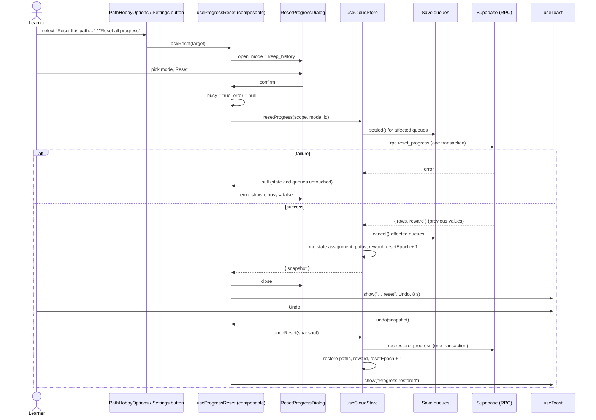

# Design Document: Reset Progress

## Overview

Reset progress lets a signed-in learner start a path, or every path, over without deleting any path. Two entry points open the same confirm dialog: "Reset this path…" in the hobby options menu of the Path_Page, and "Reset all progress" in the Settings Danger zone. The dialog offers two modes, "Wipe everything" and "Keep activity history". After a successful reset an Undo toast is shown for 8 seconds.

The design copies the structure of three existing features:

- **Delete with Undo** (`useCloudStore.remove` / `undoRemove`, `path.vue` `onDeleteHobby` / `undoDelete`): the store waits for the database, only then changes state, and hands back what it needs for Undo. The Undo runs from the app-wide toast.
- **Account deletion dialog** (`useAccountActions` + `AccountDeleteDialog` + `PathConfirmDialog`): a composable owns `open`, `busy` and `error`, a thin dialog wrapper renders them, a failure keeps the dialog open.
- **Progress rows** (`toProgressRow`, `parseProgressRow`, `queueFor`): the same row shape is used for the snapshot, and the same save queues are drained before the reset so a late write cannot undo it.

Decisions that go beyond the requirements:

| Decision | Reason |
| --- | --- |
| Reset and Undo are two database functions (`reset_progress`, `restore_progress`), called with `supabase.rpc` | One call is one transaction (Req 10.1). Same approach as `save_generated_path`. |
| `reset_progress` returns the rows it overwrote | The snapshot is taken in the same transaction as the update, so it is exact even for rows the client does not hold. |
| `parseProgressRow`, `stampCompletions` and `stampQuestTicks` are changed to keep timestamps of nodes that are not completed | Without it, Req 3.6 holds in the database but is lost on the next page load or the next tick. See "Activity history after a keep-history reset". |
| `SaveQueue` gets `settled()` and `cancel()` | A queued write of old progress would otherwise land after the reset and restore it. |
| `PathView` reloads its progress when a `resetEpoch` prop changes | `useSkillPath` reads the store once on mount, so the view would keep showing old progress. Remounting would destroy the element that must get focus back (Req 12.3). |
| `PathConfirmDialog` gets a `role` prop and a default slot | Req 12.1 asks for role `dialog`; the existing dialog is an `alertdialog`. The mode choice goes in the slot. |
| `useToast.show` gets a `durationMs` option | Req 8.2 needs 8 s; the shared default is 5 s. |
| "Reset this path…" appears only in the menu of the shown hobby | Req 1.1 and 1.2 say "the shown path". Other entries in the list keep Archive and Delete… only. |
| "Signed in" includes anonymous accounts | `settings.vue` already uses `hasSession` (anonymous or signed in) for the Danger zone, and anonymous users have the `authenticated` role under RLS. |

## Architecture



Layers, from the database up:

1. `supabase/migrations/20261109000000_reset_progress.sql`: the two functions.
2. `app/utils/cloud-api.ts`: `resetProgress`, `restoreProgress`.
3. `app/utils/progress-reset.ts` (new, pure): what a reset changes, the Undo restore, copy for the dialog.
4. `app/composables/useCloudStore.ts`: `resetProgress`, `undoReset`, `resetEpoch`.
5. `app/composables/useProgressReset.ts` (new): dialog state, toast, Undo.
6. `ResetProgressDialog.vue` (new) on top of `PathConfirmDialog`.
7. Wiring in `PathHobbyOptions` → `PathHobbyList` → `PathSidebar` / `PathView` → `path.vue`, and in `settings.vue`.

## Components and Interfaces

### Database: `20261109000000_reset_progress.sql`

Both functions are `security invoker`, so Row Level Security applies and `auth.uid()` is the learner (Req 10.2). Execute is revoked from `public` and `anon` and granted to `authenticated`, as for `save_generated_path`.

```sql
-- reset-progress: reset and restore of progress rows in one transaction.
-- Apply after 20261108000200_quests.sql.

create function public.reset_progress(
  p_scope text,                 -- 'path' | 'all'
  p_mode text,                  -- 'wipe' | 'keep_history'
  p_path_id uuid default null   -- required for 'path'
)
returns jsonb
language plpgsql
security invoker
set search_path = public
as $$
declare
  v_uid uuid := (select auth.uid());
  v_rows jsonb;
  v_reward jsonb := null;
  v_week text;
  v_count integer;
begin
  if v_uid is null then
    raise exception 'no_session' using errcode = '28000';
  end if;
  if p_scope not in ('path', 'all') or p_mode not in ('wipe', 'keep_history') then
    raise exception 'bad_arguments' using errcode = '22023';
  end if;
  -- Req 10.4: a path that is not the caller's fails the whole call, nothing changes.
  if p_scope = 'path' and (
    p_path_id is null
    or not exists (select 1 from public.paths where id = p_path_id and user_id = v_uid)
  ) then
    raise exception 'path_not_found' using errcode = 'P0002';
  end if;

  -- The values about to be overwritten: the Undo snapshot.
  select coalesce(jsonb_agg(jsonb_build_object(
    'path_id', pr.path_id,
    'completed', to_jsonb(pr.completed),
    'quests', pr.quests,
    'completed_at', pr.completed_at,
    'quest_ticks', pr.quest_ticks,
    'daily_pick', pr.daily_pick,
    'daily_bonus_count', pr.daily_bonus_count
  )), '[]'::jsonb)
  into v_rows
  from public.progress pr
  where pr.user_id = v_uid and (p_scope = 'all' or pr.path_id = p_path_id);

  -- A path with no progress row gets an empty one, so "reset" always ends in the same state.
  insert into public.progress as pr (path_id, user_id)
  select p.id, p.user_id from public.paths p
  where p.user_id = v_uid and (p_scope = 'all' or p.id = p_path_id)
  on conflict (path_id) do update set
    completed = '{}',
    quests = '{}',
    daily_pick = null,
    daily_bonus_count = 0,
    completed_at = case when p_mode = 'wipe' then '{}'::jsonb else pr.completed_at end,
    quest_ticks  = case when p_mode = 'wipe' then '{}'::jsonb else pr.quest_ticks end;

  if p_scope = 'all' and p_mode = 'wipe' then
    select weekly_reward_week, weekly_reward_count into v_week, v_count
    from public.profiles where id = v_uid;
    if found then
      v_reward := jsonb_build_object('week', v_week, 'count', v_count);
      update public.profiles set weekly_reward_week = null, weekly_reward_count = 0 where id = v_uid;
    end if;
  end if;

  return jsonb_build_object('rows', v_rows, 'reward', v_reward);
end;
$$;

create function public.restore_progress(p_rows jsonb, p_reward jsonb default null)
returns void
language plpgsql
security invoker
set search_path = public
as $$
declare
  v_uid uuid := (select auth.uid());
begin
  if v_uid is null then
    raise exception 'no_session' using errcode = '28000';
  end if;

  -- A row whose path is gone matches nothing and is skipped.
  update public.progress pr set
    completed = array(select jsonb_array_elements_text(r.value -> 'completed')),
    quests = r.value -> 'quests',
    completed_at = r.value -> 'completed_at',
    quest_ticks = r.value -> 'quest_ticks',
    daily_pick = nullif(r.value -> 'daily_pick', 'null'::jsonb),
    daily_bonus_count = (r.value ->> 'daily_bonus_count')::integer
  from jsonb_array_elements(p_rows) as r(value)
  where pr.user_id = v_uid and pr.path_id = (r.value ->> 'path_id')::uuid;

  if p_reward is not null then
    update public.profiles set
      weekly_reward_week = p_reward ->> 'week',
      weekly_reward_count = (p_reward ->> 'count')::integer
    where id = v_uid;
  end if;
end;
$$;

revoke execute on function public.reset_progress(text, text, uuid) from public, anon;
grant execute on function public.reset_progress(text, text, uuid) to authenticated;
revoke execute on function public.restore_progress(jsonb, jsonb) from public, anon;
grant execute on function public.restore_progress(jsonb, jsonb) to authenticated;

-- Rollback:
-- drop function public.reset_progress(text, text, uuid);
-- drop function public.restore_progress(jsonb, jsonb);
```

Notes:

- The `progress_touch_updated_at` trigger fires on the `on conflict do update` branch, so `updated_at` moves as for any update.
- Check constraints (`daily_bonus_count >= 0`, week format) cannot fail for values that were stored earlier, so a restore only fails for infrastructure reasons.
- `supabase/README.md` gets the new file in the migration list and a "Reset progress" block in the RLS checklist (see Testing Strategy).

### Types: `shared/types/cloud.ts`

```ts
export type ResetScope = 'path' | 'all'
export type ResetMode = 'wipe' | 'keep_history'

/** One overwritten Progress_Row as `reset_progress` returns it. Other columns are kept as read. */
export interface ResetSnapshotRow {
  path_id: string
  [column: string]: unknown
}

/** What Undo needs. `reward` is the Weekly_Reward before the reset, or null when the reset did not touch it. */
export interface ResetSnapshot {
  rows: ResetSnapshotRow[]
  reward: WeeklyReward | null
}
```

### Cloud API: `app/utils/cloud-api.ts`

Two methods are added to `CloudApi`. Like the others they throw `CloudError` on any error and make no decisions.

```ts
/** Resets progress in one transaction. Returns the raw `{ rows, reward }` snapshot. */
resetProgress(scope: ResetScope, mode: ResetMode, pathId: string | null): Promise<unknown>
/** Writes a snapshot back in one transaction. */
restoreProgress(rows: readonly ResetSnapshotRow[], reward: WeeklyReward | null): Promise<void>
```

```ts
async resetProgress(scope, mode, pathId) {
  const result: Outcome = await client.rpc('reset_progress', { p_scope: scope, p_mode: mode, p_path_id: pathId })
  check(result)
  return result.data ?? null
},
async restoreProgress(rows, reward) {
  check(await client.rpc('restore_progress', { p_rows: [...rows], p_reward: reward }))
},
```

### Snapshot parsing: `app/utils/cloud-rows.ts`

```ts
const snapshotSchema = z.object({
  rows: z.array(z.object({ path_id: z.string().min(1) }).passthrough()),
  reward: z.object({ week: dayKeySchema.nullable(), count: countSchema }).nullable(),
})

/** The RPC result as a ResetSnapshot, or null when its shape is wrong. */
export function parseResetSnapshot(raw: unknown): ResetSnapshot | null
```

### Activity history after a keep-history reset

Req 3.6 keeps `completed_at` and `quest_ticks` of a path whose `completed` and `quests` are now empty. Three existing functions assume that timestamps only exist for completed nodes and ticked quests, and would drop the kept history:

| Function | Today | Change |
| --- | --- | --- |
| `parseProgressRow` (`cloud-rows.ts`) | Keeps `completed_at` only for completed nodes; keeps tick times only for ticked quests. | Keep both for every node of the tree. `readQuestTicks` loses its `quests` argument and drops only entries that are not in the tree or are all-null. |
| `stampCompletions` (`cloud-library.ts`) | Output has only completed nodes. | New signature `(prev, before, after, now)`. A node completed in `after` keeps `prev[id]` if it was also completed in `before`, otherwise gets `now`. A node completed in neither keeps `prev[id]` (retained history). A node completed in `before` but not in `after` is dropped (Req 6.6 of accounts-cloud-save). |
| `stampQuestTicks` (`cloud-library.ts`) | Output has only entries of `after.quests`. | Iterate the union of the keys of `prev` and `after.quests`. For each quest: ticked in `after` keeps its time if it was ticked in `before`, else `now`; unticked in `after` but ticked in `before` loses its time; ticked in neither keeps `prev`. |

`applyProgressChange` in `quest-rules.ts` passes `path.progress` as the new `before` argument of `stampCompletions`. Data written by the app before this change contains no timestamps for non-completed nodes, so reading it is unaffected.

Known limit: if a learner completes again a node whose old timestamp was kept, the old timestamp is replaced by the new one. The streak counts days with any activity, so a day is only lost when that timestamp was the only activity of that day. Fixing it needs a separate history store, which Req 3.6 rules out (see Open Questions).

### Pure reset logic: `app/utils/progress-reset.ts` (new)

```ts
import type { ResetMode, ResetScope, ResetSnapshot, WeeklyReward } from '#shared/types/cloud'
import { emptyProgress } from '#shared/utils/progress-engine'
import type { CloudPath } from './cloud-library'
import { parseProgressRow } from './cloud-rows'

export const UNDO_WINDOW_MS = 8000

export interface ResetPlan {
  /** Completed_at and quest ticks are cleared too (Wipe everything). */
  clearsHistory: boolean
  /** The account-wide Weekly_Reward is cleared (all + wipe only, Req 4.1 to 4.3). */
  resetsReward: boolean
}

export function resetPlan(scope: ResetScope, mode: ResetMode): ResetPlan {
  const wipe = mode === 'wipe'
  return { clearsHistory: wipe, resetsReward: wipe && scope === 'all' }
}

/**
 * The paths after a reset. Every path of `scope` (all of them, archived ones
 * included, for 'all'; the one with `pathId` for 'path') gets empty Progress,
 * no Daily_Pick and a zero Daily_Bonus_Count; with 'wipe' also no
 * Completion_Timestamps and no Tick_Times. Other paths are returned as they are
 * (same object). Only progress fields change.
 */
export function withProgressReset(
  paths: readonly CloudPath[],
  scope: ResetScope,
  pathId: string | null,
  mode: ResetMode,
): CloudPath[]

/** The Weekly_Reward after the reset: `{ week: null, count: 0 }` when the plan resets it, else unchanged. */
export function rewardAfterReset(reward: WeeklyReward | null, plan: ResetPlan): WeeklyReward | null

/**
 * Puts snapshot rows back. A row is read with `parseProgressRow` against the
 * tree of its path, so it follows the same rules as a page load. Rows of paths
 * that are no longer held are skipped.
 */
export function withRestoredProgress(paths: readonly CloudPath[], snapshot: ResetSnapshot): CloudPath[]

/** One sentence under a mode in the dialog (Req 3.3). */
export function resetModeDescription(scope: ResetScope, mode: ResetMode): string
```

`withProgressReset` mirrors the SQL of `reset_progress` column by column. The two are kept in step by the property tests on the TypeScript side and the SQL checklist on the database side.

Copy used by `resetModeDescription`:

| Scope | Mode | Sentence |
| --- | --- | --- |
| path | wipe | "Clears completed skills, quests and activity history of this path. Your streak can drop." |
| path | keep_history | "Clears completed skills and quests of this path. Keeps your activity history, so your streak stays." |
| all | wipe | "Clears completed skills, quests, activity history and the weekly reward on every path. Your streak can drop." |
| all | keep_history | "Clears completed skills and quests on every path. Keeps your activity history and weekly reward." |

### Save queues: `app/utils/save-queue.ts`

```ts
export interface SaveQueue<T> {
  push(value: T): void
  retry(): void
  /** Resolves when nothing is in flight or waiting. Never rejects; a failed write only leaves its value for `retry`. */
  settled(): Promise<void>
  /** Forgets the waiting value and the value kept after a failure. A write already in flight is not aborted. */
  cancel(): void
}
```

`settled` is implemented with a list of resolvers that `start` calls when it finishes and finds no `waiting` value. `cancel` sets `waiting` and `failed` to `null`.

### Cloud_Store: `app/composables/useCloudStore.ts`

State gets one field, `resetEpoch: number` (0 in `emptyState` and in the `loading` state set by `bootstrap`). It increases on every successful reset and Undo and is exposed as `resetEpoch: ComputedRef<number>`.

```ts
export interface ResetResult {
  /** null only when the database call worked but its answer could not be read; there is then no Undo. */
  snapshot: ResetSnapshot | null
}

CLOUD_MESSAGES.resetFailed = "Couldn't reset your progress. Nothing was changed. Try again."
CLOUD_MESSAGES.undoFailed  = "Couldn't undo the reset. Your progress stays reset."

async function resetProgress(scope: ResetScope, mode: ResetMode, id?: string): Promise<ResetResult | null> {
  const cloud = api()
  if (!cloud || state.value.status !== 'ready') return null           // Req 10.3
  const target = scope === 'path' ? find(id ?? '') : undefined
  if (scope === 'path' && !target) return null
  const plan = resetPlan(scope, mode)
  const keys = scope === 'path' ? [target!.pathId] : state.value.paths.map((p) => p.pathId)

  await settleQueues(keys, plan.resetsReward)                          // pending writes land first
  let raw: unknown
  try {
    raw = await cloud.resetProgress(scope, mode, target?.pathId ?? null)
  } catch {
    return null                                                         // no state change, no toast (Req 9.2)
  }
  cancelQueues(keys, plan.resetsReward)                                 // also dismisses their "couldn't save" toasts

  const profile = state.value.profile
  state.value = {
    ...state.value,
    paths: withProgressReset(state.value.paths, scope, target?.pathId ?? null, mode),
    profile: profile ? { ...profile, weeklyReward: rewardAfterReset(profile.weeklyReward, plan) } : profile,
    resetEpoch: state.value.resetEpoch + 1,
  }
  return { snapshot: parseResetSnapshot(raw) }
}

async function undoReset(snapshot: ResetSnapshot): Promise<boolean> {
  const cloud = api()
  if (!cloud) { toast.show(CLOUD_MESSAGES.undoFailed); return false }
  const keys = snapshot.rows.map((row) => row.path_id)
  await settleQueues(keys, snapshot.reward !== null)
  try {
    await cloud.restoreProgress(snapshot.rows, snapshot.reward)
  } catch {
    toast.show(CLOUD_MESSAGES.undoFailed)                               // post-reset data stays (Req 8.5)
    return false
  }
  cancelQueues(keys, snapshot.reward !== null)
  const profile = state.value.profile
  state.value = {
    ...state.value,
    paths: withRestoredProgress(state.value.paths, snapshot),
    profile: profile && snapshot.reward ? { ...profile, weeklyReward: snapshot.reward } : profile,
    resetEpoch: state.value.resetEpoch + 1,
  }
  return true
}
```

Helpers inside the store:

- `settleQueues(keys, withReward)`: `await Promise.all([...keys.map((k) => queues.get(k)?.settled()), withReward ? rewardQueue?.settled() : undefined])`.
- `cancelQueues(keys, withReward)`: calls `cancel()` on those queues and dismisses `failureToasts.get(key)` through `toast.dismiss`, so a "Retry" button cannot write old progress back. A `settled()` write that fails shows its sticky toast; `cancelQueues` removes it after a successful reset.

The paths, the reward and `resetEpoch` change in one assignment, so the Path, Quests and Profile pages see the new XP, level, streak and weekly values together (Req 4.4), the same way `progressStore.save` does it. Streak and weekly values are derived from `paths` and `weeklyReward`, so they need no extra code.

The "path reset when the progress row did not exist" case needs nothing on the client: the function creates an empty row.

### Dialog state: `app/composables/useProgressReset.ts` (new)

Modeled on `useAccountActions`: plain refs per call, no global state. The Path_Page and the Settings_Page each call it.

```ts
export type ResetTarget =
  | { scope: 'path'; id: string; hobby: string }
  | { scope: 'all' }

export function useProgressReset() {
  const cloud = useCloudStore()
  const toast = useToast()

  const open = ref(false)
  const busy = ref(false)
  const error = ref<string | null>(null)
  const mode = ref<ResetMode>('keep_history')
  /** Kept after closing so the leave transition shows no placeholder title. */
  const target = ref<ResetTarget>({ scope: 'all' })
  const pathCount = computed(() => cloud.paths.value.length)

  function askReset(next: ResetTarget): void {
    target.value = next
    mode.value = 'keep_history'     // Req 3.2
    error.value = null
    open.value = true
  }

  function cancelReset(): void {
    if (busy.value) return          // PathConfirmDialog also ignores Cancel while busy
    open.value = false              // no store call (Req 7.3)
  }

  function setMode(next: ResetMode): void {
    if (busy.value) return
    mode.value = next
    error.value = null              // Req 9.6
  }

  /** Resolves true when the reset succeeded, so the page can restore focus. */
  async function confirmReset(): Promise<boolean> {
    if (busy.value) return false
    busy.value = true
    error.value = null              // Req 9.6
    const { value: t } = target
    const result = await cloud.resetProgress(t.scope, mode.value, t.scope === 'path' ? t.id : undefined)
    busy.value = false              // Req 9.5
    if (!result) {
      error.value = CLOUD_MESSAGES.resetFailed   // dialog stays open, no toast (Req 9.1, 9.4)
      return false
    }
    open.value = false              // Req 7.6
    showUndo(t, result.snapshot)
    return true
  }

  function showUndo(t: ResetTarget, snapshot: ResetSnapshot | null): void {
    const message = t.scope === 'path' ? `${t.hobby} progress reset` : 'All progress reset'
    toast.show(
      message,
      snapshot ? { label: 'Undo', run: () => void undo(snapshot) } : null,
      { durationMs: UNDO_WINDOW_MS },
    )                                // replaces any visible Undo toast, dropping its snapshot (Req 8.7)
  }

  /** Runs from the app-wide toast, possibly after the page was left: it only uses the store and the toast. */
  async function undo(snapshot: ResetSnapshot): Promise<void> {
    if (await cloud.undoReset(snapshot)) toast.show('Progress restored')   // Req 8.4
  }

  return { open, busy, error, mode, target, pathCount, askReset, cancelReset, setMode, confirmReset }
}
```

The snapshot lives only in the closure of the toast action. When the toast hides (after `UNDO_WINDOW_MS`, or when another toast replaces it) nothing refers to the closure, so the saved values are discarded (Req 8.6, 8.7). The `AppToast` timer pauses while the toast is hovered or focused, as it does for every toast, so the window can be longer than 8 s for a learner who is on the Undo button.

### Toast: `useToast.ts`, `AppToast.vue`

- `Toast` gets `durationMs: number`.
- `show(message, action, options: { sticky?: boolean; durationMs?: number })` sets `durationMs: options.durationMs ?? TOAST_DURATION_MS`.
- `AppToast` starts `remaining` from `toast.value?.durationMs ?? TOAST_DURATION_MS` instead of the constant. Existing callers are unchanged.

### `PathConfirmDialog.vue` changes

```ts
withDefaults(defineProps<{ …; role?: 'alertdialog' | 'dialog' }>(), { …, role: 'alertdialog' })
```

- The card uses `:role="role"`.
- A default slot is added between the message paragraph and the error paragraph, for content such as the mode choice.
- The title/message ids, focus trap, `busy` handling, `role="alert"` error and opener focus return stay as they are. That covers Req 7.2, 7.3, 7.5, 12.2 to 12.4.

### `ResetProgressDialog.vue` (new, `app/components/`)

Same role as `AccountDeleteDialog`: a wrapper that gives `PathConfirmDialog` its text.

```vue
<script setup lang="ts">
import { useId } from 'vue'
import type { ResetMode, ResetScope } from '#shared/types/cloud'
import { resetModeDescription } from '~/utils/progress-reset'

defineProps<{
  open: boolean
  scope: ResetScope
  /** Hobby name for the scope 'path'. */
  hobby: string | null
  /** Number of paths for the scope 'all'. */
  pathCount: number
  mode: ResetMode
  busy: boolean
  error: string | null
}>()
const emit = defineEmits<{ confirm: []; cancel: []; 'update:mode': [mode: ResetMode] }>()
</script>
```

Template, in outline:

```vue
<PathConfirmDialog
  :open="open"
  role="dialog"
  :title="scope === 'path' ? `Reset your ${hobby ?? ''} path?` : 'Reset all your progress?'"
  :message="scope === 'path'
    ? 'Your skill tree stays. Choose what happens to your progress.'
    : `This resets ${pathCount} ${pathCount === 1 ? 'path' : 'paths'}, archived ones included. Your skill trees stay.`"
  :confirm-label="scope === 'path' ? 'Reset path' : 'Reset all progress'"
  tone="danger"
  :busy="busy"
  :error="error"
  @confirm="emit('confirm')"
  @cancel="emit('cancel')"
>
  <fieldset :disabled="busy" class="mt-1 flex w-full flex-col gap-2 text-left">
    <legend class="sr-only">What should be reset?</legend>
    <label v-for="m in MODES" :key="m.value" class="… has-checked:border-ink has-focus-visible:outline-2 …">
      <input type="radio" :name="groupName" :value="m.value" :checked="mode === m.value" class="sr-only"
             @change="emit('update:mode', m.value)">
      <b>{{ m.label }}</b>
      <span>{{ resetModeDescription(scope, m.value) }}</span>
    </label>
  </fieldset>
</PathConfirmDialog>
```

`MODES` is `[{ value: 'keep_history', label: 'Keep activity history' }, { value: 'wipe', label: 'Wipe everything' }]`; the radios use the same label-wrapping style as the provider choice in `settings.vue`. The confirm button is enabled on open and needs no typed text (Req 7.4). Styling uses token utilities only.

### Entry point 1: path page

`PathHobbyOptions.vue`

```ts
const props = defineProps<{ hobby: string; alwaysVisible: boolean; canReset: boolean }>()
const emit = defineEmits<{ archive: []; reset: []; delete: [] }>()
function choose(action: 'archive' | 'reset' | 'delete'): void {
  closeMenu(true)                      // focus returns to the "⋯" button first, as for delete
  emit(action)
}
```

A new menu item sits between Archive and the separator, rendered with `v-if="canReset"`: `<PathIcon name="reset" …/> Reset this path…`, class `text-ink`, `role="menuitem"`, `tabindex="-1"`. Keyboard navigation already works from `items()`, which reads the DOM.

`app/utils/icons.ts`: add `'reset'` to the icon name list and a counter-clockwise arrow shape to the shape table (stroke icon, `filled: false`, like `trash`).

`PathHobbyList.vue`

```ts
const emit = defineEmits<{ …; reset: [entry: HobbyEntry] }>()
```
```vue
<PathHobbyOptions … :can-reset="entry.id === activeId" @reset="emit('reset', entry)" />
```

Demo entries have `to: null` and render no `PathHobbyOptions`, so Demo_Mode shows no reset item (Req 1.3, 11.1).

`PathSidebar.vue`: add `reset: [entry: HobbyEntry]` to its emits and `@reset="emit('reset', $event)"` on `PathHobbyList`.

`PathView.vue`

```ts
const props = defineProps<{ …; /** Increases when the store reset or restored progress. */ resetEpoch?: number }>()
const emit = defineEmits<{ …; 'reset-hobby': [id: string] }>()

function onReset(entry: HobbyEntry): void { emit('reset-hobby', entry.id) }

watch(() => props.resetEpoch, () => {
  reload()                // re-reads the store: progress, states, current node, percent
  selectedId.value = null // the Current_Node shows again (Req 6.3)
  sheetOpen.value = false // the node sheet, if open, described old progress
})
```

`@reset="onReset"` is added on both `PathSidebar` and the mobile `PathHobbyList` (sheet). The dialog does not live in `PathView`; the page owns it, like the Undo of Delete.

`useSkillPath.ts` returns one more member, `reload(): void { progress.value = store.load() }`, and `onMounted` calls it. Nothing else in the composable changes.

`path.vue`

```ts
const reset = useProgressReset()

function onResetHobby(id: string): void {
  const hobby = cloud.paths.value.find((p) => p.record.id === id)?.record.tree.hobby
  if (hobby) reset.askReset({ scope: 'path', id, hobby })
}

async function onConfirmReset(): Promise<void> {
  if (!(await reset.confirmReset())) return
  // The opener is normally still mounted, so PathConfirmDialog returns focus to it.
  // If it is gone (e.g. the hobby sheet closed), fall back to the hobby list heading.
  await nextTick()
  if (!document.activeElement || document.activeElement === document.body) {
    document.getElementById('sidebar-hobbies')?.focus()
  }
}
```

Template additions:

```vue
<PathView … :reset-epoch="cloud.resetEpoch.value" @reset-hobby="onResetHobby" />
…
<ResetProgressDialog
  v-if="!isDemo"
  :open="reset.open.value"
  :scope="reset.target.value.scope"
  :hobby="reset.target.value.scope === 'path' ? reset.target.value.hobby : null"
  :path-count="reset.pathCount.value"
  :mode="reset.mode.value"
  :busy="reset.busy.value"
  :error="reset.error.value"
  @update:mode="reset.setMode"
  @confirm="onConfirmReset"
  @cancel="reset.cancelReset"
/>
```

The shown path stays selected because nothing touches `chosenId` or the route (Req 6.2).

### Entry point 2: Settings

`settings.vue` adds `const reset = useProgressReset()` and a row at the top of the Danger zone card (inside the existing `v-if="hasSession"`):

```vue
<div :class="[rowClass, dividerClass]">
  <span :class="rowTextClass">
    <b :class="rowTitleClass">Reset all progress</b>
    <span :class="rowHintClass">Starts every path over. Your paths stay</span>
  </span>
  <button type="button" :disabled="cloud.paths.value.length === 0" :class="[… danger button classes …, 'disabled:opacity-60']"
          @click="reset.askReset({ scope: 'all' })">
    Reset all progress
  </button>
</div>
```

The button is disabled while the Cloud_Store holds no paths, which includes the loading state (Req 2.4). The page renders `ResetProgressDialog` next to `AccountDeleteDialog` with `scope="all"`, `:hobby="null"` and `@confirm="reset.confirmReset"`. The opener (the button) stays mounted, so focus returns to it (Req 12.3). After a reset, `cloud.paths` is replaced, so the page needs nothing else. The "Delete account" row keeps its place below.

The Quests page needs no change: `ensureDailyPick` already creates a pick for any path whose `dailyPick` is null (Req 5.2).

## Data Models

No table or column is added. The reset only writes columns that already exist:

| Column (`progress`) | Wipe everything | Keep activity history |
| --- | --- | --- |
| `completed` | `{}` | `{}` |
| `quests` | `{}` | `{}` |
| `completed_at` | `{}` | unchanged |
| `quest_ticks` | `{}` | unchanged |
| `daily_pick` | `null` | `null` |
| `daily_bonus_count` | `0` | `0` |

| Column (`profiles`) | all + wipe | all + keep_history, any path reset |
| --- | --- | --- |
| `weekly_reward_week` | `null` | unchanged |
| `weekly_reward_count` | `0` | unchanged |

Columns of `paths` are never written (Req 6.1).

Wire format of the RPC result (`reset_progress`), kept in `ResetSnapshot`:

```json
{
  "rows": [
    { "path_id": "…", "completed": ["a"], "quests": {}, "completed_at": { "a": 1700000000000 },
      "quest_ticks": {}, "daily_pick": null, "daily_bonus_count": 1 }
  ],
  "reward": { "week": "2026-11-09", "count": 2 }
}
```

`reward` is `null` unless the reset cleared the Weekly_Reward. `rows` holds only the rows that existed before the reset.

## Error Handling

| Situation | Behavior | Req |
| --- | --- | --- |
| Reset RPC fails (network, RLS, constraint, foreign path) | Store returns `null`. State, queues and the screen behind the dialog are unchanged. The dialog stays open, shows `CLOUD_MESSAGES.resetFailed` in its `role="alert"` paragraph, re-enables its controls. No toast, no Undo. | 9.1 to 9.5, 10.4 |
| No session or the store is not `ready` | `api()` is `null` or status is not `ready`; same path as an RPC failure. The function also raises `no_session` for a call without `auth.uid()`. | 10.3 |
| Path id not in the store (path deleted in another tab) | Store returns `null` before any request. The dialog shows the same message. | 9.1 |
| Error after a Mode change or a new confirm | `setMode` and `confirmReset` set `error` to `null` first. | 9.6 |
| Reset worked, answer could not be parsed | State is updated, the dialog closes, the toast shows without an Undo button. | 8.1 |
| A pending progress write fails while the queues are drained | Its sticky "couldn't save" toast appears; if the reset then succeeds, `cancelQueues` dismisses it and drops its value. If the reset fails, it stays with its Retry. | 9.2 |
| Undo RPC fails | Store shows `CLOUD_MESSAGES.undoFailed`, state keeps the post-reset values. | 8.5 |
| Undo for a path deleted meanwhile | The SQL update matches no row and the client skips the path. No error. | 8.3 |
| Second reset while an Undo toast shows | `toast.show` replaces it; the first snapshot is no longer referenced. | 8.7 |
| Double confirm | `confirmReset` returns at once while `busy`. | 7.5 |

Known limit: a write that is already in flight when `cancel()` runs cannot be aborted. `settled()` before the RPC makes this rare for the reset itself (the in-flight write finishes first). It remains possible only for writes started between `settled()` and the RPC, which the modal dialog prevents.

## Correctness Properties

*A property is a characteristic or behavior that should hold true across all valid executions of a system-essentially, a formal statement about what the system should do. Properties serve as the bridge between human-readable specifications and machine-verifiable correctness guarantees.*

The properties below test the pure TypeScript layer (`progress-reset.ts`, `cloud-rows.ts`, `cloud-library.ts`) and the store with a mock `CloudApi`. The SQL functions are covered by the checklist in the Testing Strategy.

### Property 1: Reset postcondition by mode

For any `CloudPath`, any scope and any mode, after `withProgressReset` the path has empty `progress` (no completed ids, no quest ticks), `dailyPick` equal to `null` and `dailyBonusCount` equal to 0; with mode `wipe` its `completedAt` and `questTicks` are empty, and with mode `keep_history` they are deep-equal to the values before the reset.

**Validates: Requirements 3.4, 3.5, 3.6, 5.1**

### Property 2: Reset touches only the scope and only progress fields

For any list of paths (archived and not), any mode and any scope: with scope `all` every path is reset; with scope `path` and a target id, every path other than the target is the same object as before. For every reset path, `pathId`, `record` (including `archived`, `addedAt` and `tree`) and `level` equal their values before.

**Validates: Requirements 1.4, 2.3, 6.1**

### Property 3: Weekly reward follows scope and mode

For any weekly reward (including `null`), any scope and any mode, `rewardAfterReset` returns `{ week: null, count: 0 }` when the scope is `all` and the mode is `wipe` (and the input was not `null`), and returns the input unchanged in every other combination.

**Validates: Requirements 4.1, 4.2, 4.3**

### Property 4: Reset is idempotent

For any list of paths, scope, target and mode, applying `withProgressReset` twice gives a list deep-equal to applying it once.

**Validates: Requirements 3.4, 3.5**

### Property 5: Kept history survives a save and reload

For any `CloudPath` and any scope and mode, writing the reset path with `toProgressRow` and reading it back with `parseProgressRow` against its tree gives the same `progress`, `completedAt`, `questTicks`, `dailyPick` and `dailyBonusCount` as the reset path held in memory.

**Validates: Requirements 3.6**

### Property 6: Later saves keep retained history

For any previous `completedAt` and `questTicks` and any progress change `before → after`, `stampCompletions` and `stampQuestTicks` keep the timestamp of every node (and tick time of every quest) that is not completed (ticked) in `before` or `after`; they drop the timestamp of a node completed in `before` and not in `after`; and they give `now` to a node completed in `after` and not in `before`.

**Validates: Requirements 3.6**

### Property 7: Undo restores the previous values

For any list of paths, scope, target and mode, let `snapshot` hold the `toProgressRow` rows of the paths in scope and the reward before the reset (reward only when the plan resets it). Then `withRestoredProgress(withProgressReset(paths, …), snapshot)` has, for every path, `progress`, `completedAt`, `questTicks`, `dailyPick` and `dailyBonusCount` deep-equal to the original, and restoring the reward gives the reward from before the reset.

**Validates: Requirements 8.3**

### Property 8: A failed reset changes nothing

For any store state and any failing `CloudApi.resetProgress` (a rejection with any error), `useCloudStore().resetProgress` returns `null`, leaves `paths`, `profile` and `resetEpoch` deep-equal to their values before, does not cancel any queue, and does not call `restoreProgress`.

**Validates: Requirements 9.2, 9.3, 9.4**

## Testing Strategy

**Property tests** (`fast-check`, already used in `tests/property/`; at least 100 runs each). Each test carries the tag `Feature: reset-progress, Property N: <text>`. Generators produce `CloudPath` values with valid trees, random completed ids, quest ticks that match their quests, timestamps, daily picks, bonus counts and `archived` flags, built from the existing fixtures used by the `cloud-rows` and `quest-rules` tests. File: `tests/property/reset-progress.property.test.ts`.

**Existing tests that change** (the behavior they pin is relaxed on purpose, see "Activity history after a keep-history reset"):

- `parseProgressRow` tests for dropping timestamps of non-completed nodes and tick times of unticked quests.
- `stampCompletions` / `stampQuestTicks` tests, for the new `before` argument and for retained entries.
- `applyProgressChange` tests that call `stampCompletions`.

**Unit and component tests** (`tests/unit/`):

- `progress-reset`: `resetPlan` table, `resetModeDescription` for all four combinations (non-empty, one sentence), `parseResetSnapshot` with valid and invalid shapes.
- `save-queue`: `settled()` resolves after an in-flight write and its waiting value; `cancel()` drops the waiting and failed values.
- `useCloudStore` with a mock API: success updates paths, reward and `resetEpoch` in one assignment; no session returns `null`; unknown path id returns `null`; `undoReset` failure keeps state and shows the error toast; queues are drained before the call and cancelled after a success only; a cancelled queue's "Retry" toast is gone.
- `useProgressReset` with a mock store: preselected `keep_history`; `confirmReset` busy lock; failure keeps the dialog open, shows the message, no toast; `setMode` clears the error; success closes the dialog and shows a toast with an Undo action and `durationMs` 8000; a second reset replaces the toast; Undo shows "Progress restored".
- `ResetProgressDialog`: role `dialog` with `aria-labelledby` and `aria-describedby`; text for both scopes (hobby name, "1 path" / "N paths"); two radios in one group, the preselected one checked; descriptions shown; confirm enabled on open; all controls disabled while `busy`; error in a `role="alert"` element; focus starts on Cancel.
- `PathHobbyOptions` / `PathHobbyList`: "Reset this path…" only when `canReset`, only for the active entry, not for demo entries; menu keyboard navigation includes it; the emit chain reaches `PathView`.
- `PathView`: a changed `resetEpoch` reloads progress, so the first node is current.
- `settings` page: the Danger zone row shows with a session, the button is disabled with zero paths, it is absent without a session.
- `AppToast`: honors `durationMs`; existing toasts keep 5 s.

**Database checklist**: `supabase/README.md` gets the new migration in the list and a "Reset progress" section in the RLS checklist, run by hand like the existing steps:

| # | Step | Expected result |
| --- | --- | --- |
| R1 | As A: `select public.reset_progress('path', 'wipe', '<A path id>');` | Returns A's old row; the row is empty; other paths of A unchanged |
| R2 | As A: `select public.reset_progress('all', 'keep_history');` | All A's progress rows have empty `completed` and `quests`, null `daily_pick`, 0 bonus; `completed_at` and `quest_ticks` unchanged; profile reward unchanged |
| R3 | As A: `select public.reset_progress('all', 'wipe');` | Same as R2 but history empty; reward week null and count 0; the result's `reward` holds the old values |
| R4 | As B: `select public.reset_progress('path', 'wipe', '<A path id>');` | Error `path_not_found`; A's rows unchanged |
| R5 | As B: `select public.reset_progress('all', 'wipe');` | B's rows only; A's rows unchanged |
| R6 | No session (`anon`): `select public.reset_progress('all', 'wipe');` | Permission denied |
| R7 | As A: bad scope or mode | Error `bad_arguments`; nothing changed |
| R8 | As A: run R3, then `restore_progress` with the returned `rows` and `reward` | Rows and profile reward equal their values before R3 |
| R9 | As A: `restore_progress` with a `path_id` of B | A's rows and B's rows unchanged |
| R10 | As A: a path with no progress row, then R1 on it | An empty progress row exists afterwards |

**Not covered by automated tests**: atomicity of the SQL (a single plpgsql call runs in one transaction), RLS, and the 8 s timing in a real browser. Atomicity is checked by R1 to R5 and by code review; the timing by a fake-timer test of `AppToast` and one manual check.

**Changelog**: when the implementation is finished, add under `## [Unreleased]` → `### Added` in `CHANGELOG.md`: "Reset progress from the ⋯ menu of a path or from Settings → Danger zone, either wiping everything or keeping your activity history, with Undo for 8 seconds (spec: reset-progress)." Existing entries stay unchanged (Req 13).

## Open Questions

1. **Re-completing a node with kept history.** Because Req 3.6 keeps history in the same columns that new activity uses, completing again a node (or re-ticking a quest) that has a kept timestamp overwrites that timestamp with the new time. The learner can lose a streak day only when that timestamp was the only activity of its day. A separate history store (for example a `history` array on `progress`) would remove this, but conflicts with the wording of Req 3.4 to 3.6 and 8.3. The design follows the requirements; the choice is for the requirements owner.
2. **Reset from the menu of a non-shown hobby.** The design offers "Reset this path…" only for the shown hobby, as Req 1.1 and 1.2 say. Adding it to every hobby entry is a one-line change (`:can-reset="true"`) if wanted.
