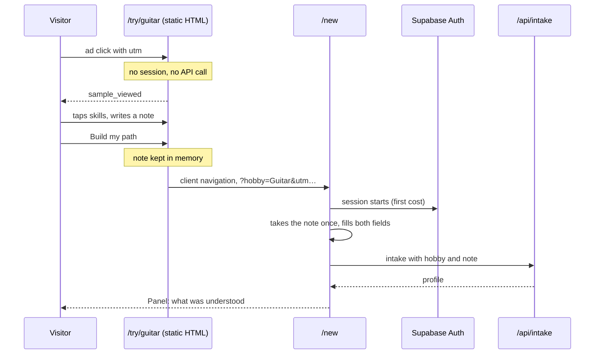

# Design Document: Sample path page

## Overview

`/try/<slug>` is one new page that composes existing components around a static Sample. It adds no endpoint, no table and no dependency. The work has four parts:

1. **Data**: three JSON files, a schema, and a function that turns a Sample into the Skill_Tree the path components already draw.
2. **Page**: `app/pages/try/[hobby].vue` and a small set of `Sample*` components that arrange existing components as in the mockups `dev_docs/SAMPLE PAGE · *.png`.
3. **Handoff**: a note kept in memory and a query on `/new`, picked up by the existing hobby handoff.
4. **Analytics**: four browser events, and the fix of bug APP-ANALYTICS-01 (one identity for browser and server events).

Requirements are in [requirements.md](requirements.md), scenarios and decisions in [scenarios.md](scenarios.md).

### What the code already gives us

| Need | Existing piece | Reuse |
|---|---|---|
| Draw the path | `PathCanvas`, `PathNode`, `PathNodeLabel`, `PathTrail`, `PathProgressRing`, `PathNextUpTag`, `PathSectionHeader`, `usePathLayout`, `useViewportClass` | As is, plus an optional preview prop (below) |
| Node looks | `deriveNodeStates(tree, emptyProgress())` already gives: first skill `current`, milestones `milestone`, the rest `locked` | As is |
| Finish line card | `PathFinishLine` | Optional `plain` prop |
| Quest rows | `PathQuestItem` | Optional `readonly` prop |
| Sheets | `PathBottomSheet` with `useFocusTrap` (Escape, focus trap, scroll lock) | As is, twice |
| Sticky right column | `PathSidePanel` | As is |
| Video card and player | `WatchVideoCard` (`layout="list"`), `WatchEmbedPlayer` | As is. `WatchSection` is not used: it records events |
| Note textarea | `HobbyNoteField` (grows with `field-sizing`, 800 limit, counter) | Optional label and placeholder props |
| Landing offer | `#founding` section of the landing page, `?landing=1` keeps visitors with paths on it | Link target of the founding line |
| Primary button | `AppButton` | As is |
| Mascot | `mascot/wick.vue`, `toWickOutfit` | As is |
| Logo and header row | Markup of the `/new` header | Same classes in `SampleTopBar` |
| Hobby handoff | `/new` reads `?hobby=`, fills the field, starts intake once a session is ready, removes `hobby` from the URL | Extended by two lines |
| Event client | `track()` in `app/utils/analytics.ts` | Four names added |

### Key design decisions

1. **The Sample becomes a Skill_Tree.** `sampleToTree` maps `name` to `title`, `desc` to `description`, and chains the skills with prerequisites. Everything downstream (layout, node states, labels) is existing, tested code. No second renderer.
2. **Preview_Mode is data, not a branch per component.** `PathCanvas` gets one optional prop, `preview`, an object with the tag text, a sub label per node and a header model per section. The page computes it with pure helpers. With the prop absent, every code path is the one of today.
3. **No session is a property of the route, checked in one function.** `startsSession(path, query)` decides for the global middleware. The page's own files import nothing that can reach the database or an API, and a static test keeps it so.
4. **The note travels in memory.** A module variable holds `{ hobby, note, at }` for the one client navigation to `/new`. It is never written to storage, which also keeps the rule of `path-intake` (AS7: the Note is never stored).
5. **The browser tells the server who it is.** The two build requests carry the PostHog ids in headers the app sets itself. The server falls back to the user id.

## Architecture

### Module layout

```
data/sample-paths.json                 the export, as supplied by the owner (kept; the source)
data/samples/README.md                 how to refresh the samples
data/samples/photography.json          Sample_Files, written by the script below
data/samples/guitar.json
data/samples/birdwatching.json

scripts/build-sample-paths.mjs         export → Sample_Files; rerunnable

shared/types/sample-path.ts            SamplePath, SampleSection, SampleSkill, SampleVideo
shared/utils/sample-slugs.ts           SAMPLE_SLUGS, isSampleSlug, hobbyTextFromSlug, CAMPAIGN_KEYS, campaignQuery
shared/utils/sample-path.ts            samplePathSchema, parseSamplePath, sampleToTree, sampleCounts

app/utils/sample-paths.ts              static imports of the three files; getSample(slug)
app/utils/sample-copy.ts               every string of Requirement 13
app/utils/sample-view.ts               previewModel, canvasPreview, toRankedVideo, introLine
app/utils/sample-handoff.ts            handoffTarget, setSampleHandoff, takeSampleHandoff
app/utils/sample-events.ts             utmProps, createSampleTracker
app/utils/session-start.ts             startsSession

app/pages/try/[hobby].vue              route rule, head, <SampleView>
app/components/sample/SampleView.vue          orchestration (selection, sheets, note, tracker)
app/components/sample/SampleTopBar.vue        logo, tag, Log in, Build my own path
app/components/sample/SampleIntroCard.vue     Wick, intro line, h1, help text
app/components/sample/SampleSkillPreview.vue  tag, position, title, quests, videos
app/components/sample/SampleVideoList.vue     WatchVideoCard + WatchEmbedPlayer, no recorder
app/components/sample/SampleMineBox.vue       heading, HobbyNoteField, AppButton, small line, Skip slot
app/components/sample/SampleMineBar.vue       mobile sticky bar
app/components/sample/SampleFoundingLine.vue  desktop line under the box, a plain link
```

Changed files:

| File | Change |
|---|---|
| `app/middleware/auth.global.ts` | Calls `startsSession`; `/try/` paths start nothing |
| `app/components/path/PathCanvas.vue` | Optional `preview` prop |
| `app/components/path/PathNode.vue` | Optional `statusText` prop for the accessible name |
| `app/components/path/PathNextUpTag.vue` | Optional `label` prop, default "NEXT UP"; width follows the text when a label is given |
| `app/components/path/PathSectionHeader.vue` | Optional `countText` and `note` props |
| `app/components/path/PathFinishLine.vue` | Optional `plain` prop |
| `app/components/path/PathQuestItem.vue` | Optional `readonly` prop |
| `app/components/hobby/HobbyNoteField.vue` | Optional `label`, `hint`, `placeholder` props |
| `app/pages/new.vue` | Handoff takes the note; `start=0` fills without starting |
| `app/utils/landing.ts` | `withoutHobbyQuery` also drops `start` |
| `app/utils/analytics.ts` | Four event names; `analyticsHeaders` (Requirement 12) |
| `nuxt.config.ts` | `routeRules` that prerender the three pages |
| `tests/unit/conventions.test.ts` | Scans `app/components/sample` and the page |

Changed for Requirement 12 only: `app/composables/useHobbyBuilder.ts`, `server/api/tree.post.ts`, `server/api/intake.post.ts`, `server/utils/llm-handlers.ts`, `server/utils/intake-handlers.ts`, `server/utils/ai-observability.ts`, and a new `server/utils/analytics-events.ts`.

### Page flow



## Components and Interfaces

### Types and schema (`shared/types/sample-path.ts`, `shared/utils/sample-path.ts`)

```ts
export interface SampleVideo { id: string; title: string; channel: string; durationSeconds: number; thumbnailUrl: string }
export interface SampleSkill { id: string; title: string; desc: string; milestone: boolean; quests: QuestTriple<string>; videos: SampleVideo[] }
export interface SampleSection { level: Level; name: string; skills: SampleSkill[] }
export interface SamplePath { slug: SampleSlug; hobby: string; mascot: string; finish: string; sections: SampleSection[] }

export function parseSamplePath(value: unknown, slug: SampleSlug): Result<SamplePath, string[]>  // errors read "<path>: <message>"
export function sampleToTree(sample: SamplePath): SkillTree
export function sampleCounts(sample: SamplePath): { skills: number; sections: number }
```

`samplePathSchema` is a strict zod schema with the checks of Requirement 2, criterion 3. It sets no upper or lower bound on sections or skills beyond "at least 1", so counts always come from the data. `parseSamplePath` adds the two checks zod cannot express simply: `slug` equals the expected slug, and skill ids are unique across the file.

`sampleToTree`:

- `hobby` → `hobby`; `mascot` → `mascot.set` (an unknown value falls back to `explorer` in `toWickOutfit`, as for generated trees);
- each section: `name` → `title`, `level` kept;
- each skill: `desc` → `description`, `optional: false`, `milestone` kept, `quests` kept, `prerequisites`: the id of the skill before it in file order, across sections, and none for the first.

This is the shape of `data/sample-bouldering.json`, which the layout engine and the progress engine already handle.

### Converter script (`scripts/build-sample-paths.mjs`)

Run from the project root: `node scripts/build-sample-paths.mjs` (also `yarn samples`). The export is refreshed by the owner when more videos are available, so the script is committed and runs again without manual steps (decision 16).

1. Read `data/sample-paths.json`. It must be a list of `{ slug, sample }`.
2. For each entry, `JSON.parse(sample)`. Collect every failure: bad JSON, a `slug` that is not a Sample_Slug, a `slug` that differs from the parsed `slug`, a slug listed twice.
3. On any failure, print them all and exit with code 1 before writing anything.
4. Otherwise write `data/samples/<slug>.json` for each entry, keys reordered to the order of Requirement 2.1, 2 space indentation, final newline. Output is a function of the input only, so a rerun on the same export changes no byte, and `git diff` shows exactly what a refreshed export changed.
5. Warn about a Sample_Slug the export lacks, and leave its file as it is.

The script checks the shape of the export, not the content. The content checks (Requirement 2.3) stay in `sample-files.test.ts`, which the README and the script's last line tell the owner to run. Keeping the zod schema out of the script keeps it a plain `.mjs` file in the style of `scripts/build-wick-art.mjs`, with no TypeScript loader.

`data/samples/README.md` holds the three steps: replace the export, run the script, run `yarn test`.

### Slugs and campaign parameters (`shared/utils/sample-slugs.ts`)

```ts
export const SAMPLE_SLUGS = ['photography', 'guitar', 'birdwatching'] as const
export type SampleSlug = (typeof SAMPLE_SLUGS)[number]
export function isSampleSlug(value: unknown): value is SampleSlug
/** Requirement 1.3. Null when the slug gives no usable text. */
export function hobbyTextFromSlug(raw: string): string | null
export const CAMPAIGN_KEYS: readonly string[]  // the Campaign_Params
/** The Campaign_Params of a query with a string value of 1 to 200 characters. Arrays use their first value. */
export function campaignQuery(query: Readonly<Record<string, unknown>>): Record<string, string>
/** Where an unknown slug goes: `{ path: '/new', query }` with hobby and start=0, or without both. */
export function unknownSlugTarget(raw: string, query: Readonly<Record<string, unknown>>): { path: '/new'; query: Record<string, string> }
```

It lives in `shared/` because `nuxt.config.ts` imports `SAMPLE_SLUGS` for the prerender rules, as it already imports `THEMES`.

### Route (`app/pages/try/[hobby].vue`, `nuxt.config.ts`)

```ts
// app/utils/sample-route.ts
export function sampleRedirect(slug: string, query): { path: '/new'; query } | null   // null: show the page
// app/middleware/sample-slug.ts, named in the page's definePageMeta
const target = sampleRedirect(slug, to.query)
if (target !== null) return navigateTo(target, { redirectCode: 302, replace: true })
```

A named route middleware runs on the server for a direct request (a real 302) and in the browser for an in-app navigation. The decision is the pure `sampleRedirect`, which takes the slug and the query only, so tests cover it without Nuxt. The page itself only reads `getSample(slug)`, sets the head (`title`, `robots: noindex`) and renders `SampleView`. It calls no composable of auth, cloud, billing or videos.

`nuxt.config.ts`:

```ts
routeRules: Object.fromEntries(SAMPLE_SLUGS.map((slug) => [`/try/${slug}`, { prerender: true }])),
```

With the `vercel` preset the three pages become static files and every other `/try/<slug>` reaches the server function (V3). Query strings do not affect a static page, so an ad link with utm parameters gets the same file.

`getSample` in `app/utils/sample-paths.ts` imports the three JSON files statically, parses each once at module load and returns `null` for a file that fails. The three files together are a few tens of kilobytes, so one chunk for the route is fine.

### No cost before intent

```ts
// app/utils/session-start.ts
/** False where no session may start: Demo_Mode (as before) and every Sample_Page. */
export function startsSession(path: string, query: Readonly<Record<string, unknown>>): boolean
```

`auth.global.ts` becomes `if (startsSession(to.path, to.query)) void useAuth().ensure()`. The two demo conditions move into the function unchanged.

What else runs on every page, and why it is safe here:

| Piece | Behavior with no session |
|---|---|
| `plugins/cloud.client.ts` | Watches `userId`, which stays empty; `cloud.clear()` only. `useChannelMutes()` needs a sender, which needs a session (V5) |
| `plugins/paddle-retain.client.ts` | Acts only on `signed_in` |
| `plugins/posthog.client.ts` | Sends analytics, which is allowed (Requirement 3.3) |
| `AuthDialog`, `AppToast` in `app.vue` | Read state only |

A visitor who reaches `/try/…` by a link inside the app may already have a session from the page before. The Sample_Page still does not use it.

The page's own files are kept clean by a static guard test (`sample-no-cost.test.ts`): no file under `app/components/sample/`, nor the page, nor `app/utils/sample-*.ts`, may contain `useAuth`, `useCloudStore`, `useSkillVideos`, `useVideoEvents`, `useHobbyBuilder`, `useBillingStatus`, `useFoundingCheckout`, `getSupabase`, `WatchSection`, `AuthSessionGate`, `$fetch`, `fetch(`, `/api/`, `localStorage` or `sessionStorage`.

### Preview_Mode of the path components

```ts
// app/utils/path-preview.ts (types only, so the path components import nothing from the sample page)
export interface CanvasPreview {
  /** Text of the tag above the current node. */
  tag: string
  /** Sub label per node id. */
  status: Readonly<Record<string, string>>
  /** One per section, in order. */
  headers: readonly PreviewHeader[]
}
export interface PreviewHeader { variant: 'banner' | 'divider'; eyebrow: string; title: string; countText: string | null; note: string | null }
// app/utils/sample-view.ts
export function canvasPreview(sample: SamplePath): CanvasPreview
```

`PathCanvas` with `preview` set:

- `view.status` comes from `preview.status[node.id]` instead of `statusLine(state, checked)`, and is passed to `PathNodeLabel` (unchanged) and to `PathNode` as `statusText`, which replaces the status part of its `aria-label`;
- `headerViews` are built from `preview.headers` instead of `sectionHeaderModels`, and `PathSectionHeader` renders `countText` in place of "done/total skills" and `note` in place of the lock line, without the lock icon;
- `PathNextUpTag` gets `:label="preview.tag"`. With a label the tag drops its fixed width and uses side padding, so "START HERE" fits.
- `PathNodeLabel` gets `sideLines` from `preview.titleLines` (5 on the sample page, 3 by default). The last skill of each file is titled with the finish line, and at 360 px "Take 10 portraits with a clearly blurred background" needs 5 lines beside the wider milestone node. Five lines with the status are about 106 px, under the 112 px between rows.

`states` comes from `deriveNodeStates(tree, emptyProgress())` and `progress` is `emptyProgress()`, so the first skill is `current` with an empty ring, milestones are `milestone`, and the rest `locked`. A locked node is already an enabled button with the pointer cursor.

`PathFinishLine` with `plain`: the same shell, flag and eyebrow, the title in a `p` instead of an `h2`, and none of the count, bar or state blocks. It takes `title` from the existing `view.title`; the page passes a view with only the title meaningful.

`PathQuestItem` with `readonly`: the same row classes on a `div` instead of a `label`, no `input`, no pointer cursor, the empty box `aria-hidden`.

### Layout

Desktop, from the mockup:

```
┌ SampleTopBar ───────────────────────────────────────────────────────────┐
│ logo  [SAMPLE PATH]                              Log in  [Build my own] │
├──────────────────────────────────────────┬──────────────────────────────┤
│ SampleIntroCard                          │ PathSidePanel (sticky, 100dvh)│
│ PathCanvas (preview)                     │  ┌ SampleSkillPreview ──────┐ │
│   banner, nodes, dividers                │  │ scrolls when it is tall  │ │
│ PathFinishLine (plain)                   │  └──────────────────────────┘ │
│                                          │  ┌ SampleMineBox (tinted) ──┐ │
│                                          │  │ always in view           │ │
│                                          │  └──────────────────────────┘ │
└──────────────────────────────────────────┴──────────────────────────────┘
```

- Grid: `lg:grid lg:grid-cols-[minmax(0,1fr)_clamp(360px,30vw,460px)]` inside a centered container, the main column `max-w-160` as on the path screen. There is no sidebar column.
- Right column: its own sticky `aside`, `h-[calc(100dvh-82px)]`, under a top bar fixed at 82 px on desktop. The preview wrapper is `min-h-0 shrink overflow-y-auto`, the Mine_Box and founding line `shrink-0`, so the box stays in view at the top of the page and when a playing video makes the preview tall (Requirement 9.3). `PathSidePanel` is not reused: it is one full screen tall because the path screen has no top bar, which here would push the box 82 px below the window.
- Mine_Box card on desktop: `bg-primary-soft border-2 border-primary rounded-3xl shadow-raised-primary`. If a token for this pairing does not pass the contrast test, the missing token is added to every theme first, as the design rule asks.

Mobile:

- Top bar with logo and tag, intro card, path, finish card, then `pb` equal to the bar's height plus the safe area.
- `SampleMineBar`: `fixed inset-x-0 bottom-0 z-30`, `border-t-2 border-line bg-surface`, `pb-[env(safe-area-inset-bottom)]`. The sheets use the existing `z-40` and `z-50`, so they cover it. Below 380 px the text block hides and the button takes the full width: at 360 px the text and the button at its fixed padding need about 335 of the 328 px.
- Skill sheet: `PathBottomSheet` with `SampleSkillPreview` and the "Make this path mine" button.
- Mine_Sheet: a second `PathBottomSheet` with `SampleMineBox` and the Skip text button.

At 360 px the intro card stacks Wick (72 px) beside the text as in the mockup, and the intro line may wrap.

### Founding line (desktop only)

`SampleFoundingLine` is one `p` under the Mine_Box in the right column: the copy string and a `NuxtLink` "See the offer" to `/?landing=1#founding`, underlined, in the accent text color, with `cursor-pointer` and a 44 px tall hit area. It reads no state and imports nothing but the copy module, so it cannot send a request (the static guard covers it like every other `Sample*` file). It is `hidden lg:block`. The wording is a draft until the owner confirms it (decision 14).

### SampleView state

```ts
const selectedId = ref<string>(firstSkillId)        // desktop default; kept across viewport changes
const skillSheetOpen = ref(false)
const mineSheetOpen = ref(false)
const opener = shallowRef<HTMLElement | null>(null) // focus return target
const note = ref('')
const activeVideoId = ref<string | null>(null)
const leaving = ref(false)                          // true after the first Intent_Action
```

- `onSelect(id, el)`: desktop: if `id !== selectedId`, set it, clear `activeVideoId`, track. Mobile: set it, remember `el` as opener, open the skill sheet, track.
- Closing a sheet clears `activeVideoId` and focuses `opener`.
- "Make this path mine": close the skill sheet, open the Mine_Sheet, keep the node as opener.
- "Build my own path": focus the textarea through a ref exposed by `SampleMineBox`.
- `build(skipped)`: if `leaving`, return. Set `leaving`, track, `setSampleHandoff`, `navigateTo(handoffTarget(...))`. If the navigation is refused, clear `leaving`.

### Skill preview and videos

```ts
// app/utils/sample-view.ts
export interface PreviewModel {
  id: string
  tag: string                       // FIRST SKILL or PREVIEW
  position: { section: number; skill: number }
  title: string
  description: string
  quests: QuestTriple<string>
  videos: RankedVideo[]             // empty: the fallback line
}
export function previewModel(sample: SamplePath, skillId: string): PreviewModel | null
export function toRankedVideo(video: SampleVideo): RankedVideo
```

`toRankedVideo` fills the fields the card does not show: `channelId: null`, `style: 'explainer'`, `matchedQuestText: null`, `poolLanguage: 'en'`. The card gets `language="en"`, so no language label shows.

`SampleVideoList` renders one `WatchVideoCard` per video with `layout="list"` and, in its `player` slot, `WatchEmbedPlayer` and a "Close video" button, the markup of `WatchSection` without the recorder. It binds no handler to `playing`, `progress`, `paused`, `ended` or `skipped`. The wrapper carries `[&_button]:cursor-pointer`, which gives the card's play button the pointer cursor without touching the shared component.

### Handoff (`app/utils/sample-handoff.ts`, `app/pages/new.vue`)

```ts
export const HANDOFF_MAX_AGE_MS = 60_000
/** The target of the navigation: `/new` with the hobby and the Campaign_Params. Never the note. */
export function handoffTarget(hobby: string, query: Readonly<Record<string, unknown>>): { path: '/new'; query: Record<string, string> }
export function setSampleHandoff(hobby: string, note: string, now?: number): void
/** The note when the stored hobby matches (after normalizeHobby) and is fresh. Clears the store either way. */
export function takeSampleHandoff(hobby: string, now?: number): string | null
```

The note is trimmed and cut to `NOTE_MAX` before it is stored. In `new.vue`, the existing handoff effect changes in two places:

```ts
const value = parseHobbyQuery(route.query.hobby)
if (value === null) { handoffDone = true; return }
if (route.query.start === '0') {            // Requirement 1.5: fill, do not start
  handoffDone = true
  hobby.value = value
  void router.replace({ query: withoutHobbyQuery(route.query) })
  return
}
if (auth.status.value !== 'anonymous' && auth.status.value !== 'signed_in') return
handoffDone = true
hobby.value = value
note.value = takeSampleHandoff(value) ?? ''  // Requirement 10.4
void start()
void router.replace({ query: withoutHobbyQuery(route.query) })
```

The effect's decision is the pure `hobbyHandoffStep(query, sessionReady)` in `app/utils/landing.ts` (task 3): `none`, `fill` (with `start=0`), `wait` or `start`. `new.vue` only acts on it.

`start()` reads the note after its first await, when it is already set. With a note, intake returns the detected fields and the Panel opens on its chips. With none, the result is today's landing handoff. The `start=0` branch does not wait for the session, because it sends nothing.

Why the visitor never sees the empty step: `AuthSessionGate` shows the loading state until the session exists; the effect then fills both fields and moves to `reading` in the same tick.

### Analytics events (`app/utils/sample-events.ts`)

```ts
export function utmProps(query: Readonly<Record<string, unknown>>): Record<string, string>   // the five utm_* keys only
export interface SampleTracker {
  viewed(): void
  skillOpened(skillId: string): void
  mineOpened(source: 'bar' | 'skill_sheet' | 'top_bar' | 'note_focus'): void
  buildClicked(input: { hasNote: boolean; skipped: boolean }): void
}
export function createSampleTracker(send: (event: AnalyticsEvent, props: AnalyticsProps) => void, base: { hobby: SampleSlug } & Record<string, string>): SampleTracker
```

The tracker holds the once-only rules (`viewed`, `mineOpened` and `buildClicked` send once per instance; `skillOpened` sends on every call, and `SampleView` decides when a skill counts as opened). `SampleView` creates it with `track` and calls `viewed()` in `onMounted`, so nothing is sent during prerendering. Its signature takes no note, so the note cannot reach an event.

### Funnel chain fix (Requirement 12)

Browser, `app/utils/analytics.ts`:

```ts
/** The PostHog ids as request headers, or {} when there is no client. Never throws. */
export function analyticsHeaders(client: Pick<PostHog, 'get_distinct_id' | 'get_session_id'> | null | undefined): Record<string, string>
```

`useHobbyBuilder` spreads it into the headers of the `/api/intake` and `/api/tree` requests, and drops its own `skill_path_generated` capture.

Server:

```ts
// server/utils/analytics-events.ts
export interface AnalyticsIdentity { distinctId: string; sessionId?: string }
/** From the two headers; null when the distinct id is missing or not usable (Requirement 12.2). */
export function readAnalyticsIdentity(headers: { distinctId: string | undefined; sessionId: string | undefined }): AnalyticsIdentity | null
export async function captureServerEvent(identity: AnalyticsIdentity, event: string, properties: Record<string, unknown>): Promise<void>
```

- `tree.post.ts` and `intake.post.ts` read the headers and pass `analytics: AnalyticsIdentity | null` into the handler input.
- The handlers call `createAiObservabilityContext(analytics?.distinctId ?? userId, analytics?.sessionId)`, and `captureAiGeneration` adds `$session_id` when present.
- The tree handler, just before its 200 return, awaits an optional dep `recordGenerated({ identity, startLevel, cached })` inside a try, where `identity` is the browser's or `{ distinctId: userId }`. The runtime wires it to `captureServerEvent(identity, 'skill_path_generated', { start_level, cached })`. The handler result keeps its shape, and tests pass a fake dep, as they do for `afterSave`.
- `captureServerEvent` reuses the PostHog client of `ai-observability.ts` and never throws.

The header is a claim by the browser. It only decides which analytics person an event joins, so a false value can only move the sender's own events. It is never used for access, limits or stored data.

## Data Models

No database change. No localStorage key. In memory only: the Handoff, `{ hobby: string; note: string; at: number }`.

Sample_File, as supplied (three files today: photography 3 sections and 14 skills, birdwatching 2 and 13, guitar 2 and 9; each has videos on 2 skills, so the fallback line is what most previews show).

## Error Handling

| Case | Result |
|---|---|
| Unknown slug, or a Sample_File that does not parse | 302 to `/new` (Requirement 1.2) |
| Layout engine fails to load or to lay out | "This path could not be drawn."; intro, preview of the first skill on desktop and the Mine_Box still work |
| Thumbnail fails to load | The card's neutral block |
| YouTube blocked | The player's own failure state |
| Analytics blocked | Nothing is sent, nothing else changes |
| Navigation to `/new` refused | `leaving` is cleared, the button works again |
| Handoff missing on `/new` (memory lost) | Hobby filled, empty note: the landing handoff |
| Intake or generation errors after the handoff | The existing flow |

## Correctness Properties

Each is a fast-check property test with at least 100 runs, tagged `// Feature: sample-path, Property N: <title>`.

### Property 1: Route decision

*For any* string, `isSampleSlug` is true only for the three slugs. For every other string, `unknownSlugTarget` gives path `/new`; its `hobby`, when present, is at most 60 characters, has no leading or trailing space, holds only the allowed characters and comes with `start=0`; and its other keys are exactly the Campaign_Params of the input query.

**Validates: Requirements 1.1 to 1.3, 10.6**

### Property 2: Sample to tree

*For any* valid Sample (1 to 4 sections, 1 to 8 skills each), `sampleToTree` gives a tree with the same sections and skills in the same order, `checkPathOrder` accepts it, `deriveNodeStates` with empty Progress marks exactly the first skill `current` and no skill `completed`, and `sampleCounts` equals the counted totals.

**Validates: Requirements 2.5, 5.1, 5.3, 5.4**

### Property 3: Preview labels

*For any* valid Sample, `canvasPreview` gives one status per skill id and one header per section; the first skill's status names its quest and video counts, every other milestone's is "Milestone", every other skill's is "Tap to preview"; only the first header is a banner; and no string it returns holds a Dash_Character when the Sample holds none.

**Validates: Requirements 5.2, 5.5, 13.2**

### Property 4: Handoff never leaks the note

*For any* hobby, note and query, `handoffTarget` gives a path and query in which no value contains the note (for notes of 3 or more characters that are not part of the hobby or of a Campaign_Param value), and `takeSampleHandoff` returns the trimmed note once for the same hobby within 60 s, then null; null for another hobby; null after 60 s.

**Validates: Requirements 10.1 to 10.6**

### Property 5: Events

*For any* sequence of tracker calls, `sample_viewed`, `sample_mine_opened` and `sample_build_clicked` are sent at most once, every sent event has `hobby` and exactly the utm properties of the base, and no property value is longer than 200 characters or of a type other than string or boolean.

**Validates: Requirements 11.2 to 11.7**

### Property 6: Server identity

*For any* pair of header values, `readAnalyticsIdentity` returns null or an identity whose distinct id is 1 to 200 characters with no control character, and the tree handler's events use that id when it exists and the user id otherwise.

**Validates: Requirements 12.2, 12.3**

## Testing Strategy

The project tests pure helpers with Vitest in a Node environment and has no component or browser test environment. The seven acceptance checks of the brief map as follows.

| Check | Automated | By hand |
|---|---|---|
| 1. No session, no costly request | `sample-no-cost.test.ts`: `startsSession('/try/guitar', {})` is false, for any query; the static guard over the page's own files; `SampleVideoList` binds no player or skip handler | Network tab with cleared storage: matrix row A1 |
| 2. Unknown slug | `sample-route.test.ts` and Property 1 | Row A3 |
| 3. Signed in user sees the page | The page decision takes only the slug; `startsSession` ignores stored state; the static guard forbids auth and cloud composables | Row A2 |
| 4. Empty videos | `sample-view.test.ts`: `previewModel` of a skill with no video gives an empty list, and the component shows the fallback line when the list is empty (one `v-if`, covered by the static check that the heading sits in the same branch as the cards) | Row C6 |
| 5. Handoff | `sample-handoff.test.ts` and Property 4; a flow test in the style of `path-intake-flow.test.ts`: note taken once, `start` called once, `start=0` calls nothing | Row E1 |
| 6. Four events | `sample-events.test.ts` and Property 5 | Row F1 in PostHog live events |
| 7. Two sizes | `sample-layout.test.ts`: the photography and guitar files, both viewport classes, `computePathLayout` succeeds, with the overlap assertions of `path-layout.test.ts`; label widths for a 360 px column | Rows B5 at 360 px |

Other example tests:

- `sample-files.test.ts`: the three real files pass `parseSamplePath`; each `slug` matches its file name; no Dash_Character in their path text.
- `sample-copy.test.ts`: no Dash_Character in any copy string; the strings equal the table of Requirement 13.
- `sample-conventions.test.ts`: in `app/components/sample/*.vue` every `<button`, `<a`, `NuxtLink` and `AppButton` carries `cursor-pointer` (or sits under the video wrapper rule); the files join the token scan of `conventions.test.ts`.
- `node-visual.test.ts`, `section-headers.test.ts`, `path-layout.test.ts`, `finish-line.test.ts`: unchanged and green, which is the check that Preview_Mode is off by default.
- `tree-route.test.ts`, `path-intake-route.test.ts`, extended: the identity passed in, the fallback to the user id, `recordGenerated` once on a 200 (with `cached` on a cache hit) and never on an error.
- `analytics-identity.test.ts`: header parsing; `analyticsHeaders` with and without a client.

**Not covered by tests:** rendering, focus return, the sticky column, the 44 px targets, and the request list in a real browser. They are checked by hand below. Playwright is not added for now (decision 13), so rows A1, E1 and F1 of the matrix carry the browser facts of acceptance checks 1, 5 and 6, and they are part of the launch gate.

### Manual test matrix

Run on desktop and at 360 px, in the boulder theme, with one pass of the page in the other two themes.

**Launch gate (decision 17):** rows A1, B5, E1 and F1 must pass before the ad links go live. Every other row is checked after launch; its result goes into `changes.md`, under "Manual checks after launch", as it is done.

| Scenario | Do | Check |
|---|---|---|
| A1 (gate) | Clear site data, open `/try/guitar?utm_source=reddit&utm_campaign=t1` with the network tab open | No request to Supabase, `/api/*` or a model. Only app files, fonts, PostHog, `i.ytimg.com`. No Supabase key in localStorage |
| A2 | Sign in, have a path, open `/try/photography` | Sample page, no redirect, still no Supabase request |
| A3 | Open `/try/calligraphy?utm_source=reddit` | `/new` with "calligraphy" in the field, no intake request, URL keeps `utm_source` and has no `hobby` |
| A4 | `/try/film-photography`, `/try/Guitar` | `/new` with "film photography", "Guitar" |
| A5 | `/try/---`, `/try/%3Cb%3E` | `/new` with an empty field |
| A6 | `curl` the built page | `noindex` meta, intro text in the HTML |
| A7 | Throttle to slow 3G | Intro and box text first, path after |
| A8 | Save the halloween theme, open a sample | Page in that theme, readable |
| A9 | Block PostHog | Page works |
| B1 to B4, B6 | Compare each sample with the desktop and mobile mockups | Counts, outfit, tag, labels, headers, finish card as specified |
| B5 (gate) | Photography and guitar at 360 px and 1280 px | No overlap, no sideways scroll |
| C1, C2 | Desktop: load, click three skills, click the selected one | First selected, outline moves, one event per change |
| C3 | Mobile: tap a skill, close with each of the three ways, with a keyboard | Focus back on the skill |
| C4 | Tab through the preview | Quest rows are skipped |
| C5 | Play a video in the first skill | Plays in the card, no `/api/videos`, no `video_*` event, nothing new in localStorage |
| C6 | Open a skill without videos | One line, no heading |
| C7 | Play, then select another skill | Player gone |
| C8 | Press "Make this path mine" | Sheets swap; closing returns focus to the skill |
| C9, D5 | Type a note, select a skill, resize across 1024 px | Both kept |
| C10 | Block `youtube-nocookie.com`, tap a video | Player's failure state |
| D1 | Desktop, short window (700 px high), play a video; then press "See the offer" | Box still in view; founding line has no number; the link opens the landing page at the offer, also for an account with paths; no request was sent from the sample page for the line |
| D2 | Press "Build my own path" | Caret in the note box |
| D3 | Mobile bar button, Escape | Sheet opens and closes, focus on the bar button |
| D4 | Paste 900 characters | Stops at 800, counter shows |
| D6 | Scroll to the end on mobile | Finish card fully above the bar |
| D7 | Focus the box twice | One `sample_mine_opened` |
| E1 (gate) | Write "I know four chords, I want to sing three songs", build | `/new`: loading, filled form with Wick reading, Panel with chips. URL has utm, no note at any moment |
| E2, E3, E4 | Empty note, Skip with text typed, spaces only | Panel with questions, no chips |
| E5 | Block `/api/intake`, build | Generation starts |
| E6 | Account with 3 hobbies, build a fourth | Limit card |
| E7 | Account that has a guitar path, build guitar | Note what happens (V2) |
| E8 | Double click "Build my path" | One navigation, one event |
| E9 | Refresh `/new`; go back | Nothing starts; sample page with an empty box |
| E11 | Press "Log in" | `/path` opens |
| F1 (gate), F2, F3 | Walk through with PostHog live events | Four events, once each, with `hobby` and utm, no note |
| F4 | After a build, open the person in PostHog | One chain including `skill_path_generated` and `$ai_generation` |
| F5 | Block PostHog, build | Path builds |

Also by hand: keyboard only pass of both layouts, a screen reader pass of both sheets, and the 44 px targets with the browser's inspector.
