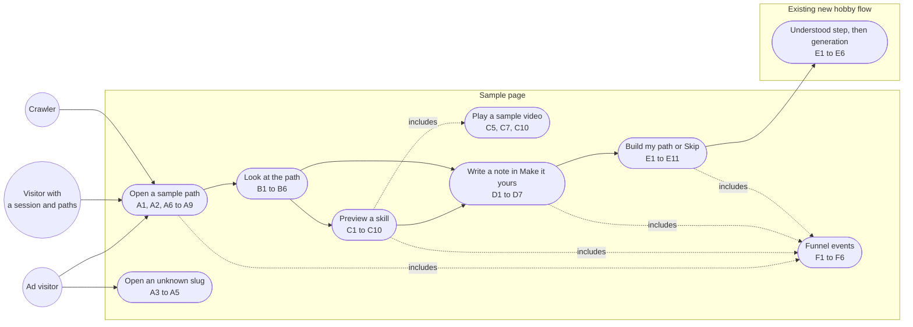
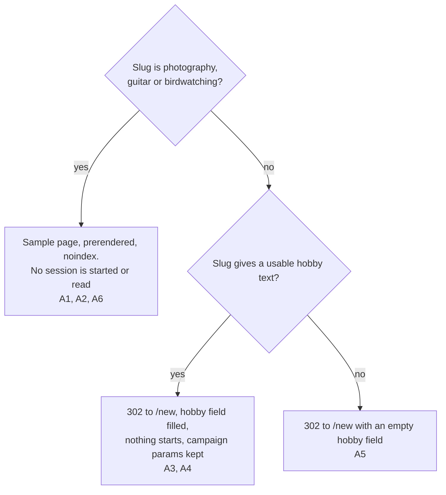
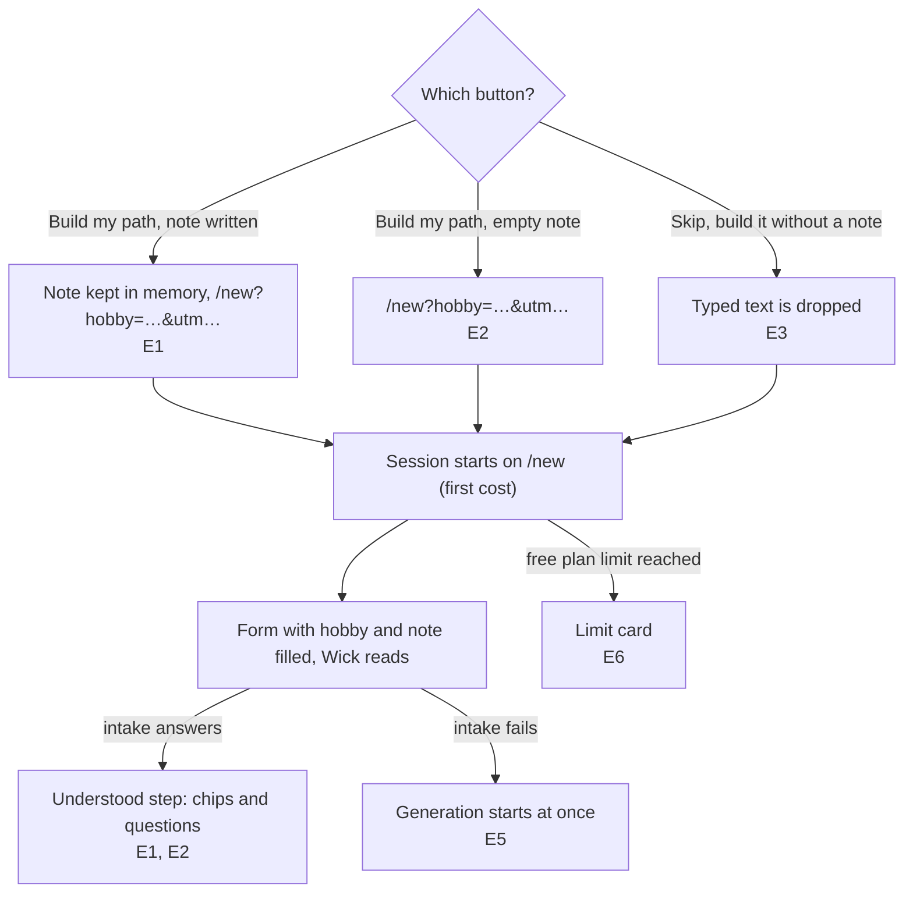

# Scenarios: Sample path page

A public, read only page at `/try/<hobby>` that shows a finished path for photography, guitar or birdwatching, and asks the visitor for one sentence before anything is built. It is the landing page for ads.

Why: PostHog on 2026-11-23 shows 70 ad visitors (all `utm_source=reddit`) who saw the landing page since 2026-11-22. One of them opened `/new`. None submitted a hobby. The sample page shows the result first and asks afterwards.

Design references, in `dev_docs/`:

- `SAMPLE PAGE · Desktop (try it tap skills)@1x.png`
- `SAMPLE PAGE · Mobile · What the ad click lands on@1x.png`
- `SAMPLE PAGE · Mobile · Skill tapped@1x.png`
- `SAMPLE PAGE · Mobile · Make it yours@1x.png`

The mockups are adapted to the project: the page is built from the components of the path, new hobby and landing pages, with theme tokens only. Where the brief and the mockups differ, the brief wins (the differences are listed under Assumptions, AS10).

The brief of 2026-11-23 is the source of these rows. A row is `Confirmed` when the brief states it, and `Open` when it rests on an assumption or an open decision listed at the end.

## Diagrams

### Use cases

### Which page opens

### Handoff

## Scenarios

### A. Arriving

| ID | Starting state | Action | Expected result | Covered by | Status |
|---|---|---|---|---|---|
| A1 | New visitor, empty storage, from an ad link with utm parameters | Opens `/try/guitar` | The sample page shows. No session is created, anonymous included. No request goes to the database, the model or `/api/videos`. `sample_viewed` is sent once with `hobby: guitar` and the utm properties | 1.1, 3.1 to 3.5, 11.2, 11.3 | Confirmed |
| A2 | Visitor with a stored session and paths | Opens `/try/photography` | The same sample page. No redirect to `/path`. The stored session is not read and not refreshed | 1.8, 3.7 | Confirmed |
| A3 | Anyone | Opens `/try/calligraphy` | Redirect (302) to `/new`. The hobby field holds "calligraphy". Nothing starts until the visitor presses "Build my path" there. Campaign parameters stay in the URL | 1.2, 1.4, 1.5, 10.6 | Confirmed |
| A4 | Anyone | Opens `/try/film-photography` or `/try/Guitar` | Redirect to `/new` with "film photography", or "Guitar": hyphens become spaces, and only the three exact slugs are sample pages | 1.1, 1.3 | Open (AS1) |
| A5 | Anyone | Opens a slug that gives no usable text (`/try/---`, a slug with `<` or over 60 characters of text cut to nothing) | Redirect to `/new` with an empty hobby field | 1.3 | Open (AS1) |
| A6 | Crawler | Fetches `/try/birdwatching` | Static HTML made at build time, with `<meta name="robots" content="noindex">` | 1.6, 1.7 | Confirmed |
| A7 | Slow connection, before the scripts run | Looks at the page | Top bar, intro card and the "Make it yours" copy are in the HTML. The path shows the loading state until the scripts run, as on the real path screen | 5.9 | Open (AS2) |
| A8 | Visitor who saved another theme on this device | Opens a sample | The page uses the saved theme. A new visitor gets boulder, the default | 4.4 | Confirmed (decision 13) |
| A9 | PostHog is blocked | Opens a sample and uses it | Everything works. No event is sent, no error is shown | 11.8 | Confirmed |

### B. The path

| ID | Starting state | Action | Expected result | Covered by | Status |
|---|---|---|---|---|---|
| B1 | Any sample | Looks at the intro card | Wick in the outfit named in the file. The line "GUITAR · 9 SKILLS · 2 SECTIONS" with the counts of the file. The finish line as the heading. The help text | 4.4 to 4.6 | Confirmed |
| B2 | Any sample | Looks at the path | Sections and skills in file order, drawn with the real path components. The first skill has the current look and the tag "START HERE". Every other skill has the locked look, and milestones the milestone look | 5.1, 5.3, 5.4 | Confirmed |
| B3 | Any sample | Reads the labels | "Tap to preview" under every skill title, and "Milestone" under a milestone. The first skill shows its content instead, as in the mockup: "3 quests · 2 videos", or "3 quests" when it has no video | 5.5 | Confirmed (first skill: AS3) |
| B4 | Any sample | Scrolls to the end | The finish line card: flag, "THE FINISH LINE", the finish text. No count, no progress | 6.1, 6.2 | Confirmed |
| B5 | File with 3 sections and 14 skills, and file with 2 sections and 9 skills | Opens each at 360 px and on desktop | No overlap, no clipped label, no sideways scroll | 2.5, 14.5 | Confirmed |
| B6 | Any sample | Looks at the section headers | One header per section with "SECTION n · LEVEL" and the section name. The first is the banner with "7 skills" (the count of the file, no progress). Later ones are dividers with "Opens after the first milestone" | 5.2 | Open (AS4) |

### C. Skill preview

| ID | Starting state | Action | Expected result | Covered by | Status |
|---|---|---|---|---|---|
| C1 | Desktop | Opens the page | The first skill is selected. Its preview is in the sticky right column. No `sample_skill_opened` | 7.1, 11.4 | Confirmed |
| C2 | Desktop | Clicks another skill | The preview changes, the node gets the selection outline, `sample_skill_opened` is sent with the skill id. A click on the selected skill does nothing | 7.2, 11.4 | Confirmed |
| C3 | Mobile | Taps a skill | A bottom sheet opens with the preview. `sample_skill_opened` is sent. Escape, the close button or the backdrop closes it, and focus returns to the skill | 7.3, 7.7, 11.4 | Confirmed |
| C4 | Preview open | Reads it | A tag ("FIRST SKILL" on the first skill, "PREVIEW" on the others) and "Section 1 · Skill 3", then title, description, "3 QUESTS" with "+10 XP EACH", and the 3 quests as rows with an empty box. Nothing can be ticked, and the rows are not buttons | 7.4, 7.6 | Confirmed (tag, position and XP line: mockup) |
| C5 | Skill with videos | Looks at the preview, then taps a video | Heading "VIDEOS PICKED FOR THIS SKILL" and the existing video card. The tap plays the video in the existing embedded player. No watch event is recorded and `/api/videos` is not called | 8.1, 8.2, 8.4 | Confirmed |
| C6 | Skill with an empty videos list | Looks at the preview | One line: "Videos appear when you reach this skill." No heading and no empty block | 8.5 | Confirmed |
| C7 | A video is playing | Selects another skill, or closes the sheet | The player closes | 8.3 | Confirmed |
| C8 | Mobile, skill sheet open | Presses "Make this path mine" at its end | The skill sheet closes and the "Make it yours" sheet opens | 7.8, 9.4 | Confirmed |
| C9 | A skill is selected | Resizes across 1024 px | The selection is kept. No sheet opens by itself | 7.9 | Open (AS5) |
| C10 | YouTube is blocked | Taps a video | The existing player shows its own failure state. The rest of the page works | 8.2 | Confirmed |

### D. Make it yours

| ID | Starting state | Action | Expected result | Covered by | Status |
|---|---|---|---|---|---|
| D1 | Desktop | Looks at the right column | The box is under the preview and always in view, tinted in the primary color: heading, label, textarea with an example note for this hobby as placeholder, "Build my path", "Free to try. No signup. About 20 seconds.". Under the box, the founding line without numbers, a plain link to the landing page offer | 9.1, 9.3, 9.10 | Confirmed (placeholders: decision 15; founding line wording: Open, decision 14) |
| D2 | Desktop | Presses "Build my own path" in the top bar | Focus moves to the note box. `sample_mine_opened` is sent | 4.3, 11.5 | Confirmed |
| D3 | Mobile | Presses "Tell Wick where I am" in the sticky bar (which also shows "Make it yours" and "Free. No signup.") | A sheet opens with the same box and "Skip, build it without a note". `sample_mine_opened` is sent. Escape closes it and focus returns to the button | 9.4, 9.6, 11.5 | Confirmed |
| D4 | Box shown | Types several lines | The textarea grows with the text, then scrolls. At most 800 characters; "n left" shows from 40 left | 9.2 | Confirmed (limit: AS6) |
| D5 | Note typed on mobile | Closes the sheet and opens it again, or resizes to desktop | The text is still there | 9.7 | Open (AS5) |
| D6 | Mobile | Scrolls to the end of the path | The sticky bar does not cover the finish line card | 9.5 | Confirmed |
| D7 | Desktop, a second or later interaction with the box | Focuses the note box again | No second `sample_mine_opened` | 11.5 | Open (AS7) |

### E. Handoff into the new hobby flow

| ID | Starting state | Action | Expected result | Covered by | Status |
|---|---|---|---|---|---|
| E1 | Note written | Presses "Build my path" | `sample_build_clicked` with `has_note: true`. `/new` opens with the hobby and the note filled, intake reads the note, and the understood step shows what was read. The empty first step never shows. The URL never holds the note. utm parameters stay in the URL. This is the first moment a session exists | 10.1, 10.3 to 10.6, 11.6 | Confirmed |
| E2 | Empty note | Presses "Build my path" | The same with an empty note: the understood step opens with its questions. `has_note: false` | 9.8, 10.9, 11.6 | Confirmed |
| E3 | Mobile, with or without typed text | Presses "Skip, build it without a note" | As E2. Typed text is not passed on. `has_note: false` | 10.2, 11.6 | Confirmed |
| E4 | Note of spaces only | Presses "Build my path" | As E2 | 10.1 | Confirmed |
| E5 | After the press, intake fails or takes over 5 s | Waits | Generation starts at once, as the new hobby flow does today | 10.8 | Confirmed |
| E6 | Signed in, free plan, 3 active hobbies, none of them this one | Presses "Build my path" | The existing limit card on `/new` | 10.8 | Confirmed |
| E7 | Signed in or anonymous visitor who already has a path for this hobby | Presses "Build my path" | The existing flow decides, as when the hobby is typed on `/new` (it rebuilds that hobby) | 10.8 | Open (V2) |
| E8 | Any | Presses the button twice quickly | One navigation, one event | 10.7 | Confirmed |
| E9 | On `/new` after the handoff | Refreshes, or goes back and forward | Nothing starts again. Back shows the sample page with an empty note box | 10.5 | Confirmed |
| E10 | A handoff note is left in memory (the visitor stopped the navigation) | Later opens `/new?hobby=chess` | The note is not used: it belongs to another hobby, or is older than 60 s | 10.4 | Confirmed |
| E11 | Desktop | Presses "Log in" in the top bar | The link opens `/path`. Nothing starts on the sample page itself | 3.6, 4.2 | Confirmed (decision 13) |

### F. Analytics

| ID | Starting state | Action | Expected result | Covered by | Status |
|---|---|---|---|---|---|
| F1 | Visitor opens a sample, opens one skill, opens "Make it yours", builds with a note | One walk through | `sample_viewed`, `sample_skill_opened`, `sample_mine_opened`, `sample_build_clicked`: one each, each with `hobby` and the utm properties of the landing URL | 11.1 to 11.6 | Confirmed |
| F2 | Link without utm parameters | Same walk through | The four events with `hobby` and no utm property | 11.2 | Confirmed |
| F3 | Any | Writes a note and builds | No event holds the note or its length | 11.7 | Confirmed |
| F4 | Visitor came through a sample page and built a path | Looks at the person in PostHog | One chain under one distinct id: `sample_viewed` … `intake_shown`, `intake_answered`, `skill_path_generated`, and the `$ai_generation` events of the build | 12.1 to 12.4 | Confirmed |
| F5 | The browser sends no usable PostHog id (blocked, or an old cached page) | Builds | The server events fall back to the user id, as today. The build is not affected | 12.2 | Confirmed |
| F6 | Background jobs (video fill, Fresh check) | Run | Their `$ai_generation` events keep the server process id | 12.6 | Confirmed |

## Owner decisions

1. 2026-11-23: three slugs only: photography, guitar, birdwatching. Any other slug goes to `/new` with the hobby prefilled.
2. 2026-11-23: no cost before intent. Until "Build my path" the page creates no session, writes nothing to the database, and calls neither the model nor `/api/videos`.
3. 2026-11-23: the page renders for visitors with a session and paths. Never redirect them to `/path`.
4. 2026-11-23: one static JSON file per hobby, committed, loaded at build time. The owner supplies the files. Counts come from the data.
5. 2026-11-23: the three pages are prerendered and carry robots noindex for now.
6. 2026-11-23: the real path node and section components are reused in a read only mode.
7. 2026-11-23: no watch events on this page.
8. 2026-11-23: the note goes through client state or sessionStorage, never the URL. utm parameters stay attached.
9. 2026-11-23: after the handoff everything is the existing flow, unchanged.
10. 2026-11-23: four events with hobby and utm properties. The missing funnel events are fixed first, as their own task, and the server generation event uses the browser's distinct id.
11. 2026-11-23: no dash or hyphen in any user facing text on the page.
12. 2026-11-23: out of scope: path generation, the video pipeline, billing, the real path screen, new tables, a calligraphy page.
13. 2026-11-23: answers to OD1 to OD5. `skill_path_generated` is sent by the server only. Video titles and channel names are exempt from the dash rule. "Log in" is a plain link to `/path`. No Playwright for now. The page follows the saved theme.
14. 2026-11-23: answer to OD6. The desktop founding line is shown without numbers, as a plain link to the landing page offer, and the page sends no request for it. The owner confirms the exact wording.
15. 2026-11-23: the placeholder notes are: photography "I shoot on auto with a mirrorless camera. I want portraits with a soft background."; guitar "I know a few chords and play the same old songs. I want to sing while I play."; birdwatching "I can only name a sparrow and a crow. I want to know the birds in my local park."
16. 2026-11-23: the converter from the export to the Sample_Files is a committed script that can be run again. The export will be refreshed when more videos are available, so the export step stays in the docs.
17. 2026-11-23: the launch gate of the manual pass is rows A1, B5, E1 and F1. The other rows are checked after launch and tracked in `changes.md`.

## Assumptions

Small points the brief does not settle. Each is open to change, and none blocks the work.

- **AS1. Slug to hobby text.** Only an exact, lower case match is a sample page. For any other slug, hyphens and underscores become spaces, the text is trimmed and cut to 60 characters, and it is used only when it holds letters, digits, spaces, apostrophes, `&` and `.`. Anything else opens `/new` with an empty field.
- **AS2. The path draws after the scripts load.** The layout engine runs in the browser only, as on the real path screen, so the prerendered HTML holds the top bar, the intro card and the "Make it yours" text, not the nodes.
- **AS3. The first skill's sub label is its content**, "3 quests · 2 videos", as in the mockup, with the counts of the file. "In progress · 0/3" would be untrue on a sample.
- **AS4. Section headers show no progress.** As in the mockup, the banner of the first section shows "7 skills", not "0/7 skills", and a later section shows "Opens after the first milestone" ("second" for a third section, "the milestone above" beyond that), not "Reach … to unlock". The line is left out when the section before it has no milestone.
- **AS5. One state for selection and note** across the two layouts, as the real path screen keeps its selection.
- **AS6. The note limit is 800 characters**, the limit of the existing Note, with the same "n left" counter.
- **AS7. `sample_mine_opened` is sent once per page load**, with a `source` property, so a visitor who opens the sheet three times counts once in the funnel.
- **AS8. `/try` without a slug is not a page.** It gives the normal 404.
- **AS9. Click ids travel with the utm parameters**: `rdt_cid`, `gclid`, `fbclid`, `ttclid`, `msclkid`, so the ad platform can still match the visit after the handoff.

- **AS10. Where the mockups and the brief differ, the brief wins.** (a) The mockup's intro heading ("From flat photos to portraits with a soft background") is a second sentence the files do not hold; the heading is the file's `finish`. (b) The mockup's video rows show "Video · about 7 min"; the page uses the existing video card in its list layout, with the channel name and the duration on the thumbnail. (c) The mockup's numbers (12 skills, 2 sections, 6 skills) are examples; the page counts the file. (d) The mobile mockup shows Wick without an outfit; Wick wears the file's outfit at every width.
- **AS11. Example note as placeholder.** The mockup shows a hobby specific example in the note box. The files have no field for it, so the three examples live in the copy module, keyed by slug, with a general one as fallback. The owner set the three texts on 2026-11-23 (decision 15); the fallback is still a draft.

## Open decisions

None. OD1 to OD6 were answered by the owner on 2026-11-23 and are recorded as decisions 13 and 14 above. The OD numbers stay as references in the other documents.

| # | Question | Answer (2026-11-23) |
|---|---|---|
| OD1 | Should `skill_path_generated` come from the server only, or from both sides? | Server only, with the browser's distinct id |
| OD2 | Do video titles and channel names fall under the "no dash" rule? | No. They are exempt, shown as published |
| OD3 | Where does "Log in" go? | A plain link to `/path` |
| OD4 | May `@playwright/test` be added? | Not for now. The browser test task is dropped |
| OD5 | Force boulder, or follow the saved theme? | Follow the saved theme |
| OD6 | Show the founding line of the desktop mockup? | Yes, without numbers, as a plain link to the landing page offer, with no request. The owner confirms the exact wording |

The founding line wording is the only open point: the draft in Requirement 13 is used until the owner confirms it.

## To verify

- **V1.** posthog-js 1.451.0 gives the ids the browser must send (`get_distinct_id()`, `get_session_id()`). Its tracing extension uses the header names `X-POSTHOG-DISTINCT-ID` and `X-POSTHOG-SESSION-ID` (seen in `node_modules/posthog-js`). Check that the extension actually adds them in production; the design does not depend on it.
- **V2.** What `/new` does today when the visitor already has a path for the same hobby (path-intake manual row J4 says the old path is replaced), and what happens to its progress. If progress is lost, add a confirmation on `/new` in a later spec; it is out of scope here.
- **V3.** With the `vercel` Nitro preset, `routeRules` with `prerender: true` writes the three pages as static files, and every other `/try/<slug>` reaches the server function that answers 302.
- **V4.** Every video in the supplied files can be embedded (the video pipeline only stores embeddable videos, but the files are a copy).
- **V5.** `app/plugins/cloud.client.ts` and `useChannelMutes()` send nothing when no session was started.
- **V6.** The path canvas at exactly 360 px with the longest titles in the files (51 characters).
- **V7.** The data file in the working tree, `data/sample-paths.json`, is an export: a list of `{ slug, sample }` where `sample` is a JSON string. The brief asks for one file per hobby in the plain shape. A committed, rerunnable script converts it (decision 16), because the export will be refreshed when more videos are available.
