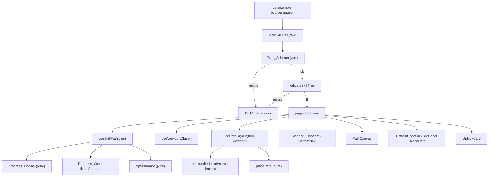
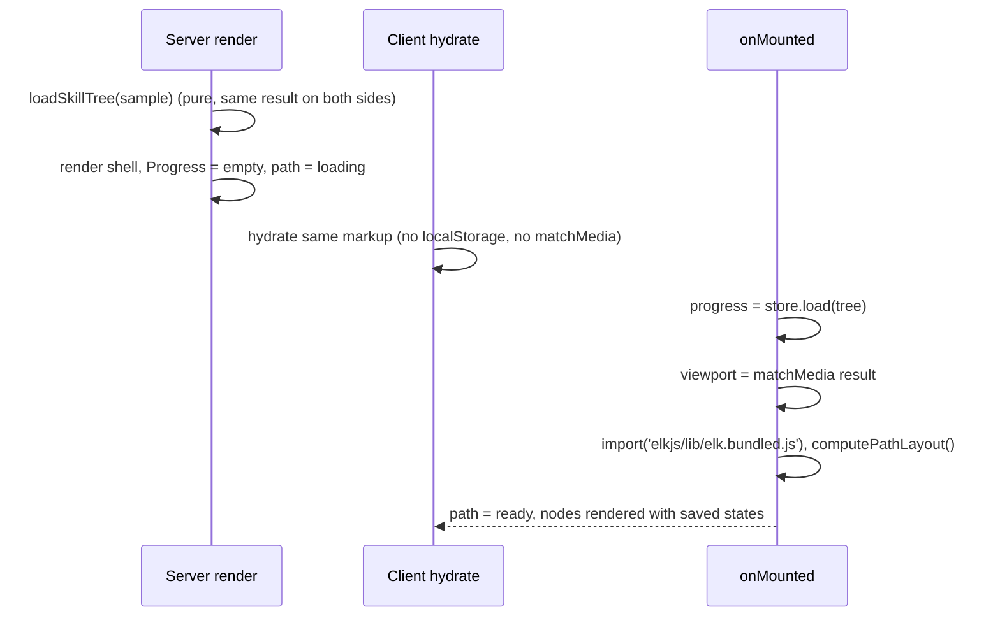
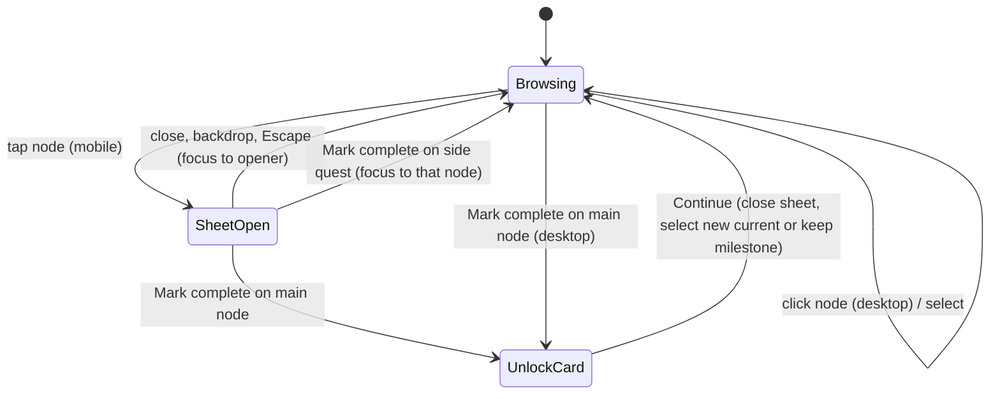

# Design Document: skill-path-ui

## Overview

This feature builds Pursio's core path view on top of a hard-coded bouldering skill tree. The data flows through four layers:

1. **Data and checks** (pure, shared): a zod `Tree_Schema`, a graph `Tree_Validator`, and the `Sample_Tree` JSON.
2. **Logic** (pure): the `Progress_Engine` (node states, unlocking, quest toggles), XP and level math, and the `Progress_Store` parse/serialize functions.
3. **Layout** (async, client only): `Path_Layout` asks elkjs for a layered top-to-bottom ordering, then maps nodes onto the winding trail with fixed per-viewport constants.
4. **View** (Vue): a page that wires composables to small typed components. Nodes are HTML buttons, the trail is SVG, and every visual comes from theme tokens.

The pure layers have no Vue, DOM or Nuxt auto-import dependency, so `yarn test` runs them in Node with vitest and fast-check.

### Key decisions

| Decision | Choice | Why |
|---|---|---|
| Route | `app/pages/path.vue` at `/path`. `/` stays the landing placeholder. | Keeps the future landing page free. Easy to move later. |
| elkjs build | `elkjs/lib/elk.bundled.js`, loaded with a dynamic `import()` on the client after mount. Tests import the same file in Node. | One code path for app and tests. The graph has 13 nodes, so compute time is negligible; the cost is parse time of a 1.6 MB file (about 480 KB gzip, measured from `elkjs@0.12.1`). A dynamic import keeps it out of the entry chunk and the loading state (Req 5.11) covers the wait. The `ELK` instance is injected, so a Web Worker build (`elk-api.js` + `elk-worker.min.js`) can replace it later without touching layout logic. |
| SSR | Server renders the shell from an empty Progress. The path area renders the loading state on the server and on the first client render. Progress, viewport class and layout are resolved in `onMounted`. | The first client render matches the server HTML exactly, so there is no hydration mismatch (Req 10.8). Layout needs elkjs and the viewport, both client-only. |
| Responsive shell | CSS `lg:` (Tailwind's default 64rem = 1024 px) switches the page shell. A `matchMedia('(min-width: 1024px)')` composable picks layout constants and sheet vs panel behavior. | The shell is correct in SSR HTML for both widths. JS only decides what CSS cannot (layout numbers, focus behavior). |
| Node rendering | Nodes are absolutely positioned HTML `<button>`s; trail dots are SVG circles. | `--pursio-radius-node` is a CSS `border-radius` (for example `46% 54% 42% 58% / ...` in boulder), which SVG shapes cannot express. Buttons also give focus and accessible names for free. |
| Main node order vs elkjs | elkjs receives the prerequisite edges plus "trail edges" between consecutive Main_Nodes in document order. The Main_Node order is read back from elkjs layers. | Trail edges force elkjs layers to increase along the document order, so the elkjs ordering and Req 5.2/5.3 agree. See "Path order precondition". |
| Progress storage key | `pursio-progress:v1:<hobby>` | Contains the schema version and the hobby (Req 10.1). |

### Path order precondition (gap in requirements)

The Tree_Validator accepts a prerequisite that points to a later Node (Req 2.6). Req 5.3 requires Main_Nodes to descend in document order and Req 5.8 requires every Node to sit below its prerequisites. Both can hold only if prerequisites come earlier. A Main_Node that depends on a Side_Quest_Node also conflicts with the fixed 112/124 px Main_Node spacing (Req 5.4) when side quests stack.

The design adds a layout-only check, `checkPathOrder`:

- **P1**: every prerequisite of a Main_Node is a Main_Node that comes earlier in document order (Section order, then Node order).
- **P2**: every prerequisite of a Side_Quest_Node comes earlier in document order (any Node type).

A tree that fails P1 or P2 is still valid data, but `Path_Layout` returns a `LayoutError` of kind `unsupported_order` and the Path_View shows "This path could not be drawn" (Req 5.12). The Sample_Tree satisfies P1 and P2. Layout properties (Req 5.8–5.10) are generated over trees that satisfy P1 and P2.

## Architecture



### Lifecycle and hydration



Nothing that depends on `localStorage`, `matchMedia` or elkjs runs during setup. `useSkillPath` starts with `emptyProgress()` on both server and client. Header stats therefore SSR as `Lv 1`, `0 / 100 XP` and update after mount; this is a post-hydration update, not a mismatch.

If tree loading fails (Req 3.8), the page shows the error message on server and client and never starts layout.

### Module placement

| Path | Contents | Runs in |
|---|---|---|
| `data/sample-bouldering.json` | Sample_Tree | imported by page and tests |
| `shared/types/skill-tree.ts` | `SkillTree`, `Section`, `SkillNode`, `Level`, `QuestTriple` | types |
| `shared/types/validation.ts` | `ValidationError` union, `Result<T, E>` | types |
| `shared/types/progress.ts` | `Progress`, `NodeState`, `CompletionResult` | types |
| `shared/utils/skill-tree-schema.ts` | `skillTreeSchema`, `parseSkillTree`, type equality check | Node + browser |
| `shared/utils/skill-tree-validate.ts` | `validateSkillTree` | Node + browser |
| `shared/utils/skill-tree-load.ts` | `loadSkillTree`, `formatValidationError` | Node + browser |
| `shared/utils/progress-engine.ts` | `emptyProgress`, `deriveNodeStates`, `findCurrentNodeId`, `markComplete`, `toggleQuest`, `checkedCount`, `diffUnlocked` | Node + browser |
| `shared/utils/xp.ts` | `XP_PER_NODE`, `LEVEL_THRESHOLDS`, `xpFor`, `levelFor`, `xpSummary` | Node + browser |
| `app/utils/progress-store.ts` | `progressStorageKey`, `serializeProgress`, `parseStoredProgress`, `pruneProgress`, `createProgressStore` | Node (tests) + browser |
| `app/utils/path-layout.ts` | `LAYOUT_CONFIG`, `checkPathOrder`, `buildElkGraph`, `placePath`, `computePathLayout`, `trailDots` | Node (tests) + browser |
| `app/utils/node-visual.ts` | `nodeVisual`, `statusLine`, `chipFor`, `buttonFor`, `formatTitleList`, `segmentTone` | Node (tests) + browser |
| `app/utils/section-headers.ts` | `sectionHeaderModels` | Node (tests) + browser |
| `app/utils/fresh-samples.ts` | static "Fresh this week" entries per node id | browser |
| `app/composables/useSkillPath.ts` | reactive Progress, states, actions, persistence | browser + SSR |
| `app/composables/usePathLayout.ts` | layout status, recompute on viewport change | browser |
| `app/composables/useViewportClass.ts` | `'mobile' \| 'desktop' \| null` | browser |
| `app/composables/useFocusTrap.ts` | Tab cycling, Escape, initial focus, restore focus | browser |
| `app/pages/path.vue` | page orchestration | SSR + browser |
| `app/components/path/*.vue` | view components (auto-imported as `Path*`) | SSR + browser |
| `vitest.config.ts`, `tests/**` | test setup, arbitraries, tests | Node |

Pure modules use explicit relative or `#shared` imports (no reliance on Nuxt auto-imports), so vitest can load them without Nuxt.

## Components and Interfaces

### Tree loading

```ts
// shared/utils/skill-tree-schema.ts
export const skillTreeSchema: z.ZodType<SkillTree>          // see Data Models
export function parseSkillTree(input: unknown): Result<SkillTree, SchemaError[]>

// shared/utils/skill-tree-validate.ts
export function validateSkillTree(tree: SkillTree): GraphError[]

// shared/utils/skill-tree-load.ts
export function loadSkillTree(input: unknown): Result<SkillTree, ValidationError[]>
export function formatValidationError(error: ValidationError): string
```

`parseSkillTree` calls `skillTreeSchema.safeParse` (never throws) and maps each zod issue to `{ kind: 'schema', path, message }`. zod 4 reports every issue by default, which gives one error per mismatched value (Req 1.5). zod paths are `PropertyKey[]`; symbols are converted with `String()` so the path type is `(string | number)[]`. A root mismatch (null, list, string, number) yields path `[]` (Req 1.6). `z.object` strips unknown keys by default (Req 1.7).

Non-empty strings use `z.string().regex(/\S/)`, so whitespace-only strings fail. `quests` is `z.tuple([nonEmpty, nonEmpty, nonEmpty])`, which both enforces exactly 3 and infers `[string, string, string]`.

`loadSkillTree` runs the schema first and returns its errors if any; otherwise it runs `validateSkillTree` (Req 3.8). `formatValidationError` produces, for example, `sections.0.nodes.2.quests: Expected 3 items`, `Duplicate id "gear-basics"`, `"flagging" needs unknown skill "first-v3"` or `Prerequisite loop: a → b → a`.

#### Graph validator algorithm

All steps read the input and build new structures; the input is never mutated (Req 2.11).

1. **Index**: walk Sections then Nodes, record `position(id)` = first occurrence index and `occurrences(id)`.
2. **duplicate_id**: for each id with `occurrences > 1`, one error, ordered by first occurrence (Req 2.1).
3. **missing_prerequisite**: for each Node in document order, for each prerequisite in list order, if the id is not in the index, one error `{ nodeId, prerequisiteId }`. Repeated identical pairs are reported once (Req 2.2).
4. **cycle**: build a graph over unique ids with edge `prerequisite → dependent`, skipping unknown prerequisite ids (Req 2.4). Duplicate ids merge their prerequisite lists. Run iterative Tarjan SCC, visiting roots in document order. For each SCC that has more than one id, or a self edge, extract one simple cycle: start at the SCC member with the lowest position, BFS inside the SCC following edges, stop when an edge returns to the start, and read the path back. The result lists each id once, ordered so each id is a prerequisite of the next and the last is a prerequisite of the first (Req 2.3).
5. **Sort and concat**: duplicates, then missing, then cycles; within a kind, sort by `position` of the first id named (Req 2.5). Ties keep discovery order.

When a valid tree gets one extra edge from X to a descendant D (or to itself), the original graph was acyclic, so every cycle in the new graph uses that edge. The extracted cycle therefore contains both X and D (Req 2.10).

### Progress_Engine

```ts
// shared/utils/progress-engine.ts
export function emptyProgress(): Progress
export function isAvailable(tree: SkillTree, progress: Progress, id: string): boolean
export function findCurrentNodeId(tree: SkillTree, progress: Progress): string | null
export function deriveNodeStates(tree: SkillTree, progress: Progress): Map<string, NodeState>
export function markComplete(tree: SkillTree, progress: Progress, id: string): CompletionResult
export function toggleQuest(tree: SkillTree, progress: Progress, id: string, index: 0 | 1 | 2): Progress
export function checkedCount(progress: Progress, id: string): number
export function diffUnlocked(before: Map<string, NodeState>, after: Map<string, NodeState>): string[]
export function activeSectionIndex(tree: SkillTree, progress: Progress): number
```

- `isAvailable`: id not in `completed` and every prerequisite in `completed` (Req 4.3, 4.7).
- `findCurrentNodeId`: first Main_Node in document order with `isAvailable` (Req 4.2). Side_Quest_Nodes are skipped, so they are never `current` (Req 4.5).
- `deriveNodeStates`: applies the ordered rules of Req 4.1: `completed`, `current`, `side_quest` (optional and available), `milestone`, `locked`. A side quest with an incomplete prerequisite falls through to `locked` (or `milestone` if flagged as such) (Req 4.4).
- `markComplete`: if the id is unknown or not available, returns `{ progress: input, completed: false }` with the same object reference (Req 4.10, 4.13). Otherwise returns a new Progress with the id appended to `completed` and `quests` unchanged (Req 9.1), plus `completed: true`, `kind: 'main' | 'side'` and `nextCurrentId`.
- `toggleQuest`: flips one boolean in a copy of the quest triple, creating `[false, false, false]` first if absent. Unknown ids return the input unchanged.
- `diffUnlocked`: ids whose state went from `locked` to `current` or `side_quest` (Req 9.5).
- `activeSectionIndex`: Section containing the Current_Node, or the last Section when none (glossary: Active_Section).

### XP and levels

```ts
// shared/utils/xp.ts
export const XP_PER_NODE = 50
export const LEVEL_THRESHOLDS = [0, 100, 200, 400, 700] as const   // level n starts at index n-1
export function xpFor(tree: SkillTree, progress: Progress): number   // 50 × completed ids present in tree
export function levelFor(xp: number): 1 | 2 | 3 | 4 | 5
export function xpSummary(tree: SkillTree, progress: Progress): XpSummary
```

`XpSummary` = `{ xp, level, nextLevelXp: number | null, barPercent, label }`. Below level 5: `label = "<xp> / <next> XP"`, `barPercent = Math.round(100 * xp / next)`. Level 5: `label = "<xp> XP"`, `barPercent = 100` (Req 11.1–11.4). The streak is the constant `STATIC_STREAK = 6` (Req 11.6).

### Progress_Store

```ts
// app/utils/progress-store.ts
export const PROGRESS_SCHEMA_VERSION = 1
export function progressStorageKey(hobby: string): string     // "pursio-progress:v1:<hobby>"
export function serializeProgress(progress: Progress): string // JSON.stringify of StoredProgress
export function parseStoredProgress(raw: string | null): { progress: Progress; invalid: boolean }
export function pruneProgress(progress: Progress, tree: SkillTree): Progress
export interface StorageLike { getItem(k: string): string | null; setItem(k: string, v: string): void; removeItem(k: string): void }
export function createProgressStore(getStorage: () => StorageLike | null, tree: SkillTree): ProgressStore
export interface ProgressStore { load(): Progress; save(progress: Progress): void }
```

- `parseStoredProgress`: `null` → empty, `invalid: false` (Req 10.3). `JSON.parse` failure or `storedProgressSchema` mismatch → empty, `invalid: true` (Req 10.4). Duplicate ids in `completed` are collapsed.
- `pruneProgress`: drops completed ids and quest entries for ids not in the tree; keeps the rest unchanged (Req 10.5).
- `createProgressStore.load`: reads the key, removes it when `invalid`, prunes, returns. `save` writes `serializeProgress`. Every storage call is wrapped in `try/catch`; on any throw or a `null` storage, `load` returns empty and `save` does nothing, with no message (Req 10.6). `getStorage` on the client is `() => { try { return window.localStorage } catch { return null } }`.
- `save` is called synchronously inside the action handler, so the write lands before the next event is processed (Req 10.1).

### Path_Layout

```ts
// app/utils/path-layout.ts
export type ViewportClass = 'mobile' | 'desktop'
export const LAYOUT_CONFIG: Record<ViewportClass, LayoutConfig>
export interface ElkLike { layout(graph: ElkNode): Promise<ElkNode> }
export function checkPathOrder(tree: SkillTree): LayoutError | null
export function buildElkGraph(tree: SkillTree, cfg: LayoutConfig): ElkNode
export function placePath(tree: SkillTree, elkResult: ElkNode, cfg: LayoutConfig): Result<PathLayout, LayoutError>
export function computePathLayout(tree: SkillTree, viewport: ViewportClass, elk: ElkLike): Promise<Result<PathLayout, LayoutError>>
export function trailDots(a: Point, b: Point): [Point, Point, Point]   // 28%, 50%, 72%
```

`LAYOUT_CONFIG` (all px; x is relative to the center line, y from the top of the path area):

| Key | Mobile | Desktop | Source |
|---|---|---|---|
| `windingOffsets` | 0, -60, -90, -60 | 0, -90, -135, -90 | Req 5.2 |
| `rowGap` | 112 | 124 | Req 5.4 |
| `sideX` | +110 | +170 | Req 5.5 |
| `size.main / milestone / side` | 72 / 84 / 64 | 80 / 92 / 70 | Req 5.6 |
| `headerHeight` | 104 | 120 | fixed band, fits Banner and Divider styles |
| `headerTop` (first header) | 16 | 8 | reference spacing |
| `sectionLead` (header bottom → first Main_Node center) | 92 | 104 | room for NEXT UP tag (44/50 px above node top) |
| `sectionTail` (last Main_Node center → next header top) | 76 | 84 | node half + shadow + label |
| `sideLabelReserve` (below side quest box) | 40 | 44 | label under side quest |
| `sideGap` (min space between side footprints) | 12 | 12 | |
| `bottomPadding` | 120 | 64 | mobile clears the 80 px bottom nav (Req 12.2) |
| `dotDiameter` | 8 | 10 | Req 6.1 |
| `ringPad` | 9 | 10 | reference |

Header bands have a fixed height per viewport, so switching a header between Banner and Divider style never moves nodes.

**`buildElkGraph`**: one child per unique id with width and height from `size`, edges `prereq → node` for every prerequisite, plus trail edges `main[i] → main[i+1]`. Layout options: `elk.algorithm: layered`, `elk.direction: DOWN`, `elk.randomSeed: 1`, `elk.layered.considerModelOrder.strategy: NODES_AND_EDGES`. Children and edges are emitted in document order, so the input graph is deterministic.

**`placePath`** steps:

1. Read elkjs `y` per id. Sort Main_Nodes by `(y, document position)`. If that order differs from document order, or any id is missing from the result, return `layout_failed`. With P1 and trail edges this never happens; the check guards against elkjs surprises.
2. Walk Sections. For Section s: header band `[cursor, cursor + headerHeight]`; `cursor = band bottom + sectionLead` is the first Main_Node center; each next Main_Node is `+ rowGap`. Main_Node `i` (global index) gets `cx = windingOffsets[i % 4]`. After the Section, `cursor = last center + sectionTail` (or band bottom if the Section has no Main_Node).
3. Place Side_Quest_Nodes in elkjs order `(y, document position)`, which is a topological order:
   - `anchor` = the prerequisite with the lowest center (largest `cy`, ties by document position).
   - If the anchor is a Main_Node with a next Main_Node, `desired = midpoint(anchor.cy, next.cy)` (Req 5.5). Otherwise `desired = anchor.cy + rowGap / 2`.
   - Footprint = `[cy - size/2, cy + size/2 + sideLabelReserve]`. Starting at `desired`, while the footprint intersects a header band or an already placed side footprint (plus `sideGap`), move `cy` to just below that interval. The occupied list is scanned in sorted order, so the loop ends.
   - `cx = sideX`.
4. `height` = max of every node footprint bottom and header bottom, plus `bottomPadding`.
5. Segments: for every `(prereq, node)` pair, `trailDots(prereq center, node center)`.

Side and Main_Nodes never overlap horizontally: the widest Main_Node box reaches `0 + 46 = 46` px (desktop milestone at offset 0), while the nearest side box edge is at `110 - 32 = 78` (mobile) or `170 - 35 = 135` (desktop). Main_Nodes are at least 112 px apart vertically with half sizes of at most 46, and header bands are separated from Main_Node boxes by `sectionLead - 46 > 0` and `sectionTail - 46 > 0`. Side quests are pushed past header bands and each other. Together this gives Req 5.7 and 5.9.

**`computePathLayout`**: `checkPathOrder` → `buildElkGraph` → `await elk.layout()` inside `try/catch` → `placePath`. Any throw becomes `layout_failed` (Req 5.12).

### Section headers and trail tone

```ts
// app/utils/section-headers.ts
export interface SectionHeaderModel {
  index: number                 // 0-based; eyebrow shows index + 1
  eyebrow: string               // "SECTION 2 · INTERMEDIATE"
  title: string
  variant: 'banner' | 'divider'
  count: { done: number; total: number } | null   // banner only
  lockedBy: string | null       // previous Section's milestone title while it is not completed
}
export function sectionHeaderModels(tree: SkillTree, progress: Progress): SectionHeaderModel[]

// app/utils/node-visual.ts
export function segmentTone(states: Map<string, NodeState>, seg: TrailSegment): 'done' | 'trail'
```

`sectionHeaderModels` marks `activeSectionIndex` as the only banner (Req 7.2, 7.3). `count.done` counts completed Main_Nodes of that Section and `total` counts its Main_Nodes, Milestone_Nodes included (Req 7.2). `lockedBy` is set only for divider headers whose previous Section has a Milestone_Node that is not completed; if the previous Section has several, the last one is used (Req 7.4, 7.5). Because the models are computed from `progress`, a completion updates banner, divider and count in the same render (Req 7.6, 7.7).

`segmentTone` is `done` when both ends are `completed`, otherwise `trail` (Req 6.2, 6.3).

### Composables

```ts
// useViewportClass.ts
export function useViewportClass(): Readonly<Ref<ViewportClass | null>>   // null until mounted

// usePathLayout.ts
export function usePathLayout(tree: SkillTree, viewport: Readonly<Ref<ViewportClass | null>>): {
  status: Readonly<Ref<'loading' | 'ready' | 'error'>>
  layout: Readonly<Ref<PathLayout | null>>
}
```

`usePathLayout` caches one `ELK` instance from the dynamic import. It watches `viewport` (immediate); each run increments a request token and ignores results from older runs, so fast resizes cannot apply a stale layout. While a run is pending, `status` is `loading` (Req 5.11). When the viewport crosses 1024 px, the watcher recomputes without a reload (Req 5.13, 12.10). Progress lives in `useSkillPath`, so layout errors cannot touch it (Req 5.12).

```ts
// useSkillPath.ts
export function useSkillPath(tree: SkillTree): {
  progress: Readonly<Ref<Progress>>
  states: ComputedRef<Map<string, NodeState>>
  currentId: ComputedRef<string | null>
  activeSection: ComputedRef<number>
  xp: ComputedRef<XpSummary>
  toggleQuest(id: string, index: 0 | 1 | 2): void
  complete(id: string): CompletionOutcome | null   // null when not completed
}
```

`progress` starts as `emptyProgress()`. `onMounted` replaces it with `store.load()`. Each action computes the new Progress with the pure engine, assigns it, and calls `store.save()` in the same tick. `complete` returns `{ result, unlocked }` where `unlocked = diffUnlocked(statesBefore, statesAfter)`.

```ts
// useFocusTrap.ts
export function useFocusTrap(
  container: Ref<HTMLElement | null>,
  options: { active: Ref<boolean>; initialFocus: Ref<HTMLElement | null>; onEscape?: () => void },
): void
```

When `active` turns true, it focuses `initialFocus`. It listens for `keydown` on the container: Tab on the last focusable element wraps to the first, Shift+Tab on the first wraps to the last (Req 8.14), Escape calls `onEscape` (Req 8.13). Focusable elements are queried at keypress time, so content changes are handled.

### Page orchestration (`app/pages/path.vue`)

Page state, beyond `useSkillPath` and `usePathLayout`:

| State | Type | Meaning |
|---|---|---|
| `selectedId` | `string \| null` | Last tapped node; null means "default" |
| `sheetOpen` | `boolean` | Mobile Bottom_Sheet open |
| `openerId` | `string \| null` | Node button that opened the sheet, for focus return |
| `unlock` | `{ completedTitle; nextTitle: string \| null } \| null` | Unlock_Moment card |
| `animating` | `Set<string>` | Node ids playing the unlock animation |

Derived: `effectiveSelectedId = selectedId ?? currentId ?? lastNodeOfLastSection` (Req 8.2). All state survives a viewport switch, so Progress, checks and selection stay unchanged (Req 12.10). The Bottom_Sheet renders only when `viewport === 'mobile' && sheetOpen`; the Side_Panel renders only on desktop.



Completion flow (`onComplete(id)`):

1. If the button is disabled, the handler is not bound and the `disabled` attribute blocks activation (Req 9.2).
2. `outcome = complete(id)`. If null, stop.
3. Set `animating = outcome.unlocked` unless `prefers-reduced-motion: reduce` matches; clear after 600 ms (Req 9.5, 9.6). Node states update in the same render as the completion in both cases; the animation is decorative.
4. Main node: open the Unlock_Moment card with `nextTitle` = title of the new Current_Node or null ("Path complete") (Req 9.3).
5. Side quest: no card. Mobile: close the sheet and focus the side quest button. Desktop: keep it selected (Req 9.9).

Continue (Req 9.7, 9.8): close card; on mobile close the sheet and return focus to the opener (Req 8.16); set `selectedId = currentId` when a Current_Node exists, otherwise keep the completed node.

### View components (`app/components/path/`)

All use `<script setup lang="ts">` with `defineProps<...>()` and `defineEmits<...>()`.

| Component | Props | Emits | Notes |
|---|---|---|---|
| `PathSidebar` | `hobby: string`, `percent: number` | — | Desktop only. Logo, nav, "Your hobbies", "+ Add a hobby". |
| `PathNavItems` | `variant: 'bottom' \| 'side'` | — | Path = `NuxtLink to="/path"` with `aria-current="page"` (Req 12.7). Others are `type="button"` no-ops (Req 12.8). |
| `PathBottomNav` | — | — | Mobile only, fixed, `h-20` (80 px). |
| `PathMobileHeader` | `hobby`, `xp: XpSummary`, `streak` | — | Two rows (Req 11.7). Hobby switcher is a no-op button. Includes `sr-only` `<h1>`. |
| `PathDesktopHeader` | `hobby`, `xp`, `streak` | — | "YOUR PATH" + `<h1 class="font-display">` and stats on the right (Req 11.8). |
| `PathXpBar` | `percent: number` | — | Track `bg-locked`, fill `bg-done`; `role="progressbar"` with `aria-valuenow`. |
| `PathStatus` | `state: 'loading' \| 'error'`, `message?: string` | — | Loading skeleton or error text in place of the path. `role="status"` / `role="alert"`. |
| `PathCanvas` | `tree`, `layout: PathLayout`, `states`, `progress`, `activeSection`, `selectedId`, `showSelection: boolean`, `animating: ReadonlySet<string>` | `select(id, el)` | `relative` box of `layout.height`; positions children with inline `left: calc(50% + Xpx)` and `top: Ypx` (numbers only, no colors). |
| `PathTrail` | `segments`, `states`, `dotDiameter` | — | One `<svg aria-hidden="true">` with a nested `<svg x="50%" overflow="visible">` so circle `cx` is relative to the center line. `fill="currentColor"` with `text-done` or `text-trail` per segment (Req 6.1–6.3). |
| `PathSectionHeader` | `index`, `section`, `variant: 'banner' \| 'divider'`, `count?: { done; total }`, `lockedBy?: string` | — | Fixed band height from the layout (Req 7.1–7.5). |
| `PathNode` | `node`, `state`, `isMilestone`, `size`, `checked: number`, `selected: boolean`, `animate: boolean` | `select` | `<button>` with `aria-label="<title>, <status>"` (Req 6.13). Classes from `nodeVisual`. |
| `PathProgressRing` | `size`, `pad`, `checked: 0..3` | — | Shaped with `rounded-node`. Fill via a scoped style: `conic-gradient(var(--pursio-primary) 0 var(--ring-deg), var(--pursio-line) 0)`; `--ring-deg` set inline as `checked * 120deg` (Req 6.6). |
| `PathNextUpTag` | — | — | `bg-ink text-bg`, "NEXT UP". |
| `PathNodeLabel` | `title`, `status`, `state`, `align: 'side' \| 'below'`, `maxWidth: number` | — | `aria-hidden="true"` (the button already carries the name). Title `text-muted` when locked, else `text-ink` (Req 6.12). |
| `PathIcon` | `name: IconName` | — | Inline SVG, `stroke="currentColor"`, `stroke-width="2.2"`, `stroke-linecap="round"`, `aria-hidden="true"` (Req 13.7). `IconName` = `check \| lock \| star \| trophy \| compass \| close \| flame \| bolt \| map \| feed \| target \| user \| chevron \| mountain \| play \| article`. |
| `PathNodeDetail` | `node`, `state`, `isCurrent`, `checks: QuestTriple<boolean>`, `position?: { section; skill }`, `lockedBy: string[]`, `fresh: FreshItem[]`, `layout: 'sheet' \| 'panel'` | `toggle(index)`, `complete` | Chip, title (`font-head`), description, quests or locked note, fresh list, action button (Req 8.4–8.12). |
| `PathQuestItem` | `text`, `checked` | `toggle` | `<label>` wrapping a visually hidden `<input type="checkbox">` and a custom box; `min-h-12` (Req 8.8, 13.8). |
| `PathFreshList` | `items: FreshItem[]`, `layout` | — | Static `<article>` cards, not links (no dead routes). |
| `PathBottomSheet` | `open`, `labelledBy` | `close` | `<Teleport to="body">`, `role="dialog"`, `aria-modal="true"`, backdrop `bg-overlay` click closes, `useFocusTrap` with initial focus on the close button (Req 8.1, 8.13, 8.14, 8.17). Slide-up transition with `motion-reduce:transition-none`. Locks body scroll while open. |
| `PathSidePanel` | slot | — | Desktop `<aside aria-label="Skill details">`, `sticky top-0 h-dvh overflow-y-auto` (Req 12.5); contains `PathNodeDetail` and `PathWeekCard`. |
| `PathWeekCard` | — | — | Static "This week", Mon–Sun dots, "3 of 4 sessions" (Req 12.6). |
| `PathUnlockCard` | `completedTitle`, `nextTitle: string \| null` | `continue` | Modal dialog over `bg-overlay`, `font-display` "+50 XP", focus trap with initial focus on Continue, no Escape or backdrop dismissal (Req 9.3, 9.4). |

#### Page shell

- **Mobile** (`< lg`): `PathMobileHeader`, path area (`PathStatus` or `PathCanvas`), `PathBottomNav` fixed at the bottom. The canvas `bottomPadding` keeps the last label above the nav (Req 12.1, 12.2).
- **Desktop** (`lg:`): CSS grid `grid-cols-[248px_minmax(0,1fr)_clamp(360px,30vw,460px)]`. Sidebar and side panel are `sticky top-0 h-dvh`; only the center column scrolls with the page (Req 12.3–12.5). The center column is `mx-auto w-full max-w-160` (640 px). At 1024 px the panel is 360 px; at 1920 px it is 460 px.

#### Width at 320 px and 1024 px (Req 12.9)

The tightest cases:

- 320 px mobile: half column = 160. Leftmost box edge = `-90 - 42 = -132`. Side quest box right edge = `110 + 32 = 142`.
- 1024 px desktop: center column = `1024 - 248 - 360 = 416`, half = 208. Leftmost box edge = `-135 - 46 = -181`. Side quest box right edge = `170 + 35 = 205`.

All boxes fit. Labels are the risk: `PathCanvas` gives every label `maxWidth = halfColumn - |labelStartX| - 4` (side labels: `2 × (halfColumn - sideX) - 4`, capped at the reference widths 100/140) and lets titles wrap. `halfColumn` is measured with a `ResizeObserver` on the canvas. The canvas has `overflow-x: clip` as a last guard so nothing can create page scrolling.

#### Node visuals (`nodeVisual`)

Static class strings so Tailwind's scanner sees every utility.

| Node_State | Fill | Shadow | Icon | Icon color | Extra |
|---|---|---|---|---|---|
| `completed` | `bg-done` | `shadow-raised-done` | check | `text-done-ink` | |
| `current` (not milestone) | `bg-primary` | `shadow-raised-primary` | star | `text-primary-ink` | ring + NEXT UP |
| `current` (milestone) | `bg-gold` | `shadow-raised-gold` | trophy | `text-ink` | ring + NEXT UP, milestone size (Req 4.12) |
| `side_quest` | `bg-surface` | `shadow-raised-line` (new) | compass | `text-ink` | `border-3 border-dashed border-trail` |
| `milestone` | `bg-locked` | `shadow-raised-locked` | trophy | `text-locked-ink` | milestone size |
| `locked` | `bg-locked` | `shadow-raised-locked` | lock | `text-locked-ink` | |

Every node uses `rounded-node` (Req 6.10). Desktop selection outline: `outline-4 outline-offset-6 outline-ink` when `showSelection && selected && state !== 'current'` (Req 8.15). Unlock animation: a `@keyframes pursio-unlock` scale pop of 450 ms in `main.css`, applied with `motion-safe:animate-[pursio-unlock_450ms_ease-out]` (Req 9.5, 9.6).

Status line (`statusLine`): `Done`, `In progress · N/3`, `Side quest`, `Milestone`, `Locked` (Req 6.11). Status line color: `text-accent-text` for current, `text-muted` otherwise.

#### Node detail content

| State | Chip (bg / text) | Body | Button |
|---|---|---|---|
| `completed` | `COMPLETED` (`bg-done` / `text-done-ink`) | quests + fresh | disabled "Completed" |
| `current` | `IN PROGRESS` (`bg-primary-soft` / `text-accent-text`) | quests + fresh | enabled "Mark complete" |
| `side_quest` | `SIDE QUEST` (`bg-surface-2` / `text-ink`) | quests + fresh | enabled "Mark complete" |
| `milestone` (not current) | `MILESTONE` (`bg-surface-2` / `text-ink`) | quests + fresh | disabled "Locked" |
| `locked` | `LOCKED` (`bg-surface-2` / `text-muted`) | "Finish <titles> to unlock this skill." | disabled "Locked" |

A milestone Current_Node has state `current`, so it gets the enabled button. Enabled button: `bg-primary text-primary-ink shadow-raised-primary font-head`. Disabled button: `bg-surface-2 text-muted` with no shadow. `formatTitleList` joins titles with ", " and " and " before the last (Req 8.9). Desktop shows "Section N · Skill M" next to the chip (Req 8.5).

### Theme token changes

No new color is needed: every color in the reference maps to an existing token. One shadow mapping is added to `@theme inline` in `main.css`:

```css
--shadow-raised-line: 0 6px 0 var(--pursio-line);
```

It reuses `--pursio-line`, so no per-theme value is needed. It is used by side quest nodes, the Side_Panel card and the Unlock_Moment card. `/dev/theme` gets a sample element using it in the "Raised buttons" section. The `pursio-unlock` keyframes are also added to `main.css`.

If implementation finds a color the tokens lack, it follows Req 13.3: add `--pursio-<name>` to all three theme blocks, map it, and add a swatch before use.

### Dependencies and scripts

`package.json` additions, exact pins (current npm versions at design time):

- `dependencies`: `zod` `4.6.7`, `elkjs` `0.12.1`
- `devDependencies`: `fast-check` `4.10.2`, `vitest` `5.1.0`
- `scripts.test`: `vitest run`

`vitest.config.ts` sets `environment: 'node'` and aliases `#shared` → `./shared`, `~` → `./app`, `~~` → `.`. Versions are re-checked at install time; if any changed, the exact installed version is pinned.

elkjs is licensed `EPL-2.0 OR GPL-3.0-or-later`; the GPL-3.0-or-later option is compatible with the project's AGPL-3.0.

## Data Models

```ts
// shared/types/skill-tree.ts
export type Level = 'beginner' | 'intermediate' | 'advanced'
export type QuestTriple<T> = [T, T, T]

export interface SkillNode {
  id: string
  title: string
  description: string
  prerequisites: string[]
  optional: boolean
  milestone: boolean
  quests: QuestTriple<string>
}

export interface Section {
  title: string
  level: Level
  nodes: SkillNode[]
}

export interface SkillTree {
  hobby: string
  sections: Section[]
  mascot: { set: string }
}
```

```ts
// shared/utils/skill-tree-schema.ts (shape only)
const text = z.string().regex(/\S/, 'Must not be empty')
const nodeSchema = z.object({
  id: text, title: text, description: text,
  prerequisites: z.array(z.string()),
  optional: z.boolean(), milestone: z.boolean(),
  quests: z.tuple([text, text, text]),
})
const sectionSchema = z.object({
  title: text,
  level: z.enum(['beginner', 'intermediate', 'advanced']),
  nodes: z.array(nodeSchema).min(1),
})
export const skillTreeSchema = z.object({
  hobby: text,
  sections: z.array(sectionSchema).min(1),
  mascot: z.object({ set: text }),
})

// Compile-time drift check (Req 1.9): fails `yarn typecheck` if the two diverge.
type Equals<A, B> = (<T>() => T extends A ? 1 : 2) extends (<T>() => T extends B ? 1 : 2) ? true : false
const schemaMatchesTypes: Equals<z.infer<typeof skillTreeSchema>, SkillTree> = true
```

Prerequisite ids are not checked for emptiness by the schema; the validator reports unknown ids (Req 1.8).

```ts
// shared/types/validation.ts
export type Result<T, E> = { ok: true; value: T } | { ok: false; errors: E }

export interface SchemaError { kind: 'schema'; path: (string | number)[]; message: string }
export type GraphError =
  | { kind: 'duplicate_id'; id: string }
  | { kind: 'missing_prerequisite'; nodeId: string; prerequisiteId: string }
  | { kind: 'cycle'; nodeIds: string[] }
export type ValidationError = SchemaError | GraphError
```

```ts
// shared/types/progress.ts
export interface Progress {
  completed: string[]                                  // unique, insertion order
  quests: Record<string, QuestTriple<boolean>>         // absent entry = all unchecked
}
export type NodeState = 'locked' | 'current' | 'completed' | 'side_quest' | 'milestone'
export type CompletionResult =
  | { completed: false; progress: Progress }
  | { completed: true; progress: Progress; kind: 'main' | 'side'; nextCurrentId: string | null }
```

Stored form (version lives in the key):

```json
{ "completed": ["gear-basics", "reading-grades"], "quests": { "warm-up-routine": [true, false, false] } }
```

`storedProgressSchema` = `z.object({ completed: z.array(z.string()), quests: z.record(z.string(), z.tuple([z.boolean(), z.boolean(), z.boolean()])) })`.

```ts
// app/utils/path-layout.ts
export interface Point { x: number; y: number }               // x relative to center line
export type NodeKind = 'main' | 'milestone' | 'side'
export interface NodePlacement { id: string; kind: NodeKind; cx: number; cy: number; size: number }
export interface HeaderPlacement { sectionIndex: number; top: number; height: number }
export interface TrailSegment { fromId: string; toId: string; dots: [Point, Point, Point] }
export interface PathLayout {
  viewport: ViewportClass
  nodes: Record<string, NodePlacement>
  mainOrder: string[]
  headers: HeaderPlacement[]
  segments: TrailSegment[]
  height: number
  dotDiameter: number
  ringPad: number
}
export type LayoutError =
  | { kind: 'unsupported_order'; nodeId: string; prerequisiteId: string }
  | { kind: 'layout_failed'; message: string }
```

A Node with `milestone: true` and `optional: true` is treated as a side quest for placement (`kind: 'side'`); the Sample_Tree has none.

### Sample_Tree ids

Slug ids, document order:

| Section | Node id | Title | Prerequisites | Flags |
|---|---|---|---|---|
| 1 First sessions (beginner) | `gear-basics` | Gear basics | — | |
| | `reading-grades` | Reading grades | gear-basics | |
| | `falling-safely` | Falling safely | reading-grades | optional |
| | `warm-up-routine` | Warm-up routine | reading-grades | |
| | `footwork-basics` | Footwork basics | warm-up-routine | |
| | `body-positioning` | Body positioning | footwork-basics | |
| | `resting-on-the-wall` | Resting on the wall | body-positioning | |
| | `first-v2` | First V2 | resting-on-the-wall | milestone |
| 2 Technique (intermediate) | `flagging` | Flagging | first-v2 | |
| | `heel-hooks` | Heel hooks | flagging | |
| | `toe-hooks` | Toe hooks | heel-hooks | |
| | `reading-a-route` | Reading a route | toe-hooks | |
| | `first-v4` | First V4 | reading-a-route | milestone |

Descriptions and quests come from the reference designs where they exist (for example Footwork basics: "Climb 3 easy routes with silent feet", "Place every foot on the tip of your shoe", "Watch the silent feet drill") and are written in the same style for the rest. Main_Nodes per Section: 7 and 5, which gives "0/7 skills" on first load.

## Correctness Properties

*A property is a characteristic or behavior that should hold true across all valid executions of a system-essentially, a formal statement about what the system should do. Properties serve as the bridge between human-readable specifications and machine-verifiable correctness guarantees.*

Generators referenced below live in `tests/arbitraries.ts`:

- `arbShapeTree`: shape-valid Skill_Trees with arbitrary prerequisite strings (may break graph rules).
- `arbValidTree`: 1–3 Sections, 1–15 Nodes each, unique ids, prerequisites drawn from Nodes earlier in a random topological order, then Node positions shuffled across Sections so prerequisites can point later. Random `optional` and `milestone` flags.
- `arbPathTree`: like `arbValidTree` but satisfying P1 and P2 (document order is topological; Main_Node prerequisites are earlier Main_Nodes). Milestones sit last in some Sections. Several side quests may share an anchor.
- `arbLinearMainTree`: `arbValidTree` restricted so no Main_Node has a Side_Quest_Node among its direct or indirect prerequisites.
- `arbProgress(tree)`: a subset of the tree's ids as `completed` plus random quest triples for random ids.

### Property 1: Schema round trip

*For any* Skill_Tree produced by `arbShapeTree`, `parseSkillTree(JSON.parse(JSON.stringify(tree)))` returns `ok: true` with a value deeply equal to the tree, and does not throw.

**Validates: Requirements 1.1, 1.2, 1.3, 1.4, 1.10**

### Property 2: Schema rejects every mismatch at its path

*For any* Skill_Tree from `arbShapeTree` and any non-empty set of independent leaf mutations (blank or whitespace-only string, wrong primitive type, bad `level`, `quests` of length other than 3, empty `sections` or `nodes`), `parseSkillTree` does not throw, returns `ok: false`, and the set of error paths equals the set of mutated paths. *For any* non-object JSON value (null, list, string, number, boolean), it returns `ok: false` with exactly one error whose path is `[]`.

**Validates: Requirements 1.1, 1.2, 1.3, 1.5, 1.6**

### Property 3: Unknown keys are dropped silently

*For any* Skill_Tree from `arbShapeTree` with extra keys (names not in the schema) added to the root, Sections, Nodes or `mascot`, `parseSkillTree` returns `ok: true` with a value deeply equal to the tree without the extra keys.

**Validates: Requirements 1.7**

### Property 4: Schema ignores graph rules

*For any* Skill_Tree from `arbShapeTree`, including ones with duplicate ids, unknown prerequisite ids or cycles, `parseSkillTree` returns `ok: true`.

**Validates: Requirements 1.8**

### Property 5: Valid trees produce no graph errors

*For any* Skill_Tree from `arbValidTree`, `validateSkillTree` returns `[]`.

**Validates: Requirements 2.6, 2.7**

### Property 6: Duplicated ids are reported once each

*For any* tree from `arbValidTree` with at least 2 Nodes, and any set of id copies (Node A's id set to Node B's id, possibly several times for the same id), `validateSkillTree` returns exactly one `duplicate_id` error per distinct repeated id, naming that id.

**Validates: Requirements 2.1, 2.8**

### Property 7: Unknown prerequisites are reported per pair and never as cycles

*For any* tree from `arbValidTree` and any set of (Node, fresh id absent from the tree) additions, `validateSkillTree` returns exactly one `missing_prerequisite` error per distinct pair, naming both ids, and no `cycle` error.

**Validates: Requirements 2.2, 2.4, 2.9**

### Property 8: Added back edges are reported as well-formed cycles

*For any* tree from `arbValidTree`, any Node X and any Node D that is X itself or a descendant of X, adding D to X's prerequisites makes `validateSkillTree` return at least one `cycle` error whose ids include X and D. Every `cycle` error lists distinct ids, and for each consecutive pair (and last to first) the first id is a prerequisite of the second.

**Validates: Requirements 2.3, 2.10**

### Property 9: Errors are complete and ordered

*For any* tree from `arbValidTree` with a random mix of the mutations from Properties 6, 7 and 8, the result contains all `duplicate_id` errors, then all `missing_prerequisite` errors, then all `cycle` errors, and within each kind the document position of the first named Node is non-decreasing.

**Validates: Requirements 2.5**

### Property 10: Validator is pure

*For any* tree from `arbShapeTree`, calling `validateSkillTree` twice on a deep clone returns deeply equal lists in the same order, and the input is deeply equal to a snapshot taken before the calls.

**Validates: Requirements 2.11**

### Property 11: Node states match the rule table

*For any* tree from `arbValidTree` and Progress from `arbProgress(tree)`, `deriveNodeStates` returns exactly one state for every Node id, equal to a test oracle that applies Req 4.1 rules in order with Current_Node = first available Main_Node in document order; at most one Node is `current`, and it is a Main_Node.

**Validates: Requirements 4.1, 4.2, 4.3, 4.5, 4.8**

### Property 12: Ready nodes have their prerequisites done

*For any* tree from `arbValidTree` and Progress from `arbProgress(tree)`, every Node in state `current` or `side_quest` has all of its prerequisites in `completed`, and every Side_Quest_Node with a prerequisite outside `completed` is not `side_quest`.

**Validates: Requirements 4.4, 4.9**

### Property 13: Completing a node unlocks exactly the satisfied nodes

*For any* tree from `arbValidTree`, Progress from `arbProgress(tree)` and available Node N, `markComplete` returns `completed: true`, a `completed` list equal to the old list plus N, `quests` deeply equal to the old `quests`, and in the new Progress a Node is available if and only if it is not completed and all its prerequisites are completed.

**Validates: Requirements 4.6, 4.7, 9.1**

### Property 14: Invalid completions change nothing

*For any* tree from `arbValidTree`, Progress from `arbProgress(tree)` and id that is already completed, not available, or absent from the tree, `markComplete` returns `completed: false` and the same Progress object.

**Validates: Requirements 4.10, 4.13**

### Property 15: Walking the path finishes in main-node-count steps

*For any* tree from `arbLinearMainTree`, starting from `emptyProgress()` and calling `markComplete` on `findCurrentNodeId` once per step, every step succeeds, all Main_Nodes are completed after exactly as many steps as there are Main_Nodes, and `findCurrentNodeId` then returns null.

**Validates: Requirements 4.11**

### Property 16: Main nodes follow the winding trail

*For any* tree from `arbPathTree` and either viewport class, the resulting layout gives the i-th Main_Node (document order) `cx = windingOffsets[i % 4]` and a box size of `size.milestone` for Milestone_Nodes, `size.main` for other Main_Nodes and `size.side` for Side_Quest_Nodes; Main_Node centers strictly increase in `cy` along document order, and consecutive Main_Nodes in the same Section are exactly `rowGap` apart.

**Validates: Requirements 5.2, 5.3, 5.4, 5.6**

### Property 17: Side quests sit on the side column at or below their slot

*For any* tree from `arbPathTree` and either viewport class, every Side_Quest_Node has `cx = sideX` and `cy` at or below its desired slot (midpoint between its lowest prerequisite and the next Main_Node, as defined in `placePath`); when it is the only side quest in that slot and the slot is clear of header bands, `cy` equals the midpoint.

**Validates: Requirements 5.5**

### Property 18: Every node is placed below its prerequisites

*For any* tree from `arbPathTree` and either viewport class, the layout has exactly one placement per Node id and no others, and every Node's `cy` is greater than the `cy` of each of its prerequisites.

**Validates: Requirements 5.8**

### Property 19: Nothing overlaps

*For any* tree from `arbPathTree` and either viewport class, no two Node boxes intersect and no Node box intersects any header band; header bands appear once per Section in Section order.

**Validates: Requirements 5.7, 5.9**

### Property 20: Layout is deterministic

*For any* tree from `arbPathTree` and either viewport class, two runs of `computePathLayout` with the same ELK instance return deeply equal layouts.

**Validates: Requirements 5.10**

### Property 21: Trail segments match prerequisite links

*For any* tree from `arbPathTree`, viewport class and Progress from `arbProgress(tree)`, the layout has exactly one segment per (prerequisite, dependent) pair, each with 3 dots at 28%, 50% and 72% of the line between the two centers, and `segmentTone` is `done` exactly when both ends are `completed`.

**Validates: Requirements 6.1, 6.2, 6.3**

### Property 22: Section headers have one banner and correct counts

*For any* tree from `arbValidTree` and Progress from `arbProgress(tree)`, `sectionHeaderModels` returns one model per Section in order, exactly one with variant `banner` at `activeSectionIndex`, only the banner has a count with `0 ≤ done ≤ total` and `total` = Main_Nodes in that Section, and `lockedBy` is non-null exactly for divider headers whose previous Section has an incomplete Milestone_Node.

**Validates: Requirements 7.1, 7.2, 7.3, 7.4, 7.5**

### Property 23: Stored progress round trip

*For any* Progress matching the stored schema, `parseStoredProgress(serializeProgress(p))` returns `invalid: false` and a Progress with the same set of completed ids and the same quest triples.

**Validates: Requirements 10.7**

### Property 24: Corrupt stored values fall back to empty

*For any* string that is not valid JSON, and any JSON value that does not match the stored schema, `parseStoredProgress` returns `invalid: true` and an empty Progress without throwing.

**Validates: Requirements 10.4**

### Property 25: Pruning keeps exactly the known ids

*For any* tree from `arbValidTree` and Progress containing a mix of tree ids and foreign ids, `pruneProgress` returns a Progress whose completed ids and quest keys are exactly the input's entries for tree ids, with their values unchanged.

**Validates: Requirements 10.5**

### Property 26: XP and level math

*For any* tree from `arbValidTree` and Progress (including foreign ids), `xpFor` equals 50 × the number of completed ids present in the tree; *for any* integer XP ≥ 0, `levelFor` matches the threshold table, `xpSummary` gives `"<xp> / <next> XP"` and `round(100 × xp / next)` below level 5 and `"<xp> XP"` with 100 at level 5; and adding any id to `completed` never lowers the level.

**Validates: Requirements 11.1, 11.2, 11.3, 11.4, 11.9**

## Error Handling

| Failure | Detection | Behavior |
|---|---|---|
| Sample_Tree fails schema | `loadSkillTree` returns schema errors | `PathStatus` error: "This path could not be loaded: <first error>". No nodes, trail or headers. Validator not run (Req 3.8). |
| Sample_Tree fails graph rules | `loadSkillTree` returns graph errors | Same message with the first graph error (Req 3.8). |
| Tree violates P1/P2 | `checkPathOrder` | `PathStatus` error: "This path could not be drawn." Progress untouched (Req 5.12). |
| elkjs import or `layout()` throws, or a node is missing from the result | `try/catch` in `computePathLayout`, completeness check in `placePath` | Same "could not be drawn" message (Req 5.12). Logged with `console.error` in dev only. |
| Stale layout after quick resizes | request token in `usePathLayout` | Older results are discarded. |
| Stored progress is not JSON or wrong shape | `parseStoredProgress` | Key removed, empty Progress, no message (Req 10.4). |
| Stored progress has unknown ids | `pruneProgress` | Unknown entries dropped (Req 10.5). |
| localStorage missing or throws | `try/catch` in `createProgressStore` | In-memory Progress for this visit, no message (Req 10.6). |
| `markComplete` on unknown or unavailable id | engine guard | Returns input, `completed: false`; UI does nothing (Req 4.13, 9.2). |
| Disabled button activation | native `disabled` attribute | No event (Req 9.2). |
| Placeholder nav or hobby controls | `type="button"` with no handler | Route, Progress and selection unchanged, no error (Req 12.8). |

Error text uses `text-ink` on `bg-surface` inside a `role="alert"` box, so it meets contrast in every theme.

## Testing Strategy

PBT fits this feature: the schema, validator, engine, XP math, store parsing and layout are pure or near-pure functions over large structured input spaces. The Vue view is checked with example tests and manual checks, not PBT.

### Setup

- `vitest` `5.1.0` with `fast-check` `4.10.2`; `yarn test` = `vitest run` (single run, no watch). Node environment, no dev server, browser or network (Req 14.3, 14.7).
- Layout tests import `elkjs/lib/elk.bundled.js` directly and reuse one instance across runs.
- Layout properties are async: `fc.assert(fc.asyncProperty(...), { numRuns: 100 })`.
- Every property test runs at least 100 iterations (`numRuns: 100`, or more for cheap pure properties).
- Each property is implemented by one test, tagged with a comment in the form `// Feature: skill-path-ui, Property 16: Main nodes follow the winding trail`.
- fast-check prints the seed and shrunk counterexample on failure, and vitest exits non-zero (Req 14.5).

### Layout

```
tests/
  arbitraries.ts
  property/
    skill-tree-schema.property.test.ts     Properties 1–4
    skill-tree-validate.property.test.ts   Properties 5–10
    progress-engine.property.test.ts       Properties 11–15
    path-layout.property.test.ts           Properties 16–21
    section-headers.property.test.ts       Property 22
    progress-store.property.test.ts        Properties 23–25
    xp.property.test.ts                    Property 26
  unit/
    sample-tree.test.ts
    skill-tree-load.test.ts
    path-layout.test.ts
    node-visual.test.ts
    progress-store.test.ts
    xp.test.ts
    conventions.test.ts
```

### Unit and example tests

- **Sample_Tree** (Req 3.1–3.7): hobby, mascot, Section titles and levels, the 13 titles in order, single side quest and its prerequisite, milestones last and main, the linear chain, and zero schema and validator errors.
- **Loading** (Req 3.8): schema-invalid input returns schema errors only (validator spy not called); graph-invalid input returns graph errors; `formatValidationError` output for each kind.
- **Layout examples** (Req 5.1, 5.5, 5.12): `buildElkGraph(sample)` has `layered`/`DOWN` options and every prerequisite edge; on the sample, "Falling safely" sits at `cx = 110` and the exact midpoint between "Reading grades" and "Warm-up routine" on mobile; a throwing `ElkLike` gives `layout_failed`; a P1 violation gives `unsupported_order`.
- **Visual mappings** (Req 4.12, 6.4–6.13, 8.4, 8.9–8.12): `nodeVisual` per state including milestone current, ring degrees for 0–3 checks, `statusLine` per state, `chipFor`, `buttonFor`, `formatTitleList` with 1, 2 and 3 titles.
- **Store** (Req 10.1–10.3, 10.6): fake `StorageLike` records `setItem` with the right key after save; missing key gives empty Progress; a storage whose methods throw gives empty Progress and a silent save.
- **XP edges** (Req 11.2, 11.4): 0, 99, 100, 199, 200, 399, 400, 699, 700, 750.
- **Unlock diff** (Req 9.5): completing "Reading grades" on the sample unlocks "Warm-up routine" (`current`) and "Falling safely" (`side_quest`) only.
- **Conventions** (Req 13.1, 13.5, 13.7, 14.1, 14.2): a scan of `app/components/path/**` and `app/pages/path.vue` rejects hex, `rgb(`, `hsl(`, `oklch(`, CSS named colors in style or `fill`/`stroke`, literal `font-family`, `border-radius`, `box-shadow` values, blurred shadows, and emoji code points; `package.json` pins for the four new packages have no range characters.
- **Contrast** (Req 13.9): parse `themes.css` and check the text/background pairs the design uses (ink, muted and accent-text on bg, surface and surface-2; primary-ink on primary; done-ink on done; banner-ink and banner-muted on banner; bg on ink; muted on surface-2 for disabled buttons) are at least 4.5:1 in all three themes. A failing pair is fixed by adjusting the token, not the component.

### Manual checks

Run with `yarn dev` (started by the user) and `yarn build && yarn preview` for SSR:

- No hydration warning in the console with and without saved Progress (Req 10.8).
- Loading state is visible before nodes appear (throttle the network) (Req 5.11).
- 320, 390, 1024, 1440 and 1920 px widths: no horizontal scroll, all labels visible, side panel 360–460 px, sticky sidebar and panel (Req 12.1–12.9).
- Crossing 1024 px keeps Progress, checks and selection (Req 5.13, 12.10).
- Bottom_Sheet: focus lands on close, Tab and Shift+Tab wrap, Escape and backdrop close, focus returns to the node (Req 8.13–8.17).
- Unlock card: focus on Continue, no auto-dismiss, Continue flows on both viewports, side quest completion flow (Req 9.3–9.9).
- `prefers-reduced-motion: reduce` in devtools: no animations, card still shows (Req 9.6).
- Switch themes on `/dev/theme` then return: path restyles, DOM and state unchanged (Req 13.2).
- `yarn typecheck` exits 0 (Req 1.9, 13.10).

## Open Points

- **Path order precondition (P1/P2)**: trees valid under Req 2 but with backward prerequisites or Main_Nodes depending on side quests cannot be drawn. The Sample_Tree is fine. If AI-generated trees need these shapes later, the requirements for Req 5.3/5.4 need revisiting.
- **Route**: the path lives at `/path`. If the demo should open straight on the path, it can move to `/` without design changes.
- **Desktop at 1024 px**: the center column is 416 px. Boxes fit, but labels wrap more than in the 1440 px reference.
