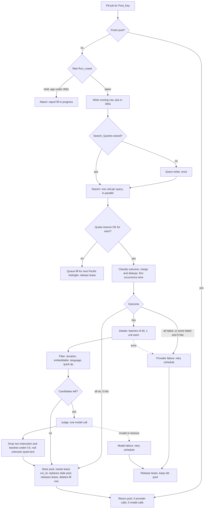
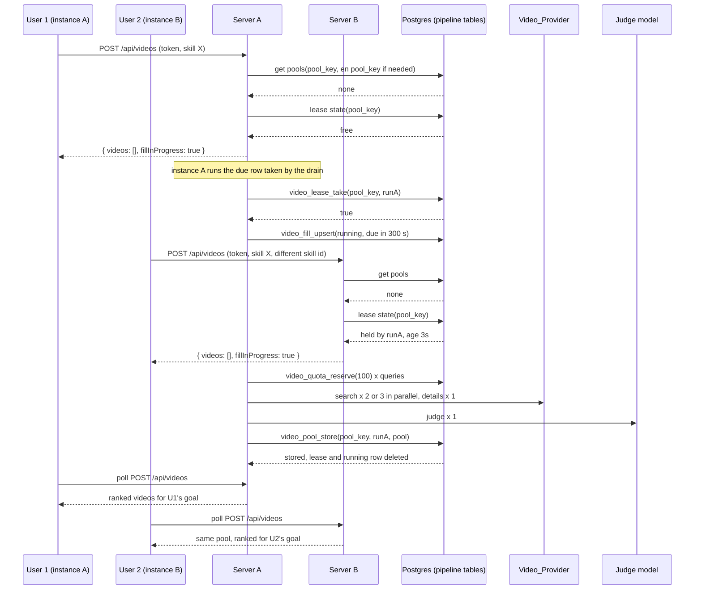
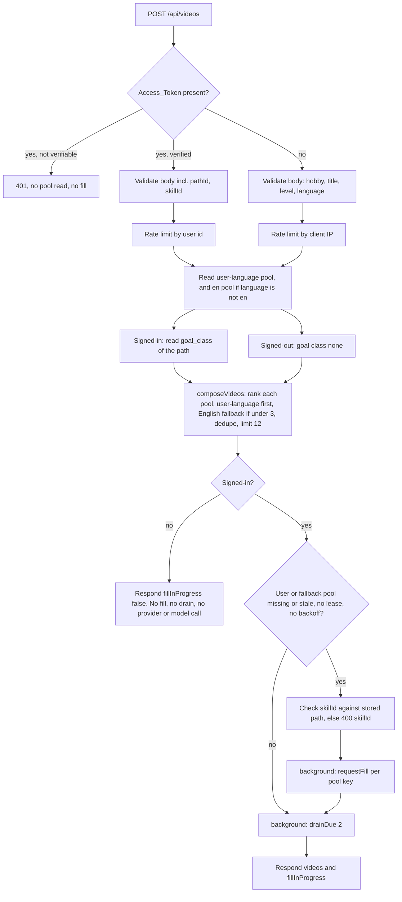

# Design Document: Skill Video Pipeline

## Overview

The Skill Video Pipeline finds, checks and scores learning videos per Pool_Key (Normalized hobby, Normalized Skill title, Level, Language_Code) and shows them in the Skill_Sheet. Results are cached in a shared Video_Pool in Postgres, so the cost of search and Judge calls is paid once per Pool_Key and not once per user.

The design extends existing modules instead of adding parallel ones:

| Existing module | Extension |
| --- | --- |
| `shared/types/skill-tree.ts` (`SkillNode`) | `searchQueries`, `quickTip` on every node |
| `shared/utils/skill-tree-schema.ts`, `skill-tree-load.ts` | Schema fields, plus a generation-only check that makes missing fields a Validation_Error |
| `server/utils/generator.ts`, `server/utils/providers/*`, `server/prompts/skill-tree.md` | Prompt additions, a second adapter method `generateStructured` used by the Judge, the query writer and the goal classifier |
| `server/utils/llm-handlers.ts` (`handleTreeRequest`, `TreeDeps`) | Optional `goal` in the body, Goal_Class stored with the path, background fill after save written as due `video_fills` rows (drained by the cron job) |
| `server/utils/rate-limiter.ts` | A second limiter instance for the videos endpoints (user key for Signed_In_Users, client IP key for Signed_Out_Users) |
| `server/utils/supabase-server.ts`, `account-runtime.ts` | A service-role client for server-only tables (read in `video/runtime.ts`, see Decision 4), a user-token client to read the user's path |
| `supabase/migrations/*` (profiles, paths, RLS, `save_generated_path`) | New migrations: pipeline tables, video events, `profiles.language`, `profiles.goal`, `paths.goal_class` |
| `app/utils/cloud-api.ts` (`CloudApi`), `save-queue.ts`, `useCloudStore.ts` | `mergeVideoEvents`, reuse of `createSaveQueue` for event sync |
| `app/components/path/PathNodeDetail.vue`, `PathQuestItem.vue`, `PathView.vue` | Watch section and "Watch how" link |
| `nuxt.config.ts` | Runtime config keys, deploy preset, the comment on the service role key (Decisions 4 and 9) |

### Key design decisions

1. **Pool_Key level is the Skill's section level** (`Section.level`: `beginner | intermediate | advanced`), not the user's `StartLevel` (`new | some | serious`). The section level is the same for every user who has that skill title in that section, which is what makes pools shareable.
2. **The Goal never enters generation of queries.** The tree is generated and cached by `(hobby, startLevel, provider, model)` as today. Goal classification is a separate, small model call made after the tree exists (`server/utils/goal-classifier.ts`), and its result is stored in `paths.goal_class`. The tree cache therefore never depends on the Goal.
3. **The server never trusts the client for what gets searched.** A Signed_In_User's request carries `pathId` and `skillId` along with the hobby, title and Level. When a fill is needed, the server loads the user's path with the user's own token (RLS applies), finds the Skill, and cross-checks hobby, title and Level against it. Search_Queries, description, quests and the quick-tip flag come from the stored path. A client cannot put arbitrary queries into a shared pool.
4. **Signed-out users can read, never start work.** A request without an Access_Token reads existing pools, ranked with Goal_Class `none`, limited by client IP. It never causes a provider call, a model call, a fill request or an opportunistic drain. A token that is present but cannot be verified gets 401.
5. **All pipeline state lives in Postgres, behind SQL functions with atomic semantics** (quota reserve, lease take, pool store). Instances share it, restarts keep it, and the Client roles have no access.
6. **The pipeline logic is written against a `PipelineStore` interface.** The Postgres implementation calls the SQL functions. An in-memory implementation with an injected clock is used by tests.
7. **The host is Vercel (serverless), and background work is done by a cron-driven drain, not by the request.** `background()` always returns `false`, so every fill becomes a due `video_fills` row. There is no `event.waitUntil`, no `@vercel/functions` and no fire-and-forget promise. Work must also be safe when the platform kills the function early (see Serverless execution).
8. **Language default is `en`.** The browser language is not used. A user picks another language on the Settings page. When the user's language is not `en` and the user-language pool holds fewer than 3 videos, English videos from the `en` pool follow the user-language videos.

## Architecture

### Module layout

```
shared/types/video.ts            Video types: GoalClass, VideoStyle, VideoSource, PoolVideo, RankedVideo, VideoEvent, ...
shared/utils/video-normalize.ts  normalizeText, languageCode, poolKey
shared/utils/video-events.ts     Pure event reducers: apply*, mergeEvents, combineSources, countFeedSkips, parse/serialize
shared/utils/pacific-time.ts     pacificDay(ms), nextPacificMidnight(ms)
shared/utils/watch-how.ts        Quest-to-video matching by Normalized text; formatDuration; showPoolLanguageLabel
shared/utils/search-queries.ts   validateSearchQueries (count, length, name, distinct, level terms)

server/utils/video/provider.ts           VideoProvider interface, result and error types
server/utils/video/youtube-provider.ts   YouTube Data API v3 implementation (only module that knows YouTube)
server/utils/video/select-provider.ts    The one module that picks the active provider (imports youtube-provider)
server/utils/video/search.ts             Search stage: params, parallel calls, outcome classification, merge and dedupe
server/utils/video/details.ts            Details stage: batches of 50, unknown fields
server/utils/video/filter.ts             Filter stage (pure)
server/utils/video/judge.ts              Judge stage: input builder, zod output schema, apply verdicts
server/utils/video/pool.ts               Pool build, staleness (pure)
server/utils/video/ranking.ts            baseScore, goalAdjustment, rankVideos (pure)
server/utils/video/compose.ts            composeVideos: per-pool ranking, English fallback, dedupe, limit (pure)
server/utils/video/pipeline.ts           runPipeline(job, deps): Search, Details, Filter, Judge, Store
server/utils/video/pipeline-store.ts     PipelineStore interface
server/utils/video/pipeline-store-pg.ts  Postgres implementation over the service-role client
server/utils/video/quota.ts              Quota policy over PipelineStore (threshold, reserve, saturate)
server/utils/video/scheduler.ts          requestFill, runFill (lease, single-flight), fillWindow, retry schedule, drainDue
server/utils/video/query-writer.ts       Writes Search_Queries for a Skill that has none (Req 1.18)
server/utils/video/handlers.ts           handleVideosRequest, handleFillRequest, handleDrainRequest
server/utils/video/runtime.ts            Wires real deps (config, service-role client, limiter, `background` that always returns false)
server/utils/goal-classifier.ts          classifyGoal(goal, config, adapter) -> GoalClass
server/prompts/video-judge.md            Judge system prompt
server/prompts/search-queries.md         Query writer system prompt
server/prompts/goal-class.md             Goal classifier system prompt
server/api/videos.post.ts                POST /api/videos
server/api/videos/fill.post.ts           POST /api/videos/fill
server/api/videos/drain.post.ts          POST /api/videos/drain

app/components/watch/WatchSection.vue    Heading, "Finding videos for this skill" line, up to 3 cards
app/components/watch/WatchVideoCard.vue  Thumbnail card, language label, tap to play, skip observer
app/components/watch/WatchEmbedPlayer.vue  youtube-nocookie IFrame API player, watched seconds
app/composables/useSkillVideos.ts        Fetch, poll while fill in progress (signed-in only), state per skill
app/composables/useVideoEvents.ts        Event recorder: local store, cloud sync, retry
app/utils/video-api.ts                   Typed client for /api/videos and /api/videos/fill
app/utils/video-events-store.ts          localStorage store for events
app/utils/user-settings.ts               language and goal in the browser (default language `en`)
app/utils/youtube-iframe.ts              Loader and minimal types for the IFrame API (no new dependency)

supabase/migrations/20261110000000_goal_language.sql   profiles.language/goal, paths.goal_class, save_generated_path
supabase/migrations/20261110000100_video_pipeline.sql  Pipeline tables, functions, RLS lockdown
supabase/migrations/20261110000200_video_events.sql    video_events, merge_video_events, RLS
supabase/migrations/20261110000300_video_drain_cron.sql  pg_cron + pg_net job, every 20 s, POST /api/videos/drain (secrets from Vault)
```

Nitro auto-imports only top-level `server/utils/*.ts`. The existing code imports nested modules explicitly (`./providers/anthropic`). The new `server/utils/video/*` modules do the same.

### Boundaries

- Only `select-provider.ts` imports `youtube-provider.ts`. Every other Pipeline module imports `provider.ts` only (Req 2.3). An import-boundary unit test enforces this.
- The Client never calls the provider. It calls `/api/videos` and `/api/videos/fill`. The only provider-owned requests it makes are the embed itself: the IFrame API script from `www.youtube.com`, the player on `www.youtube-nocookie.com`, and thumbnails from `i.ytimg.com` (Req 2.9, 12.4, Decision 8).
- The API key is read from runtime config in `video/runtime.ts` and passed to `createYouTubeProvider({ apiKey, fetcher })`. It is sent in the `x-goog-api-key` request header, so it is never part of a URL that could end up in an error (Decision 10; verified live in the first task, fallback is the `key` query parameter with URL-free errors).

### Serverless execution

The app is deployed on Vercel (`nitro.preset = 'vercel'`, `maxDuration` 60 s). A function instance lives only as long as the request and has a platform time limit. The design handles this in five ways.

1. **One `background(task)` dependency, which always returns `false` on Vercel.** All background work goes through it: the fill after path creation, the fill after the current Skill changes, a fill requested by the videos endpoint, and the opportunistic drain. Handlers receive `background` as a dependency, so tests can record or drop the tasks. There is no fire-and-forget fallback. Because `background` returns `false`, the caller writes a due `video_fills` row instead, and the drain picks the work up. The drain is called every 20 s by a Supabase pg_cron job through pg_net (see Decision 9).
2. **The first implementation task checks that `nuxt.config.ts` sets `nitro.preset = 'vercel'` and `maxDuration` 60 s.** No `waitUntil` check is needed.
3. **Runs are small.** One run is 2 or 3 searches (started in parallel), one details call and one Judge call, with a provider timeout of 10 s and a model timeout of 30 s. The worst case is therefore about 10 s (searches) + 10 s (details) + 30 s (Judge) = 50 s, and a typical run takes a few seconds. This fits a typical function limit of 60 s. The preset's limit must be at least 60 s; if it is lower, the model timeout is lowered with it.
4. **Few pools per invocation.** A fill request (path creation, current Skill change, `POST /api/videos/fill`) writes a due `video_fills` row for every pool in the Current_Window, current Skill first, and starts no run inline. The opportunistic drain after a Signed_In_User's videos request runs at most 2 fills (Req 9.18), and the Drain_Route at most 5 and stops starting new runs once 50 s of its time budget is used.
5. **A killed run recovers by itself.** Before the first provider call, a run writes (or keeps) a `video_fills` row with reason `running` and `next_run_at = now + 300 s`, and holds the Run_Lease. The row and the lease both live in the database. If the platform kills the function, the lease expires at 300 s and the `running` row becomes due at the same time. The next videos request of a Signed_In_User for that Pool_Key takes over the lease, and the drain runs the due row. A successful `video_pool_store` deletes the row.

### Pipeline flow



### Shared run with lease (two users, two instances, cron drain)



If runA is killed or stalls, its lease ages to 300 s and its `running` row becomes due. Any instance may then take the lease with a new run id, and the drain may run the due row. `video_pool_store` checks that the caller's run id still owns the lease, so a late runA cannot overwrite the pool stored by the run that took over (Req 7.12).

### Videos request flow (Signed_In_User and Signed_Out_User)



## Components and Interfaces

### Shared normalization and keys (`shared/utils/video-normalize.ts`)

```ts
/** Lowercase, remove every \p{P} character, trim, collapse whitespace runs to one space. Letters and digits of any script stay. */
export function normalizeText(input: string): string
/**
 * Primary subtag, lowercase.
 * null, undefined, empty or whitespace-only input (language not chosen) -> 'en'.
 * Non-empty input without a valid primary subtag (not 2 to 3 ASCII letters before an optional '-' or '_' part) -> 'und'.
 */
export function languageCode(input: string | null | undefined): string
export interface PoolKeyParts { hobby: string; skillTitle: string; level: Level; language: string }
/** JSON array of [normalizeText(hobby), normalizeText(skillTitle), level, languageCode(language)]. Injective like cacheKey. */
export function poolKey(parts: PoolKeyParts): string
```

`normalizeText` follows the glossary order (lowercase, then remove punctuation, then trim and collapse). It does not apply Unicode normalization forms. It is separate from the existing `normalizeHobby` (tree cache key), which stays unchanged. The same function is used by the server for Pool_Key and by the Client for "Watch how" matching (Req 7.13, 12.11).

`poolKey` contains no skill id, quest index, region or user id.

### Search queries (`shared/utils/search-queries.ts`)

```ts
export const LEVEL_TERMS: Record<Level, readonly string[]> = {
  beginner: ['for beginners', 'first', 'basics'],
  intermediate: ['drills', 'technique', 'common mistakes'],
  advanced: ['advanced', 'training', 'breakdown'],
}
export type QueryIssue = 'count' | 'empty' | 'length' | 'name' | 'duplicate' | 'level_term'
/** Checks 2..3 queries, each 3..100 chars after trim, containing the hobby or the skill title (case-insensitive), pairwise distinct (case-insensitive), at least one level term for the skill's section level. */
export function validateSearchQueries(queries: readonly string[], ctx: { hobby: string; skillTitle: string; level: Level }): QueryIssue[]
```

Level terms are matched as case-insensitive substrings. `first` and `basics` match inside longer words by design (the requirement lists terms, not tokens).

### Skill tree and generator changes (Req 1)

`shared/types/skill-tree.ts`:

```ts
export interface SkillNode {
  /* existing fields */
  /** 2 to 3 video search strings; absent on paths made before this feature. */
  searchQueries?: string[]
  /** True when videos shorter than 60 s are fine; absent means false. */
  quickTip?: boolean
}
```

- `skillTreeSchema`: add `searchQueries: z.array(text).min(2).max(3).optional()` and `quickTip: z.boolean().optional()` (stored trees from older paths still load; the drift check `Equals<z.infer<...>, SkillTree>` keeps schema and type aligned). `toProviderSchema` already closes objects with all keys required, so the model must return both fields on new generations.
- `skill-tree-load.ts`: `loadSkillTree(candidate, { requireVideoFields: true })` (used only by the generator) adds a Validation_Error kind `video_fields` for a missing or non-boolean `quickTip`, and for `validateSearchQueries` issues. These errors reach the existing `retryNote` and retry loop (Req 1.10, 1.15). Stored trees are loaded without the option.
- `server/prompts/skill-tree.md`: add instructions for `searchQueries` (inputs: hobby, skill, section level only; level terms) and `quickTip`. No Goal text is in this prompt or its user message (Req 1.9).
- The zod schema keeps the order of `searchQueries` and carries `quickTip`, so tree round trip holds (Req 1.13, 1.16, 1.20). Readers use `node.quickTip ?? false` (Req 1.17).

Goal classification (`server/utils/goal-classifier.ts`):

```ts
export function coerceGoalClass(raw: unknown): GoalClass   // anything not exactly 'targeted' | 'casual' | 'none' -> 'none'
export async function classifyGoal(goal: string, config: ProviderConfig, adapter: ProviderAdapter, signal?: AbortSignal): Promise<GoalClass>
```

An empty or whitespace goal returns `none` without a model call. Any failure (error, timeout, invalid output) returns `none` (Req 1.11, 1.12).

`handleTreeRequest` changes:
1. Accepts optional `body.goal` (string, trimmed, at most 200 characters; otherwise `invalid_input`).
2. After the tree is available (cache or generation), runs `classifyGoal` with the resolved config. The result goes into `PathSaveInput.goalClass`. The classifier call is not billable against the hourly limiter and has a 10 s timeout.
3. After a successful save, calls `deps.afterSave?.({ pathId, tree })`. The real `afterSave` (wired in `runtime.ts`) calls `background(fillWindow(jobs))`, which returns `false` on Vercel, so `afterSave` writes due `video_fills` rows and the response does not wait (Req 8.1, 8.2). It never throws.

`PathSaveArgs` gains `p_goal_class`; `save_generated_path` is replaced by a 7-argument version (default `'none'`). `buildSaveArgs` in `shared/utils/cloud-path.ts` passes it.

### Provider adapter extension

`ProviderAdapter` (`server/utils/providers/types.ts`) gains one method used by the Judge, the query writer and the goal classifier:

```ts
generateStructured(config: ProviderConfig, options: {
  systemPrompt: string
  userText: string
  schemaName: string
  schema: JsonSchema          // already passed through toProviderSchema
  maxTokens: number
  signal?: AbortSignal
}): Promise<AdapterResult>
```

Anthropic uses a forced tool call and OpenAI uses structured output, as `generateTree` does today. Failures map to the existing `AdapterFailure` codes. The pipeline uses the Default_Config (server key) for these calls because the work is shared and runs in the background. If the Default_Config is missing, the model step fails like a model failure (Req 9.9, 9.10) and nothing else breaks.

### Video provider (`server/utils/video/provider.ts`)

```ts
export type ProviderErrorKind = 'not_configured' | 'quota_exceeded' | 'timeout' | 'upstream'
export class ProviderError extends Error { constructor(readonly kind: ProviderErrorKind) }  // message is the kind only

export interface SearchHit { id: string; title: string; channel: string; thumbnailUrl: string }
export interface VideoDetails {
  id: string
  title: string; channel: string; description: string; thumbnailUrl: string
  durationSeconds: number | null
  viewCount: number | null; likeCount: number | null
  publishedAt: string | null
  defaultAudioLanguage: string | null
  hasCaptions: boolean | null
  embeddable: boolean | null
}
export interface VideoProvider {
  /** maxResults 1..50. language is a Language_Code or 'und'. */
  search(query: string, maxResults: number, opts: { language: string; signal?: AbortSignal }): Promise<SearchHit[]>
  /** 1..50 ids. Ids the provider does not return are absent from the result. */
  getDetails(ids: readonly string[], opts: { signal?: AbortSignal }): Promise<VideoDetails[]>
}
```

`createYouTubeProvider({ apiKey, fetcher })`:

- Empty key: throws `ProviderError('not_configured')` before any fetch (Req 2.5).
- `search`: `GET search` with `part=snippet`, `type=video`, `videoEmbeddable=true`, `safeSearch=strict`, `maxResults` of at most 10, `q`, and `relevanceLanguage` only when the language is not `und`. No `regionCode` (Req 3.2 to 3.6).
- `getDetails`: `GET videos` with `part=snippet,contentDetails,statistics,status`. Duration is parsed from ISO 8601. Missing statistics, language or caption fields become `null` (Req 4.2, 4.3).
- 10 s timeout through `AbortSignal.timeout`. Status 403 with reason `quotaExceeded` maps to `quota_exceeded`, abort to `timeout`, anything else to `upstream`. No retry inside the provider within a run beyond what Req 2.6 allows (at most one); the Pipeline retries per Req 9.12. Errors carry only the kind, never URL, headers or body (Req 2.6, 2.7).

### Pipeline stages

**Search** (`search.ts`): `searchAll(provider, queries, language, gate)` starts one call per query (at most 5 queries, 10 results each), all in parallel so the stage costs at most one provider timeout. Before each call it asks quota for 100 units (the reserve calls are issued in query order). Results are merged by video id, keeping the first occurrence in query order (Req 3.1, 3.7). A failed search is dropped and the rest continue (Req 3.8).

The stage returns one of four outcomes, decided by a pure function `classifySearch(outcomes)` where each outcome is `failed` or `ok(hits)`:

| Outcome | Condition | Run result |
| --- | --- | --- |
| `blocked` | the quota gate refused a call | queue for next Pacific midnight (Req 9.6) |
| `provider_failure` | every search failed, or at least one failed and the successful ones return 0 hits in total | nothing stored, lease released, retry scheduled (Req 3.9, 3.11) |
| `empty` | every search succeeded and the hits in total are 0 | store an empty pool, skip details and Judge (Req 3.10) |
| `candidates` | otherwise | merged Candidate list continues |

**Details** (`details.ts`): empty hits skip the call (Req 4.6). Otherwise ids are split into batches of at most 50. Each batch reserves 1 unit. Candidates missing from the response are dropped (Req 4.4). A failed batch stops the run with a provider failure and no candidates move on (Req 4.5).

**Filter** (`filter.ts`, pure):

```ts
export function filterCandidates(c: readonly VideoDetails[], ctx: { language: string; quickTip: boolean }): VideoDetails[]
```

Keep a candidate iff all hold: `embeddable !== false` (an unknown value is kept because the search already set `videoEmbeddable=true`); `durationSeconds` is a number greater than 0 and at most 1500; `durationSeconds >= 60` unless `quickTip`; and the language rule (keep when `language === 'und'` or no default audio language; else the primary subtag, lowercased, equals `language`).

**Judge** (`judge.ts`):

```ts
export const judgeVerdictSchema = z.object({
  video_id: z.string(),
  teaches_this_skill: z.number().min(0).max(1),
  level_fit: z.number().min(0).max(1),
  is_instruction: z.boolean(),
  style: z.enum(['drill', 'technique', 'explainer', 'approachable']),
  best_matching_quest_text: z.string().nullable(),
})
export const judgeOutputSchema = z.object({ verdicts: z.array(judgeVerdictSchema) })
export function buildJudgeInput(ctx: { hobby; skillTitle; skillDescription; questTexts: [string, string, string]; level }, c: readonly VideoDetails[]): string
export function applyVerdicts(output: unknown, c: readonly VideoDetails[], questTexts: readonly string[]): { ok: true; kept: PoolVideo[] } | { ok: false }
```

- Input per candidate: id, title, description cut to its first 500 characters, channel, duration. The context has the quest texts as a plain list with no index or id (Req 6.2, 6.3).
- `applyVerdicts` returns `ok: false` for any schema failure (the whole response is discarded, Req 6.7). On success: ignore verdicts for unknown ids (6.10), drop candidates with no verdict (6.8), drop `is_instruction === false` and `teaches_this_skill < 0.5` (6.5, 6.6), and set `matchedQuestText` to the sent quest text whose Normalized form equals the Normalized verdict text, else `null` (6.9). The stored value is the quest text as sent, so the client compares like with like.
- One model call for all candidates, 30 s timeout (Req 9.9). The call uses `generateStructured` with the Default_Config.

**Store** (`pool.ts` + `PipelineStore.storePool`): builds a `VideoPool` with unique ids (a final dedupe by id guards the invariant, Req 7.2), only filtered and judged videos (7.3), and `storedAt` from the database clock.

### Ranking, goal rerank and English fallback (`ranking.ts`, `compose.ts`; Req 10, 11)

```ts
export const GOAL_BONUS = 0.1                         // within 0..0.2
export function baseScore(v: { teachesThisSkill: number; levelFit: number }): number     // product, clamped to 0..1
export function goalAdjustment(v: PoolVideo, goal: GoalClass): number                  // 0 or GOAL_BONUS
export function rankVideos(pool: readonly PoolVideo[], goal: GoalClass): PoolVideo[]   // full ranked list, no cap

export const FALLBACK_MIN = 3
export function fallbackApplies(language: string, userPoolCount: number): boolean      // language !== 'en' && userPoolCount < 3
export function composeVideos(input: {
  language: string                         // Language_Code of the user
  goal: GoalClass                          // 'none' for Signed_Out_Users
  userPool: VideoPool | null
  enPool: VideoPool | null                 // null when language is 'en' or not read
  limit?: number                           // default 12
}): RankedVideo[]
```

- `targeted`: bonus for `drill` and `technique`. `casual`: bonus for `approachable` or `durationSeconds <= 900`. `none` (or an unknown stored value): 0 for all (Req 11.4 to 11.6).
- Order within one pool: ranking score descending, then video id ascending (Req 11.8). The rerank runs per request on the cached pool, makes no provider call and writes nothing (Req 11.3, 11.10).
- `composeVideos`: rank the user-language pool alone. If `fallbackApplies(language, userPool?.videos.length ?? 0)`, rank the English pool alone and append it after all user-language videos (Req 10.15, 10.16, 11.11). Drop an English video whose id is in the user-language list (the user-language copy wins), and do this before applying the limit of 12 (Req 10.17). Each output video carries `poolLanguage`: the user's Language_Code for user-language videos and `en` for Fallback_Videos (Req 10.18). When `language` is `en`, no English pool is read and no fallback is returned (Req 10.20).
- A Signed_Out_User uses `goal = 'none'` for both pools (Req 11.12).

### Quota (`quota.ts`)

```ts
export const SEARCH_COST = 100
export const DETAILS_COST = 1
export function dailyQuota(raw: unknown): number            // positive integer, else 10000 (Req 9.7)
export function quotaThreshold(quota: number): number       // Math.ceil(quota * 0.9)
export interface QuotaGate { reserveSearch(): Promise<boolean>; reserveDetails(): Promise<boolean>; markExceeded(): Promise<void> }
```

`reserveSearch` calls `PipelineStore.reserveQuota({ units: 100, gateThreshold: true })`. It succeeds only when `used < threshold` and `used + 100 <= quota`, as one atomic statement in Postgres (Req 9.3, 9.4, 9.16). `reserveDetails` uses `units: 1`, ignores the threshold and requires `used + 1 <= quota`. Reservation happens before the call, so errored calls stay counted (Req 9.1). `markExceeded` raises `used` to the quota (Req 9.5). The Pacific_Day is decided by the database clock (`timezone('America/Los_Angeles', now())::date`), and `shared/utils/pacific-time.ts` mirrors it for the in-memory store and for tests.

### Scheduler (`scheduler.ts`)

```ts
export interface FillJob {
  poolKey: string
  hobby: string; skillTitle: string; skillDescription: string
  quests: [string, string, string]; level: Level; language: string
  searchQueries: string[] | null; quickTip: boolean
  /** Used only to write generated queries back to the user's path, only by jobs started inside a Signed_In_User request. Never stored. */
  persist?: (queries: string[]) => Promise<void>
}
export interface Scheduler {
  /** Returns the state to report. Starts at most one background run through background(). */
  requestFill(job: FillJob): Promise<{ inProgress: boolean }>
  runFill(job: FillJob): Promise<RunOutcome>
  /** Runs due queued fills, at most `max`. */
  drainDue(max: number): Promise<number>
  /** Passes at most 2 jobs to background() (current Skill first); queues the others as due rows. When background() returns false (always on Vercel), all jobs are queued. */
  fillWindow(jobs: readonly FillJob[]): Promise<void>
}
export const INLINE_FILLS_PER_REQUEST = 2
export const DRAIN_AFTER_REQUEST = 2
export const DRAIN_ROUTE_MAX = 5
```

- `requestFill`: checks in this order. A Fresh_Pool exists: do nothing. An unexpired lease exists: return `inProgress: true`. A queued fill with `next_run_at` in the future (backoff or quota wait) exists: return `inProgress: false` and start nothing. Otherwise call `background(runFill(job))` and return `inProgress: true` (Req 10.4). If `background` returns `false` (always on Vercel), write a due row and return `inProgress: true`.
- `runFill`: tries `takeLease(poolKey, runId)`. If it fails, exit (another run owns the key). On success it writes the `running` row (due in 300 s), runs `runPipeline`, which ends with `storePool` (Req 7.6, 7.8) or a failure that releases the lease, keeps the old pool, and replaces the `running` row with a `retry` or `quota` row.
- `fillWindow`: starts from the Skills in the Current_Window without a Fresh_Pool. The first 2 run one after another. Every other one is written as a `new` row with `next_run_at = now`, so a later drain runs it. One failure never stops the rest (Req 8.5 to 8.7). Nothing is filled outside the window.
- Retry schedule (pure function `nextRetry(attempts, now)`): delays 60 s, 120 s, 240 s, 480 s, 960 s for attempts 1 to 5. The sixth attempt of one Pacific_Day is not started, and the fill waits for the next Pacific midnight, where `attempts` resets (Req 9.12). A quota-blocked fill waits for the next Pacific midnight and does not count as an attempt (Req 9.6).
- `drainDue(max)`: loads up to `max` rows with `next_run_at <= now` (`for update skip locked`) and runs each. The queued job carries everything it needs (it holds no user token), so `persist` is not set. The Drain_Route and the videos endpoint are the only callers (Req 9.18).
- Failure logging: `console.error('[video]', { poolKey, type })` with a fixed `type` label. No keys, no bodies (Req 9.13).

### Handlers (`handlers.ts`) and endpoints

`POST /api/videos` (Req 10).

Request body:

```ts
interface VideosRequest {
  hobby: string; skillTitle: string; level: Level
  language: string | null         // null or empty means not chosen, so 'en'
  pathId?: string                 // required for a Signed_In_User, ignored otherwise
  skillId?: string                // required for a Signed_In_User, ignored otherwise
}
```

Response (`VideosResponse`): `{ videos: RankedVideo[]; fillInProgress: boolean }`, or `{ error: 'invalid_input' | 'unauthorized' | 'rate_limited'; field?: string }` with status 400, 401, 429.

Steps:
1. Read the bearer token. If one is present and `verifyAccessToken` fails: 401, no pool read, no provider call, no fill (Req 10.10). If none is present, the request is a Signed_Out_User request.
2. Validate the body: non-empty `hobby` and `skillTitle` of at most 100 characters, `level` in `Level`. For a Signed_In_User, also non-empty `pathId` and `skillId`. Any failure: 400 with `field`, no provider call, no fill (Req 10.5). `language` is reduced by `languageCode`, so a missing language is `en`.
3. Rate limit with the existing `createRateLimiter({ limit: 60, windowMs: 60_000, now: Date.now })`, keyed by `user:<id>` for a Signed_In_User and `ip:<client ip>` for a Signed_Out_User. Over the limit: 429 before any pool read (Req 10.6).
4. Compute the user-language `poolKey`. When the language is not `en`, also compute the English `poolKey` (same normalized hobby and title and Level, language `en`). Read both pools with one query. No provider or model call in this path (Req 10.2).
5. Goal: a Signed_In_User's `goal_class` is read from `paths` with the user's token (RLS applies); if this fails, use `none` (Req 11.6). A Signed_Out_User uses `none`.
6. `composeVideos` builds the response list (ranking, fallback, dedupe, limit 12, `poolLanguage` per video).
7. **Signed_Out_User:** respond with `fillInProgress: false`. Stop. No fill, no drain, no provider call, no model call (Req 10.9, 10.11, 10.12, 8.10, 9.22).
8. **Signed_In_User:** decide fills. The user pool needs a fill when it is missing or stale. The English pool needs a fill when the Fallback_Condition holds (language is not `en` and the user pool holds fewer than 3 videos) and the English pool is missing or stale (Req 10.19, 10.20). For each pool that needs a fill, `requestFill` checks the lease and backoff as described above. If at least one fill must be requested, the Server first loads the Skill from the user's stored path by `skillId` and checks it (Req 10.13, 10.14): the Skill must exist and its Normalized hobby, Normalized title and section Level must equal the request, else 400 `invalid_input` with `field: 'skillId'` and no fill. The jobs are built from the stored Skill only (queries, description, quests, quick-tip flag) and differ only in `language`. If the path cannot be loaded because of a database error, no fill is requested and the response is still served.
9. `fillInProgress` is true while a fill is in progress or was just requested for the user pool or for the English pool (Req 10.21).
10. After building the response, call `background(drainDue(2))` (Req 9.18). This runs only for Signed_In_Users.
11. Respond. Each video carries `matchedQuestText` and `poolLanguage` (Req 10.8, 10.18). No field of `Pipeline_State`, key or token appears.

`POST /api/videos/fill` body `{ pathId, currentSkillId }`: requires a verified token (missing or unverifiable: 401; Signed_Out_Users never reach any work). Loads the path with the user's token, computes the Current_Window with `currentWindow(tree, currentSkillId)` (the current Skill and the next 2 in path order, fewer near the end), builds jobs for the user's Language_Code, and calls `background(fillWindow(jobs))`. Returns `202 { accepted: true }` immediately (Req 8.3). It uses the same limiter. At most 2 pools run inline (see Serverless execution); the rest are queued.

`POST /api/videos/drain`: requires header `x-video-drain-secret` equal to `runtimeConfig.videoDrainSecret` (constant-time comparison). A missing header, a wrong value, or no configured secret returns an error response (404 when no secret is configured, 401 otherwise) and runs nothing (Req 9.21). With the correct secret it runs `background(drainDue(5))` and returns 202 (Req 9.20). There is no scheduler yet (Decision 7), so the route is called by hand or by an external caller later.

## Data Models

### Shared types (`shared/types/video.ts`)

```ts
export type GoalClass = 'targeted' | 'casual' | 'none'
export type VideoStyle = 'drill' | 'technique' | 'explainer' | 'approachable'
export type VideoSource = 'skill_sheet' | 'feed'

export interface PoolVideo {
  id: string; title: string; channel: string; thumbnailUrl: string
  durationSeconds: number
  viewCount: number | null; likeCount: number | null; publishedAt: string | null
  defaultAudioLanguage: string | null; hasCaptions: boolean | null
  teachesThisSkill: number; levelFit: number
  style: VideoStyle
  matchedQuestText: string | null
}
export interface VideoPool { poolKey: string; videos: PoolVideo[]; storedAt: number /* epoch ms */ }
export interface RankedVideo {
  id: string; title: string; channel: string; thumbnailUrl: string
  durationSeconds: number; style: VideoStyle; matchedQuestText: string | null
  poolLanguage: string                       // Language_Code of the pool the video came from
}
export interface VideosRequest {
  hobby: string; skillTitle: string; level: Level; language: string | null
  pathId?: string; skillId?: string
}
export type VideosResponse =
  | { videos: RankedVideo[]; fillInProgress: boolean }
  | { error: 'invalid_input' | 'unauthorized' | 'rate_limited'; field?: string }

export interface VideoEvent {
  videoId: string
  source: VideoSource
  playedAt: number | null       // epoch ms of the first play, set once
  watchedSeconds: number        // >= 0, never decreases
  finished: boolean             // sticky
  saved: boolean
  savedAt: number | null        // Saved_Time: time of the last save or unsave; null is earlier than every time
  skipped: boolean
  updatedAt: number             // epoch ms of the last change
}
```

`savedAt` is the Saved_Time of Req 13. Only a save or an unsave changes `saved` and `savedAt` (Req 13.19). The merge keeps the `saved` value of the record with the later `savedAt`, independently of the other fields, and keeps `saved = true` when the times are equal and either record has it (Req 13.13).

### Settings additions

- `ProfileRow` and `ProfilePatch` (`shared/types/cloud.ts`) gain `language: string | null` and `goal: string | null`. `cloud-rows.ts` parses them. `useCloudStore` exposes them like `displayName`.
- Browser store `pursio-user-settings:v1` (`app/utils/user-settings.ts`, same pattern as `llm-settings.ts`): `{ language: string | null, goal: string }`.
- The Settings page gets a Language select (list of Language_Codes with names, with `English` as the default) and a Goal text field (max 200 characters, optional). The Goal is entered only here (Decision 11). The default language is `en`. The browser language is not read (Decision 12). A stored value that is not a valid code is treated as `und` by `languageCode`.
- `buildTreeRequest` (`app/utils/tree-client.ts`) adds `goal` to the body only when it is non-empty. The Goal affects the path only through `goal_class`.

### Database

New migrations (all in `supabase/migrations`, applied after the existing ones).

**`20261110000000_goal_language.sql`**

```sql
alter table public.profiles add column language text check (char_length(language) between 2 and 35);
alter table public.profiles add column goal text check (char_length(goal) <= 200);
alter table public.paths add column goal_class text not null default 'none'
  check (goal_class in ('targeted', 'casual', 'none'));
-- replace save_generated_path with a 7-argument version; p_goal_class default 'none';
-- on conflict also sets goal_class = excluded.goal_class. Same grants as before.
```

**`20261110000100_video_pipeline.sql`** (server-only)

```sql
create table public.video_pools (
  pool_key  text primary key,
  videos    jsonb not null,
  stored_at timestamptz not null default now(),
  run_id    uuid not null
);
create table public.video_leases (
  pool_key text primary key,
  run_id   uuid not null,
  taken_at timestamptz not null default now()
);
create table public.video_quota (
  day  date primary key,                       -- Pacific_Day
  used integer not null default 0 check (used >= 0)
);
create table public.video_fills (
  pool_key     text primary key,
  job          jsonb not null,                 -- FillJob without persist; holds no user id and no token
  reason       text not null check (reason in ('new','stale','quota','retry','running')),
  attempts     integer not null default 0,
  attempts_day date,                           -- Pacific_Day the attempts count belongs to
  next_run_at  timestamptz not null,
  created_at   timestamptz not null default now()
);
create index video_fills_due on public.video_fills (next_run_at);
```

`running` rows are written when a run starts, with `next_run_at = now() + 300 s`, so a run killed by the platform becomes due when its lease expires.

SQL functions (all `language plpgsql`, `security definer`, `set search_path = public`, `revoke execute ... from public, anon, authenticated; grant execute ... to service_role`):

| Function | Behavior |
| --- | --- |
| `video_quota_reserve(p_units int, p_quota int, p_threshold int, p_gate boolean) returns boolean` | Computes `d := (timezone('America/Los_Angeles', now()))::date`, inserts `(d, 0)` on conflict do nothing, then `update video_quota set used = used + p_units where day = d and used + p_units <= p_quota and (not p_gate or used < p_threshold)`. Returns whether a row changed. The row lock serializes concurrent instances. |
| `video_quota_saturate(p_quota int)` | Upserts today's row and sets `used = greatest(used, p_quota)`. |
| `video_lease_take(p_key text, p_run uuid, p_timeout_s int) returns boolean` | `insert ... on conflict (pool_key) do update set run_id = p_run, taken_at = now() where video_leases.taken_at <= now() - make_interval(secs => p_timeout_s)`. Returns whether the caller now owns the lease. |
| `video_lease_release(p_key text, p_run uuid)` | Deletes the lease only when `run_id = p_run`. |
| `video_pool_store(p_key text, p_run uuid, p_videos jsonb) returns boolean` | In one transaction: requires a lease row with `run_id = p_run`, else returns false. Upserts the pool with `stored_at = now()`, deletes the lease and any queued fill (including the `running` row) for the key. |
| `video_pools_read(p_keys text[])` | Returns `pool_key`, `videos`, `stored_at` and `now()` as epoch values for up to 2 keys, so the app server clock never decides staleness. Also returns whether an unexpired lease exists and the `next_run_at` of a queued fill for each key. |
| `video_fill_upsert(p_key text, p_job jsonb, p_reason text, p_attempts int, p_attempts_day date, p_next timestamptz)` | Upsert by key. |
| `video_fills_due(p_max int) returns setof video_fills` | `for update skip locked` on rows with `next_run_at <= now()`, ordered by `next_run_at`. |
| `video_fill_delete(p_key text)` | Deletes the row. |

**RLS and server-only access (Req 7.9, 9.17)**

```sql
alter table public.video_pools  enable row level security;
alter table public.video_leases enable row level security;
alter table public.video_quota  enable row level security;
alter table public.video_fills  enable row level security;
revoke all on public.video_pools, public.video_leases, public.video_quota, public.video_fills from anon, authenticated;
-- No policies. Only the service role (which bypasses RLS) reaches these tables.
```

The server reads the service role key from runtime config `supabaseServiceRoleKey` in `video/runtime.ts` (Decision 4). The pool never holds a user id, so a shared pool leaks nothing about a user. Signed_Out_User reads go through the same service-role read function; no Client role gets table access.

**`20261110000200_video_events.sql`** (per user, RLS)

```sql
create table public.video_events (
  user_id         uuid not null default auth.uid() references auth.users (id) on delete cascade,
  video_id        text not null check (char_length(video_id) between 1 and 64),
  source          text not null check (source in ('skill_sheet', 'feed')),
  played_at       timestamptz,
  watched_seconds double precision not null default 0 check (watched_seconds >= 0),
  finished        boolean not null default false,
  saved           boolean not null default false,
  saved_at        timestamptz,
  skipped         boolean not null default false,
  updated_at      timestamptz not null default now(),
  primary key (user_id, video_id, source)
);
alter table public.video_events enable row level security;
grant select, insert, update, delete on public.video_events to authenticated;
create policy video_events_owner on public.video_events
  for all to authenticated
  using (user_id = (select auth.uid()))
  with check (user_id = (select auth.uid()));
```

`merge_video_events(p_rows jsonb)` (`security invoker`, granted to `authenticated`) upserts each row with the same merge rule as `mergeEvents` in TypeScript: earliest non-null `played_at`, `greatest(watched_seconds)`, `finished` OR, `saved_at = greatest(saved_at)` (null is earlier than every time), `saved` from the row with the later `saved_at` and `(old.saved or new.saved)` when `saved_at` is equal, `skipped` kept only when no play exists, `updated_at = greatest`. `user_id` is forced to `auth.uid()` inside the function. Because `merge_video_events` is invoked per batch and is idempotent and monotone, retries and the local-to-cloud move are safe (Req 13.9, 13.10, 13.13, 13.14).

### Pool_Key and storage format

`poolKey` is the JSON text of `[hobby, title, level, language]` after normalization. Pools are stored as `video_pools.videos jsonb` holding `PoolVideo[]`. Pool_Expiry is 604800 s; `isStale(ageSeconds)` is `ageSeconds >= 604800` (Req 7.4).

### Pacific time (`shared/utils/pacific-time.ts`)

```ts
export function pacificDay(ms: number): string               // 'YYYY-MM-DD' in America/Los_Angeles, via Intl.DateTimeFormat
export function nextPacificMidnight(ms: number): number      // epoch ms of the next 00:00:00 in that zone, DST applied
```

Implemented with `Intl.DateTimeFormat` and a search over the offset (no new dependency). Used by the in-memory store, retry scheduling in tests and the DST tests. In production the database computes the same value with `timezone('America/Los_Angeles', now())`.

### Configuration changes

Added to `runtimeConfig` in `nuxt.config.ts` (server-only) and to the example environment file with placeholder values:

| Key | Runtime config | Purpose |
| --- | --- | --- |
| `NUXT_YOUTUBE_API_KEY` (already listed) | `youtubeApiKey` | Provider key |
| `NUXT_VIDEO_DAILY_QUOTA` | `videoDailyQuota` | Daily_Quota, default 10000 |
| `NUXT_VIDEO_DRAIN_SECRET` | `videoDrainSecret` | Protects `/api/videos/drain` |

`NUXT_SUPABASE_SERVICE_ROLE_KEY` is reused. None of these go under `runtimeConfig.public`, so none reach the Client bundle (Req 2.4, 2.7, 2.8).

`nuxt.config.ts` also changes in two places that are tracked as implementation tasks:

- The comment on `supabaseServiceRoleKey` that says the key is only for `account-runtime.ts` is updated to say that `account-runtime.ts` and `video/runtime.ts` read it (Decision 4).
- `nitro.preset = 'vercel'` and `maxDuration` 60 s are set (Decision 9).

## Client design

### Data flow

1. `PathView.vue` already knows the selected node and `currentId`. When the Skill_Sheet or side panel opens for a node, `useSkillVideos` (new composable) calls `video-api.fetchVideos(req)` with `hobby` (tree.hobby), `skillTitle`, the section `level` and the language from user settings (default `en`). When a session exists it sends the Access_Token plus `pathId` and `skillId`. When no session exists (demo mode) it sends no token and no ids, and shows the section only if the response has 1 or more videos (Req 12.16, 12.17).
2. For a Signed_In_User, while the response has `fillInProgress: true` and 0 videos, the composable polls every 5 s (up to 24 polls, 120 s) and stops when the response changes, the sheet closes, or the node changes (Req 12.7, 12.9). For a Signed_Out_User `fillInProgress` is always false, so there is no polling and no "Finding videos" line.
3. When `currentId` changes (completion, or first load of a path) and a session exists, `PathView` calls `video-api.requestFill({ pathId, currentSkillId })`, debounced 500 ms, fire and forget (Req 8.3). Signed-out users send no fill request.
4. Failures set the state `hidden`. No dialog, no toast, no effect on quests (Req 12.10).

```ts
export type SkillVideosState =
  | { kind: 'hidden' }
  | { kind: 'finding' }                                  // signed in, fill in progress, 0 videos
  | { kind: 'ready'; videos: RankedVideo[]; language: string }   // up to 12, in server order; language is the user's Language_Code
```

### Components

- `WatchSection.vue` (props: `videos: RankedVideo[]`, `language: string`, `finding: boolean`, `activeId: string | null`; emits `play(id)`, `stop`). Renders `<section aria-labelledby>` with heading "Watch", the line "Finding videos for this skill" when `finding`, or up to 3 `WatchVideoCard` for `videos.slice(0, 3)`; hidden for `hidden`. If `activeId` is a video outside the first 3, its player renders above the cards (Req 12.1, 12.7 to 12.9, 12.12).
- `WatchVideoCard.vue` (props: `video`, `language`, `active`; emits `play`, `skipped`). A `<button>` whose accessible name includes the title, showing thumbnail, title, channel and `formatDuration` (`m:ss`, or `h:mm:ss` from 3600 s). When `video.poolLanguage !== language` (a Fallback_Video), it also shows the pool language code as a small label such as `EN`, using token utilities (Req 12.18); the label text is part of the card's accessible name. It never autoplays. An `IntersectionObserver` (threshold 0.5) starts a 2 s timer while visible and emits `skipped` once if the video is not played (Req 12.2, 12.14, 13.7).
- `WatchEmbedPlayer.vue` (props: `videoId`, `title`; emits `playing`, `progress(seconds)`, `paused`, `ended`). Loads the IFrame API script once (`app/utils/youtube-iframe.ts`, from `www.youtube.com`) and creates `new YT.Player(el, { host: 'https://www.youtube-nocookie.com', videoId, playerVars: { autoplay: 1, playsinline: 1, rel: 0, origin }, events })`. Created only after a tap or a "Watch how" activation, so autoplay is allowed by the user gesture (Req 12.3 to 12.5). Watched time accumulates from a 1 s timer while the state is playing, scaled by `getPlaybackRate()`. It flushes to the recorder at most every 5 s and on pause, end, `pagehide` and `visibilitychange` to hidden (Req 13.2).
- `PathQuestItem.vue` gets an optional prop `watchHow: { videoId: string; title: string } | null` and emits `watch`. It renders a "Watch how" button with accessible name `Watch how: <video title>, for quest: <quest text>` (Req 12.11, 12.14).
- `PathNodeDetail.vue` gets props `videos: SkillVideosState` and owns `activeVideoId = ref<string | null>(null)`. Only one player exists at a time because only the active id renders `WatchEmbedPlayer`; playing another video replaces the previous player (Req 12.6). `watchHowFor(questText, videos)` from `shared/utils/watch-how.ts` is computed for each quest from the received videos (up to 12, including Fallback_Videos) (Req 12.11). Activating a link sets `activeVideoId` and scrolls the Watch section into view.
- All styling uses token utilities already in use in `PathNodeDetail.vue` (`bg-surface`, `bg-surface-2`, `border-line`, `text-ink`, `text-muted`, `font-head`, `shadow-raised-line`, `rounded-2xl`), with no hardcoded values (Req 12.15).

```ts
// shared/utils/watch-how.ts
/** Highest-ranked video (earliest in the received order) whose Normalized matchedQuestText equals the Normalized quest text; null if none. */
export function watchHowFor(questText: string, videos: readonly RankedVideo[]): RankedVideo | null
export function formatDuration(seconds: number): string
export function topCards(videos: readonly RankedVideo[], max = 3): RankedVideo[]
/** True when the video came from a pool whose language differs from the user's Language_Code. */
export function showPoolLanguageLabel(video: RankedVideo, userLanguage: string): boolean
```

### Event recorder (`useVideoEvents`)

- Pure reducers in `shared/utils/video-events.ts`: `applyPlay(rec, now)`, `applyProgress(rec, seconds, durationSeconds, now)`, `applySave(rec, saved, now)`, `applySkip(rec, now)`, `mergeEvents(a, b)`, `combineSources(recs)`, `countFeedSkips(recs)`, plus `serializeEvent` and `parseEvent` (zod).
- Rules: `applyPlay` sets `playedAt` once and clears `skipped`. `applyProgress` sets `watchedSeconds = max(old, seconds)` and sets `finished` when `durationSeconds > 0 && watchedSeconds >= 0.8 * durationSeconds`; `finished` never clears, and unknown or zero duration never sets it (Req 13.3, 13.4, 13.10). `applySkip` does nothing if `playedAt !== null`. Only `applySave` changes `saved` and `savedAt` (Req 13.19).
- Storage: signed-in users (cloud store ready) write through `CloudApi.mergeVideoEvents`. Others write to localStorage key `pursio-video-events:v1`. The local store also holds the pending (unsent) record keys.
- Sync uses the existing `createSaveQueue`: the value is the set of pending records, the write calls `mergeVideoEvents`. On failure the records stay pending locally, the player is unaffected, no UI is shown, a retry timer runs at 30 s, and pending records are retried again on app start (Req 13.14).
- Sign-in: when the cloud store becomes ready and local records exist, all are sent through `merge_video_events` (server-side merge) and removed locally after success (Req 13.13).
- One record per `(videoId, source)`, updated in place (Req 13.9). The same format is used by the later Feed (13.15).
- Playing or finishing a video never calls the progress engine, so XP, level and streak are unchanged (Req 12.13).

## Correctness Properties

*A property is a characteristic or behavior that should hold true across all valid executions of a system-essentially, a formal statement about what the system should do. Properties serve as the bridge between human-readable specifications and machine-verifiable correctness guarantees.*

Redundancy review: the search-query count, length, name and distinctness checks form one validator property (Property 1), and level terms are separate (Property 2). The "no duplicate ids" requirement appears at merge time, at store time and in the fallback composition; merge and store are one property over overlapping results (Property 10), and the cross-pool case is part of Property 31. Event rules are split between single-record reducers (Property 35), merge (Property 36) and cross-source combine (Property 37) because each has a different invariant. Checks that only restated another, such as "unknown quest text becomes null", are folded into the Judge property (Property 15). The signed-out guarantees (no provider call, no model call, no fill, no drain, base-score order) are one property (Property 27).

### Property 1: Search query validation

*For any* hobby, skill title, level and list of strings, `validateSearchQueries` reports no `count`, `empty`, `length`, `name` or `duplicate` issue if and only if the list has 2 or 3 entries, each trimmed entry has 3 to 100 characters and contains the hobby or the skill title case-insensitively, and all entries are pairwise distinct case-insensitively.

**Validates: Requirements 1.1, 1.2, 1.3, 1.10**

### Property 2: Level terms rule

*For any* list of valid queries and any section level, `validateSearchQueries` reports no `level_term` issue if and only if at least one query contains (case-insensitively) one of the terms listed for that level.

**Validates: Requirements 1.4, 1.5, 1.6**

### Property 3: Query prompt ignores the Goal

*For any* hobby, skill, level and any two Goal strings, the user message built for query writing is identical, because the builder's input type has no Goal.

**Validates: Requirements 1.8, 1.9**

### Property 4: Goal class coercion

*For any* raw classifier output (any JSON value or error) and any goal text, `coerceGoalClass` returns one of `targeted`, `casual`, `none`; it returns the raw value only when it is exactly one of those three strings, and returns `none` for an empty or whitespace goal.

**Validates: Requirements 1.11, 1.12**

### Property 5: Skill tree round trip with video fields

*For any* valid Skill_Tree whose nodes have 2 or 3 `searchQueries` and a boolean `quickTip`, serializing then parsing yields an equivalent tree with the queries in the same order and the same flags; and *for any* node with no stored `quickTip`, the reader treats it as `false`.

**Validates: Requirements 1.13, 1.16, 1.17, 1.20**

### Property 6: Generation requires the video fields

*For any* generated tree in which some node has a missing or non-boolean `quickTip`, or an invalid query list, `loadSkillTree` with `requireVideoFields` returns errors and no tree; the same tree with all fields valid loads.

**Validates: Requirements 1.10, 1.14, 1.15**

### Property 7: Normalization and Pool_Key

*For any* strings a and b, `normalizeText` is idempotent; `normalizeText(a) === normalizeText(b)` whenever a and b differ only in case, in whitespace runs, in leading or trailing whitespace, or in punctuation characters; and *for any* two Pool_Key inputs, `poolKey` is equal if and only if the Normalized hobby, the Normalized title, the level and the Language_Code are all equal. Inputs that differ in a letter or digit of any script (including non-Latin) give different keys.

**Validates: Requirements 7.11, 7.13**

### Property 8: Language code

*For any* language input, `languageCode` returns `en` for null, undefined, empty or whitespace-only input; returns the lowercase primary subtag for a well-formed tag (`en-US` and `EN` give `en`, `pt-BR` gives `pt`); and returns `und` for any other non-empty input without a valid primary subtag.

**Validates: Requirements 3.3, 3.4, 5.4, 14.39**

### Property 9: Search request parameters

*For any* query, language code and result count, the search request built by the provider has `type=video`, `videoEmbeddable=true`, `safeSearch=strict`, `maxResults` of at most 10, `relevanceLanguage` equal to the language code when it is not `und` and absent otherwise, and no `regionCode` or other region parameter; two requests with the same query and language code give identical parameters.

**Validates: Requirements 3.2, 3.3, 3.4, 3.5, 3.6**

### Property 10: Merge keeps each video once, first occurrence first

*For any* list of search result lists with overlapping video ids, the merged candidate list and the final stored Video_Pool each contain every video id at most once, and the merged list keeps the first occurrence in query order.

**Validates: Requirements 3.7, 7.2**

### Property 11: Search outcome classification

*For any* list of per-query search outcomes (each failed or succeeded with a list of hits), `classifySearch` returns `provider_failure` if and only if every search failed or at least one failed and the successful searches returned 0 hits in total; returns `empty` if and only if every search succeeded with 0 hits in total; and otherwise returns the merged candidates of the successful searches. A `provider_failure` stores no pool and keeps any existing pool; an `empty` outcome stores an empty pool that counts as a Fresh_Pool.

**Validates: Requirements 3.8, 3.9, 3.10, 3.11**

### Property 12: Details batching and unknown fields

*For any* candidate list of size n, the details stage makes `ceil(n / 50)` calls with at most 50 ids each (0 calls for n = 0); candidates absent from the response are dropped; candidates with absent optional fields are kept with those fields unknown.

**Validates: Requirements 4.1, 4.3, 4.4, 4.6**

### Property 13: Filter keeps exactly the passing candidates

*For any* candidate list, language code and quick-tip flag, the filter output is a sub-list of the input in the same order, and a candidate is in the output if and only if it is not `embeddable === false`, its duration is greater than 0 and at most 1500 seconds, its duration is at least 60 seconds unless the flag is true, and (the language code is `und`, or it has no default audio language, or its primary subtag equals the language code case-insensitively).

**Validates: Requirements 5.1, 5.2, 5.3, 5.4, 5.5, 5.6**

### Property 14: Judge input

*For any* candidates and skill context, the Judge input contains each candidate's title, channel and duration, a description truncated to at most 500 characters (descriptions of 500 characters or fewer unchanged), the hobby, skill title, skill description and level, and the quest texts without any index or id.

**Validates: Requirements 6.2, 6.3**

### Property 15: Judge output handling

*For any* Judge response and candidate list: if the response violates the verdict schema in any way (missing field, wrong type, number outside 0 to 1, a `style` outside the four values, a `best_matching_quest_text` that is neither string nor null, or unparsable output), the result is a model failure and keeps no candidates; otherwise the kept set is exactly the candidates with a verdict, `is_instruction` true and `teaches_this_skill >= 0.5`, verdicts for unknown ids are ignored, candidates without a verdict are dropped, and each kept video's `matchedQuestText` is the sent quest text whose Normalized form equals the Normalized verdict text, or null when none does.

**Validates: Requirements 6.4, 6.5, 6.6, 6.7, 6.8, 6.9, 6.10, 7.3**

### Property 16: Staleness boundary

*For any* pool age in seconds, the pool is stale if and only if the age is at least 604800; a stale pool is still served until a refresh stores a new pool, and a fresh pool causes zero provider calls and zero model calls.

**Validates: Requirements 7.4, 7.5, 7.7**

### Property 17: Single run per Pool_Key

*For any* number of concurrent requests (1 to 20) for the same Pool_Key spread over any number of server instances sharing one store, with no fresh pool, exactly one pipeline run executes, the provider receives exactly one search per Search_Query, one details call, and the judge receives one call; all requests read the same stored pool; and requests for different Pool_Keys run separately.

**Validates: Requirements 7.6, 7.8, 7.14, 8.9**

### Property 18: Lease expiry and takeover

*For any* lease age, a second run can take the lease if and only if the age is at least 300 seconds; and *for any* sequence where run A's lease expires and run B takes it, A's later store attempt returns false and leaves B's pool unchanged.

**Validates: Requirements 7.8, 7.12**

### Property 19: Failed runs keep the existing pool

*For any* existing pool (fresh or stale) and any failure in search, details or judge, the stored pool for the key is unchanged, the lease is released, a retry is scheduled, and requests still receive the existing pool. *For any* run that is killed after taking the lease (no release, no store), the lease and the `running` row expire together at 300 seconds, after which another run can take the key and a drain can run the due row.

**Validates: Requirements 7.10, 9.8, 9.9, 9.10, 9.11, 9.15**

### Property 20: Current window and inline fill bound

*For any* tree and current skill id, the window is the current skill followed by up to 2 next skills in path order, never containing skills outside the tree. *For any* window in which k skills have no fresh pool, a fill request starts at most 2 runs (current skill first), writes a due queued fill for each of the other k - 2 skills, and starts no run for a skill with a fresh pool or outside the window; one failed run does not stop the others.

**Validates: Requirements 8.4, 8.5, 8.6, 8.7, 9.18**

### Property 21: Quota never exceeds the daily limit

*For any* sequence of reserve operations (search of 100, details of 1, exceeded markers) issued by any number of instances in any interleaving, the counted use for a Pacific_Day never exceeds the Daily_Quota; a gated reserve succeeds if and only if `used < ceil(0.9 * quota)` and `used + 100 <= quota`; after `markExceeded` the counted use equals the quota and no later gated reserve succeeds that day.

**Validates: Requirements 9.1, 9.3, 9.4, 9.5, 9.16**

### Property 22: Daily quota configuration

*For any* raw configuration value, `dailyQuota` returns the value when it is a positive integer (as a number or integer string) and 10000 otherwise.

**Validates: Requirements 9.7**

### Property 23: Pacific day boundaries

*For any* instant, `nextPacificMidnight(t)` is greater than `t`, is at most 25 hours after `t`, is the first instant where `pacificDay` changes, and `pacificDay` is not the UTC date in general; this holds on days where daylight saving time starts or ends, where a Pacific day lasts 23 or 25 hours.

**Validates: Requirements 9.2, 9.6**

### Property 24: Retry schedule

*For any* attempt count within one Pacific_Day, the retry delay for attempt n (1 to 5) is strictly greater than the delay for attempt n - 1; attempt 6 is not started that day and is scheduled for the next Pacific midnight; the attempt counter resets on a new Pacific_Day; and a quota-blocked fill is scheduled for the next Pacific midnight without increasing the counter.

**Validates: Requirements 9.2, 9.6, 9.12**

### Property 25: Secrets never leak

*For any* random API key string and any provider failure mode (not configured, quota exceeded, timeout, upstream error with a body or URL that includes the key), no thrown error message, log entry argument or response body produced by the provider, pipeline or handlers contains the key string.

**Validates: Requirements 2.5, 2.6, 2.7, 9.13, 10.7**

### Property 26: Invalid, unauthorized and over-limit requests have no side effects

*For any* videos request that is invalid (missing or empty hobby or title, hobby or title over 100 characters, missing or unknown level, or for a Signed_In_User a missing or empty path id or skill id), the handler returns 400 with the failing field name; *for any* request with a present token that cannot be verified the handler returns 401; *for any* request over the rate limit (keyed by user for Signed_In_Users and by client IP for Signed_Out_Users) the handler returns the rate-limit error before any pool read. In all these cases there is no provider call, no model call and no fill request. *For any* signed-in request whose skill id is not in the user's path or whose Normalized hobby, Normalized title or level differs from the stored skill, the handler returns 400 with field `skillId` and requests no fill.

**Validates: Requirements 10.5, 10.6, 10.10, 10.14**

### Property 27: Signed-out requests read only

*For any* pool state (missing, stale or fresh, for the user-language and English pools), any stored goal class on other users' paths, and any language, a Signed_Out_User request makes zero provider calls, zero model calls, requests zero fills, runs zero queued fills or retries, responds with `fillInProgress` false, and returns each pool's videos in base-score order (goal class `none`), with an empty list when no pool exists.

**Validates: Requirements 8.10, 9.22, 10.9, 10.11, 10.12, 11.12**

### Property 28: Drain bounds and secret

*For any* number of due queued fills, a Signed_In_User videos request runs at most 2 of them, a Signed_Out_User request runs none, and a Drain_Route call with the correct secret runs at most 5; *for any* secret value that differs from the configured secret, an absent header, or an unset configured secret, the Drain_Route runs zero fills and makes zero provider and model calls.

**Validates: Requirements 9.18, 9.20, 9.21, 9.22**

### Property 29: Ranking order

*For any* pool, goal class and permutation of the pool, `rankVideos` returns the same list; the list is ordered by ranking score descending with equal scores ordered by video id ascending; and every base score is in 0 to 1. For an empty pool the list is empty.

**Validates: Requirements 11.1, 11.2, 11.8, 11.9**

### Property 30: Goal rerank bound

*For any* video and goal class, the goal adjustment is in 0 to 0.2; it is positive only for `targeted` with style `drill` or `technique`, or `casual` with style `approachable` or duration of 900 seconds or less; for `none` it is 0 for every video so the order equals the order by base score; and *for any* two videos whose base scores differ by more than 0.2, the higher base score ranks first under every goal class. The rerank reads only the cached pool and the goal class and does not change the stored pool.

**Validates: Requirements 11.3, 11.4, 11.5, 11.6, 11.7, 11.10**

### Property 31: Language fallback composition

*For any* language code, goal class and pair of pools (user-language pool and English pool, each possibly missing), `composeVideos` returns Fallback_Videos if and only if the language is not `en` and the user-language pool holds fewer than 3 videos (a missing pool holds 0); every user-language video comes before every Fallback_Video whatever the ranking scores; each group is ordered by Property 29 within its own pool; no video id appears twice, and when an id is in both pools the user-language copy is kept and the duplicate is removed before the limit of 12 is applied; the result has at most 12 videos; and each video's `poolLanguage` is the user's language code for user-language videos and `en` for Fallback_Videos. When the language is `en` or the user-language pool holds 3 or more videos, the result contains no English-pool video that is not also a user-language video.

**Validates: Requirements 10.1, 10.15, 10.16, 10.17, 10.18, 10.20, 11.11**

### Property 32: English fallback fill requests

*For any* signed-in request with any language, user-language pool state and English pool state, exactly one background fill of the English pool is requested if and only if the language is not `en`, the user-language pool holds fewer than 3 videos, the English pool is missing or stale, and no unexpired lease and no future backoff exists for the English key; the English fill is built from the stored skill with language `en`; no English fill is requested when the language is `en` or the user-language pool holds 3 or more videos; and `fillInProgress` is true whenever a fill is in progress or was requested for either pool.

**Validates: Requirements 10.3, 10.4, 10.19, 10.20, 10.21**

### Property 33: Watch how matching

*For any* list of received ranked videos (including Fallback_Videos) and any quest text, `watchHowFor` returns the earliest-listed video whose Normalized `matchedQuestText` equals the Normalized quest text, or null when there is none (including when every matched text is null); and *for any* permutation of the three quests of a skill, each quest gets the same video as before the permutation.

**Validates: Requirements 12.11, 12.12**

### Property 34: Watch section selection, duration format and language label

*For any* list of received videos, the cards shown are the first 3 in the given order; *for any* duration in seconds, `formatDuration` gives `m:ss` below 3600 and `h:mm:ss` from 3600, and parsing the text back gives the same number of seconds; and *for any* video and user language code, `showPoolLanguageLabel` is true if and only if the video's `poolLanguage` differs from the user's language code.

**Validates: Requirements 12.1, 12.2, 12.18**

### Property 35: Event reducers

*For any* event record and any sequence of play, progress, save and skip actions: `watchedSeconds` never decreases and stays non-negative; `finished` never goes from true to false; `finished` is true if and only if some progress update had a duration greater than 0 and watched seconds of at least 80 percent of it; `playedAt` is set by the first play and never changes after; a play clears `skipped` while a skip is ignored once the video was played; and `saved` and `savedAt` change only on a save or unsave action, where both `savedAt` and `updatedAt` are set to the action time.

**Validates: Requirements 13.1, 13.2, 13.3, 13.4, 13.5, 13.6, 13.8, 13.10, 13.19**

### Property 36: Event merge

*For any* event records a, b and c for the same video and source, `mergeEvents` is commutative, associative and idempotent; the result has `watchedSeconds >= max(a, b)`, `finished` true if either is, the earliest non-null `playedAt`, `savedAt` equal to the later `savedAt` (null earlier than every time), and `saved` equal to the `saved` value of the record with the later `savedAt` regardless of which record has the later `playedAt`, `watchedSeconds` or `updatedAt`; when the `savedAt` values are equal, `saved` is true if either record has it.

**Validates: Requirements 13.13, 13.20**

### Property 37: Event combine across sources and skipped counting

*For any* set of records of one video over the two sources, `combineSources` returns the earliest `playedAt`, the highest `watchedSeconds`, `finished` if any record has it, and the `saved` and `savedAt` of the record with the latest `savedAt` (`saved` true when equal `savedAt` values differ in `saved`); and `countFeedSkips` counts exactly the records with `source = 'feed'` and `skipped = true`.

**Validates: Requirements 13.16, 13.17**

### Property 38: Event round trip

*For any* valid event record, serializing then parsing gives an equivalent record including its source and its `savedAt`.

**Validates: Requirements 13.18**

## Error Handling

| Situation | Behavior | Req |
| --- | --- | --- |
| Provider key missing or empty | `ProviderError('not_configured')`, no HTTP request, stored data untouched, retry scheduled | 2.5 |
| Provider quota exceeded response | Counted use set to Daily_Quota, fill queued for the next Pacific midnight | 9.5, 9.6 |
| Search fails or exceeds 10 s | That search's results are dropped, other searches continue | 3.8 |
| Every search fails, or some fail and the others return 0 hits | Provider failure: no pool stored, lease released, retry scheduled | 3.9, 3.11, 9.8, 9.10 |
| Every search succeeds with zero hits | An empty pool is stored (avoids re-spending quota for 7 days) | 3.10 |
| Details call fails | Run stops, no candidates move on, provider failure path | 4.5 |
| Judge invalid or timeout (30 s) | Whole response discarded, model failure path, existing pool kept | 6.7, 9.9 |
| Default model config missing | Treated as a model failure | 9.9 |
| Query writer fails for a skill without queries | The run ends as a model failure; no queries are stored; generation is not retried inside the run | 1.19 |
| Quota gate refuses a search | Fill queued for next Pacific midnight, existing pool or empty list served | 9.3, 9.4, 9.6 |
| Lease held (age under 300 s) | Request is attached by reporting `fillInProgress: true`, no new run | 7.8 |
| Lease expired and a run still stores | `video_pool_store` returns false for the old run; its result is discarded | 7.12 |
| Function killed by the platform mid-run | Lease and `running` row expire together at 300 s; a later signed-in request takes over, or the drain runs the due row; the old pool is untouched | 7.12, 9.15 |
| `background` returns false (always on Vercel) | the caller writes a due `video_fills` row; the cron-driven drain runs it | 8.1, 9.18 |
| Database error in pool read | Handler returns an empty list and `fillInProgress: false`, never an error that blocks the sheet | 9.11 |
| Path or goal class not loadable | Rank with `none`; no fill is requested when the path itself cannot be loaded | 11.6 |
| Invalid request body | 400 with `field`; no provider call, no fill | 10.5 |
| Token present but not verifiable | 401, no pool read, no fill | 10.10 |
| Rate limit | 429 before any pool read | 10.6 |
| Signed-out request, any pool state | Pools are read and returned; nothing else runs | 10.9, 10.11 |
| Signed-out call to the fill route | 401, no work | 8.10 |
| Drain route with wrong, missing or unset secret | Error response, no fill, no provider or model call | 9.21 |
| Skill id not in path or mismatched | 400 `invalid_input` with `field: 'skillId'`, only when a fill would be requested | 10.14 |
| Pipeline failure during path creation | Path save response is unchanged; fill is a background task that logs and ends | 9.11, 8.7 |
| Client fetch fails | Watch section hidden, quests stay usable | 12.10 |
| Event write fails | Playback continues, record stays pending locally, retry within 30 s and at next start | 13.14 |
| Embed fails to load (blocked script) | Card returns to thumbnail state with no dialog | 12.10 |

Logging uses `console.error('[video]', { poolKey, type })` with `type` from a fixed set (`provider`, `quota`, `model`, `store`, `config`). Provider errors carry only a kind. Responses contain no pipeline state fields (Req 9.13, 9.17).

## Testing Strategy

The test stack is the existing one: Vitest 5.1.0 and fast-check 4.10.2. No new dependency is needed. Unit tests live in `tests/unit/video-*.test.ts`, property tests in `tests/property/video-*.property.test.ts`, and fakes in `tests/support/video-fakes.ts`.

Property-based testing applies here because the pipeline stages, normalization, ranking, composition, quota policy, event reducers and merges are pure or in-memory logic with large input spaces. It does not apply to SQL DDL and RLS grants, to the embed iframe, to thumbnail layout, or to latency targets. Those use example tests, an import-boundary test, a convention test for hardcoded colors and a gated database test.

Property tests use fast-check (no hand-written property framework), run at least 100 iterations each, implement each property with a single test, and carry a tag comment in the form `Feature: skill-video-pipeline, Property N: <title>`.

### Fakes (Req 14.31)

- `FakeVideoProvider`: implements `VideoProvider`; scripted results, failures and quota responses per call; records every search request (to assert parameters and counts).
- `FakeJudge`: a `ProviderAdapter` whose `generateStructured` returns scripted verdicts, malformed output or an error; records the user text (to assert no quest index or id).
- `InMemoryPipelineStore`: implements `PipelineStore` with an injected clock. It mirrors the SQL functions (atomic reserve, lease take with timeout, `storePool` requiring the lease run id, fills including `running` rows). Several scheduler instances can share one store to simulate several servers. A `restart()` helper builds new scheduler objects over the same state.
- `FakeBackground`: implements `background(promise)` like a host with a background API. It collects promises so tests can await them, and has a `kill()` mode that drops the promise and the rest of the run (to simulate the platform ending the function). A `unavailable` mode returns `false` to test the queued-row path.
- Tests make no network call and use no production database. A sentinel API key is set in the test environment for the secret-leak tests.

### Property tests

| Property | Generators |
| --- | --- |
| 1 to 3 | Strings (including unicode and boundary lengths 2, 3, 100, 101), 1 to 4 query lists, hobbies, skills, levels, goal pairs |
| 4 | `fc.anything()` raw outputs, goal strings |
| 5, 6 | Existing tree arbitraries in `tests/arbitraries.ts`, extended with queries and flags (valid and broken) |
| 7, 8 | Unicode strings with generated case, whitespace and punctuation edits; Latin and non-Latin letters and digits; language tags well-formed, empty, null and malformed |
| 9 to 13 | Candidate lists with overlapping ids, per-query failures and hit counts, durations (including 0, 59, 60, 1500, 1501), languages (`en-US`, `pt-BR`, missing, `und`) |
| 14, 15 | Judge responses built from valid verdicts then mutated |
| 16, 18, 24 | Ages and attempt counts around the boundaries, with the fake clock |
| 17, 19, 20, 21 | Request counts, instance counts, kill points and operation interleavings over the in-memory store (random scheduling of awaited steps), windows of 0 to 3 skills with random fresh states |
| 22, 23 | Raw values, instants across DST transitions of several years |
| 25, 26 | Random key strings and failure modes; invalid request, token and rate-limit generators |
| 27, 28 | Random pool states for both language keys, random numbers of due fills, correct and wrong secrets, signed-in and signed-out callers |
| 29, 30 | Pools with random scores, styles, durations and ids, shuffled |
| 31, 32 | Language codes (`en`, `pt`, `und`, others), pools of 0 to 6 videos with overlapping ids, missing and stale pool states, leases and backoff states |
| 33, 34 | Quest texts and matched texts with punctuation and case variations, permutations, durations, pool languages |
| 35 to 38 | Action sequences, event records with random times, equal and null `savedAt`, and flags |

### Unit and integration tests (example based)

The numbers in brackets are the verification criteria of Requirement 14.

- Generation with a fake model: beginner and advanced sets for one skill differ, a bad query response triggers the retry loop, a missing flag triggers the retry loop, a missing or invalid goal class is stored as `none` [14.1, 14.2, 14.28].
- Two users with different skill ids and one Pool_Key cause 1 run, 2 or 3 searches, 1 details call, 1 judge call [14.3]. Different language codes cause 2 runs [14.4]. Two instances on one store behave the same [14.23].
- Pool age 604800 refreshes and still serves; 604799 does not refresh [14.5]. Filter example with a long video, a non-embeddable one, a wrong-language one, a non-instruction one, and `en-US` kept for `en` [14.6].
- Quota: above threshold no search reaches the provider [14.8]. Quota-exceeded response saturates the count until the next Pacific midnight [14.9]. Reset at Pacific midnight, with DST start and end days [14.10]. Two instances near the limit stay at or below the quota [14.25].
- Failures: provider failure and judge failure serve the stale pool [14.11, 14.12]. With no pool, the sheet still loads and shows no videos [14.15]. Search failure matrix: all failed stores nothing; all ok with zero hits stores an empty fresh pool; one failed and rest zero stores nothing [14.35].
- Judge schema rejections for missing `style` and invalid `best_matching_quest_text`; unknown quest text stored as null; no quest index sent [14.13, 14.19].
- Targeted goal ranks a drill above an explainer whose base is 0.1 lower; none or missing class keeps base order [14.14]. Signed-out user gets base order while a signed-in `targeted` user gets a different order; unverifiable token returns 401; signed-out requests are limited by IP [14.34].
- Signed-out request on a missing or stale pool: 0 provider calls, 0 judge calls, no fill, no queued fill run, empty or stored list with the flag false [14.33].
- Fill source: a fill uses the stored skill's queries, quests and flag and ignores values placed in the request body; a wrong skill id or mismatched hobby, title or level returns 400 `skillId`; missing path or skill id returns 400 naming the field [14.32].
- Drain: at most 5 per route call, rejects wrong, missing and unset secret, at most 2 after a signed-in request and none after a signed-out request, a due queued fill runs with no scheduled job [14.37].
- Language: no chosen language gives `en`, malformed gives `und` [14.39]. For `pt` with 2 videos the response lists the 2 `pt` videos first, then English videos, each ranked within its pool, up to 12, each with its `poolLanguage` [14.40]. A duplicate id appears once with the user-language copy, removed before the limit [14.41]. A missing or stale English pool causes exactly one English fill for a signed-in user and none for a signed-out user, whose existing English pool is still used [14.42]. No fallback and no English fill for `en`, or for a user pool of 3 or more; fallback for 0, 1 or 2 [14.43].
- Component tests (`@vue/test-utils` is not installed, so these use the composable and pure helper level, not DOM mounting): the Watch section shows exactly 3 cards for more than 3 received videos, no video plays before an action, tap or link starts playback, the language label shows only for videos whose pool language differs from the user's [14.16].
- Watch how: different quest texts, Normalized equality, several matches pick the highest ranked, two users with different quest orders [14.20, 14.21].
- Sentinel key appears in no Client bundle file and in no response body or header [14.18]. The Client requests no provider-owned host other than the embed, script and thumbnail hosts [14.38].
- Restart: quota, queued fills, retry schedule and unexpired leases survive `restart()` [14.22]. Lease at 299 s blocks and at 300 s can be taken over, and the late run cannot replace the pool [14.24]. A killed run (FakeBackground `kill()`) leaves a lease and a `running` row that expire together, and the next request or drain completes the pool.
- Serverless wiring: every background task (path-creation fill, fill route, endpoint fill, opportunistic drain) goes through `background`; no module starts a promise outside it; `unavailable` mode queues due rows.
- No `regionCode` in any search, and identical parameters for different user regions [14.27].
- Quick tip: a 45 s candidate is kept with `quickTip: true` and dropped with `false` or no flag [14.29].
- Hobby and title equivalence classes for the Pool_Key [14.30].
- Event source: a skipped `skill_sheet` record is not counted for the Feed [14.17]. Merge keeps the later saved value even when the other record has later play or update times; equal times keep `saved` true; the round trip keeps `savedAt` [14.36].
- Import boundary: only `select-provider.ts` imports `youtube-provider.ts` (Req 2.3).
- Convention test (existing `conventions.test.ts` pattern): no hardcoded colors in `app/components/watch/*`.

### Database tests

Client-role denial on the pipeline tables and the RLS isolation of `video_events` [14.26] need a real Postgres. They live in `tests/integration/video-db.test.ts`, which is skipped unless a local test database URL is provided (for example from `supabase start`). The same contract test file also runs against `InMemoryPipelineStore` so the in-memory behavior stays aligned with the SQL functions. Nothing runs against the production database [14.31].

## Requirements Traceability

| Requirement | Design elements |
| --- | --- |
| 1 Search queries, quick tip, goal class | Skill tree and generator changes, `validateSearchQueries`, `goal-classifier.ts`, `query-writer.ts`, migration `goal_language`, Properties 1 to 6 |
| 2 Provider abstraction | `provider.ts`, `youtube-provider.ts`, `select-provider.ts`, configuration changes, Property 25 |
| 3 Search | `search.ts` (parallel calls, `classifySearch`), `youtube-provider.ts` params, Properties 8 to 11 |
| 4 Details | `details.ts`, Property 12 |
| 5 Filter | `filter.ts`, Property 13 |
| 6 Judge | `judge.ts`, `generateStructured`, Properties 14, 15 |
| 7 Store and sharing | `PipelineStore`, `video_pools`, `video_leases`, `video_pool_store`, `poolKey`, Properties 7, 10, 16 to 19 |
| 8 Triggers | `afterSave` in `handleTreeRequest`, `POST /api/videos/fill`, `fillWindow`, `background` returning false (due rows), signed-out rule in the endpoint, Properties 20, 27 |
| 9 Quota, failures, drain | `quota.ts`, `video_quota*` functions, `nextRetry`, `pacific-time.ts`, `video_fills` (including `running`), `drainDue`, `POST /api/videos/drain`, Serverless execution, Properties 19, 21 to 24, 27, 28 |
| 10 Videos endpoint | `handlers.ts`, `POST /api/videos`, `compose.ts`, `video_pools_read`, Properties 26, 27, 31, 32 |
| 11 Ranking | `ranking.ts`, `compose.ts`, Properties 29 to 31 |
| 12 Watch section | `WatchSection`, `WatchVideoCard` (language label), `WatchEmbedPlayer`, `PathQuestItem`, `PathNodeDetail`, `watch-how.ts`, Properties 33, 34 |
| 13 Video events | `video_events` table, `merge_video_events`, `video-events.ts`, `useVideoEvents`, Properties 35 to 38 |
| 14 Verification | Testing Strategy: fakes, property table and example tests, with the criterion numbers in brackets |

## Decisions

These record the outcomes of the design review.

1. **Level in Pool_Key is the section level.** Confirmed. The Pool_Key and the queries use `Section.level`, not the user's `StartLevel`.
2. **`pathId` and `skillId` in the videos request.** Confirmed for Signed_In_Users. The server loads the stored Skill and takes queries, quests and the quick-tip flag from it, and checks hobby, title and Level against it.
3. **Signed-out users can read, never start work.** Signed_Out_Users read existing Video_Pools, ranked with goal class `none`, limited by client IP with the existing limiter. Starting a fill requires a verified Access_Token. Signed_Out_Users never cause a provider call, a model call, a fill request or the opportunistic drain. A present token that cannot be verified returns 401. The endpoint flow, the fill route and Property 27 reflect this.
4. **The service role key is read in `video/runtime.ts`.** Accepted. Task: update the comment in `nuxt.config.ts` that says the key is only for `account-runtime.ts`, so it names both readers.
5. **Search outcomes.** All searches failed is a provider failure (nothing stored). All succeeded with zero hits stores an empty pool. A partial failure whose remaining searches return zero hits is a provider failure. Property 11 covers this.
6. **`savedAt` on `VideoEvent`.** Confirmed. The merge keeps the later saved value independently of other fields. A tie keeps `saved = true` if either record has it.
7. **Retry driver.** Queued fills and retries run only through the opportunistic drain after a Signed_In_User's videos request (at most 2) and through the secret-protected drain route (at most 5). A Supabase pg_cron job calls the route every 20 s through pg_net (migration `20261110000300_video_drain_cron.sql`, secrets `video_drain_app_url` and `video_drain_secret` in Supabase Vault; the job does nothing if either is missing).
8. **Embed hosts.** The IFrame API script from `www.youtube.com`, the player on `www.youtube-nocookie.com` and thumbnails from `i.ytimg.com` are accepted as the embed load.
9. **Background work on Vercel.** `background()` always returns `false`, so fills from path creation, current Skill change, the fill route and the endpoint become due `video_fills` rows, run by the cron-driven drain (Decision 7). There is no `event.waitUntil`, no `@vercel/functions` and no fire-and-forget fallback. Tasks:
   - `nuxt.config.ts` sets `nitro.preset = 'vercel'` with `maxDuration` 60 s. Supabase is only the database, Auth and pg_cron + pg_net, not a host.
   - The work is safe if the platform kills a function early: the state is in the database with a 300 s lease and a `running` row, so a killed run is recovered by lease expiry and retried by the drain.
   - A run is sized to fit a typical limit (2 or 3 parallel searches, one details call, one Judge call, provider timeout 10 s, model timeout 30 s). A fill request queues every pool as a due row, and the opportunistic drain runs at most 2 fills per request (Req 9.18).
10. **API key transport.** The key is sent in the `x-goog-api-key` header. The first task verifies it with one live call; the fallback is the `key` query parameter with URL-free errors.
11. **Goal entry.** The Goal is entered only on the Settings page for now. The new-hobby page does not ask for it.
12. **Language default.** The default language is `en`, not the browser language. Users pick another language on the Settings page. When the language is not `en` and the user-language pool holds fewer than 3 videos, English videos follow the user-language videos, deduplicated by video id with the user-language copy winning, and an English fill is requested when the English pool is missing or stale. Each video carries `poolLanguage`, and the Video_Card shows a label when it differs from the user's language.
