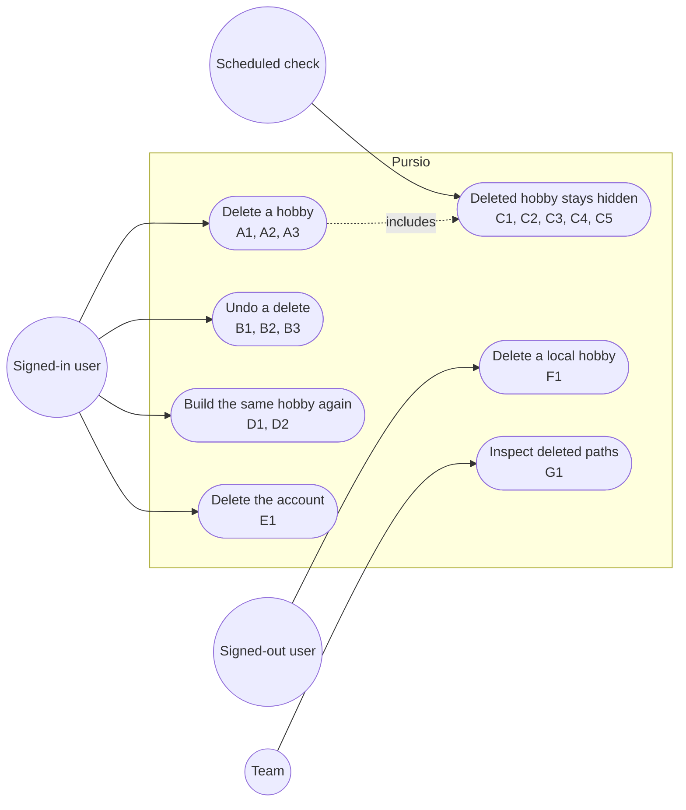
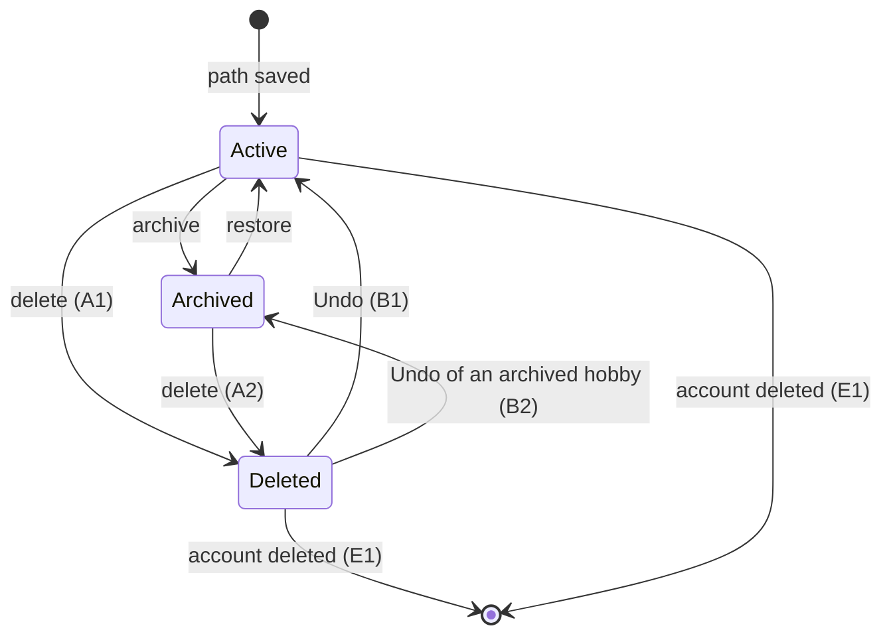

# User Scenarios: Soft-delete paths

When a signed-in user deletes a hobby, its path row is kept and marked as deleted, instead of being removed. The user sees exactly what they see today. The team can later look at deleted paths (tree and progress) to learn which paths did not work.

Today, deleting removes the `paths` row and, through the foreign key, its `progress` row. Undo inserts both rows again.

## Diagrams

### Use cases

### State of a path row

## Scenarios

### A. Deleting

| ID | Starting state | Action | Expected result | Covered by | Status |
|---|---|---|---|---|---|
| A1 | Signed-in user with an active hobby | Deletes the hobby and confirms | The hobby leaves every list, as today. The path row stays, with the time of deletion. Its tree and progress are unchanged. | new | Confirmed |
| A2 | Signed-in user with an archived hobby | Deletes it from the archive list | Same as A1. The row keeps its archived value. | new | Confirmed |
| A3 | Signed-in user, the delete request fails (network, server) | Deletes a hobby | The "change failed" message shows and the hobby stays in the list, as today. Nothing is marked. | new | Confirmed |

### B. Undo

| ID | Starting state | Action | Expected result | Covered by | Status |
|---|---|---|---|---|---|
| B1 | User just deleted an active hobby (A1) | Chooses Undo | The hobby is back with the same id, creation time, tree, progress and colour. The deletion mark is cleared. | new | Confirmed |
| B2 | User just deleted an archived hobby (A2) | Chooses Undo | The hobby is back in the archive list. | new | Confirmed |
| B3 | User deleted a hobby, then built the same hobby again (D1) | Chooses Undo for the old one | Undo fails with the "change failed" message, as today. The new hobby is unchanged. The old row stays deleted. | new | Confirmed |

### C. After deletion

| ID | Starting state | Action | Expected result | Covered by | Status |
|---|---|---|---|---|---|
| C1 | User has a deleted hobby | Opens the app on any device | The hobby is in no list: sidebar, archive, Quests, Profile, Fresh. | new | Confirmed |
| C2 | User has a deleted hobby | Opens a saved link to that hobby, or requests its videos | The app behaves as if the hobby does not exist, as it does today after a delete. | new | Confirmed |
| C3 | A deleted hobby was active in the last 14 days | The scheduled Fresh check runs | The hobby is not checked, unless another non-deleted path has the same hobby. | new | Confirmed |
| C4 | User has a deleted hobby with completed skills | Looks at XP, level and streak | See open decision O1. | new | Open |
| C5 | User has a deleted hobby | Resets progress for "all hobbies" | The deleted hobby's progress is not changed. | new | Confirmed |

### D. Building the same hobby again

| ID | Starting state | Action | Expected result | Covered by | Status |
|---|---|---|---|---|---|
| D1 | User deleted "guitar" | Builds "guitar" again | A new path row is created, with no progress. The deleted row stays as it was. | new | Confirmed |
| D2 | User deleted "guitar" twice (built, deleted, built, deleted) | Builds it a third time | A third row is created. Both deleted rows stay. | new | Confirmed |

### E. Account

| ID | Starting state | Action | Expected result | Covered by | Status |
|---|---|---|---|---|---|
| E1 | User with active and deleted hobbies | Deletes the account | Every row of the user is removed for good, deleted paths and their progress included. | new | Confirmed |

### F. Signed-out user

| ID | Starting state | Action | Expected result | Covered by | Status |
|---|---|---|---|---|---|
| F1 | A hobby stored only in the browser | Deletes it | It is removed from the browser, as today. There is no server row to mark. | out of scope | Out of scope |

### G. Team

| ID | Starting state | Action | Expected result | Covered by | Status |
|---|---|---|---|---|---|
| G1 | Deleted paths exist | The team queries the database with the service role | Each deleted path shows its hobby, tree, progress, creation time and deletion time. | new | Confirmed |

## Owner decisions

- 2026-11-21: Deleting marks the row and does not remove it, so that deleted paths can be studied.
- 2026-11-21: Building a deleted hobby again creates a new row. The old row is not restored (D1, D2).
- 2026-11-21: Deleting the account removes everything for good, deleted paths included (E1).
- 2026-11-21: A deleted path keeps its tree and its progress as they were (A1, G1).
- 2026-11-21: Hobbies stored only in the browser are out of scope (F1).

## Open decisions

- **O1. Do the completed skills of a deleted hobby still count for XP, level and streak? (C4)** Today they stop counting, because the progress row is removed. Recommendation: keep today's behaviour, so the user's numbers drop exactly as they do now, and come back on Undo.
- **O2. How long are deleted rows kept? (G1)** Recommendation: until the account is deleted, with no automatic clean-up for now. If the privacy text promises that deleted hobbies are erased, it must be updated before release.
- **O3. Should the existing `hobby_deleted` analytics event carry numbers? (A1)** It is sent with no detail today. Recommendation: add the count of completed skills and the total number of skills, and the age of the path in days. No hobby name, because it is free text typed by the user.

## To verify

- Nothing outside the app reads the `paths` table directly (dashboards, exports), since such a reader would start to see deleted rows.
